# V-Tracker (snap_q) - React JS Admin Panel Specification

## 1. Overview & Architecture Strategy

The V-Tracker Admin Panel is a React JS web dashboard managing the V-Tracker business operations: package sales (₹5999 + 18% GST), premium recharge plan subscriptions, QR tag lifecycle, 15-generation MLM referral income distribution, vehicle document management, and user/order administration.

### Key Administrative Objectives:
1. **Package & Recharge Plan Management**: Manage the ₹5999 GPS V-Tracker package (excluding 18% GST) and premium recharge plans (30–365 days).
2. **QR Code Batch & Tag Lifecycle**: Generate, print, assign, and revoke QR codes for 2W, 3W, 4W, and Commercial vehicles.
3. **15-Generation Referral Income Engine**: Configure and monitor the multi-level referral payout structure (Gen 1: 10% → Gen 15: 0.5%).
4. **Vehicle Document Management**: Store, verify, and display vehicle documents (RC, Insurance, PUC, Fitness, Permit).
5. **Order Fulfillment Pipeline**: Process physical device + QR tag orders from checkout to delivery dispatch.
6. **User & Account Governance**: Manage Active / Inactive / Blocked user states with cascading QR emergency routing controls.

---

## 2. React JS Admin Panel Screen & Feature Breakdown

### 2.1 Dashboard (`/dashboard`)
- **Header**: Admin profile dropdown, Global Search (User / Vehicle / Order / QR Code), Dark/Light theme toggle, Notifications bell.
- **Stat Cards (Top Row)**:
  - QR Generated (Total count of all QR codes ever generated)
  - QR Active (Currently linked to a vehicle and functional)
  - QR Inactive (Generated but not linked, expired, or deactivated)
  - Total Orders (All time order count)
  - Total Users (with Active / Inactive / Blocked sub-counts)
  - Sales Today (₹ revenue collected today, inclusive of GST)
- **Charts**:
  - *Sales-by-Channel Chart*: Pie/donut chart showing revenue split by channel (In-App, Website, Offline/Dealer — for future multi-channel expansion).
  - *GST Split Chart*: Bar or stacked chart showing Base Amount (₹5999) vs CGST (9%) vs SGST (9%) or IGST (18%) per order for accounting/compliance.
  - *Order Fulfillment Breakdown*: Bar chart by vehicle category (2W, 3W, 4W, Commercial).
- **Activity Feed**: Live stream of new registrations, orders placed, user blocks/unblocks, QR activations, and recharge renewals.

---

### 2.2 User Management (`/users`)
- **User Directory Table**:
  - Columns: User ID, Name, Mobile Number, Email, Registered Vehicles Count, Active Recharge Plan, Referral Generation Level, Total Orders, Registration Date, Account Status (`Active` [Green] / `Inactive` [Grey] / `Blocked` [Red]).
  - Filter Tabs: `All Users`, `Active`, `Inactive` (Dormant), `Blocked / Suspended`.
  - Quick Search: Search by Name, Mobile, Email, or Vehicle Registration Number.
- **User Detail & Status Control Modal**:
  - *Personal Information*: View profile, edit details, audit log of PII accesses.
  - *Status Toggle & Action Bar*:
    - **Activate User**: Reinstates a suspended/dormant account.
    - **Mark as Inactive**: Deactivates account session (keeps data intact, stops promotional notifications).
    - **Block / Suspend User**:
      - **Block Reason Dropdown**: Abusive Scanner Calls, Fraudulent Vehicle Claim, Unpaid Orders, Policy Violation, Custom Reason.
      - **Emergency QR Behavior Choice**:
        - *Option A (Full Shutdown)*: Scanning QR displays "Tag Deactivated by System".
        - *Option B (Emergency Support Fallback)*: Scanning QR routes call to V-Tracker Admin Hotline instead of direct owner forwarding.
      - **Block Duration**: Temporary (1-30 days) or Permanent.
      - **Audit History**: Log of who blocked the user, timestamp, and reason.
  - *Linked Vehicles*: List of vehicles registered by this user with QR code status override toggles.
  - *Recharge History*: Current active plan, renewal date, past recharge transactions.
  - *Referral Tree*: Visual tree showing this user's position in the 15-generation chain and income earned.
  - *Order History*: Past purchases and delivery statuses.
  - *Wallet & Points*: Points balance, earned rewards, and payout history.

---

### 2.3 QR Generation & Inventory (`/qr-generation` & `/qr-inventory`)

#### QR Generation Form (`/qr-generation`)
- **Form Fields**:
  - *Vehicle Type*: Dropdown — `2 Wheeler` / `3 Wheeler` / `4 Wheeler` / `Commercial`.
  - *Quantity*: Numeric input for batch size.
  - *Custom Toggle*: Switch ON/OFF.
    - When ON: Logo Upload field (image picker), Size selector (Standard / Large / Custom dimensions).
    - When OFF: Standard V-Tracker branded QR.
- **Submit Button**: Generates batch → displays Batch ID confirmation card on screen.
- **Download Button**: Export generated batch as PDF/SVG file for physical printing.

#### Batch History Table (`/qr-generation`)
- Columns: Batch ID, Generation Date, Vehicle Type, Quantity, Custom/Standard, Status (Generated / Printed / Partially Assigned / Fully Assigned), Download Action.
- Filter: Date range, Vehicle type, Status.

#### QR Tag Inventory (`/qr-inventory`)
- **Tag Status Table**: QR Tag ID, Batch ID, Category, Status (Unprinted / Printed / Shipped / Active / Damaged / Revoked), Linked Vehicle Registration, Owner ID.
- **Tag Lifecycle Actions**: Mark as Damaged/Lost, Force Unlink from Vehicle, Revoke Tag, Re-assign to different Vehicle.

---

### 2.4 Vehicle & Document Management (`/vehicles`)
- **Vehicle Registry Table**:
  - Columns: Registration Number (e.g., TS09XX1234), Owner Name, Vehicle Type (2W / 3W / 4W / Commercial), Linked QR Tag ID, Active Recharge Plan, Registration Date, Document Verification Status (Verified ✅ / Pending ⏳ / Rejected ❌).
  - Actions: Search Vehicle, Re-assign Owner, Deactivate Emergency Routing, View Call History.

#### Vehicle Document Show (`/vehicles/:id/documents`)
- **Document Types Managed**:
  - Registration Certificate (RC)
  - Insurance Certificate
  - Pollution Under Control (PUC)
  - Fitness Certificate
  - Permit (if applicable for commercial vehicles)
- **Admin Actions**:
  - View uploaded document images/PDFs.
  - Verify / Approve document (marks as ✅ Verified).
  - Reject document with rejection reason (marks as ❌ Rejected, triggers user re-upload notification).
  - Flag expired documents (auto-detect from expiry date fields).
  - Document Expiry Alerts: Dashboard widget showing documents expiring within 30 days.

---

### 2.5 Package & Recharge Plan Management (`/plans`)

#### Package Configuration
- **Base Package**: ₹5999 (excluding 18% GST).
  - Includes: GPS V-Tracker device + 2 QR Codes + 6 Months Free Recharge.
  - Admin can update base price, GST percentage, and bundled items.

#### Premium Recharge Plans Table
| Plan Duration | Price |
|---------------|-------|
| 30 Days       | ₹199  |
| 90 Days       | ₹499  |
| 150 Days      | ₹699  |
| 180 Days      | ₹899  |
| 210 Days      | ₹999  |
| 365 Days      | ₹1,599 |

- **Admin Controls**:
  - Edit plan duration and pricing.
  - Add / Remove plans.
  - Toggle plan visibility (Active / Hidden).
  - View active subscribers per plan.
  - Recharge revenue breakdown chart (by plan duration).

---

### 2.6 E-Commerce & Order Fulfillment (`/orders`)
- **Order Table**:
  - Columns: Order ID, Customer Name, Package/Plan Type, Vehicle Category, Delivery Address & Pincode, Payment Status (Paid / Pending / Refunded), GST Amount (18%), Total Amount, Order Status (Placed → Processing → Dispatched → Delivered → Cancelled).
  - Filter Tabs: All, New Orders, Processing, Dispatched, Delivered, Returns.
- **Order Dispatch Drawer**:
  - Assign physical GPS V-Tracker device serial number.
  - Assign QR Tag IDs (2 per package) from unassigned batch inventory.
  - Enter Courier Partner & Tracking Number.
  - Update timeline status (triggers user app push notification).

---

### 2.7 Rewards & Referral Admin (`/referrals` & `/scratch-cards`)

#### Scratch Card Reward Pool (`/scratch-cards`)
- **Reward Pool Management**:
  - Configure reward cards for the mobile app's `scratcher` widget (`scratch_card_screen.dart`, `scratch_card_widget.dart`).
  - Reward Tier Types: Cashback (₹10 - ₹500), Discount Coupons, Premium Plan Free Extension Days, "Better Luck Next Time".
  - Win Probability Matrix: Set percentage odds per reward tier.
  - Active Card Limits: Set max scratch cards a user can earn per referral or recharge event.

#### 15-Generation Referral Income Plan (`/referrals`)

#### Income Plan Configuration
| Generation | Income % |
|-----------|---------|
| Generation 1  | 10%  |
| Generation 2  | 5%   |
| Generation 3  | 4%   |
| Generation 4  | 3%   |
| Generation 5  | 2%   |
| Generation 6  | 1%   |
| Generation 7  | 1%   |
| Generation 8  | 1%   |
| Generation 9  | 1%   |
| Generation 10 | 1%   |
| Generation 11 | 0.5% |
| Generation 12 | 0.5% |
| Generation 13 | 0.5% |
| Generation 14 | 0.5% |
| Generation 15 | 0.5% |

- **Income Rule**: Every time a referred user (across any of the 15 generations) recharges a premium plan, the referrer chain earns the configured percentage of the recharge amount.
- **Admin Controls**:
  - Edit income percentages per generation.
  - Add / Remove generation levels.
  - View total payouts by generation level.
  - Payout approval queue (manual review before disbursement).
  - Fraud detection flags: Same IP rapid signups, circular referral chains, dormant accounts used for chain padding.

#### Referral Network Explorer
- **Tree Visualization**: Interactive tree/graph showing referral chains up to 15 levels deep for any selected user.
- **Referral Leaderboard**: Top referrers ranked by total network size and total income earned.
- **Payout History Table**: User ID, Generation Level, Referral User, Recharge Plan, Recharge Amount, Income %, Payout Amount, Payout Status (Pending / Approved / Paid / Rejected), Date.

---

### 2.8 Discounts, Coupons & Points (`/promotions`)
- **Coupon Manager**:
  - Create / Edit Coupon Code (e.g. `WELCOME50`, `VTRACK20`).
  - Discount Type (Percentage % / Fixed ₹), Max Limit, Min Cart Value, Expiry Date.
- **Points & Rewards Rule Engine**:
  - Set Point Conversion Rate (e.g., 10 pts = ₹1).
  - Set Signup Points Bonus, Referral Points Bonus.

---

### 2.9 Emergency Call & Route Logs (`/call-logs`)
- **Call Monitor Table**:
  - Columns: Log ID, Caller (Masked Anon ID), Vehicle Registration Number, Owner (Masked Anon ID), Timestamp, Call Duration, Call Result (Connected / Missed / Busy / User Disconnected).
- **Security & Privacy Audit Log**:
  - Records every time an admin views unmasked phone numbers or overrides vehicle ownership settings.

---

### 2.10 Content & Support Management (`/support` & `/cms`)
- **Help & Support Tickets (`/support`)**:
  - Customer queries list, priority status (High / Medium / Low), assign support agent, reply thread.
- **CMS & Legal Pages (`/cms`)**:
  - Markdown editor for Mobile App pages: Privacy Policy, Terms & Conditions, About Us, Help FAQs.

---

## 3. UI Navigation Architecture & Screen Hierarchy

```mermaid
graph TD
    A[Admin Login] --> B[Dashboard]
    
    B --> C[User Management]
    C --> C1[User Directory: Active / Inactive / Blocked]
    C --> C2[User Profile & PII Drawer]
    C --> C3[Block / Suspend Modal & QR Fallback Action]
    C --> C4[Referral Tree & Income View]
    
    B --> D[QR Generation & Inventory]
    D --> D1[QR Generation Form]
    D --> D2[Batch History Table]
    D --> D3[QR Tag Inventory & Lifecycle]
    
    B --> E[Vehicle & Documents]
    E --> E1[Vehicle Registry]
    E --> E2[Vehicle Document Show & Verification]
    
    B --> F[Package & Recharge Plans]
    F --> F1[Base Package Config Rs 5999 + GST]
    F --> F2[Premium Recharge Plans Editor]
    F --> F3[Active Subscribers & Revenue]
    
    B --> G[Orders & Fulfillment]
    G --> G1[Order Table & Filters]
    G --> G2[Dispatch & Device+QR Assignment]
    
    B --> H[15-Gen Referral Income]
    H --> H1[Income % Configuration Table]
    H --> H2[Referral Network Tree Explorer]
    H --> H3[Payout Queue & History]
    
    B --> I[Promotions & Points]
    I --> I1[Coupon Manager]
    I --> I2[Points Config]
    
    B --> J[Call Logs & Audit]
    J --> J1[Call Traffic Monitor]
    J --> J2[Privacy Audit Trail]
    
    B --> K[Support & CMS]
    K --> K1[Help Tickets]
    K --> K2[App Content Editor]
```



---

## 4. React JS Component Hierarchy (Front-End Only)

```
src/
├── components/
│   ├── layout/
│   │   ├── Sidebar.jsx
│   │   ├── Header.jsx
│   │   └── AdminLayout.jsx
│   ├── common/
│   │   ├── DataTable.jsx
│   │   ├── StatusBadge.jsx
│   │   ├── MetricCard.jsx
│   │   ├── ModalDrawer.jsx
│   │   └── DocumentViewer.jsx
│   └── charts/
│       ├── SalesByChannelChart.jsx
│       ├── GstSplitChart.jsx
│       ├── OrdersBreakdownChart.jsx
│       └── RechargeRevenueChart.jsx
├── pages/
│   ├── Dashboard.jsx
│   ├── UsersPage.jsx
│   ├── UserDetailsPage.jsx
│   ├── QrGenerationPage.jsx
│   ├── QrInventoryPage.jsx
│   ├── VehiclesPage.jsx
│   ├── VehicleDocumentsPage.jsx
│   ├── PackagePlansPage.jsx
│   ├── OrdersPage.jsx
│   ├── ReferralIncomePage.jsx
│   ├── ReferralTreePage.jsx
│   ├── PayoutHistoryPage.jsx
│   ├── PromotionsPage.jsx
│   ├── CallLogsPage.jsx
│   ├── SupportTicketsPage.jsx
│   └── CmsEditorPage.jsx
├── routes/
│   └── AppRoutes.jsx
└── assets/
```
