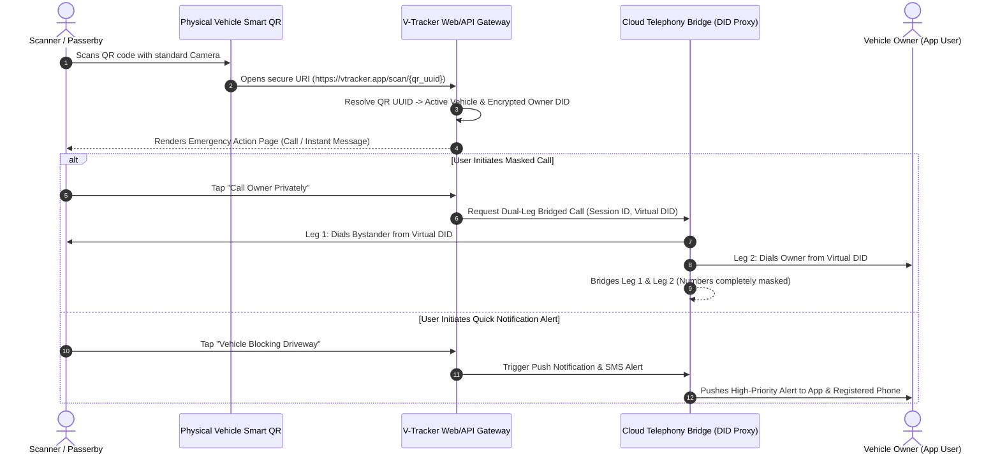
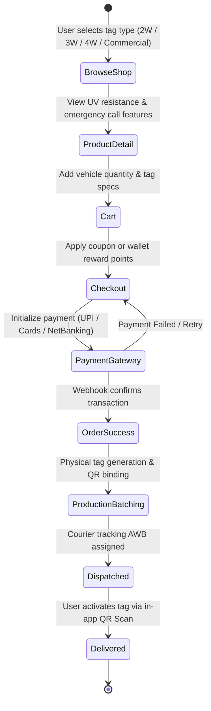
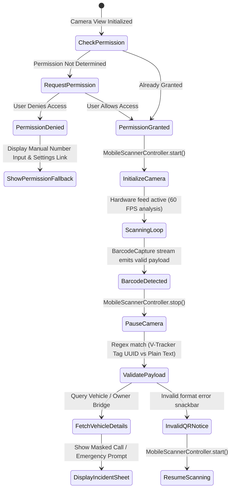
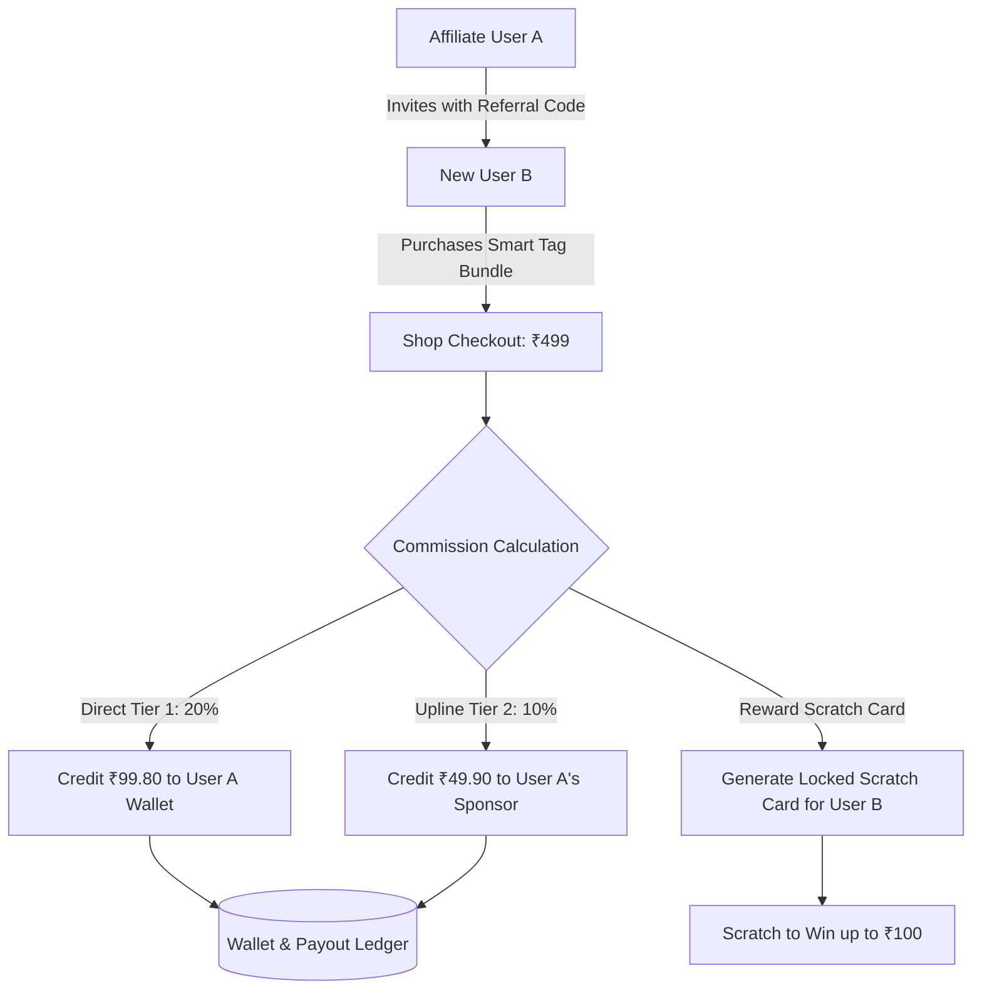
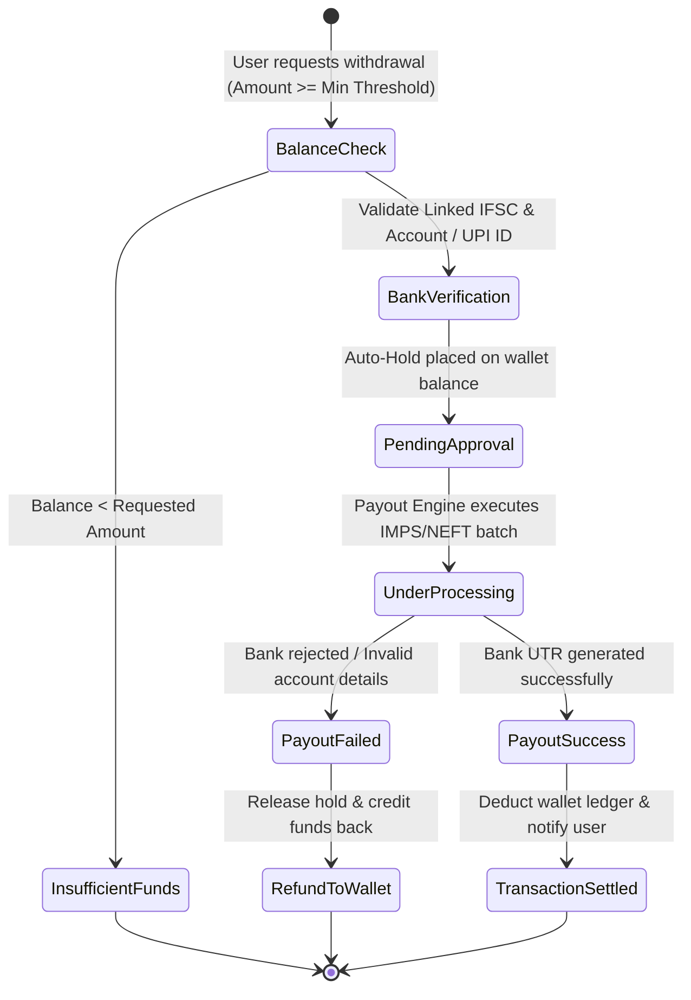

# V-Tracker (snap_q) - Project Documentation

## 1. Problem Statement & Solution

### Problem Statement
1. **Privacy & Security Vulnerability**: Vehicle owners often leave raw contact numbers on windshields/dashboards, exposing themselves to harassment, spam calls, and security risks.
2. **Emergency Communication Barriers**: When a vehicle blocks access, is parked incorrectly, faces an emergency, or needs towing, bystanders have no safe, immediate way to contact the owner.
3. **App Adoption Friction**: Existing contact mechanisms require the person scanning or reporting to download specialized apps, causing major delays during urgent situations.
4. **Fragmented Smart Tag Purchasing & Lifecycle**: Owners lack a streamlined hub to purchase vehicle-customized QR labels (2W, 3W, 4W, Commercial), manage multiple vehicles, track shipments, and redeem rewards.

### Solution Provided by V-Tracker
1. **100% Private Emergency QR Tag System**: Smart QR labels attached to vehicles allow anyone to scan and instantly contact the owner privately without revealing phone numbers or requiring scanner app downloads.
2. **Vehicle Search & QR Scanner Suite**: Integrated registration search and native camera scanner with real-time call history tracking.
3. **Dedicated E-Commerce Hub & Order Management**: Full shop for vehicle-specific QR labels (2W, 3W, 4W, Commercial), cart system, coupon/points redemption, address management, and live order tracking.
4. **Gamified Rewards & Referral Engine**: Built-in scratch cards, referral incentives, and reward points redemption system to drive user engagement.

---

## 2. Comprehensive System Architecture & Engineering Specifications

### 2.1 System Overview & Technology Stack
V-Tracker (`snap_q`) is a privacy-first smart automotive utility platform. It bridges anonymous vehicle incident resolution, smart physical QR tag provisioning, multi-tier affiliate referral mechanics, and vehicle utility services (FASTag, RTO vehicle lookup).

| Domain | Specification | Detail |
| :--- | :--- | :--- |
| **Client Engine** | Flutter 3.x / Dart ^3.11.4 | Cross-platform mobile (Android & iOS) |
| **Architecture Pattern** | Feature-First Clean Architecture | Strict separation: `lib/core` (Cross-cutting) vs `lib/features` (Domain modules) |
| **UI Design System** | Custom Material Tokens | `AppColors`, `AppSpacing`, `AppTypography`, Atomic UI Primitives |
| **Camera & QR Engine** | `mobile_scanner` & CameraX/AVFoundation | Hardware-accelerated barcode and QR decode pipeline |
| **Gamification Engine** | `scratcher` + Local RNG Seed | Interactive scratch-to-reveal dynamic cash/points reward cards |
| **Navigation & Shell** | `google_nav_bar` + Custom Route Registry | Declarative and named routing (`AppPages` / `AppRoutes`) |
| **Privacy Telephony Bridge** | Cloud Virtual DID / PSTN Proxy | Dual-leg call forwarding without MSISDN leakage |

---

### 2.2 High-Level Design (HLD)

#### 2.2.1 Distributed Architecture & Infrastructure Topology
The V-Tracker ecosystem separates public anonymous interactions (passersby scanning vehicle tags) from private authenticated owner workflows.

```mermaid
graph TD
    subgraph "External Scanners & Passersby"
        A[Bystander Smartphone] -->|Scans QR Code / Web URL| B[Privacy Gateway Web PWA]
        B -->|Anonymous Incident Dispatch| C[Telephony & Notification Proxy]
    end

    subgraph "V-Tracker Mobile Application (Flutter)"
        D[Auth & Identity] --> E[Home Vehicle Dashboard]
        E --> F[QR Scanner & RTO Search Engine]
        E --> G[Smart Tag E-Commerce Store]
        E --> H[Referral & Team Commission Engine]
        E --> I[Wallet & Payout Gateway]
    end

    subgraph "Backend Services & Cloud Infrastructure"
        J[API Gateway / Load Balancer]
        K[Identity & User Service]
        L[Vehicle & QR Registry]
        M[Masked Telephony Bridge (Exotel/Twilio/PSTN)]
        N[E-Commerce & Inventory Service]
        O[Referral & Commission Ledger]
        P[Payment & Payout Engine (Razorpay/Payouts)]
        Q[Push Notification Dispatcher (FCM)]
    end

    C --> J
    D & E & F & G & H & I --> J
    J --> K & L & M & N & O & P & Q
    M -.->|Masked Dual-Leg Call| A
    M -.->|Masked Dual-Leg Call| E
    Q -.->|Instant Emergency Alert| E
```

#### 2.2.2 End-to-End Masked Privacy Call Flow
When a vehicle is parked inappropriately, blocking access, or in an emergency, bystanders scan the tag. The system establishes contact through a masked telephony bridge without revealing either party's personal phone number.



#### 2.2.3 E-Commerce Tag Ordering & Physical Fulfillment Pipeline
Smart QR tags are physical RFID/vinyl-coated exterior vehicle tags configured per vehicle category (2-Wheeler, 3-Wheeler, 4-Wheeler, Heavy Commercial).



---

### 2.3 Low-Level Design (LLD)

#### 2.3.1 Clean Architecture Domain Separation
The codebase adheres to a Feature-First modular structure:

```
lib/
├── main.dart                          # Application entry point, theme bootstrapper
├── core/                              # Cross-cutting foundational layer
│   ├── constants/                     # Design tokens & immutable values
│   │   ├── app_colors.dart            # Semantic color palette
│   │   ├── app_spacing.dart           # Grid metrics, spacing, border radii
│   │   ├── app_typography.dart       # Font sizing, weights, line heights
│   │   └── app_assets.dart            # Vector & raster asset paths
│   ├── routes/                        # Centralized routing engine
│   │   ├── app_routes.dart            # 40+ Route string constants
│   │   └── app_pages.dart             # MaterialPageRoute generator with guard routing
│   ├── utils/                         # Validators, formatters, string extensions
│   └── widgets/                       # Atomic & composite reusable UI components
│       ├── app_bar/                   # VTAppBar & VTAppBar2 (gradient & transparent)
│       ├── drawer/                    # VTDrawer, headers, multi-tier affiliate tiles
│       ├── vt_button.dart             # Universal reactive button (Primary, Secondary, Outline)
│       ├── vt_text_field.dart          # Form input with floating label & validation
│       ├── vt_search_bar.dart         # Vehicle registration number search bar
│       ├── vt_dropdown.dart           # Form select & modal bottom sheet options
│       ├── vt_container.dart          # Styled gradient / card container primitive
│       └── vt_snackbar.dart           # Themed toast notifications
└── features/                          # Domain-driven feature modules
    ├── auth/                          # Get Started, Login, Sign Up, Forgot Password
    ├── home/                          # Dashboard, active vehicles, quick actions, statistics
    ├── qr/                            # MobileScanner view, QR generation, emergency resolution
    ├── calls/                         # Call history logs, masked incident review
    ├── shop/                          # Product catalog, product details, cart, checkout, tracking
    ├── referral/                      # Scratch card rewards, direct referrals, team trees
    ├── withdraw/                      # Wallet balance, bank accounts, payout requests, history
    ├── fasttag/                       # FASTag check balance, instant provider recharge
    ├── vehicle_search/                # Registration plate lookup, RTO RC status inspection
    ├── profile/                       # User profile, vehicle management, address book
    ├── notifications/                 # Real-time alert feed & incident history
    ├── navigation/                    # Persistent shell with GoogleNavBar
    └── misc/                          # Privacy Policy, Terms & Conditions, Help & Support
```

#### 2.3.2 Core Domain Models & Schemas

##### 1. Vehicle Registration & Smart Tag Schema (`VehicleDetails`)
```dart
class VehicleDetails {
  final String id;
  final String registrationNumber; // e.g. "MH 12 AB 1234"
  final String vehicleType;         // "2-Wheeler" | "4-Wheeler" | "Commercial"
  final String modelName;           // e.g. "Hyundai Creta"
  final String ownerName;
  final String maskedPhone;         // e.g. "+91 98*****412"
  final String qrCodeId;            // Unique encrypted tag GUID
  final bool isQrActive;
  final DateTime registeredAt;
}
```

##### 2. E-Commerce Cart & Order Schema (`CartItem` & `OrderModel`)
```dart
class CartItem {
  final String productId;
  final String title;
  final double unitPrice;
  int quantity;
  final String vehicleCategory;
  final String tagColorVariant;

  double get totalPrice => unitPrice * quantity;
}

class OrderModel {
  final String orderId;
  final List<CartItem> items;
  final double subtotal;
  final double discountAmount;
  final double totalAmount;
  final String deliveryAddress;
  final String orderStatus; // "Placed" | "Processing" | "Shipped" | "Delivered"
  final String? trackingNumber;
  final DateTime createdAt;
}
```

##### 3. Multi-Tier Referral & Commission Schema (`ReferralNode`)
```dart
class ReferralNode {
  final String userId;
  final String userName;
  final int tierLevel;           // Tier 1 (Direct), Tier 2, Tier 3 (Indirect)
  final double totalTagOrders;
  final double commissionEarned;
  final DateTime joinedDate;
}
```

##### 4. Scratch Card Reward Model (`ScratcherReward`)
```dart
class ScratcherReward {
  final String id;
  final String title;
  final double cashValue;
  final int rewardPoints;
  final bool isScratched;
  final DateTime expiryDate;
}
```

#### 2.3.3 QR Scanner Subsystem Lifecycle
The hardware camera pipeline is managed via `MobileScannerController` with explicit lifecycle handlers:



---

### 2.4 UI Design System & Component Hierarchy

#### 2.4.1 Design Tokens
The application relies on consolidated semantic design constants rather than ad-hoc inline values:

* **Primary Colors**:
  - `AppColors.primaryNavy` (`#0A1628`): Deep corporate navy used for headers, primary action surfaces, and dark contrast.
  - `AppColors.gold` (`#F5A623`): Accent metallic gold used for badges, VIP tags, scratch-card borders, and CTA highlights.
  - `AppColors.bg` (`#F8FAFC`): Crisp Slate-50 background ensuring optimal readability and contrast.
  - `AppColors.navBar` (`#0F1E35`): Deep obsidian for the floating navigation bar.
* **Semantic Feedback**:
  - `AppColors.success` (`#087443`) / `AppColors.successBg` (`#ECFDF5`)
  - `AppColors.error` (`#F04438`)
  - `AppColors.warning` (`#F79009`)
  - `AppColors.info` (`#1570EF`)
* **Spacing & Elevation Metrics**:
  - `AppSpacing.xs` (4dp), `AppSpacing.s` (8dp), `AppSpacing.m` (16dp), `AppSpacing.l` (24dp), `AppSpacing.xl` (32dp).
  - Radii: `radiusS` (4dp), `radiusM` (8dp), `radiusL` (12dp), `radiusXl` (16dp), `radiusRound` (99dp).

#### 2.4.2 Core UI Component Taxonomy

```
UI Component Library
│
├── VTButton (Base Button Primitive)
│   ├── Primary (AppColors.primaryNavy background, white text)
│   ├── Gold CTA (AppColors.gold background, navy text)
│   ├── Danger / Emergency (AppColors.error background, white text)
│   └── Outline / Ghost (Transparent background, navy/gold border)
│
├── VTTextField (Form Primitive)
│   ├── Standard Text Input
│   ├── Vehicle Plate Formatter (Capitalized, spaced alphanumeric)
│   ├── Masked Password Input (Eye suffix toggle)
│   └── Multi-line Notes / Incident Description
│
├── VTAppBar / VTAppBar2 (Navigation Primitives)
│   ├── Primary Navy Gradient with back affordance
│   └── Dual Action Header (Menu Drawer trigger + Notification Bell Badge)
│
├── VTDrawer (Side Navigation Hierarchy)
│   ├── DrawerHeaderWidget (User avatar, name, verified status badge)
│   ├── DrawerBannerCardWidget (Promotional tag purchase / affiliate prompt)
│   ├── DrawerExpandableTileWidget (Multi-tier Team: Direct, Performance, Payouts)
│   └── DrawerTileWidget (FASTag, Orders, Profile, Legal, Logout)
│
├── VTSearchBar (Lookup Primitive)
│   └── Real-time uppercase vehicle registration number plate search with clear button
│
└── VTSnackbar (Feedback Primitive)
    ├── VTSnackbar.showSuccess (Green pill toast with checkmark icon)
    └── VTSnackbar.showError (Red pill toast with error alert icon)
```

#### 2.4.3 Screen-to-Route Mapping Table

| Route Identifier | Page Class | Feature Module | Core Purpose |
| :--- | :--- | :--- | :--- |
| `AppRoutes.getStarted` | `GetStarted` | Auth | Onboarding carousel & entry point |
| `AppRoutes.login` | `LoginScreen` | Auth | Mobile number & password login |
| `AppRoutes.signUp` | `RegisterScreen` | Auth | User registration & referral code entry |
| `AppRoutes.navigation` | `MainNavigationShell` | Navigation | 4-tab shell with `GoogleNavBar` |
| `AppRoutes.home` | `HomeScreen` | Home | Vehicle fleet overview, quick actions, stats |
| `AppRoutes.qrScanner` | `QrScannerScreen` | QR | Fullscreen live hardware camera scanner |
| `AppRoutes.qrTab` | `MyQrScreen` | QR | Owner's active digital QR smart tag |
| `AppRoutes.callHistory` | `CallHistoryScreen` | Calls | Historical log of masked emergency calls |
| `AppRoutes.vehicleSearch`| `VehicleSearchScreen` | Vehicle Search | RTO plate lookup & owner alert dispatch |
| `AppRoutes.shop` | `ShopScreen` | Shop | Physical QR tag e-commerce catalog |
| `AppRoutes.productDetail`| `ProductDetailScreen`| Shop | Detailed specifications of smart tag |
| `AppRoutes.cart` | `CartScreen` | Shop | Cart quantity management & subtotal tally |
| `AppRoutes.checkout` | `CheckoutScreen` | Shop | Address selection & payment initialization |
| `AppRoutes.trackOrder` | `TrackOrderScreen` | Shop | Step-by-step courier dispatch tracker |
| `AppRoutes.referral` | `ReferralScreen` | Referral | Referral link generation & statistics |
| `AppRoutes.scratchCard` | `ScratchCardScreen` | Referral | Interactive scratch-to-win canvas |
| `AppRoutes.directReferral`| `DirectReferralScreen`| Referral | Level 1 referred member list |
| `AppRoutes.teamPerformance`|`TeamPerformanceScreen`| Referral| Downline volume & commission metrics |
| `AppRoutes.withdraw` | `WithdrawScreen` | Withdraw | Wallet balance & payout disbursement |
| `AppRoutes.bankDetails` | `BankDetailsScreen` | Withdraw | Linked bank account / UPI VPA form |
| `AppRoutes.fasttagCheck` | `FasttagCheckScreen` | FASTag | Toll balance & vehicle association status |
| `AppRoutes.fasttagRecharge`|`FasttagRechargeScreen`| FASTag | Instant FASTag wallet top-up |
| `AppRoutes.myVehicles` | `MyVehiclesScreen` | Profile | Manage multiple 2W/4W vehicle profiles |
| `AppRoutes.notifications`| `NotificationScreen`| Notifications| Push alert logs & emergency notifications |

---

### 2.5 Business Logic Engines & State Machines

#### 2.5.1 Multi-Tier Affiliate Commission Engine
The platform incorporates a multi-tier referral distribution engine that pays commissions on physical smart tag sales:



#### 2.5.2 Wallet Withdrawal & Bank Payout State Machine
Payout requests transition through stringent compliance checks to prevent fraud:



---

## 3. Complete Project Source Code

### Source Files Manifest

| # | File Path | Type | Lines |
| :--- | :--- | :--- | :--- |
| 1 | [`pubspec.yaml`](#file-pubspecyaml) | Configuration | 95 |
| 2 | [`analysis_options.yaml`](#file-analysis_optionsyaml) | Configuration | 28 |
| 3 | [`lib/core/constants/app_colors.dart`](#file-libcoreconstantsapp_colorsdart) | Application Dart | 39 |
| 4 | [`lib/core/constants/app_spacing.dart`](#file-libcoreconstantsapp_spacingdart) | Application Dart | 40 |
| 5 | [`lib/core/constants/app_strings.dart`](#file-libcoreconstantsapp_stringsdart) | Application Dart | 167 |
| 6 | [`lib/core/constants/app_text_styles.dart`](#file-libcoreconstantsapp_text_stylesdart) | Application Dart | 150 |
| 7 | [`lib/core/routes/app_pages.dart`](#file-libcoreroutesapp_pagesdart) | Application Dart | 144 |
| 8 | [`lib/core/routes/app_routes.dart`](#file-libcoreroutesapp_routesdart) | Application Dart | 43 |
| 9 | [`lib/core/utils/dynamic_snackbar.dart`](#file-libcoreutilsdynamic_snackbardart) | Application Dart | 318 |
| 10 | [`lib/core/utils/snackbar_helper.dart`](#file-libcoreutilssnackbar_helperdart) | Application Dart | 51 |
| 11 | [`lib/core/widgets/app_bar/vt_app_bar.dart`](#file-libcorewidgetsapp_barvt_app_bardart) | Application Dart | 89 |
| 12 | [`lib/core/widgets/app_bar/vt_app_bar_2.dart`](#file-libcorewidgetsapp_barvt_app_bar_2dart) | Application Dart | 91 |
| 13 | [`lib/core/widgets/drawer/drawer_banner_card_widget.dart`](#file-libcorewidgetsdrawerdrawer_banner_card_widgetdart) | Application Dart | 95 |
| 14 | [`lib/core/widgets/drawer/drawer_expandable_tile_widget.dart`](#file-libcorewidgetsdrawerdrawer_expandable_tile_widgetdart) | Application Dart | 113 |
| 15 | [`lib/core/widgets/drawer/drawer_header_widget.dart`](#file-libcorewidgetsdrawerdrawer_header_widgetdart) | Application Dart | 48 |
| 16 | [`lib/core/widgets/drawer/drawer_tile_widget.dart`](#file-libcorewidgetsdrawerdrawer_tile_widgetdart) | Application Dart | 52 |
| 17 | [`lib/core/widgets/drawer/vt_drawer.dart`](#file-libcorewidgetsdrawervt_drawerdart) | Application Dart | 294 |
| 18 | [`lib/core/widgets/vt_button.dart`](#file-libcorewidgetsvt_buttondart) | Application Dart | 82 |
| 19 | [`lib/core/widgets/vt_contianer.dart`](#file-libcorewidgetsvt_contianerdart) | Application Dart | 46 |
| 20 | [`lib/core/widgets/vt_dropdown.dart`](#file-libcorewidgetsvt_dropdowndart) | Application Dart | 126 |
| 21 | [`lib/core/widgets/vt_search_bar.dart`](#file-libcorewidgetsvt_search_bardart) | Application Dart | 179 |
| 22 | [`lib/core/widgets/vt_snackbar.dart`](#file-libcorewidgetsvt_snackbardart) | Application Dart | 39 |
| 23 | [`lib/core/widgets/vt_text_field.dart`](#file-libcorewidgetsvt_text_fielddart) | Application Dart | 128 |
| 24 | [`lib/features/auth/domain/validation_helper.dart`](#file-libfeaturesauthdomainvalidation_helperdart) | Application Dart | 45 |
| 25 | [`lib/features/auth/presentation/screens/forgot_password_screen.dart`](#file-libfeaturesauthpresentationscreensforgot_password_screendart) | Application Dart | 218 |
| 26 | [`lib/features/auth/presentation/screens/get_started.dart`](#file-libfeaturesauthpresentationscreensget_starteddart) | Application Dart | 57 |
| 27 | [`lib/features/auth/presentation/screens/login_screen.dart`](#file-libfeaturesauthpresentationscreenslogin_screendart) | Application Dart | 179 |
| 28 | [`lib/features/auth/presentation/screens/splash_screen.dart`](#file-libfeaturesauthpresentationscreenssplash_screendart) | Application Dart | 0 |
| 29 | [`lib/features/auth/presentation/widgets/auth_shared_widgets.dart`](#file-libfeaturesauthpresentationwidgetsauth_shared_widgetsdart) | Application Dart | 140 |
| 30 | [`lib/features/auth/presentation/widgets/login_tab_content.dart`](#file-libfeaturesauthpresentationwidgetslogin_tab_contentdart) | Application Dart | 161 |
| 31 | [`lib/features/auth/presentation/widgets/signup_tab_content.dart`](#file-libfeaturesauthpresentationwidgetssignup_tab_contentdart) | Application Dart | 151 |
| 32 | [`lib/features/calls/presentation/screens/call_history_screen.dart`](#file-libfeaturescallspresentationscreenscall_history_screendart) | Application Dart | 182 |
| 33 | [`lib/features/calls/presentation/widgets/call_history_card.dart`](#file-libfeaturescallspresentationwidgetscall_history_carddart) | Application Dart | 108 |
| 34 | [`lib/features/fasttag/presentation/screens/fasttag_check_screen.dart`](#file-libfeaturesfasttagpresentationscreensfasttag_check_screendart) | Application Dart | 572 |
| 35 | [`lib/features/fasttag/presentation/screens/fasttag_recharge_screen.dart`](#file-libfeaturesfasttagpresentationscreensfasttag_recharge_screendart) | Application Dart | 449 |
| 36 | [`lib/features/fasttag/presentation/screens/verified_documents_screen.dart`](#file-libfeaturesfasttagpresentationscreensverified_documents_screendart) | Application Dart | 677 |
| 37 | [`lib/features/home/presentation/screens/home_screen.dart`](#file-libfeatureshomepresentationscreenshome_screendart) | Application Dart | 539 |
| 38 | [`lib/features/misc/presentation/screens/about_screen.dart`](#file-libfeaturesmiscpresentationscreensabout_screendart) | Application Dart | 162 |
| 39 | [`lib/features/misc/presentation/screens/help_and_support_screen.dart`](#file-libfeaturesmiscpresentationscreenshelp_and_support_screendart) | Application Dart | 136 |
| 40 | [`lib/features/misc/presentation/screens/privacy_policy_screen.dart`](#file-libfeaturesmiscpresentationscreensprivacy_policy_screendart) | Application Dart | 86 |
| 41 | [`lib/features/misc/presentation/screens/terms_and_conditions_screen.dart`](#file-libfeaturesmiscpresentationscreensterms_and_conditions_screendart) | Application Dart | 90 |
| 42 | [`lib/features/navigation/presentation/screens/navigation_screen.dart`](#file-libfeaturesnavigationpresentationscreensnavigation_screendart) | Application Dart | 178 |
| 43 | [`lib/features/notifications/presentation/screens/notifications_screen.dart`](#file-libfeaturesnotificationspresentationscreensnotifications_screendart) | Application Dart | 17 |
| 44 | [`lib/features/profile/data/models/address_model.dart`](#file-libfeaturesprofiledatamodelsaddress_modeldart) | Application Dart | 23 |
| 45 | [`lib/features/profile/presentation/screens/address_book_screen.dart`](#file-libfeaturesprofilepresentationscreensaddress_book_screendart) | Application Dart | 458 |
| 46 | [`lib/features/profile/presentation/screens/bank_details_screen.dart`](#file-libfeaturesprofilepresentationscreensbank_details_screendart) | Application Dart | 273 |
| 47 | [`lib/features/profile/presentation/screens/edit_profile_screen.dart`](#file-libfeaturesprofilepresentationscreensedit_profile_screendart) | Application Dart | 418 |
| 48 | [`lib/features/profile/presentation/screens/my_orders_screen.dart`](#file-libfeaturesprofilepresentationscreensmy_orders_screendart) | Application Dart | 247 |
| 49 | [`lib/features/profile/presentation/screens/my_vehicles_screen.dart`](#file-libfeaturesprofilepresentationscreensmy_vehicles_screendart) | Application Dart | 254 |
| 50 | [`lib/features/profile/presentation/screens/profile_screen.dart`](#file-libfeaturesprofilepresentationscreensprofile_screendart) | Application Dart | 283 |
| 51 | [`lib/features/profile/presentation/screens/track_order_screen.dart`](#file-libfeaturesprofilepresentationscreenstrack_order_screendart) | Application Dart | 420 |
| 52 | [`lib/features/profile/presentation/widgets/add_address_bottom_sheet.dart`](#file-libfeaturesprofilepresentationwidgetsadd_address_bottom_sheetdart) | Application Dart | 307 |
| 53 | [`lib/features/profile/presentation/widgets/bank_card_preview.dart`](#file-libfeaturesprofilepresentationwidgetsbank_card_previewdart) | Application Dart | 179 |
| 54 | [`lib/features/profile/presentation/widgets/custom_button.dart`](#file-libfeaturesprofilepresentationwidgetscustom_buttondart) | Application Dart | 74 |
| 55 | [`lib/features/profile/presentation/widgets/custom_text_field.dart`](#file-libfeaturesprofilepresentationwidgetscustom_text_fielddart) | Application Dart | 95 |
| 56 | [`lib/features/qr/presentation/screens/qr_activation_screen.dart`](#file-libfeaturesqrpresentationscreensqr_activation_screendart) | Application Dart | 1 |
| 57 | [`lib/features/qr/presentation/screens/qr_scanner_screen.dart`](#file-libfeaturesqrpresentationscreensqr_scanner_screendart) | Application Dart | 275 |
| 58 | [`lib/features/qr/presentation/screens/qr_tab_screen.dart`](#file-libfeaturesqrpresentationscreensqr_tab_screendart) | Application Dart | 138 |
| 59 | [`lib/features/qr/presentation/widgets/qr_scanner_painters.dart`](#file-libfeaturesqrpresentationwidgetsqr_scanner_paintersdart) | Application Dart | 159 |
| 60 | [`lib/features/referral/data/models/direct_referral_model.dart`](#file-libfeaturesreferraldatamodelsdirect_referral_modeldart) | Application Dart | 47 |
| 61 | [`lib/features/referral/data/models/reward_model.dart`](#file-libfeaturesreferraldatamodelsreward_modeldart) | Application Dart | 51 |
| 62 | [`lib/features/referral/presentation/screens/direct_referral_screen.dart`](#file-libfeaturesreferralpresentationscreensdirect_referral_screendart) | Application Dart | 149 |
| 63 | [`lib/features/referral/presentation/screens/payout_history_screen.dart`](#file-libfeaturesreferralpresentationscreenspayout_history_screendart) | Application Dart | 431 |
| 64 | [`lib/features/referral/presentation/screens/payouts_by_teams_screen.dart`](#file-libfeaturesreferralpresentationscreenspayouts_by_teams_screendart) | Application Dart | 844 |
| 65 | [`lib/features/referral/presentation/screens/referral_screen.dart`](#file-libfeaturesreferralpresentationscreensreferral_screendart) | Application Dart | 59 |
| 66 | [`lib/features/referral/presentation/screens/scratch_card_screen.dart`](#file-libfeaturesreferralpresentationscreensscratch_card_screendart) | Application Dart | 627 |
| 67 | [`lib/features/referral/presentation/screens/team_performance_screen.dart`](#file-libfeaturesreferralpresentationscreensteam_performance_screendart) | Application Dart | 594 |
| 68 | [`lib/features/referral/presentation/screens/your_performance_screen.dart`](#file-libfeaturesreferralpresentationscreensyour_performance_screendart) | Application Dart | 745 |
| 69 | [`lib/features/referral/presentation/widgets/direct_referral_stats_card.dart`](#file-libfeaturesreferralpresentationwidgetsdirect_referral_stats_carddart) | Application Dart | 99 |
| 70 | [`lib/features/referral/presentation/widgets/direct_referral_table.dart`](#file-libfeaturesreferralpresentationwidgetsdirect_referral_tabledart) | Application Dart | 390 |
| 71 | [`lib/features/referral/presentation/widgets/dotted_line.dart`](#file-libfeaturesreferralpresentationwidgetsdotted_linedart) | Application Dart | 38 |
| 72 | [`lib/features/referral/presentation/widgets/referral_widgets.dart`](#file-libfeaturesreferralpresentationwidgetsreferral_widgetsdart) | Application Dart | 609 |
| 73 | [`lib/features/referral/presentation/widgets/scratch_card_modal_content.dart`](#file-libfeaturesreferralpresentationwidgetsscratch_card_modal_contentdart) | Application Dart | 120 |
| 74 | [`lib/features/referral/presentation/widgets/scratch_card_widget.dart`](#file-libfeaturesreferralpresentationwidgetsscratch_card_widgetdart) | Application Dart | 36 |
| 75 | [`lib/features/referral/presentation/widgets/ticket_clipper.dart`](#file-libfeaturesreferralpresentationwidgetsticket_clipperdart) | Application Dart | 45 |
| 76 | [`lib/features/referral/presentation/widgets/voucher_detail_sheet_content.dart`](#file-libfeaturesreferralpresentationwidgetsvoucher_detail_sheet_contentdart) | Application Dart | 214 |
| 77 | [`lib/features/shop/data/cart_manager.dart`](#file-libfeaturesshopdatacart_managerdart) | Application Dart | 61 |
| 78 | [`lib/features/shop/presentation/screens/cart_screen.dart`](#file-libfeaturesshoppresentationscreenscart_screendart) | Application Dart | 300 |
| 79 | [`lib/features/shop/presentation/screens/shop_screen.dart`](#file-libfeaturesshoppresentationscreensshop_screendart) | Application Dart | 348 |
| 80 | [`lib/features/shop/presentation/widget/checkout_screen.dart`](#file-libfeaturesshoppresentationwidgetcheckout_screendart) | Application Dart | 400 |
| 81 | [`lib/features/shop/presentation/widgets/checkout_screen.dart`](#file-libfeaturesshoppresentationwidgetscheckout_screendart) | Application Dart | 405 |
| 82 | [`lib/features/shop/presentation/widgets/coupon_section.dart`](#file-libfeaturesshoppresentationwidgetscoupon_sectiondart) | Application Dart | 88 |
| 83 | [`lib/features/shop/presentation/widgets/order_summary_card.dart`](#file-libfeaturesshoppresentationwidgetsorder_summary_carddart) | Application Dart | 115 |
| 84 | [`lib/features/shop/presentation/widgets/product_detail_screen.dart`](#file-libfeaturesshoppresentationwidgetsproduct_detail_screendart) | Application Dart | 375 |
| 85 | [`lib/features/shop/presentation/widgets/redeem_points_section.dart`](#file-libfeaturesshoppresentationwidgetsredeem_points_sectiondart) | Application Dart | 58 |
| 86 | [`lib/features/vehicle_search/presentation/screens/vehicle_search_screen.dart`](#file-libfeaturesvehicle_searchpresentationscreensvehicle_search_screendart) | Application Dart | 611 |
| 87 | [`lib/features/withdraw/presentation/screens/withdraw_history_screen.dart`](#file-libfeatureswithdrawpresentationscreenswithdraw_history_screendart) | Application Dart | 430 |
| 88 | [`lib/features/withdraw/presentation/screens/withdraw_screen.dart`](#file-libfeatureswithdrawpresentationscreenswithdraw_screendart) | Application Dart | 229 |
| 89 | [`lib/features/withdraw/presentation/widgets/destination_account_card.dart`](#file-libfeatureswithdrawpresentationwidgetsdestination_account_carddart) | Application Dart | 104 |
| 90 | [`lib/features/withdraw/presentation/widgets/quick_amount_chips.dart`](#file-libfeatureswithdrawpresentationwidgetsquick_amount_chipsdart) | Application Dart | 64 |
| 91 | [`lib/features/withdraw/presentation/widgets/transfer_mode_selector.dart`](#file-libfeatureswithdrawpresentationwidgetstransfer_mode_selectordart) | Application Dart | 102 |
| 92 | [`lib/features/withdraw/presentation/widgets/withdraw_balance_card.dart`](#file-libfeatureswithdrawpresentationwidgetswithdraw_balance_carddart) | Application Dart | 138 |
| 93 | [`lib/main.dart`](#file-libmaindart) | Application Dart | 32 |
| 94 | [`test/widget_test.dart`](#file-testwidget_testdart) | Unit / Widget Test | 30 |

---

<a id="file-pubspecyaml"></a>
### File: `pubspec.yaml`

```yaml
name: snap_q
description: "A new Flutter project."
# The following line prevents the package from being accidentally published to
# pub.dev using `flutter pub publish`. This is preferred for private packages.
publish_to: 'none' # Remove this line if you wish to publish to pub.dev

# The following defines the version and build number for your application.
# A version number is three numbers separated by dots, like 1.2.43
# followed by an optional build number separated by a +.
# Both the version and the builder number may be overridden in flutter
# build by specifying --build-name and --build-number, respectively.
# In Android, build-name is used as versionName while build-number used as versionCode.
# Read more about Android versioning at https://developer.android.com/studio/publish/versioning
# In iOS, build-name is used as CFBundleShortVersionString while build-number is used as CFBundleVersion.
# Read more about iOS versioning at
# https://developer.apple.com/library/archive/documentation/General/Reference/InfoPlistKeyReference/Articles/CoreFoundationKeys.html
# In Windows, build-name is used as the major, minor, and patch parts
# of the product and file versions while build-number is used as the build suffix.
version: 1.0.0+1

environment:
  sdk: ^3.11.4

# Dependencies specify other packages that your package needs in order to work.
# To automatically upgrade your package dependencies to the latest versions
# consider running `flutter pub upgrade --major-versions`. Alternatively,
# dependencies can be manually updated by changing the version numbers below to
# the latest version available on pub.dev. To see which dependencies have newer
# versions available, run `flutter pub outdated`.
dependencies:
  flutter:
    sdk: flutter

  # The following adds the Cupertino Icons font to your application.
  # Use with the CupertinoIcons class for iOS style icons.
  cupertino_icons: ^1.0.8
  google_fonts: ^6.2.1
  google_nav_bar: ^5.0.7
  mobile_scanner: ^7.2.0
  permission_handler: ^11.3.1
  scratcher: ^2.5.0


dev_dependencies:
  flutter_test:
    sdk: flutter

  # The "flutter_lints" package below contains a set of recommended lints to
  # encourage good coding practices. The lint set provided by the package is
  # activated in the `analysis_options.yaml` file located at the root of your
  # package. See that file for information about deactivating specific lint
  # rules and activating additional ones.
  flutter_lints: ^6.0.0

# For information on the generic Dart part of this file, see the
# following page: https://dart.dev/tools/pub/pubspec

# The following section is specific to Flutter packages.
flutter:

  # The following line ensures that the Material Icons font is
  # included with your application, so that you can use the icons in
  # the material Icons class.
  uses-material-design: true

  assets:
    - assets/images/
    - assets/UI/
    

  # An image asset can refer to one or more resolution-specific "variants", see
  # https://flutter.dev/to/resolution-aware-images

  # For details regarding adding assets from package dependencies, see
  # https://flutter.dev/to/asset-from-package

  # To add custom fonts to your application, add a fonts section here,
  # in this "flutter" section. Each entry in this list should have a
  # "family" key with the font family name, and a "fonts" key with a
  # list giving the asset and other descriptors for the font. For
  # example:
  # fonts:
  #   - family: Schyler
  #     fonts:
  #       - asset: fonts/Schyler-Regular.ttf
  #       - asset: fonts/Schyler-Italic.ttf
  #         style: italic
  #   - family: Trajan Pro
  #     fonts:
  #       - asset: fonts/TrajanPro.ttf
  #       - asset: fonts/TrajanPro_Bold.ttf
  #         weight: 700
  #
  # For details regarding fonts from package dependencies,
  # see https://flutter.dev/to/font-from-package

```

---

<a id="file-analysis_optionsyaml"></a>
### File: `analysis_options.yaml`

```yaml
# This file configures the analyzer, which statically analyzes Dart code to
# check for errors, warnings, and lints.
#
# The issues identified by the analyzer are surfaced in the UI of Dart-enabled
# IDEs (https://dart.dev/tools#ides-and-editors). The analyzer can also be
# invoked from the command line by running `flutter analyze`.

# The following line activates a set of recommended lints for Flutter apps,
# packages, and plugins designed to encourage good coding practices.
include: package:flutter_lints/flutter.yaml

linter:
  # The lint rules applied to this project can be customized in the
  # section below to disable rules from the `package:flutter_lints/flutter.yaml`
  # included above or to enable additional rules. A list of all available lints
  # and their documentation is published at https://dart.dev/lints.
  #
  # Instead of disabling a lint rule for the entire project in the
  # section below, it can also be suppressed for a single line of code
  # or a specific dart file by using the `// ignore: name_of_lint` and
  # `// ignore_for_file: name_of_lint` syntax on the line or in the file
  # producing the lint.
  rules:
    # avoid_print: false  # Uncomment to disable the `avoid_print` rule
    # prefer_single_quotes: true  # Uncomment to enable the `prefer_single_quotes` rule

# Additional information about this file can be found at
# https://dart.dev/guides/language/analysis-options

```

---

<a id="file-libcoreconstantsapp_colorsdart"></a>
### File: `lib/core/constants/app_colors.dart`

```dart
import 'package:flutter/material.dart';

class AppColors {
  AppColors._();

  static const Color primaryNavy = Color(0xFF0A1628);
  static const Color bg = Color(0xFFF8FAFC);
  static const Color navBar = Color(0xFF0F1E35);
  static const Color gold = Color(0xFFF5A623);
  static const Color navyLight = Color(0xFF1A3A6E);
  static const Color cardDark = Color(0xFF2E3A4E);
  static const Color white = Color(0xFFFFFFFF);
  static const Color textSecondary = Color(0xFF6B7A99);
  static const Color success = Color(0xFF087443);
  static const Color error = Color(0xFFF04438);
  static const Color warning = Color(0xFFF79009);
  static const Color info = Color(0xFF1570EF);
  static const Color grey = Color(0xFFE0E0E0);
  static const Color darkRed = Color(0xFFB71C1C);
  static const Color goldLight = Color(0xFFD4AF37);
  static const Color yellow = Color(0xFFFDE047);

  // Semantically consolidated hex colors from project files
  static const Color greyLight = Color(0xFFF1F5F9);
  static const Color borderLight = Color(0xFFE2E8F0);
  static const Color navyDark = Color(0xFF0F2C59);
  static const Color successBg = Color(0xFFECFDF5);
  static const Color successBorder = Color(0xFFA7F3D0);
  static const Color successText = Color(0xFF059669);
  static const Color emeraldDark = Color(0xFF047857);
  static const Color blueAccent = Color(0xFF3B82F6);
  static const Color greenAccent = Color(0xFF10B981);
  static const Color orangeAccent = Color(0xFFF59E0B);
  static const Color purpleAccent = Color(0xFF8B5CF6);
  static const Color slate800 = Color(0xFF1E293B);
  static const Color greenLightBg = Color(0xFFE8F5E9);
  static const Color goldLightBg = Color(0xFFFEF3C7);
  static const Color slate500 = Color(0xFF64748B);
}

```

---

<a id="file-libcoreconstantsapp_spacingdart"></a>
### File: `lib/core/constants/app_spacing.dart`

```dart
import 'package:flutter/material.dart';

class AppSpacing {
  AppSpacing._();

  // Padding & Margins
  static const double xs = 4.0;
  static const double s = 8.0;
  static const double m = 16.0;
  static const double l = 24.0;
  static const double xl = 32.0;
  static const double xxl = 40.0;

  // SizedBox Heights
  static const SizedBox heightXs = SizedBox(height: xs);
  static const SizedBox heightS = SizedBox(height: s);
  static const SizedBox heightM = SizedBox(height: m);
  static const SizedBox heightL = SizedBox(height: l);
  static const SizedBox heightXl = SizedBox(height: xl);

  // SizedBox Widths
  static const SizedBox widthXs = SizedBox(width: xs);
  static const SizedBox widthS = SizedBox(width: s);
  static const SizedBox widthM = SizedBox(width: m);
  static const SizedBox widthL = SizedBox(width: l);
  static const SizedBox widthXl = SizedBox(width: xl);

  // Border Radii
  static const double radiusS = 4.0;
  static const double radiusM = 8.0;
  static const double radiusL = 12.0;
  static const double radiusXl = 16.0;
  static const double radiusRound = 99.0;

  static BorderRadius get borderRadiusS => BorderRadius.circular(radiusS);
  static BorderRadius get borderRadiusM => BorderRadius.circular(radiusM);
  static BorderRadius get borderRadiusL => BorderRadius.circular(radiusL);
  static BorderRadius get borderRadiusXl => BorderRadius.circular(radiusXl);
  static BorderRadius get borderRadiusRound => BorderRadius.circular(radiusRound);
}

```

---

<a id="file-libcoreconstantsapp_stringsdart"></a>
### File: `lib/core/constants/app_strings.dart`

```dart
class AppStrings {
  AppStrings._();

  static const String appName = 'V Tracker';
  static const String splashTitle = 'V TRACKER';
  static const String welcomeMessage = 'Welcome to';
  static const String loginHeading = 'Login to your account';
  static const String loginSubheading = 'Enter your email and password to continue';
  static const String signupHeading = 'Create your account';
  static const String signupSubheading = 'Enter your details to create an account';
  // static const String mpinHeading = 'MPIN Setup';
  
  // Field place-holders & labels
  static const String emailLabel = 'Email Address';
  static const String passwordLabel = 'Password';
  // static const String mpinLabel = 'Enter 4-Digit MPIN';
  static const String nameLabel = 'Full Name';
  static const String phoneLabel = 'Phone Number';

  // Buttons
  static const String loginBtn = 'Login';
  static const String registerBtn = 'Signup';
  static const String submitBtn = 'Submit';
  static const String scanQrBtn = 'Scan QR Now';
  static const String buyNowBtn = 'Buy Now';

  // Validation messages
  static const String requiredField = 'This field is required';
  static const String invalidEmail = 'Please enter a valid email address';
  static const String invalidPhone = 'Please enter a valid phone number';
  static const String invalidPassword = 'Password must be at least 6 characters long';
  // static const String invalidMpin = 'MPIN must be exactly 4 digits';

  // Errors
  static const String serverError = 'Something went wrong. Please try again later.';
  static const String networkError = 'Please check your internet connection.';

  // Home Screen & Core Widgets
  static const String homeLocation = 'Hyderabad, TS';
  static const String homeEmergencyTitle = 'Emergency?\nScan QR. Connect\nin Seconds.';
  static const String homePrivateLabel = '100% Private ';
  static const String homeInstantContactLabel = 'Instant Contact\n';
  static const String homeNoAppsRequiredLabel = 'No Apps Required';
  static const String homeSearchVehicleTitle = 'Search Vehicle';
  static const String homeSearchVehicleSubtitle = 'Enter vehicle number to find & connect';
  static const String enterVehicleNumberHint = 'Enter vehicle number';
  static const String homeQuickActionsTitle = 'Quick Actions';
  static const String quickActionScanQr = 'Scan QR';
  static const String quickActionMyOrders = 'My Orders';
  static const String quickActionReferral = 'Referral';
  static const String quickActionRewards = 'Rewards';
  static const String quickActionFasttag = 'FASTag';
  static const String quickActionVerifiedDocs = 'Documents';
  static const String quickActionBankDetails = 'Bank Details';
  static const String quickActionWithdraw = 'Withdraw';
  static const String referAndEarnTitle = 'Refer & Earn';
  static const String referAndEarnSubtitle = 'Invite friends and earn exciting';
  static const String inviteNowBtn = 'Invite Now';

  // Drawer
  static const String drawerUserName = 'yOYO';
  static const String drawerUserPhone = '9158523541';
  static const String drawerHome = 'Home';
  static const String drawerOrders = 'Orders';
  static const String drawerShopNow = 'Shop Now';
  static const String drawerMyProfile = 'My Profile';
  static const String drawerProfileSub = 'Profile';
  static const String drawerBankDetails = 'Bank Details';
  static const String drawerUploadProfileImage = 'Upload Profile Image';
  static const String drawerMyOrders = 'My Orders';
  static const String drawerTrackOrder = 'Track Order';
  static const String drawerMyTeam = 'My Team';
  static const String drawerDirectReferral = 'Direct Referral';
  static const String drawerYourPerformance = 'Your Performance';
  static const String drawerTeamPerformance = 'Team Performance';
  static const String drawerPayoutHistory = 'Payout History';
  static const String drawerPayoutsByTeams = 'Payouts by Teams';
  static const String drawerReferAndEarn = 'Refer & Earn';
  static const String drawerRewards = 'Rewards';
  static const String drawerCashbackRewards = 'Cashback Rewards';
  static const String drawerRewardsHistory = 'Rewards History';
  static const String drawerCouponHistory = 'Coupon History';
  static const String drawerWithdraw = 'Withdraw';
  static const String drawerWithdrawHistory = 'Withdraw History';
  static const String drawerAboutUs = 'About Us';
  static const String drawerPrivacyPolicy = 'Privacy Policy';
  static const String drawerTermsAndConditions = 'Terms & Conditions';
  static const String drawerHelpAndSupport = 'Help & Support';
  static const String drawerNoticeAndUpdate = 'Notice & Update';
  static const String drawerSupportInbox = 'Support Inbox';
  static const String drawerWhatsappSupport = 'WhatsApp Support';
  static const String drawerLogout = 'Logout';
  static const String drawerReferAndEarnSubtitle = 'Invite friends and\nearn exciting rewards';
  static const String appVersion = 'Version 1.0.0';
  static const String searchProductsHint = 'Search products';

  // Shop Screen Products
  static const String shopProduct2WheelerTitle = '2 Wheeler QR Label';
  static const String shopProduct2WheelerSubtitle = 'Perfect for Bikes & Scooters';
  static const String shopProduct2WheelerPrice = '₹499';
  static const String shopProduct2WheelerCategory = '2 Wheeler';

  static const String shopProduct3WheelerTitle = '3 Wheeler QR Label';
  static const String shopProduct3WheelerSubtitle = 'Perfect for Auto & Rickshaw';
  static const String shopProduct3WheelerPrice = '₹649';
  static const String shopProduct3WheelerCategory = '3 Wheeler';

  static const String shopProduct4WheelerTitle = '4 Wheeler QR Label';
  static const String shopProduct4WheelerSubtitle = 'Perfect for Cars & SUVs';
  static const String shopProduct4WheelerPrice = '₹999';
  static const String shopProduct4WheelerCategory = '4 Wheeler';

  static const String shopProductCommercialTitle = 'Commercial Vehicle QR Label';
  static const String shopProductCommercialSubtitle = 'Perfect for Trucks & Vans';
  static const String shopProductCommercialPrice = '₹1,299';
  static const String shopProductCommercialCategory = 'Commercial';

  static const String shopProductPackageTitle = 'Special Package Offer';
  static const String shopProductPackageSubtitle = 'V TRACKER Income plan (Excl. 18% GST)';
  static const String shopProductPackagePrice = '₹5,999';
  static const String shopProductPackageCategory = 'Special Package';

  // Shop Screen Categories
  static const String shopCategoryAll = 'All';

  // Profile Screen
  static const String myProfileTitle = 'My Profile';
  static const String profileName = 'Shubham Maurya';
  static const String profilePhone = '9158232541';
  static const String profileEmail = 'shubham@gmail.com';
  static const String editProfileBtn = 'Edit Profile';

  static const String menuMyVehicles = 'My Vehicles';
  static const String menuMyOrders = 'My Orders';
  static const String menuAddressBook = 'Address Book';
  static const String menuPaymentMethods = 'Payment Methods';
  static const String menuReferralEarnings = 'Referral & Earnings';
  static const String menuRewards = 'Rewards';
  static const String menuHelpSupport = 'Help & Support';
  static const String menuSettings = 'Settings';
  static const String menuLogout = 'Logout';

  // Product Details Screen
  static const String productRatingReviews = '4.9 (1.2K reviews)';
  static const String featureInstantContact = 'Instant contact in emergencies';
  static const String featurePrivacyProtected = '100% privacy protected';
  static const String featureNoAppRequired = 'No app required to scan';
  static const String featureWorksAnywhere = 'Works 24/7 anywhere in India';
  static const String featureDurableWeatherproof = 'Durable & weather proof';

  // Checkout Screen
  static const String checkoutTitle = 'Checkout';
  static const String checkoutDeliveryAddress = 'Delivery Address';
  static const String checkoutChangeBtn = 'Change';
  static const String checkoutPincodeLabel = 'Pincode';
  static const String checkoutOrderSummary = 'Order Summary';
  static const String checkoutDeliveryCharges = 'Delivery Charges';
  static const String checkoutApplyCoupon = 'Apply Coupon Code';
  static const String checkoutCouponHint = 'Enter coupon code';
  static const String checkoutRedeemPoints = 'Redeem Points';
  static const String checkoutRedeemAvailable = 'Available: 250 pts (₹25)';
  static const String checkoutApplyBtn = 'Apply';
  static const String checkoutTotalAmount = 'Total Amount';
  static const String checkoutViewDetails = 'View Details';
  static const String checkoutProceedPayment = 'Proceed to Payment';
}


```

---

<a id="file-libcoreconstantsapp_text_stylesdart"></a>
### File: `lib/core/constants/app_text_styles.dart`

```dart
import 'package:flutter/material.dart';
import 'package:google_fonts/google_fonts.dart';
import 'package:snap_q/core/constants/app_colors.dart';

class AppTextStyles {
  AppTextStyles._();

  static TextStyle headTitleBold({
    double? fontSize,
    Color? color,
    FontWeight? fontWeight,
  }) =>
      GoogleFonts.outfit(
        fontSize: fontSize ?? 24,
        fontWeight: fontWeight ?? FontWeight.w700,
        color: color ?? AppColors.primaryNavy,
      );

  static TextStyle displayLarge({
    double? fontSize,
    Color? color,
    FontWeight? fontWeight,
  }) =>
      GoogleFonts.outfit(
        fontSize: fontSize ?? 32,
        fontWeight: fontWeight ?? FontWeight.w700,
        color: color ?? AppColors.primaryNavy,
      );

  static TextStyle displayMedium({
    double? fontSize,
    Color? color,
    FontWeight? fontWeight,
  }) =>
      GoogleFonts.outfit(
        fontSize: fontSize ?? 26,
        fontWeight: fontWeight ?? FontWeight.w600,
        color: color ?? AppColors.primaryNavy,
      );

  static TextStyle headlineLarge({
    double? fontSize,
    Color? color,
    FontWeight? fontWeight,
  }) =>
      GoogleFonts.outfit(
        fontSize: fontSize ?? 22,
        fontWeight: fontWeight ?? FontWeight.w600,
        color: color ?? AppColors.primaryNavy,
      );

  static TextStyle headlineMedium({
    double? fontSize,
    Color? color,
    FontWeight? fontWeight,
  }) =>
      GoogleFonts.outfit(
        fontSize: fontSize ?? 20,
        fontWeight: fontWeight ?? FontWeight.w500,
        color: color ?? AppColors.primaryNavy,
      );

  static TextStyle moneyLarge({
    double? fontSize,
    Color? color,
    FontWeight? fontWeight,
  }) =>
      GoogleFonts.outfit(
        fontSize: fontSize ?? 28,
        fontWeight: fontWeight ?? FontWeight.w700,
        color: color ?? AppColors.gold,
      );

  static TextStyle moneyMedium({
    double? fontSize,
    Color? color,
    FontWeight? fontWeight,
  }) =>
      GoogleFonts.outfit(
        fontSize: fontSize ?? 20,
        fontWeight: fontWeight ?? FontWeight.w600,
        color: color ?? AppColors.primaryNavy,
      );

  static TextStyle labelLarge({
    double? fontSize,
    Color? color,
    FontWeight? fontWeight,
  }) =>
      GoogleFonts.outfit(
        fontSize: fontSize ?? 16,
        fontWeight: fontWeight ?? FontWeight.w600,
        color: color ?? AppColors.primaryNavy,
      );

  static TextStyle labelMedium({
    double? fontSize,
    Color? color,
    FontWeight? fontWeight,
  }) =>
      GoogleFonts.outfit(
        fontSize: fontSize ?? 14,
        fontWeight: fontWeight ?? FontWeight.w500,
        color: color ?? AppColors.gold,
      );

  static TextStyle bodyLarge({
    double? fontSize,
    Color? color,
    FontWeight? fontWeight,
  }) =>
      GoogleFonts.outfit(
        fontSize: fontSize ?? 16,
        fontWeight: fontWeight ?? FontWeight.w400,
        color: color ?? AppColors.primaryNavy,
      );

  static TextStyle bodyMedium({
    double? fontSize,
    Color? color,
    FontWeight? fontWeight,
  }) =>
      GoogleFonts.outfit(
        fontSize: fontSize ?? 14,
        fontWeight: fontWeight ?? FontWeight.w400,
        color: color ?? AppColors.textSecondary,
      );

  static TextStyle bodySmall({
    double? fontSize,
    Color? color,
    FontWeight? fontWeight,
  }) =>
      GoogleFonts.outfit(
        fontSize: fontSize ?? 12,
        fontWeight: fontWeight ?? FontWeight.w400,
        color: color ?? AppColors.textSecondary,
      );

  static TextStyle captionText({
    double? fontSize,
    Color? color,
    FontWeight? fontWeight,
  }) =>
      GoogleFonts.outfit(
        fontSize: fontSize ?? 11,
        fontWeight: fontWeight ?? FontWeight.w400,
        color: color ?? AppColors.textSecondary,
      );
}

```

---

<a id="file-libcoreroutesapp_pagesdart"></a>
### File: `lib/core/routes/app_pages.dart`

```dart
import 'package:flutter/material.dart';
import 'package:snap_q/core/routes/app_routes.dart';
import 'package:snap_q/features/auth/presentation/screens/get_started.dart';
import 'package:snap_q/features/auth/presentation/screens/login_screen.dart';
import 'package:snap_q/features/auth/presentation/screens/forgot_password_screen.dart';
import 'package:snap_q/features/home/presentation/screens/home_screen.dart';
import 'package:snap_q/features/vehicle_search/presentation/screens/vehicle_search_screen.dart';
import 'package:snap_q/features/shop/presentation/screens/shop_screen.dart';
import 'package:snap_q/features/shop/presentation/widgets/product_detail_screen.dart';
import 'package:snap_q/features/shop/presentation/widgets/checkout_screen.dart';
import 'package:snap_q/features/shop/presentation/screens/cart_screen.dart';
import 'package:snap_q/features/referral/presentation/screens/scratch_card_screen.dart';
import 'package:snap_q/features/referral/presentation/screens/referral_screen.dart';
import 'package:snap_q/features/referral/presentation/screens/direct_referral_screen.dart';
import 'package:snap_q/features/referral/presentation/screens/your_performance_screen.dart';
import 'package:snap_q/features/referral/presentation/screens/team_performance_screen.dart';
import 'package:snap_q/features/referral/presentation/screens/payout_history_screen.dart';
import 'package:snap_q/features/referral/presentation/screens/payouts_by_teams_screen.dart';
import 'package:snap_q/features/qr/presentation/screens/qr_tab_screen.dart';
import 'package:snap_q/features/qr/presentation/screens/qr_scanner_screen.dart';
import 'package:snap_q/features/profile/presentation/screens/profile_screen.dart';
import 'package:snap_q/features/profile/presentation/screens/my_vehicles_screen.dart';
import 'package:snap_q/features/profile/presentation/screens/my_orders_screen.dart';
import 'package:snap_q/features/notifications/presentation/screens/notifications_screen.dart';
import 'package:snap_q/features/navigation/presentation/screens/navigation_screen.dart';
import 'package:snap_q/features/misc/presentation/screens/about_screen.dart';
import 'package:snap_q/features/misc/presentation/screens/privacy_policy_screen.dart';
import 'package:snap_q/features/misc/presentation/screens/terms_and_conditions_screen.dart';
import 'package:snap_q/features/misc/presentation/screens/help_and_support_screen.dart';
import 'package:snap_q/features/calls/presentation/screens/call_history_screen.dart';
import 'package:snap_q/features/profile/presentation/screens/address_book_screen.dart';
import 'package:snap_q/features/profile/presentation/screens/edit_profile_screen.dart';
import 'package:snap_q/features/profile/presentation/screens/track_order_screen.dart';
import 'package:snap_q/features/profile/presentation/screens/bank_details_screen.dart';
import 'package:snap_q/features/withdraw/presentation/screens/withdraw_screen.dart';
import 'package:snap_q/features/withdraw/presentation/screens/withdraw_history_screen.dart';
import 'package:snap_q/features/fasttag/presentation/screens/fasttag_check_screen.dart';
import 'package:snap_q/features/fasttag/presentation/screens/fasttag_recharge_screen.dart';
import 'package:snap_q/features/fasttag/presentation/screens/verified_documents_screen.dart';

class AppPages {
  static Route<dynamic>? generateRoute(RouteSettings settings) {
    switch (settings.name) {
      case AppRoutes.getStarted:
        return MaterialPageRoute(settings: settings, builder: (_) => const GetStarted());
      case AppRoutes.login:
        return MaterialPageRoute(settings: settings, builder: (_) => const LoginScreen());
      case AppRoutes.forgotPassword:
        return MaterialPageRoute(settings: settings, builder: (_) => const ForgotPasswordScreen());
      case AppRoutes.home:
        return MaterialPageRoute(settings: settings, builder: (_) => const HomeScreen());
      case AppRoutes.vehicleSearch:
        final vehicleNumber = settings.arguments as String? ?? '';
        return MaterialPageRoute(
          settings: settings,
          builder: (_) => VehicleSearchScreen(searchQuery: vehicleNumber),
        );
      case AppRoutes.shop:
        return MaterialPageRoute(settings: settings, builder: (_) => const ShopScreen());
      case AppRoutes.productDetail:
        final product = settings.arguments as Product;
        return MaterialPageRoute(
          settings: settings,
          builder: (_) => ProductDetailScreen(product: product),
        );
      case AppRoutes.checkout:
        final product = settings.arguments as Product?;
        return MaterialPageRoute(
          settings: settings,
          builder: (_) => CheckoutScreen(product: product),
        );
      case AppRoutes.cart:
        return MaterialPageRoute(settings: settings, builder: (_) => const CartScreen());
      case AppRoutes.scratchCard:
        return MaterialPageRoute(settings: settings, builder: (_) => const ScratchCardScreen());
      case AppRoutes.referral:
        return MaterialPageRoute(settings: settings, builder: (_) => const ReferralScreen());
      case AppRoutes.qrTab:
        return MaterialPageRoute(settings: settings, builder: (_) => const QrTabScreen());
      case AppRoutes.qrScanner:
        return MaterialPageRoute(settings: settings, builder: (_) => const QrScannerScreen());
      case AppRoutes.profile:
        return MaterialPageRoute(settings: settings, builder: (_) => const ProfileScreen());
      case AppRoutes.myVehicles:
        return MaterialPageRoute(settings: settings, builder: (_) => const MyVehiclesScreen());
      case AppRoutes.myOrders:
        return MaterialPageRoute(settings: settings, builder: (_) => const MyOrdersScreen());
      case AppRoutes.notifications:
        return MaterialPageRoute(settings: settings, builder: (_) => const NotificationsScreen());
      case AppRoutes.navigation:
        return MaterialPageRoute(settings: settings, builder: (_) => const NavigationScreen());
      case AppRoutes.about:
        return MaterialPageRoute(settings: settings, builder: (_) => const AboutScreen());
      case AppRoutes.callHistory:
        return MaterialPageRoute(settings: settings, builder: (_) => const CallHistoryScreen());
      case AppRoutes.privacyPolicy:
        return MaterialPageRoute(settings: settings, builder: (_) => const PrivacyPolicyScreen());
      case AppRoutes.termsAndConditions:
        return MaterialPageRoute(settings: settings, builder: (_) => const TermsAndConditionsScreen());
      case AppRoutes.helpAndSupport:
        return MaterialPageRoute(settings: settings, builder: (_) => const HelpAndSupportScreen());
      case AppRoutes.addressBook:
        final args = settings.arguments as Map<String, dynamic>?;
        final bool isSelectMode = args?['isSelectMode'] ?? false;
        return MaterialPageRoute(
          settings: settings,
          builder: (_) => AddressBookScreen(isSelectMode: isSelectMode),
        );
      case AppRoutes.editProfile:
        return MaterialPageRoute(settings: settings, builder: (_) => const EditProfileScreen());
      case AppRoutes.trackOrder:
        return MaterialPageRoute(settings: settings, builder: (_) => const TrackOrderScreen());
      case AppRoutes.bankDetails:
        return MaterialPageRoute(settings: settings, builder: (_) => const BankDetailsScreen());
      case AppRoutes.withdraw:
        return MaterialPageRoute(settings: settings, builder: (_) => const WithdrawScreen());
      case AppRoutes.withdrawHistory:
        return MaterialPageRoute(settings: settings, builder: (_) => const WithdrawHistoryScreen());
      case AppRoutes.directReferral:
        return MaterialPageRoute(settings: settings, builder: (_) => const DirectReferralScreen());
      case AppRoutes.yourPerformance:
        return MaterialPageRoute(settings: settings, builder: (_) => const YourPerformanceScreen());
      case AppRoutes.teamPerformance:
        return MaterialPageRoute(settings: settings, builder: (_) => const TeamPerformanceScreen());
      case AppRoutes.payoutHistory:
        return MaterialPageRoute(settings: settings, builder: (_) => const PayoutHistoryScreen());
      case AppRoutes.payoutsByTeams:
        return MaterialPageRoute(settings: settings, builder: (_) => const PayoutsByTeamsScreen());
      case AppRoutes.fasttagCheck:
        return MaterialPageRoute(settings: settings, builder: (_) => const FasttagCheckScreen());
      case AppRoutes.fasttagRecharge:
        final args = settings.arguments as Map<String, dynamic>?;
        return MaterialPageRoute(
          settings: settings,
          builder: (_) => FasttagRechargeScreen(arguments: args),
        );
      case AppRoutes.verifiedDocuments:
        return MaterialPageRoute(settings: settings, builder: (_) => const VerifiedDocumentsScreen());
      default:
        return null;
    }
  }
}


```

---

<a id="file-libcoreroutesapp_routesdart"></a>
### File: `lib/core/routes/app_routes.dart`

```dart
class AppRoutes {
  static const String login = '/login';
  static const String signUp = '/signUp';
  static const String forgotPassword = '/forgotPassword';
  static const String home = '/home';
  static const String getStarted = '/getStarted';
  static const String vehicleSearch = '/vehicleSearch';
  static const String productDetail = '/productDetail';
  static const String checkout = '/checkout';
  static const String shop = '/shop';
  static const String scratchCard = '/scratchCard';
  static const String referral = '/referral';
  static const String qrTab = '/qrTab';
  static const String qrScanner = '/qrScanner';
  static const String profile = '/profile';
  static const String myVehicles = '/myVehicles';
  static const String myOrders = '/myOrders';
  static const String notifications = '/notifications';
  static const String navigation = '/navigation';
  static const String feedback = '/feedback';
  static const String community = '/community';
  static const String about = '/about';
  static const String callHistory = '/callHistory';
  static const String privacyPolicy = '/privacyPolicy';
  static const String termsAndConditions = '/termsAndConditions';
  static const String helpAndSupport = '/helpAndSupport';
  static const String addressBook = '/addressBook';
  static const String editProfile = '/editProfile';
  static const String trackOrder = '/trackOrder';
  static const String cart = '/cart';
  static const String bankDetails = '/bankDetails';
  static const String withdraw = '/withdraw';
  static const String withdrawHistory = '/withdrawHistory';
  static const String directReferral = '/directReferral';
  static const String yourPerformance = '/yourPerformance';
  static const String teamPerformance = '/teamPerformance';
  static const String payoutHistory = '/payoutHistory';
  static const String payoutsByTeams = '/payoutsByTeams';
  static const String fasttagCheck = '/fasttagCheck';
  static const String fasttagRecharge = '/fasttagRecharge';
  static const String verifiedDocuments = '/verifiedDocuments';
}


```

---

<a id="file-libcoreutilsdynamic_snackbardart"></a>
### File: `lib/core/utils/dynamic_snackbar.dart`

```dart
import 'dart:async';
import 'package:flutter/material.dart';
import 'package:snap_q/core/constants/app_colors.dart';

enum SnackbarType { success, error, warning, info }

class DynamicSnackbarWidget extends StatefulWidget {
  final String message;
  final SnackbarType type;
  final Duration duration;
  final VoidCallback? actions;
  final VoidCallback onDismissed;

  const DynamicSnackbarWidget({
    super.key,
    required this.message,
    required this.type,
    required this.duration,
    required this.onDismissed,
    this.actions,
  });

  @override
  State<DynamicSnackbarWidget> createState() => _DynamicSnackbarWidgetState();
}

class _DynamicSnackbarWidgetState extends State<DynamicSnackbarWidget>
    with TickerProviderStateMixin {
  // Stage 1: small circle drops from notch with bounce
  late AnimationController _dropController;
  // Stage 2: circle expands into pill
  late AnimationController _expandController;
  // Stage 3: content fades in
  late AnimationController _contentController;

  Timer? _dismissTimer;
  bool _isDismissing = false;

  // Circle size
  static const double circleSize = 28.0;

  @override
  void initState() {
    super.initState();

    _dropController = AnimationController(
      vsync: this,
      duration: const Duration(milliseconds: 950),
    );

    _expandController = AnimationController(
      vsync: this,
      duration: const Duration(milliseconds: 450),
    );

    _contentController = AnimationController(
      vsync: this,
      duration: const Duration(milliseconds: 250),
    );

    // Chain: drop → (delay) → expand → fade in content
    _dropController.forward().then((_) {
      if (mounted) {
        Future.delayed(const Duration(milliseconds: 250), () {
          if (mounted) {
            _expandController.forward().then((_) {
              if (mounted) _contentController.forward();
            });
          }
        });
      }
    });

    // Total entry animation time is 950ms (drop) + 250ms (delay) + 450ms (expand) + 250ms (content) = 1900ms.
    // We adjust the dismiss timer to start after the animation fully settles.
    _dismissTimer = Timer(
      widget.duration + const Duration(milliseconds: 1000),
      _dismiss,
    );
  }

  @override
  void dispose() {
    _dismissTimer?.cancel();
    _dropController.dispose();
    _expandController.dispose();
    _contentController.dispose();
    super.dispose();
  }

  void _dismiss() {
    if (_isDismissing) return;
    _isDismissing = true;

    // Reverse chain: fade out content → shrink to circle → bounce back up into notch
    _contentController.reverse().then((_) {
      if (mounted) {
        _expandController.reverse().then((_) {
          if (mounted) {
            _dropController.reverse().then((_) {
              if (mounted) widget.onDismissed();
            });
          }
        });
      }
    });
  }

  @override
  Widget build(BuildContext context) {
    final double screenWidth = MediaQuery.of(context).size.width;
    final double bottomPadding = MediaQuery.of(context).padding.bottom;

    // Start position: circle starts within the bottom navigation bar height
    final double startBottom = bottomPadding + 15.0;
    // Resting position: floating above the bottom navigation bar (so it doesn't cover tabs)
    final double restingBottom = bottomPadding + 85.0;

    // Expanded pill dimensions
    final double expandedWidth = screenWidth - 32.0;

    // Dynamically calculate height based on message length
    final double horizontalPaddingAndIcons =
        32.0 + 20.0 + 10.0 + (widget.actions != null ? 58.0 : 0.0);
    final double textWidth = (expandedWidth - horizontalPaddingAndIcons).clamp(
      100.0,
      double.infinity,
    );
    final TextPainter textPainter = TextPainter(
      text: TextSpan(
        text: widget.message,
        style: const TextStyle(fontSize: 15, fontWeight: FontWeight.w600),
      ),
      maxLines: 3,
      textDirection: TextDirection.ltr,
    )..layout(maxWidth: textWidth);

    final double textHeight = textPainter.height;
    final double expandedHeight = (textHeight + 24.0).clamp(52.0, 120.0);

    Color bgColor;
    Color iconColor;
    IconData iconData;
    Color textColor;
    switch (widget.type) {
      case SnackbarType.success:
        bgColor = AppColors.success; // Success Maroon background
        iconColor = AppColors.goldLight; // Gold sparkles color
        iconData = Icons.auto_awesome_rounded; // Sparkles icon
        textColor = AppColors.white;
        break;
      case SnackbarType.error:
        bgColor = AppColors.darkRed; // Dark red for error
        iconColor = AppColors.white;
        iconData = Icons.cancel_rounded; // Cross icon
        textColor = AppColors.white;
        break;
      case SnackbarType.warning:
        bgColor = AppColors.gold; // Gold for warning
        iconColor = AppColors.white;
        iconData = Icons.warning_rounded; // Warning triangle
        textColor = AppColors.white;
        break;
      case SnackbarType.info:
        bgColor = AppColors.primaryNavy; // Pink for info
        iconColor = AppColors.white;
        iconData = Icons.info_rounded; // Info circle
        textColor = AppColors.white;
        break;
    }

    return AnimatedBuilder(
      animation: Listenable.merge([
        _dropController,
        _expandController,
        _contentController,
      ]),
      builder: (context, _) {
        // Stage 1: bounce drop (0→1)
        final double drop = Curves.bounceOut.transform(_dropController.value);
        // Stage 2: smooth expand (0→1)
        final double expand = Curves.easeOutCubic.transform(
          _expandController.value,
        );
        // Stage 3: content fade (0→1)
        final double content = _contentController.value;

        // --- Position: circle rises from bottom to resting spot ---
        final double bottom =
            startBottom + (restingBottom - startBottom) * drop;

        // --- Size: circle → pill ---
        final double width = circleSize + (expandedWidth - circleSize) * expand;
        final double height =
            circleSize + (expandedHeight - circleSize) * expand;
        final double radius = height / 2; // Always capsule

        // --- Color: themed pill color (state specific from the start of animation) ---
        final Color color = bgColor;

        return Positioned(
          bottom: bottom,
          left: (screenWidth - width) / 2,
          child: GestureDetector(
            onVerticalDragEnd: (d) {
              if (d.primaryVelocity != null && d.primaryVelocity! > 0) {
                _dismiss();
              }
            },
            onTap: _dismiss,
            child: Material(
              color: Colors.transparent,
              child: Container(
                width: width,
                height: height,
                decoration: BoxDecoration(
                  // 3D gradient: lighter top edge, darker bottom using state color
                  gradient: LinearGradient(
                    begin: Alignment.topCenter,
                    end: Alignment.bottomCenter,
                    colors: [
                      Color.lerp(color, Colors.white, 0.08)!,
                      color,
                      Color.lerp(color, Colors.black, 0.06)!,
                    ],
                    stops: const [0.0, 0.5, 1.0],
                  ),
                  borderRadius: BorderRadius.circular(radius),
                  border: Border.all(
                    color: Colors.white.withAlpha((30 * expand).toInt()),
                    width: 0.8,
                  ),
                  boxShadow: [
                    // Colored glow
                    BoxShadow(
                      color: color.withAlpha((60 * expand).toInt()),
                      blurRadius: 28 * expand,
                      spreadRadius: 2 * expand,
                      offset: Offset(0, 8 * expand),
                    ),
                    // Close contact shadow
                    BoxShadow(
                      color: Colors.black.withAlpha((35 * expand).toInt()),
                      blurRadius: 8 * expand,
                      offset: Offset(0, 3 * expand),
                    ),
                    // Deep ambient blur
                    BoxShadow(
                      color: Colors.black.withAlpha((18 * expand).toInt()),
                      blurRadius: 50 * expand,
                      spreadRadius: 4 * expand,
                      offset: Offset(0, 16 * expand),
                    ),
                  ],
                ),
                child: ClipRRect(
                  borderRadius: BorderRadius.circular(radius),
                  child: Opacity(
                    opacity: content,
                    child: Padding(
                      padding: const EdgeInsets.symmetric(horizontal: 16.0),
                      child: Row(
                        crossAxisAlignment: CrossAxisAlignment.center,
                        children: [
                          Icon(iconData, color: iconColor, size: 20),
                          const SizedBox(width: 12),
                          Expanded(
                            child: Padding(
                              padding: const EdgeInsets.symmetric(
                                vertical: 8.0,
                              ),
                              child: Text(
                                widget.message,
                                style: TextStyle(
                                  color: textColor,
                                  fontSize: 13.5,
                                  fontWeight: FontWeight.w600,
                                  fontFamily: 'Poppins',
                                  height: 1.3,
                                ),
                                maxLines: 3,
                                overflow: TextOverflow.ellipsis,
                              ),
                            ),
                          ),
                          if (widget.actions != null) ...[
                            const SizedBox(width: 8),
                            GestureDetector(
                              onTap: () {
                                widget.actions?.call();
                                _dismiss();
                              },
                              child: Text(
                                'UNDO',
                                style: TextStyle(
                                  color: Colors.white.withValues(
                                    alpha: 0.95,
                                  ), // Readable white
                                  fontWeight: FontWeight.w800,
                                  fontSize: 11,
                                  letterSpacing: 0.5,
                                ),
                              ),
                            ),
                          ],
                        ],
                      ),
                    ),
                  ),
                ),
              ),
            ),
          ),
        );
      },
    );
  }
}

```

---

<a id="file-libcoreutilssnackbar_helperdart"></a>
### File: `lib/core/utils/snackbar_helper.dart`

```dart
import 'package:flutter/material.dart';
import 'dynamic_snackbar.dart';

class SnackbarHelper {
  static OverlayEntry? _currentOverlay;

  static void show({
    required BuildContext context,
    required String message,
    required SnackbarType type,
    Duration duration = const Duration(seconds: 4),
    VoidCallback? action,
  }) {
    final overlayState = Overlay.of(context);

    // Build the new overlay entry
    late final OverlayEntry entry;
    entry = OverlayEntry(
      builder: (context) {
        return DynamicSnackbarWidget(
          message: message,
          type: type,
          duration: duration,
          actions: action,
          onDismissed: () {
            // Only remove if this entry is still the current active one
            if (_currentOverlay == entry) {
              entry.remove();
              _currentOverlay = null;
            }
          },
        );
      },
    );

    // Dismiss any previously showing alert immediately
    if (_currentOverlay != null) {
      _currentOverlay!.remove();
    }

    _currentOverlay = entry;
    overlayState.insert(entry);
  }

  static void dismiss() {
    if (_currentOverlay != null) {
      _currentOverlay!.remove();
      _currentOverlay = null;
    }
  }
}

```

---

<a id="file-libcorewidgetsapp_barvt_app_bardart"></a>
### File: `lib/core/widgets/app_bar/vt_app_bar.dart`

```dart
import 'package:flutter/material.dart';
import 'package:snap_q/core/constants/app_colors.dart';
import 'package:snap_q/core/constants/app_strings.dart';
import 'package:snap_q/core/constants/app_text_styles.dart';
import 'package:snap_q/core/routes/app_routes.dart';

class VTAppBar extends StatelessWidget implements PreferredSizeWidget {
  const VTAppBar({super.key});

  @override
  Widget build(BuildContext context) {
    return AppBar(
      backgroundColor: AppColors.bg,
      elevation: 0,
      scrolledUnderElevation: 0,
      automaticallyImplyLeading: false,
      titleSpacing: 16,
      title: Text(
        AppStrings.splashTitle,
        style: AppTextStyles.headTitleBold(
          fontWeight: FontWeight.w900,
          fontSize: 24,
          color: AppColors.primaryNavy,
        ),
      ),
      actions: [
        IconButton(
          onPressed: () {},
          padding: EdgeInsets.zero,
          constraints: const BoxConstraints(),
          icon: Stack(
            clipBehavior: Clip.none,
            children: [
              const Icon(
                Icons.notifications_outlined,
                size: 28,
                color: AppColors.primaryNavy,
              ),
              Positioned(
                right: 1,
                top: 1,
                child: Container(
                  width: 8,
                  height: 8,
                  decoration: const BoxDecoration(
                    color: Colors.red,
                    shape: BoxShape.circle,
                  ),
                ),
              ),
            ],
          ),
        ),
        IconButton(
          onPressed: () => Navigator.pushNamed(context, AppRoutes.cart),
          padding: EdgeInsets.zero,
          constraints: const BoxConstraints(),
          icon: const Icon(
            Icons.shopping_cart_outlined,
            size: 28,
            color: AppColors.primaryNavy,
          ),
        ),
        Container(
          decoration: BoxDecoration(
            shape: BoxShape.circle,
            border: Border.all(
              color: Colors.grey.shade300,
              width: 1,
            ),
          ),
          child: InkWell(
            onTap: () => Navigator.pushNamed(context, AppRoutes.editProfile),
            child: const CircleAvatar(
              radius: 18,
              backgroundImage: NetworkImage(
                'https://images.unsplash.com/photo-1507003211169-0a1dd7228f2d?w=100',
              ),
            ),
          ),
        ),
        const SizedBox(width: 16),
      ],
    );
  }

  @override
  Size get preferredSize => const Size.fromHeight(kToolbarHeight);
}

```

---

<a id="file-libcorewidgetsapp_barvt_app_bar_2dart"></a>
### File: `lib/core/widgets/app_bar/vt_app_bar_2.dart`

```dart
import 'package:flutter/material.dart';
import 'package:snap_q/core/constants/app_colors.dart';
import 'package:snap_q/core/constants/app_text_styles.dart';

class VTAppBar2 extends StatelessWidget implements PreferredSizeWidget {
  final String title;
  final bool showAction;
  final IconData actionIcon;
  final VoidCallback? onActionPressed;
  final Color backgroundColor;
  final bool showBackButton;
  final Color? actionIconColor;
  final int? actionBadgeCount;

  const VTAppBar2({
    super.key,
    required this.title,
    this.showAction = true,
    this.actionIcon = Icons.shopping_cart_outlined,
    this.onActionPressed,
    this.backgroundColor = const Color(0xFFF8FAFC),
    this.showBackButton = false,
    this.actionIconColor,
    this.actionBadgeCount,
  });

  @override
  Widget build(BuildContext context) {
    return AppBar(
      backgroundColor: backgroundColor,
      elevation: 0,
      scrolledUnderElevation: 0,
      automaticallyImplyLeading: false,
      titleSpacing: showBackButton ? 0 : 16,
      leading: showBackButton
          ? IconButton(
              icon: const Icon(
                Icons.arrow_back_rounded,
                color: AppColors.primaryNavy,
                size: 24,
              ),
              onPressed: () => Navigator.pop(context),
            )
          : null,
      title: Text(
        title,
        style: AppTextStyles.headTitleBold(
          fontWeight: FontWeight.w900,
          fontSize: 28,
          color: AppColors.primaryNavy,
        ),
      ),
      actions: [
        if (showAction) ...[
          IconButton(
            onPressed: onActionPressed ?? () {},
            padding: EdgeInsets.zero,
            constraints: const BoxConstraints(),
            icon: actionBadgeCount != null && actionBadgeCount! > 0
                ? Badge(
                    label: Text(
                      '$actionBadgeCount',
                      style: const TextStyle(
                        fontSize: 10,
                        fontWeight: FontWeight.bold,
                        color: Colors.white,
                      ),
                    ),
                    backgroundColor: AppColors.error,
                    child: Icon(
                      actionIcon,
                      size: 28,
                      color: actionIconColor ?? AppColors.primaryNavy,
                    ),
                  )
                : Icon(
                    actionIcon,
                    size: 28,
                    color: actionIconColor ?? AppColors.primaryNavy,
                  ),
          ),
          const SizedBox(width: 16),
        ],
      ],
    );
  }

  @override
  Size get preferredSize => const Size.fromHeight(kToolbarHeight);
}


```

---

<a id="file-libcorewidgetsdrawerdrawer_banner_card_widgetdart"></a>
### File: `lib/core/widgets/drawer/drawer_banner_card_widget.dart`

```dart
import 'package:flutter/material.dart';
import 'package:snap_q/core/constants/app_colors.dart';
import 'package:snap_q/core/constants/app_strings.dart';
import 'package:snap_q/core/constants/app_text_styles.dart';

class DrawerBannerCardWidget extends StatelessWidget {
  final VoidCallback onTap;

  const DrawerBannerCardWidget({
    super.key,
    required this.onTap,
  });

  @override
  Widget build(BuildContext context) {
    return Column(
      children: [
        const SizedBox(height: 10),
        InkWell(
          onTap: onTap,
          child: Stack(
            alignment: Alignment.centerRight,
            children: [
              Container(
                padding: const EdgeInsets.all(16),
                margin: const EdgeInsets.only(
                  top: 10,
                  left: 20,
                  right: 20,
                  bottom: 20,
                ),
                width: double.infinity,
                decoration: BoxDecoration(
                  color: AppColors.navyLight,
                  borderRadius: BorderRadius.circular(15),
                ),
                child: Row(
                  children: [
                    Expanded(
                      flex: 12,
                      child: Column(
                        crossAxisAlignment: CrossAxisAlignment.start,
                        mainAxisSize: MainAxisSize.min,
                        children: [
                          Text(
                            AppStrings.drawerReferAndEarn,
                            style: AppTextStyles.labelLarge(
                              color: AppColors.white,
                            ),
                          ),
                          const SizedBox(height: 4),
                          Text(
                            AppStrings.drawerReferAndEarnSubtitle,
                            style: AppTextStyles.bodyMedium(
                              color: AppColors.white.withValues(alpha: 0.8),
                              fontSize: 12,
                            ),
                          ),
                        ],
                      ),
                    ),
                    const Expanded(flex: 5, child: SizedBox()),
                  ],
                ),
              ),
              Positioned(
                right: 20,
                bottom: 5,
                child: Image.asset(
                  'assets/images/coin.png',
                  fit: BoxFit.contain,
                  height: 120,
                ),
              ),
            ],
          ),
        ),
        const SizedBox(height: 12),
        Center(
          child: Padding(
            padding: const EdgeInsets.only(bottom: 24),
            child: Text(
              AppStrings.appVersion,
              style: AppTextStyles.bodySmall(
                color: AppColors.primaryNavy.withValues(alpha: 0.45),
                fontSize: 12,
                fontWeight: FontWeight.w500,
              ),
            ),
          ),
        ),
      ],
    );
  }
}

```

---

<a id="file-libcorewidgetsdrawerdrawer_expandable_tile_widgetdart"></a>
### File: `lib/core/widgets/drawer/drawer_expandable_tile_widget.dart`

```dart
import 'package:flutter/material.dart';
import 'package:snap_q/core/constants/app_colors.dart';
import 'package:snap_q/core/constants/app_text_styles.dart';

class DrawerExpandableTileWidget extends StatelessWidget {
  final IconData icon;
  final String label;
  final List<String> subItems;
  final Map<String, int>? subItemIndexMap;
  final bool isParentSelected;
  final bool isParentExpanded;
  final String? activeSubTitle;
  final int activeSelectedIndex;
  final ValueChanged<bool> onExpansionChanged;
  final ValueChanged<String> onSubItemTap;

  const DrawerExpandableTileWidget({
    super.key,
    required this.icon,
    required this.label,
    required this.subItems,
    this.subItemIndexMap,
    required this.isParentSelected,
    required this.isParentExpanded,
    required this.activeSubTitle,
    required this.activeSelectedIndex,
    required this.onExpansionChanged,
    required this.onSubItemTap,
  });

  @override
  Widget build(BuildContext context) {
    final Color headerColor =
        isParentSelected ? AppColors.white : AppColors.primaryNavy;

    return Theme(
      data: Theme.of(context).copyWith(dividerColor: Colors.transparent),
      child: Padding(
        padding: const EdgeInsets.symmetric(horizontal: 12, vertical: 4),
        child: Material(
          color: isParentSelected ? AppColors.gold : Colors.transparent,
          borderRadius: BorderRadius.circular(28),
          clipBehavior: Clip.antiAlias,
          child: ExpansionTile(
            key: PageStorageKey<String>(label),
            initiallyExpanded: isParentExpanded,
            onExpansionChanged: onExpansionChanged,
            shape: const Border(),
            collapsedShape: const Border(),
            iconColor: headerColor,
            collapsedIconColor: headerColor,
            tilePadding: const EdgeInsets.symmetric(horizontal: 16),
            leading: Icon(
              icon,
              color: headerColor,
            ),
            title: Text(
              label,
              style: AppTextStyles.labelMedium(
                color: headerColor,
                fontWeight: isParentSelected ? FontWeight.w600 : FontWeight.w500,
              ),
            ),
            children: subItems.map((subTitle) {
              final int? subIndex = subItemIndexMap?[subTitle];
              final bool isSubSelected = (activeSubTitle != null &&
                      activeSubTitle == 'sub_$subTitle') ||
                  (activeSubTitle == null &&
                      subIndex != null &&
                      subIndex == activeSelectedIndex);

              return Padding(
                padding: const EdgeInsets.only(left: 20, right: 12, top: 2, bottom: 2),
                child: Material(
                  color: isSubSelected ? AppColors.goldLightBg : Colors.transparent,
                  borderRadius: BorderRadius.circular(28),
                  clipBehavior: Clip.antiAlias,
                  child: ListTile(
                    dense: true,
                    shape: RoundedRectangleBorder(
                      borderRadius: BorderRadius.circular(28),
                    ),
                    contentPadding:
                        const EdgeInsets.symmetric(horizontal: 20, vertical: 0),
                    leading: Container(
                      width: 6,
                      height: 6,
                      decoration: BoxDecoration(
                        shape: BoxShape.circle,
                        color: isSubSelected
                            ? AppColors.primaryNavy
                            : AppColors.primaryNavy.withValues(alpha: 0.4),
                      ),
                    ),
                    title: Text(
                      subTitle,
                      style: AppTextStyles.labelMedium(
                        color: AppColors.primaryNavy,
                        fontWeight:
                            isSubSelected ? FontWeight.w600 : FontWeight.w500,
                      ),
                    ),
                    onTap: () => onSubItemTap(subTitle),
                  ),
                ),
              );
            }).toList(),
          ),
        ),
      ),
    );
  }
}

```

---

<a id="file-libcorewidgetsdrawerdrawer_header_widgetdart"></a>
### File: `lib/core/widgets/drawer/drawer_header_widget.dart`

```dart
import 'package:flutter/material.dart';
import 'package:snap_q/core/constants/app_strings.dart';
import 'package:snap_q/core/constants/app_text_styles.dart';

class DrawerHeaderWidget extends StatelessWidget {
  const DrawerHeaderWidget({super.key});

  @override
  Widget build(BuildContext context) {
    return Column(
      children: [
        Padding(
          padding: const EdgeInsets.only(
            left: 20,
            top: 16,
            right: 20,
            bottom: 10,
          ),
          child: Row(
            children: [
              const CircleAvatar(
                radius: 45,
                child: Icon(Icons.person, size: 45),
              ),
              const SizedBox(width: 16),
              Column(
                crossAxisAlignment: CrossAxisAlignment.start,
                children: [
                  Text(
                    AppStrings.drawerUserName,
                    style: AppTextStyles.headlineMedium(),
                  ),
                  const SizedBox(height: 4),
                  Text(
                    AppStrings.drawerUserPhone,
                    style: AppTextStyles.bodyMedium(),
                  ),
                ],
              ),
            ],
          ),
        ),
        const Divider(indent: 20, endIndent: 20),
        const SizedBox(height: 10),
      ],
    );
  }
}

```

---

<a id="file-libcorewidgetsdrawerdrawer_tile_widgetdart"></a>
### File: `lib/core/widgets/drawer/drawer_tile_widget.dart`

```dart
import 'package:flutter/material.dart';
import 'package:snap_q/core/constants/app_colors.dart';
import 'package:snap_q/core/constants/app_text_styles.dart';

class DrawerTileWidget extends StatelessWidget {
  final IconData icon;
  final String label;
  final bool isSelected;
  final Color? customColor;
  final VoidCallback onTap;

  const DrawerTileWidget({
    super.key,
    required this.icon,
    required this.label,
    required this.isSelected,
    this.customColor,
    required this.onTap,
  });

  @override
  Widget build(BuildContext context) {
    final Color itemColor =
        customColor ?? (isSelected ? AppColors.white : AppColors.primaryNavy);

    return Padding(
      padding: const EdgeInsets.symmetric(horizontal: 12, vertical: 2),
      child: Material(
        color: customColor != null
            ? Colors.transparent
            : (isSelected ? AppColors.gold : Colors.transparent),
        borderRadius: BorderRadius.circular(28),
        clipBehavior: Clip.antiAlias,
        child: ListTile(
          contentPadding: const EdgeInsets.symmetric(horizontal: 16),
          shape: RoundedRectangleBorder(
            borderRadius: BorderRadius.circular(28),
          ),
          leading: Icon(icon, color: itemColor),
          title: Text(
            label,
            style: AppTextStyles.labelMedium(
              color: itemColor,
              fontWeight: isSelected ? FontWeight.w600 : FontWeight.w500,
            ),
          ),
          onTap: onTap,
        ),
      ),
    );
  }
}

```

---

<a id="file-libcorewidgetsdrawervt_drawerdart"></a>
### File: `lib/core/widgets/drawer/vt_drawer.dart`

```dart
import 'package:flutter/material.dart';
import 'package:snap_q/core/constants/app_colors.dart';
import 'package:snap_q/core/constants/app_strings.dart';
import 'package:snap_q/core/routes/app_routes.dart';
import 'package:snap_q/core/widgets/drawer/drawer_banner_card_widget.dart';
import 'package:snap_q/core/widgets/drawer/drawer_expandable_tile_widget.dart';
import 'package:snap_q/core/widgets/drawer/drawer_header_widget.dart';
import 'package:snap_q/core/widgets/drawer/drawer_tile_widget.dart';

class VTDrawer extends StatefulWidget {
  final int selectedIndex;
  final ValueChanged<int> onDestinationSelected;

  static int activeSelectedIndex = 0;
  static String? activeSubTitle;

  const VTDrawer({
    super.key,
    required this.selectedIndex,
    required this.onDestinationSelected,
  });

  @override
  State<VTDrawer> createState() => _VTDrawerState();
}

class _VTDrawerState extends State<VTDrawer> {
  @override
  void initState() {
    super.initState();
    if (widget.selectedIndex == 0) {
      VTDrawer.activeSelectedIndex = 0;
      VTDrawer.activeSubTitle = null;
    }
  }

  @override
  void didUpdateWidget(covariant VTDrawer oldWidget) {
    super.didUpdateWidget(oldWidget);
    if (widget.selectedIndex == 0) {
      VTDrawer.activeSelectedIndex = 0;
      VTDrawer.activeSubTitle = null;
    }
  }

  @override
  Widget build(BuildContext context) {
    return Drawer(
      backgroundColor: AppColors.bg,
      child: SafeArea(
        child: ListView(
          padding: EdgeInsets.zero,
          children: [
            // ── Drawer Header ──
            const DrawerHeaderWidget(),

            // ── Dashboard / Home (1st) ──
            DrawerTileWidget(
              icon: Icons.dashboard_outlined,
              label: AppStrings.drawerHome,
              isSelected: (VTDrawer.activeSelectedIndex == 0 && VTDrawer.activeSubTitle == null),
              onTap: () {
                setState(() {
                  VTDrawer.activeSelectedIndex = 0;
                  VTDrawer.activeSubTitle = null;
                });
                widget.onDestinationSelected(0);
              },
            ),

            // ── My Profile (2nd - Expandable) ──
            _buildExpandableTile(
              icon: Icons.person_outline,
              label: AppStrings.drawerMyProfile,
              subItems: [
                AppStrings.drawerProfileSub,
                AppStrings.drawerBankDetails,
              ],
              onSubItemTap: (subItem) {
                Navigator.pop(context);
                if (subItem == AppStrings.drawerBankDetails) {
                  Navigator.pushNamed(context, AppRoutes.bankDetails);
                } else {
                  Navigator.pushNamed(context, AppRoutes.editProfile);
                }
              },
            ),

            // ── My Team (3rd - Expandable) ──
            _buildExpandableTile(
              icon: Icons.people_outline,
              label: AppStrings.drawerMyTeam,
              subItems: [
                AppStrings.drawerDirectReferral,
                AppStrings.drawerYourPerformance,
                AppStrings.drawerTeamPerformance,
                AppStrings.drawerPayoutHistory,
                AppStrings.drawerPayoutsByTeams,
              ],
              onSubItemTap: (subItem) {
                Navigator.pop(context);
                if (subItem == AppStrings.drawerDirectReferral) {
                  Navigator.pushNamed(context, AppRoutes.directReferral);
                } else if (subItem == AppStrings.drawerYourPerformance) {
                  Navigator.pushNamed(context, AppRoutes.yourPerformance);
                } else if (subItem == AppStrings.drawerTeamPerformance) {
                  Navigator.pushNamed(context, AppRoutes.teamPerformance);
                } else if (subItem == AppStrings.drawerPayoutHistory) {
                  Navigator.pushNamed(context, AppRoutes.payoutHistory);
                } else if (subItem == AppStrings.drawerPayoutsByTeams) {
                  Navigator.pushNamed(context, AppRoutes.payoutsByTeams);
                }
              },
            ),

            // ── Orders (4th - Expandable) ──
            _buildExpandableTile(
              icon: Icons.shopping_bag_outlined,
              label: AppStrings.drawerOrders,
              subItems: [
                AppStrings.drawerShopNow,
                AppStrings.drawerMyOrders,
                AppStrings.drawerTrackOrder,
              ],
              subItemIndexMap: const {
                AppStrings.drawerShopNow: 1,
                AppStrings.drawerMyOrders: 2,
                AppStrings.drawerTrackOrder: 3,
              },
              onSubItemTap: (subItem) {
                Navigator.pop(context);
                if (subItem == AppStrings.drawerShopNow) {
                  widget.onDestinationSelected(1);
                } else if (subItem == AppStrings.drawerMyOrders) {
                  widget.onDestinationSelected(2);
                } else if (subItem == AppStrings.drawerTrackOrder) {
                  widget.onDestinationSelected(3);
                }
              },
            ),

            // ── Rewards (5th - Expandable) ──
            _buildExpandableTile(
              icon: Icons.card_giftcard_outlined,
              label: AppStrings.drawerRewards,
              subItems: [
                AppStrings.drawerReferAndEarn,
                AppStrings.drawerCashbackRewards,
              ],
              subItemIndexMap: const {
                AppStrings.drawerReferAndEarn: 4,
                AppStrings.drawerCashbackRewards: 5,
              },
              onSubItemTap: (subItem) {
                Navigator.pop(context);
                if (subItem == AppStrings.drawerReferAndEarn) {
                  Navigator.pushNamed(context, AppRoutes.referral);
                } else if (subItem == AppStrings.drawerCashbackRewards) {
                  Navigator.pushNamed(context, AppRoutes.scratchCard);
                }
              },
            ),

            // ── Withdraw (6th - Expandable) ──
            _buildExpandableTile(
              icon: Icons.account_balance_wallet_outlined,
              label: AppStrings.drawerWithdraw,
              subItems: [
                AppStrings.drawerWithdraw,
                AppStrings.drawerWithdrawHistory,
              ],
              onSubItemTap: (subItem) {
                Navigator.pop(context);
                if (subItem == AppStrings.drawerWithdrawHistory) {
                  Navigator.pushNamed(context, AppRoutes.withdrawHistory);
                } else {
                  Navigator.pushNamed(context, AppRoutes.withdraw);
                }
              },
            ),

            // ── Help & Support (7th - Expandable) ──
            _buildExpandableTile(
              icon: Icons.contact_support_outlined,
              label: AppStrings.drawerHelpAndSupport,
              subItems: [
                AppStrings.drawerAboutUs,
                AppStrings.drawerPrivacyPolicy,
                AppStrings.drawerTermsAndConditions,
              ],
              subItemIndexMap: const {
                AppStrings.drawerAboutUs: 6,
                AppStrings.drawerPrivacyPolicy: 7,
                AppStrings.drawerTermsAndConditions: 8,
              },
              onSubItemTap: (subItem) {
                Navigator.pop(context);
                if (subItem == AppStrings.drawerAboutUs) {
                  Navigator.pushNamed(context, AppRoutes.about);
                } else if (subItem == AppStrings.drawerPrivacyPolicy) {
                  Navigator.pushNamed(context, AppRoutes.privacyPolicy);
                } else if (subItem == AppStrings.drawerTermsAndConditions) {
                  Navigator.pushNamed(context, AppRoutes.termsAndConditions);
                }
              },
            ),

            // ── Logout ──
            DrawerTileWidget(
              icon: Icons.logout_rounded,
              label: AppStrings.drawerLogout,
              isSelected: false,
              customColor: Colors.red,
              onTap: () {
                Navigator.pop(context);
                Navigator.pushNamedAndRemoveUntil(
                  context,
                  AppRoutes.login,
                  (route) => false,
                );
              },
            ),

            // ── Refer & Earn Banner Card & App Version Footer ──
            DrawerBannerCardWidget(
              onTap: () {
                Navigator.pop(context);
                Navigator.pushNamed(context, AppRoutes.referral);
              },
            ),
          ],
        ),
      ),
    );
  }

  Widget _buildExpandableTile({
    required IconData icon,
    required String label,
    required List<String> subItems,
    Map<String, int>? subItemIndexMap,
    required ValueChanged<String> onSubItemTap,
  }) {
    final bool isParentSelected = VTDrawer.activeSubTitle == label ||
        VTDrawer.activeSubTitle == 'sub_$label' ||
        subItems.map((s) => 'sub_$s').contains(VTDrawer.activeSubTitle) ||
        (VTDrawer.activeSubTitle == null &&
            subItemIndexMap != null &&
            subItemIndexMap.values.contains(VTDrawer.activeSelectedIndex));

    final bool isParentExpanded = isParentSelected ||
        subItems.contains(VTDrawer.activeSubTitle) ||
        subItems.map((s) => 'sub_$s').contains(VTDrawer.activeSubTitle);

    return DrawerExpandableTileWidget(
      icon: icon,
      label: label,
      subItems: subItems,
      subItemIndexMap: subItemIndexMap,
      isParentSelected: isParentSelected,
      isParentExpanded: isParentExpanded,
      activeSubTitle: VTDrawer.activeSubTitle,
      activeSelectedIndex: VTDrawer.activeSelectedIndex,
      onExpansionChanged: (isExpanded) {
        if (isExpanded) {
          WidgetsBinding.instance.addPostFrameCallback((_) {
            if (mounted) {
              setState(() {
                VTDrawer.activeSubTitle = label;
                if (subItemIndexMap != null && subItemIndexMap.isNotEmpty) {
                  VTDrawer.activeSelectedIndex = subItemIndexMap.values.first;
                } else {
                  VTDrawer.activeSelectedIndex = -1;
                }
              });
            }
          });
        }
      },
      onSubItemTap: (subTitle) {
        final int? subIndex = subItemIndexMap?[subTitle];
        setState(() {
          VTDrawer.activeSubTitle = 'sub_$subTitle';
          if (subIndex != null) {
            VTDrawer.activeSelectedIndex = subIndex;
          } else {
            VTDrawer.activeSelectedIndex = -1;
          }
        });
        onSubItemTap(subTitle);
      },
    );
  }
}

```

---

<a id="file-libcorewidgetsvt_buttondart"></a>
### File: `lib/core/widgets/vt_button.dart`

```dart
import 'package:flutter/material.dart';
import 'package:snap_q/core/constants/app_colors.dart';
import 'package:snap_q/core/constants/app_spacing.dart';
import 'package:snap_q/core/constants/app_text_styles.dart';

class VTButton extends StatelessWidget {
  final String text;
  final VoidCallback? onPressed;
  final bool isLoading;
  final Color? backgroundColor;
  final Color? textColor;
  final double? width;
  final double height;
  final double? fontSize;
  final EdgeInsets? padding;
  final double? elevation;
  final IconData? icon;

  const VTButton({
    super.key,
    required this.text,
    required this.onPressed,
    this.isLoading = false,
    this.backgroundColor,
    this.textColor,
    this.width,
    this.height = 58,
    this.fontSize,
    this.padding,
    this.elevation,
    this.icon,
  });

  @override
  Widget build(BuildContext context) {
    return SizedBox(
      width: width ?? double.infinity,
      height: height,
      child: ElevatedButton(
        style: ElevatedButton.styleFrom(
          backgroundColor: backgroundColor ?? AppColors.gold,
          foregroundColor: textColor ?? AppColors.white,
          padding: padding ?? const EdgeInsets.symmetric(horizontal: 16),
          disabledBackgroundColor:
              (backgroundColor ?? AppColors.gold).withValues(alpha: 0.5),
          shape: RoundedRectangleBorder(
            borderRadius: BorderRadius.circular(AppSpacing.radiusXl),
          ),
          elevation: elevation ?? 6,
          shadowColor: (backgroundColor ?? AppColors.gold).withValues(alpha: 0.35),
        ),
        onPressed: isLoading ? null : onPressed,
        child: isLoading
            ? const SizedBox(
                width: 24,
                height: 24,
                child: CircularProgressIndicator(
                  strokeWidth: 2.5,
                  valueColor:
                      AlwaysStoppedAnimation<Color>(AppColors.white),
                ),
              )
            : Row(
                mainAxisSize: MainAxisSize.min,
                children: [
                  if (icon != null) ...[
                    Icon(icon, size: 22, color: textColor ?? AppColors.white),
                    const SizedBox(width: 10),
                  ],
                  Text(
                    text,
                    style: AppTextStyles.labelLarge(
                      color: textColor ?? AppColors.white,
                      fontSize: fontSize ?? 17,
                    ),
                  ),
                ],
              ),
      ),
    );
  }
}

```

---

<a id="file-libcorewidgetsvt_contianerdart"></a>
### File: `lib/core/widgets/vt_contianer.dart`

```dart
import 'package:flutter/material.dart';
import 'package:snap_q/core/constants/app_colors.dart';

class VTContianer extends StatelessWidget {
  final Widget? child;
  final EdgeInsetsGeometry? margin;
  final EdgeInsetsGeometry? padding;
  final double borderRadius;
  final Color borderColor;
  final Color backgroundColor;
  final double? width;
  final double? height;
  final double borderWidth;

  const VTContianer({
    super.key,
    this.child,
    this.margin,
    this.padding,
    this.borderRadius = 16,
    this.borderColor = AppColors.grey,
    this.backgroundColor = Colors.transparent,
    this.width,
    this.height,
    this.borderWidth = 1.0,
  });

  @override
  Widget build(BuildContext context) {
    return Container(
      width: width,
      height: height,
      margin: margin,
      padding: padding,
      decoration: BoxDecoration(
        color: backgroundColor,
        borderRadius: BorderRadius.circular(borderRadius),
        border: Border.all(
          color: borderColor,
          width: borderWidth,
        ),
      ),
      child: child,
    );
  }
}

```

---

<a id="file-libcorewidgetsvt_dropdowndart"></a>
### File: `lib/core/widgets/vt_dropdown.dart`

```dart
import 'package:flutter/material.dart';
import 'package:google_fonts/google_fonts.dart';
import 'package:snap_q/core/constants/app_colors.dart';

class VTDropdownItemData<T> {
  final T value;
  final String label;
  final IconData? icon;

  const VTDropdownItemData({
    required this.value,
    required this.label,
    this.icon,
  });
}

class VTDropdown<T> extends StatelessWidget {
  final String? label;
  final T value;
  final List<VTDropdownItemData<T>> items;
  final ValueChanged<T?> onChanged;
  final double borderRadius;
  final Color backgroundColor;

  const VTDropdown({
    super.key,
    this.label,
    required this.value,
    required this.items,
    required this.onChanged,
    this.borderRadius = 16,
    this.backgroundColor = AppColors.bg,
  });

  @override
  Widget build(BuildContext context) {
    return Column(
      crossAxisAlignment: CrossAxisAlignment.start,
      children: [
        if (label != null) ...[
          Text(
            label!,
            style: GoogleFonts.outfit(
              fontSize: 12,
              fontWeight: FontWeight.w600,
              color: AppColors.textSecondary,
            ),
          ),
          const SizedBox(height: 6),
        ],
        Container(
          padding: const EdgeInsets.symmetric(horizontal: 14, vertical: 2),
          decoration: BoxDecoration(
            color: backgroundColor,
            borderRadius: BorderRadius.circular(borderRadius),
            border: Border.all(color: AppColors.borderLight),
          ),
          child: DropdownButtonHideUnderline(
            child: DropdownButton<T>(
              value: value,
              isExpanded: true,
              dropdownColor: AppColors.white,
              borderRadius: BorderRadius.circular(20),
              elevation: 8,
              menuMaxHeight: 320,
              icon: const Icon(
                Icons.keyboard_arrow_down_rounded,
                color: AppColors.primaryNavy,
                size: 24,
              ),
              items: items.map((item) {
                final isSelected = item.value == value;
                return DropdownMenuItem<T>(
                  value: item.value,
                  child: Container(
                    padding:
                        const EdgeInsets.symmetric(horizontal: 8, vertical: 6),
                    decoration: BoxDecoration(
                      color: isSelected
                          ? AppColors.primaryNavy.withValues(alpha: 0.08)
                          : Colors.transparent,
                      borderRadius: BorderRadius.circular(12),
                    ),
                    child: Row(
                      children: [
                        if (item.icon != null) ...[
                          Icon(
                            item.icon,
                            size: 20,
                            color: isSelected
                                ? AppColors.primaryNavy
                                : AppColors.textSecondary,
                          ),
                          const SizedBox(width: 10),
                        ],
                        Expanded(
                          child: Text(
                            item.label,
                            style: GoogleFonts.outfit(
                              fontSize: 14,
                              fontWeight: isSelected
                                  ? FontWeight.bold
                                  : FontWeight.w500,
                              color: AppColors.primaryNavy,
                            ),
                          ),
                        ),
                        if (isSelected)
                          const Icon(
                            Icons.check_circle_rounded,
                            size: 18,
                            color: AppColors.primaryNavy,
                          ),
                      ],
                    ),
                  ),
                );
              }).toList(),
              onChanged: onChanged,
            ),
          ),
        ),
      ],
    );
  }
}

```

---

<a id="file-libcorewidgetsvt_search_bardart"></a>
### File: `lib/core/widgets/vt_search_bar.dart`

```dart
import 'package:flutter/material.dart';
import 'package:snap_q/core/constants/app_colors.dart';
import 'package:snap_q/core/constants/app_strings.dart';
import 'package:snap_q/core/constants/app_text_styles.dart';

class VTSearchBar extends StatefulWidget {
  final String hintText;
  final TextEditingController? controller;
  final ValueChanged<String>? onSearch;
  final ValueChanged<String>? onChanged;
  final double height;
  final IconData icon;
  final bool showSuffixButton;
  final double borderRadius;

  const VTSearchBar({
    super.key,
    this.hintText = AppStrings.enterVehicleNumberHint,
    this.controller,
    this.onSearch,
    this.onChanged,
    this.height = 52.0,
    this.icon = Icons.search_rounded,
    this.showSuffixButton = true,
    this.borderRadius = 12.0,
  });

  @override
  State<VTSearchBar> createState() => _VTSearchBarState();
}

class _VTSearchBarState extends State<VTSearchBar> {
  late final TextEditingController _controller;
  bool _isLocalController = false;

  @override
  void initState() {
    super.initState();
    if (widget.controller != null) {
      _controller = widget.controller!;
    } else {
      _controller = TextEditingController();
      _isLocalController = true;
    }
  }

  @override
  void dispose() {
    if (_isLocalController) {
      _controller.dispose();
    }
    super.dispose();
  }

  void _handleSearch() {
    if (widget.onSearch != null) {
      widget.onSearch!(_controller.text);
    }
  }

  @override
  Widget build(BuildContext context) {
    if (widget.showSuffixButton) {
      return Row(
        children: [
          // Input Field
          Expanded(
            child: Container(
              height: widget.height,
              padding: const EdgeInsets.symmetric(horizontal: 16),
              decoration: BoxDecoration(
                color: Colors.white,
                borderRadius: BorderRadius.circular(widget.borderRadius),
                border: Border.all(
                  color: Colors.grey.shade200,
                  width: 1.5,
                ),
              ),
              child: Center(
                child: TextField(
                  controller: _controller,
                  onChanged: widget.onChanged,
                  onSubmitted: (_) => _handleSearch(),
                  decoration: InputDecoration(
                    hintText: widget.hintText,
                    hintStyle: AppTextStyles.bodyMedium(
                      color: AppColors.textSecondary.withValues(alpha: 0.7),
                    ),
                    border: InputBorder.none,
                    isDense: true,
                    contentPadding: EdgeInsets.zero,
                  ),
                  style: AppTextStyles.bodyLarge(
                    color: AppColors.primaryNavy,
                  ),
                ),
              ),
            ),
          ),
          const SizedBox(width: 12),
          // Search Button
          Container(
            height: widget.height,
            width: widget.height,
            decoration: BoxDecoration(
              color: AppColors.primaryNavy,
              borderRadius: BorderRadius.circular(widget.borderRadius),
              boxShadow: [
                BoxShadow(
                  color: AppColors.primaryNavy.withValues(alpha: 0.15),
                  blurRadius: 10,
                  offset: const Offset(0, 4),
                ),
              ],
            ),
            child: IconButton(
              onPressed: _handleSearch,
              icon: Icon(
                widget.icon,
                color: Colors.white,
                size: widget.height * 0.46,
              ),
            ),
          ),
        ],
      );
    } else {
      // Unified pill/bar layout
      return Container(
        height: widget.height,
        padding: const EdgeInsets.symmetric(horizontal: 16),
        decoration: BoxDecoration(
          color: Colors.white,
          borderRadius: BorderRadius.circular(widget.borderRadius),
          border: Border.all(
            color: const Color(0xFFE2E8F0),
            width: 1.0,
          ),
          boxShadow: [
            BoxShadow(
              color: Colors.black.withValues(alpha: 0.02),
              blurRadius: 10,
              offset: const Offset(0, 4),
            ),
          ],
        ),
        child: Row(
          children: [
            Icon(
              widget.icon,
              color: AppColors.textSecondary,
              size: widget.height * 0.42,
            ),
            const SizedBox(width: 8),
            Expanded(
              child: TextField(
                controller: _controller,
                onChanged: widget.onChanged,
                onSubmitted: (_) => _handleSearch(),
                decoration: InputDecoration(
                  hintText: widget.hintText,
                  hintStyle: AppTextStyles.bodyMedium(
                    color: AppColors.textSecondary.withValues(alpha: 0.7),
                  ),
                  border: InputBorder.none,
                  isDense: true,
                  contentPadding: EdgeInsets.zero,
                ),
                style: AppTextStyles.bodyLarge(
                  color: AppColors.primaryNavy,
                ),
              ),
            ),
          ],
        ),
      );
    }
  }
}

```

---

<a id="file-libcorewidgetsvt_snackbardart"></a>
### File: `lib/core/widgets/vt_snackbar.dart`

```dart
import 'package:flutter/material.dart';
import 'package:snap_q/core/utils/snackbar_helper.dart';
import 'package:snap_q/core/utils/dynamic_snackbar.dart';

class VTSnackbar {
  VTSnackbar._();

  static void showSuccess(BuildContext context, String message) {
    SnackbarHelper.show(
      context: context,
      message: message,
      type: SnackbarType.success,
    );
  }

  static void showError(BuildContext context, String message) {
    SnackbarHelper.show(
      context: context,
      message: message,
      type: SnackbarType.error,
    );
  }

  static void showInfo(BuildContext context, String message) {
    SnackbarHelper.show(
      context: context,
      message: message,
      type: SnackbarType.info,
    );
  }

  static void showWarning(BuildContext context, String message) {
    SnackbarHelper.show(
      context: context,
      message: message,
      type: SnackbarType.warning,
    );
  }
}

```

---

<a id="file-libcorewidgetsvt_text_fielddart"></a>
### File: `lib/core/widgets/vt_text_field.dart`

```dart
import 'package:flutter/material.dart';
import 'package:google_fonts/google_fonts.dart';
import 'package:snap_q/core/constants/app_colors.dart';
import 'package:snap_q/core/constants/app_text_styles.dart';
import 'package:snap_q/core/widgets/vt_contianer.dart';

class VTTextField extends StatefulWidget {
  final TextEditingController? controller;
  final String? labelText;
  final String? hintText;
  final bool isObscure;
  final TextInputType keyboardType;
  final String? Function(String?)? validator;
  final Widget? prefixIcon;
  final Widget? suffixIcon;
  final int maxLines;
  final bool readOnly;
  final VoidCallback? onTap;
  final bool enabled;

  const VTTextField({
    super.key,
    this.controller,
    this.labelText,
    this.hintText,
    this.isObscure = false,
    this.keyboardType = TextInputType.text,
    this.validator,
    this.prefixIcon,
    this.suffixIcon,
    this.maxLines = 1,
    this.readOnly = false,
    this.onTap,
    this.enabled = true,
  });

  @override
  State<VTTextField> createState() => _VTTextFieldState();
}

class _VTTextFieldState extends State<VTTextField> {
  String? _errorText;

  @override
  Widget build(BuildContext context) {
    return Column(
      crossAxisAlignment: CrossAxisAlignment.start,
      mainAxisSize: MainAxisSize.min,
      children: [
        VTContianer(
          borderRadius: 16,
          borderColor: _errorText != null ? AppColors.error : AppColors.grey,
          backgroundColor: Colors.transparent,
          child: TextFormField(
            controller: widget.controller,
            obscureText: widget.isObscure,
            keyboardType: widget.keyboardType,
            maxLines: widget.maxLines,
            readOnly: widget.readOnly,
            onTap: widget.onTap,
            enabled: widget.enabled,
            style: AppTextStyles.bodyLarge(),
            validator: (val) {
              final err = widget.validator?.call(val);
              if (mounted && _errorText != err) {
                setState(() {
                  _errorText = err;
                });
              }
              return err;
            },
            decoration: InputDecoration(
              labelText: widget.labelText,
              hintText: widget.hintText,
              hintStyle: AppTextStyles.bodySmall(
                color: Colors.black54,
                fontSize: 14.0,
              ),
              prefixIcon: widget.prefixIcon != null
                  ? IconTheme(
                      data: const IconThemeData(
                        size: 23.0,
                        color: Colors.black54,
                      ),
                      child: widget.prefixIcon!,
                    )
                  : null,
              suffixIcon: widget.suffixIcon != null
                  ? IconTheme(
                      data: const IconThemeData(
                        size: 23.0,
                        color: Colors.black54,
                      ),
                      child: widget.suffixIcon!,
                    )
                  : null,
              border: InputBorder.none,
              enabledBorder: InputBorder.none,
              focusedBorder: InputBorder.none,
              errorBorder: InputBorder.none,
              disabledBorder: InputBorder.none,
              errorStyle: const TextStyle(height: 0, fontSize: 0),
              isDense: true,
              contentPadding: const EdgeInsets.symmetric(
                horizontal: 16,
                vertical: 10,
              ),
            ),
          ),
        ),
        if (_errorText != null) ...[
          const SizedBox(height: 4),
          Padding(
            padding: const EdgeInsets.only(left: 8.0),
            child: Text(
              _errorText!,
              style: GoogleFonts.outfit(
                color: AppColors.error,
                fontSize: 11,
                fontWeight: FontWeight.w500,
              ),
            ),
          ),
        ],
      ],
    );
  }
}

```

---

<a id="file-libfeaturesauthdomainvalidation_helperdart"></a>
### File: `lib/features/auth/domain/validation_helper.dart`

```dart
class ValidationHelper {
  ValidationHelper._();

  static String? validateEmail(String? value) {
    if (value == null || value.trim().isEmpty) {
      return 'Email is required';
    }
    final emailRegex = RegExp(r'^[\w-\.]+@([\w-]+\.)+[\w-]{2,4}$');
    if (!emailRegex.hasMatch(value.trim())) {
      return 'Enter a valid email address';
    }
    return null;
  }

  static String? validatePassword(String? value) {
    if (value == null || value.isEmpty) {
      return 'Password is required';
    }
    if (value.length < 6) {
      return 'Password must be at least 6 characters';
    }
    return null;
  }

  static String? validateName(String? value) {
    if (value == null || value.trim().isEmpty) {
      return 'Full name is required';
    }
    if (value.trim().length < 2) {
      return 'Name must be at least 2 characters';
    }
    return null;
  }

  static String? validatePhone(String? value) {
    if (value == null || value.trim().isEmpty) {
      return 'Phone number is required';
    }
    final phoneRegex = RegExp(r'^[0-9]{10}$');
    if (!phoneRegex.hasMatch(value.trim())) {
      return 'Enter a valid 10-digit phone number';
    }
    return null;
  }
}

```

---

<a id="file-libfeaturesauthpresentationscreensforgot_password_screendart"></a>
### File: `lib/features/auth/presentation/screens/forgot_password_screen.dart`

```dart
import 'package:flutter/material.dart';
import 'package:google_fonts/google_fonts.dart';
import 'package:snap_q/core/constants/app_colors.dart';
import 'package:snap_q/core/widgets/vt_button.dart';
import 'package:snap_q/core/widgets/vt_text_field.dart';
import 'package:snap_q/features/auth/domain/validation_helper.dart';
import 'package:snap_q/core/utils/snackbar_helper.dart';
import 'package:snap_q/core/utils/dynamic_snackbar.dart';

class ForgotPasswordScreen extends StatefulWidget {
  const ForgotPasswordScreen({super.key});

  @override
  State<ForgotPasswordScreen> createState() => _ForgotPasswordScreenState();
}

class _ForgotPasswordScreenState extends State<ForgotPasswordScreen> {
  final _formKey = GlobalKey<FormState>();
  final _emailController = TextEditingController();

  @override
  void dispose() {
    _emailController.dispose();
    super.dispose();
  }

  @override
  Widget build(BuildContext context) {
    return Scaffold(
      backgroundColor: AppColors.bg,
      resizeToAvoidBottomInset: false,
      body: SafeArea(
        top: false,
        child: Column(
          children: [
            // ── Header: Background image + overlay text ──
            Stack(
              children: [
                Container(
                  height: 280,
                  width: double.infinity,
                  decoration: const BoxDecoration(
                    image: DecorationImage(
                      image: AssetImage('assets/images/background.png'),
                      fit: BoxFit.cover,
                      alignment: Alignment.centerRight,
                    ),
                  ),
                ),
                Positioned(
                  bottom: 42,
                  left: 20,
                  child: Column(
                    crossAxisAlignment: CrossAxisAlignment.start,
                    children: [
                      RichText(
                        text: TextSpan(
                          children: [
                            TextSpan(
                              text: 'V ',
                              style: GoogleFonts.outfit(
                                fontSize: 32,
                                fontWeight: FontWeight.w900,
                                color: AppColors.gold,
                              ),
                            ),
                            TextSpan(
                              text: 'TRACKER',
                              style: GoogleFonts.outfit(
                                fontSize: 32,
                                fontWeight: FontWeight.w900,
                                color: AppColors.primaryNavy,
                              ),
                            ),
                          ],
                        ),
                      ),
                      const SizedBox(height: 2),
                      RichText(
                        text: TextSpan(
                          style: GoogleFonts.outfit(
                            fontSize: 13,
                            fontWeight: FontWeight.w500,
                            color: AppColors.primaryNavy,
                          ),
                          children: const [
                            TextSpan(
                              text: 'Recover Your Account ',
                            ),
                            TextSpan(
                              text: '\nSecurely',
                              style: TextStyle(
                                color: AppColors.gold,
                                fontWeight: FontWeight.bold,
                              ),
                            ),
                          ],
                        ),
                      ),
                    ],
                  ),
                ),
              ],
            ),

            // ── Forgot Password Card (Aligned Center-Top & Scrollable) ──
            Expanded(
              child: Align(
                alignment: Alignment.topCenter,
                child: SingleChildScrollView(
                  child: Transform.translate(
                    offset: const Offset(0, -14),
                    child: Container(
                      margin: const EdgeInsets.symmetric(horizontal: 24),
                      padding: const EdgeInsets.symmetric(horizontal: 20, vertical: 24),
                      decoration: BoxDecoration(
                        color: Colors.white,
                        borderRadius: BorderRadius.circular(24),
                        boxShadow: [
                          BoxShadow(
                            color: Colors.black.withValues(alpha: 0.04),
                            blurRadius: 20,
                            offset: const Offset(0, 8),
                          ),
                        ],
                      ),
                      child: Form(
                        key: _formKey,
                        child: Column(
                          crossAxisAlignment: CrossAxisAlignment.start,
                          mainAxisSize: MainAxisSize.min,
                          children: [
                            Text(
                              'Reset Password',
                              style: GoogleFonts.outfit(
                                fontSize: 18,
                                fontWeight: FontWeight.bold,
                                color: AppColors.primaryNavy,
                              ),
                            ),
                            const SizedBox(height: 6),
                            Text(
                              "Enter your email address below and we'll send you a link to reset your password.",
                              style: GoogleFonts.outfit(
                                fontSize: 13,
                                color: Colors.grey.shade500,
                                height: 1.4,
                              ),
                            ),
                            const SizedBox(height: 20),

                            // Email field
                            VTTextField(
                              controller: _emailController,
                              hintText: 'Email address',
                              prefixIcon: const Icon(Icons.email_outlined),
                              keyboardType: TextInputType.emailAddress,
                              validator: ValidationHelper.validateEmail,
                            ),
                            const SizedBox(height: 20),

                            // Reset Button
                            VTButton(
                              text: 'Send Reset Link',
                              height: 48,
                              backgroundColor: AppColors.primaryNavy,
                              textColor: Colors.white,
                              onPressed: () {
                                if (_formKey.currentState!.validate()) {
                                  SnackbarHelper.show(
                                    context: context,
                                    message: 'Password reset link sent to your email!',
                                    type: SnackbarType.success,
                                  );
                                  Navigator.pop(context);
                                }
                              },
                            ),
                            const SizedBox(height: 24),

                            // Back to Login Link
                            Center(
                              child: InkWell(
                                onTap: () => Navigator.pop(context),
                                child: RichText(
                                  text: TextSpan(
                                    style: GoogleFonts.outfit(
                                      fontSize: 14,
                                      color: Colors.grey.shade500,
                                    ),
                                    children: const [
                                      TextSpan(text: 'Remember password? '),
                                      TextSpan(
                                        text: 'Back to Login',
                                        style: TextStyle(
                                          color: AppColors.primaryNavy,
                                          fontWeight: FontWeight.bold,
                                        ),
                                      ),
                                    ],
                                  ),
                                ),
                              ),
                            ),
                          ],
                        ),
                      ),
                    ),
                  ),
                ),
              ),
            ),
          ],
        ),
      ),
    );
  }
}

```

---

<a id="file-libfeaturesauthpresentationscreensget_starteddart"></a>
### File: `lib/features/auth/presentation/screens/get_started.dart`

```dart
import 'package:flutter/material.dart';
import 'package:snap_q/core/constants/app_colors.dart';
import 'package:snap_q/core/constants/app_text_styles.dart';
import 'package:snap_q/core/routes/app_routes.dart';

class GetStarted extends StatelessWidget {
  const GetStarted({super.key});

  @override
  Widget build(BuildContext context) {
    return Scaffold(
      body: Stack(
        children: [
          Image.asset(
            'assets/images/dem.png',
            fit: BoxFit.cover,
            height: 825.45,
            width: double.infinity,
          ),
          Positioned(
            left: 0,
            right: 0,
            bottom: 60,
            child: InkWell(
              onTap: () {
                Navigator.pushNamed(context, AppRoutes.login);
              },
              child: Container(
                margin: EdgeInsets.symmetric(horizontal: 25),
                width: double.infinity,
                height: 60,
                decoration: BoxDecoration(
                  color: AppColors.gold,
                  borderRadius: BorderRadius.circular(20),
                  boxShadow: [
                    BoxShadow(
                      blurRadius: 30,
                      spreadRadius: 0,
                      offset: Offset(0, 15),
                      color: AppColors.primaryNavy.withValues(alpha: 0.5),
                    ),
                  ],
                ),
                child: Center(
                  child: Text(
                    "Get Started",
                    style: AppTextStyles.labelLarge(color: AppColors.white),
                  ),
                ),
              ),
            ),
          ),
        ],
      ),
    );
  }
}

```

---

<a id="file-libfeaturesauthpresentationscreenslogin_screendart"></a>
### File: `lib/features/auth/presentation/screens/login_screen.dart`

```dart
import 'package:flutter/material.dart';
import 'package:google_fonts/google_fonts.dart';
import 'package:snap_q/core/constants/app_colors.dart';
import 'package:snap_q/core/constants/app_strings.dart';
import 'package:snap_q/features/auth/presentation/widgets/auth_shared_widgets.dart';
import 'package:snap_q/features/auth/presentation/widgets/login_tab_content.dart';
import 'package:snap_q/features/auth/presentation/widgets/signup_tab_content.dart';

class LoginScreen extends StatelessWidget {
  const LoginScreen({super.key});

  @override
  Widget build(BuildContext context) {
    return DefaultTabController(
      length: 2,
      child: Scaffold(
        backgroundColor: AppColors.bg,
        resizeToAvoidBottomInset: false,
        body: SafeArea(
          top: false,
          child: Column(
            children: [
              // ── Header: Background image + overlay text ──
              Stack(
                children: [
                  Container(
                    height: 260,
                    width: double.infinity,
                    decoration: const BoxDecoration(
                      image: DecorationImage(
                        image: AssetImage('assets/images/background.png'),
                        fit: BoxFit.cover,
                        alignment: Alignment.centerRight,
                      ),
                    ),
                  ),
                  Positioned(
                    bottom: 28,
                    left: 20,
                    child: Column(
                      crossAxisAlignment: CrossAxisAlignment.start,
                      children: [
                        Text(
                          AppStrings.welcomeMessage,
                          style: GoogleFonts.outfit(
                            fontSize: 18,
                            fontWeight: FontWeight.w600,
                            color: AppColors.primaryNavy,
                          ),
                        ),
                        const SizedBox(height: 2),
                        RichText(
                          text: TextSpan(
                            children: [
                              TextSpan(
                                text: 'V ',
                                style: GoogleFonts.outfit(
                                  fontSize: 34,
                                  fontWeight: FontWeight.w900,
                                  color: AppColors.gold,
                                ),
                              ),
                              TextSpan(
                                text: 'TRACKER',
                                style: GoogleFonts.outfit(
                                  fontSize: 34,
                                  fontWeight: FontWeight.w900,
                                  color: AppColors.primaryNavy,
                                ),
                              ),
                            ],
                          ),
                        ),
                        const SizedBox(height: 4),
                        RichText(
                          text: TextSpan(
                            style: GoogleFonts.outfit(
                              fontSize: 14,
                              fontWeight: FontWeight.w500,
                              color: AppColors.primaryNavy,
                            ),
                            children: const [
                              TextSpan(
                                text: 'Your Vehicle Voice,\nWhen You Are ',
                              ),
                              TextSpan(
                                text: 'Not Around',
                                style: TextStyle(
                                  color: AppColors.gold,
                                  fontWeight: FontWeight.bold,
                                ),
                              ),
                            ],
                          ),
                        ),
                      ],
                    ),
                  ),
                ],
              ),

              // ── Card with TabBar + TabBarView ──
              Expanded(
                child: Transform.translate(
                  offset: const Offset(0, -14),
                  child: Container(
                    margin: const EdgeInsets.symmetric(horizontal: 24),
                    decoration: BoxDecoration(
                      color: Colors.white,
                      borderRadius: BorderRadius.circular(24),
                      boxShadow: [
                        BoxShadow(
                          color: Colors.black.withValues(alpha: 0.04),
                          blurRadius: 20,
                          offset: const Offset(0, 8),
                        ),
                      ],
                    ),
                    child: Column(
                      children: [
                        // TabBar
                        Padding(
                          padding: const EdgeInsets.fromLTRB(16, 16, 16, 0),
                          child: Container(
                            padding: const EdgeInsets.all(3),
                            decoration: BoxDecoration(
                              color: AppColors.greyLight,
                              borderRadius: BorderRadius.circular(100),
                            ),
                            child: TabBar(
                              indicator: BoxDecoration(
                                color: AppColors.primaryNavy,
                                borderRadius: BorderRadius.circular(100),
                              ),
                              indicatorSize: TabBarIndicatorSize.tab,
                              dividerColor: Colors.transparent,
                              labelColor: Colors.white,
                              unselectedLabelColor: Colors.grey.shade500,
                              labelStyle: GoogleFonts.outfit(
                                fontSize: 15,
                                fontWeight: FontWeight.w600,
                              ),
                              unselectedLabelStyle: GoogleFonts.outfit(
                                fontSize: 15,
                                fontWeight: FontWeight.w600,
                              ),
                              labelPadding: EdgeInsets.zero,
                              tabs: const [
                                Tab(height: 38, text: 'Login'),
                                Tab(height: 38, text: 'Signup'),
                              ],
                            ),
                          ),
                        ),

                        // TabBarView
                        const Expanded(
                          child: TabBarView(
                            children: [
                              LoginTabContent(),
                              SignupTabContent(),
                            ],
                          ),
                        ),
                      ],
                    ),
                  ),
                ),
              ),
              const SizedBox(height: 4),
              buildTermsText(),
              const SizedBox(height: 12),
            ],
          ),
        ),
      ),
    );
  }
}

```

---

<a id="file-libfeaturesauthpresentationscreenssplash_screendart"></a>
### File: `lib/features/auth/presentation/screens/splash_screen.dart`

```dart

```

---

<a id="file-libfeaturesauthpresentationwidgetsauth_shared_widgetsdart"></a>
### File: `lib/features/auth/presentation/widgets/auth_shared_widgets.dart`

```dart
import 'package:flutter/material.dart';
import 'package:google_fonts/google_fonts.dart';
import 'package:snap_q/core/constants/app_colors.dart';

Widget buildOrDivider() {
  return Row(
    children: [
      Expanded(child: Divider(color: Colors.grey.shade200)),
      Padding(
        padding: const EdgeInsets.symmetric(horizontal: 12),
        child: Text(
          'or continue with',
          style: GoogleFonts.outfit(fontSize: 11, color: Colors.grey.shade400),
        ),
      ),
      Expanded(child: Divider(color: Colors.grey.shade200)),
    ],
  );
}

Widget buildCompactSocialButton({
  IconData? icon,
  Color? iconColor,
  String? imagePath,
  required String label,
}) {
  return Container(
    width: double.infinity,
    padding: const EdgeInsets.symmetric(vertical: 13),
    decoration: BoxDecoration(
      color: Colors.white,
      borderRadius: BorderRadius.circular(14),
      border: Border.all(color: Colors.grey.shade200),
    ),
    child: Row(
      mainAxisAlignment: MainAxisAlignment.center,
      children: [
        if (imagePath != null)
          Image.asset(
            imagePath,
            width: 20,
            height: 20,
            fit: BoxFit.contain,
          )
        else if (icon != null)
          Icon(icon, color: iconColor, size: 20),
        const SizedBox(width: 8),
        Text(
          label,
          style: GoogleFonts.outfit(
            fontSize: 14,
            fontWeight: FontWeight.w600,
            color: AppColors.primaryNavy,
          ),
        ),
      ],
    ),
  );
}

Widget buildSecureCard() {
  return Container(
    padding: const EdgeInsets.symmetric(horizontal: 16, vertical: 10),
    decoration: BoxDecoration(
      color: AppColors.bg,
      borderRadius: BorderRadius.circular(16),
      border: Border.all(color: AppColors.borderLight),
    ),
    child: Row(
      children: [
        Container(
          padding: const EdgeInsets.all(10),
          decoration: const BoxDecoration(
            color: AppColors.goldLightBg,
            shape: BoxShape.circle,
          ),
          child: const Icon(
            Icons.shield_outlined,
            color: AppColors.primaryNavy,
            size: 20,
          ),
        ),
        const SizedBox(width: 14),
        Expanded(
          child: Column(
            crossAxisAlignment: CrossAxisAlignment.start,
            children: [
              Text(
                'Your data is secure with us.',
                style: GoogleFonts.outfit(
                  fontSize: 14,
                  fontWeight: FontWeight.bold,
                  color: AppColors.primaryNavy,
                ),
              ),
              const SizedBox(height: 4),
              Text(
                'We never share your information with anyone. Your privacy is our priority.',
                style: GoogleFonts.outfit(
                  fontSize: 12,
                  color: AppColors.slate500,
                  height: 1.3,
                ),
              ),
            ],
          ),
        ),
      ],
    ),
  );
}

Widget buildTermsText() {
  return Center(
    child: RichText(
      textAlign: TextAlign.center,
      text: TextSpan(
        style: GoogleFonts.outfit(fontSize: 12, color: Colors.grey.shade500),
        children: const [
          TextSpan(text: 'By continuing, you agree to our\n'),
          TextSpan(
            text: 'Terms of Service',
            style: TextStyle(
              color: AppColors.primaryNavy,
              fontWeight: FontWeight.bold,
            ),
          ),
          TextSpan(text: ' and '),
          TextSpan(
            text: 'Privacy Policy',
            style: TextStyle(
              color: AppColors.primaryNavy,
              fontWeight: FontWeight.bold,
            ),
          ),
        ],
      ),
    ),
  );
}

```

---

<a id="file-libfeaturesauthpresentationwidgetslogin_tab_contentdart"></a>
### File: `lib/features/auth/presentation/widgets/login_tab_content.dart`

```dart
import 'package:flutter/material.dart';
import 'package:google_fonts/google_fonts.dart';
import 'package:snap_q/core/constants/app_colors.dart';
import 'package:snap_q/core/constants/app_strings.dart';
import 'package:snap_q/core/widgets/vt_button.dart';
import 'package:snap_q/core/widgets/vt_text_field.dart';
import 'package:snap_q/features/auth/presentation/widgets/auth_shared_widgets.dart';
import 'package:snap_q/core/routes/app_routes.dart';
import 'package:snap_q/features/auth/domain/validation_helper.dart';

class LoginTabContent extends StatefulWidget {
  const LoginTabContent({super.key});

  @override
  State<LoginTabContent> createState() => _LoginTabContentState();
}

class _LoginTabContentState extends State<LoginTabContent> {
  final _formKey = GlobalKey<FormState>();
  final _emailController = TextEditingController();
  final _passwordController = TextEditingController();
  bool _obscurePassword = true;

  @override
  void dispose() {
    _emailController.dispose();
    _passwordController.dispose();
    super.dispose();
  }

  @override
  Widget build(BuildContext context) {
    return LayoutBuilder(
      builder: (context, constraints) {
        return SingleChildScrollView(
          padding: const EdgeInsets.fromLTRB(16, 9, 16, 10),
          child: ConstrainedBox(
            constraints: BoxConstraints(
              minHeight: constraints.maxHeight - 19, // Account for vertical padding
            ),
            child: IntrinsicHeight(
              child: Form(
                key: _formKey,
                child: Column(
                  crossAxisAlignment: CrossAxisAlignment.start,
                  children: [
                    // Heading
                    Text(
                      AppStrings.loginHeading,
                      style: GoogleFonts.outfit(
                        fontSize: 18,
                        fontWeight: FontWeight.bold,
                        color: AppColors.primaryNavy,
                      ),
                    ),
                    const SizedBox(height: 2),
                    Text(
                      AppStrings.loginSubheading,
                      style: GoogleFonts.outfit(
                        fontSize: 13,
                        color: Colors.grey.shade500,
                      ),
                    ),
                    const SizedBox(height: 12),

                    // Email
                    VTTextField(
                      controller: _emailController,
                      hintText: 'Email address',
                      prefixIcon: const Icon(Icons.email_outlined),
                      keyboardType: TextInputType.emailAddress,
                      validator: ValidationHelper.validateEmail,
                    ),
                    const SizedBox(height: 10),

                    // Password
                    VTTextField(
                      controller: _passwordController,
                      hintText: 'Password',
                      prefixIcon: const Icon(Icons.lock_outline),
                      isObscure: _obscurePassword,
                      validator: ValidationHelper.validatePassword,
                      suffixIcon: IconButton(
                        icon: Icon(
                          _obscurePassword
                              ? Icons.visibility_off_outlined
                              : Icons.visibility_outlined,
                          size: 20,
                        ),
                        onPressed: () {
                          setState(() {
                            _obscurePassword = !_obscurePassword;
                          });
                        },
                      ),
                    ),
                    const SizedBox(height: 6),

                    // Forgot Password
                    Align(
                      alignment: Alignment.centerRight,
                      child: GestureDetector(
                        onTap: () {
                          Navigator.pushNamed(context, AppRoutes.forgotPassword);
                        },
                        child: Text(
                          'Forgot Password?',
                          style: GoogleFonts.outfit(
                            fontSize: 13,
                            fontWeight: FontWeight.w600,
                            color: AppColors.primaryNavy,
                          ),
                        ),
                      ),
                    ),
                    const SizedBox(height: 14),

                    // Login Button
                    VTButton(
                      text: 'Login',
                      height: 48,
                      backgroundColor: AppColors.primaryNavy,
                      textColor: Colors.white,
                      onPressed: () {
                        if (_formKey.currentState!.validate()) {
                          Navigator.pushReplacementNamed(
                            context,
                            AppRoutes.navigation,
                          );
                        }
                      },
                    ),
                    const SizedBox(height: 12),

                    // Divider
                    buildOrDivider(),
                    const SizedBox(height: 12),

                    // Social button
                    buildCompactSocialButton(
                      imagePath: 'assets/images/google.png',
                      label: 'Continue with Google',
                    ),

                    // Spacer pushes secure card to bottom of white card
                    const Spacer(),
                    const SizedBox(height: 12),

                    // Secure card
                    buildSecureCard(),
                  ],
                ),
              ),
            ),
          ),
        );
      },
    );
  }
}


```

---

<a id="file-libfeaturesauthpresentationwidgetssignup_tab_contentdart"></a>
### File: `lib/features/auth/presentation/widgets/signup_tab_content.dart`

```dart
import 'package:flutter/material.dart';
import 'package:google_fonts/google_fonts.dart';
import 'package:snap_q/core/constants/app_colors.dart';
import 'package:snap_q/core/constants/app_strings.dart';
import 'package:snap_q/core/widgets/vt_button.dart';
import 'package:snap_q/core/widgets/vt_text_field.dart';
import 'package:snap_q/features/auth/presentation/widgets/auth_shared_widgets.dart';
import 'package:snap_q/core/routes/app_routes.dart';
import 'package:snap_q/features/auth/domain/validation_helper.dart';

class SignupTabContent extends StatefulWidget {
  const SignupTabContent({super.key});

  @override
  State<SignupTabContent> createState() => _SignupTabContentState();
}

class _SignupTabContentState extends State<SignupTabContent> {
  final _formKey = GlobalKey<FormState>();
  final _nameController = TextEditingController();
  final _emailController = TextEditingController();
  final _phoneController = TextEditingController();
  final _passwordController = TextEditingController();
  final _referralCodeController = TextEditingController();
  bool _obscurePassword = true;

  @override
  void dispose() {
    _nameController.dispose();
    _emailController.dispose();
    _phoneController.dispose();
    _passwordController.dispose();
    _referralCodeController.dispose();
    super.dispose();
  }

  @override
  Widget build(BuildContext context) {
    return SingleChildScrollView(
      padding: const EdgeInsets.fromLTRB(16, 9, 16, 10),
      child: Form(
        key: _formKey,
        child: Column(
          crossAxisAlignment: CrossAxisAlignment.start,
          children: [
            Text(
              AppStrings.signupHeading,
              style: GoogleFonts.outfit(
                fontSize: 18,
                fontWeight: FontWeight.bold,
                color: AppColors.primaryNavy,
              ),
            ),
            const SizedBox(height: 2),
            Text(
              AppStrings.signupSubheading,
              style: GoogleFonts.outfit(
                fontSize: 13,
                color: Colors.grey.shade500,
              ),
            ),
            const SizedBox(height: 12),

            VTTextField(
              controller: _nameController,
              hintText: 'Full Name',
              prefixIcon: const Icon(Icons.person_outline),
              validator: ValidationHelper.validateName,
            ),
            const SizedBox(height: 10),

            VTTextField(
              controller: _emailController,
              hintText: 'Email address',
              prefixIcon: const Icon(Icons.email_outlined),
              keyboardType: TextInputType.emailAddress,
              validator: ValidationHelper.validateEmail,
            ),
            const SizedBox(height: 10),

            VTTextField(
              controller: _phoneController,
              hintText: 'Phone Number',
              prefixIcon: const Icon(Icons.phone_outlined),
              keyboardType: TextInputType.phone,
              validator: ValidationHelper.validatePhone,
            ),
            const SizedBox(height: 10),

            VTTextField(
              controller: _passwordController,
              hintText: 'Password',
              prefixIcon: const Icon(Icons.lock_outline),
              isObscure: _obscurePassword,
              validator: ValidationHelper.validatePassword,
              suffixIcon: IconButton(
                icon: Icon(
                  _obscurePassword
                      ? Icons.visibility_off_outlined
                      : Icons.visibility_outlined,
                  size: 20,
                ),
                onPressed: () {
                  setState(() {
                    _obscurePassword = !_obscurePassword;
                  });
                },
              ),
            ),
            const SizedBox(height: 10),

            VTTextField(
              controller: _referralCodeController,
              hintText: 'Referral Code (Optional)',
              prefixIcon: const Icon(Icons.card_giftcard_outlined),
            ),
            const SizedBox(height: 16),

            VTButton(
              text: 'Signup',
              height: 48,
              backgroundColor: AppColors.primaryNavy,
              textColor: Colors.white,
              onPressed: () {
                if (_formKey.currentState!.validate()) {
                  Navigator.pushReplacementNamed(
                    context,
                    AppRoutes.navigation,
                  );
                }
              },
            ),
            const SizedBox(height: 12),

            buildOrDivider(),
            const SizedBox(height: 12),

            // Social button
            buildCompactSocialButton(
              imagePath: 'assets/images/google.png',
              label: 'Continue with Google',
            ),
            const SizedBox(height: 16),

            buildSecureCard(),
          ],
        ),
      ),
    );
  }
}

```

---

<a id="file-libfeaturescallspresentationscreenscall_history_screendart"></a>
### File: `lib/features/calls/presentation/screens/call_history_screen.dart`

```dart
import 'package:flutter/material.dart';
import 'package:snap_q/core/constants/app_colors.dart';
import 'package:snap_q/core/constants/app_text_styles.dart';
import 'package:snap_q/core/widgets/app_bar/vt_app_bar_2.dart';
import 'package:snap_q/features/calls/presentation/widgets/call_history_card.dart';

enum CallFilter { all, emergency, missed }

class CallLogItem {
  final CallType type;
  final String vehicleDetails;
  final String dateTime;

  const CallLogItem({
    required this.type,
    required this.vehicleDetails,
    required this.dateTime,
  });
}

class CallHistoryScreen extends StatefulWidget {
  const CallHistoryScreen({super.key});

  @override
  State<CallHistoryScreen> createState() => _CallHistoryScreenState();
}

class _CallHistoryScreenState extends State<CallHistoryScreen> {
  // Currently active filter
  CallFilter _selectedFilter = CallFilter.all;

  // Mock call logs matching the design exactly
  final List<CallLogItem> _allLogs = const [
    CallLogItem(
      type: CallType.emergency,
      vehicleDetails: '4 Wheeler - KA17SP1234',
      dateTime: 'Today, 10:30 AM',
    ),
    CallLogItem(
      type: CallType.emergency,
      vehicleDetails: '2 Wheeler - TS09GH5678',
      dateTime: 'Today, 09:15 AM',
    ),
    CallLogItem(
      type: CallType.missed,
      vehicleDetails: '4 Wheeler - MH12AB3456',
      dateTime: 'Yesterday, 08:45 PM',
    ),
    CallLogItem(
      type: CallType.emergency,
      vehicleDetails: '3 Wheeler - TS08JK1234',
      dateTime: 'Yesterday, 06:20 PM',
    ),
    CallLogItem(
      type: CallType.emergency,
      vehicleDetails: '4 Wheeler - AP09KL6789',
      dateTime: '21 May 2024, 04:10 PM',
    ),
  ];

  @override
  Widget build(BuildContext context) {
    // Filter the logs list based on active tab
    final List<CallLogItem> filteredLogs = _allLogs.where((log) {
      if (_selectedFilter == CallFilter.all) return true;
      if (_selectedFilter == CallFilter.emergency) {
        return log.type == CallType.emergency;
      }
      return log.type == CallType.missed;
    }).toList();

    return Scaffold(
      backgroundColor: AppColors.bg,
      appBar: const VTAppBar2(
        title: 'Call History',
        showAction: false,
      ),
      body: Padding(
        padding: const EdgeInsets.symmetric(horizontal: 20),
        child: Column(
          crossAxisAlignment: CrossAxisAlignment.start,
          children: [
            const SizedBox(height: 16),
              
              // ── Filter Pills / Chips ──
              Row(
                children: [
                  _buildFilterPill(
                    label: 'All',
                    filter: CallFilter.all,
                  ),
                  const SizedBox(width: 12),
                  _buildFilterPill(
                    label: 'Emergency',
                    filter: CallFilter.emergency,
                  ),
                  const SizedBox(width: 12),
                  _buildFilterPill(
                    label: 'Missed',
                    filter: CallFilter.missed,
                  ),
                ],
              ),
              const SizedBox(height: 24),
              
              // ── List of Call History Items ──
              Expanded(
                child: filteredLogs.isEmpty
                    ? Center(
                        child: Text(
                          'No calls found',
                          style: AppTextStyles.bodyMedium(
                            color: AppColors.textSecondary,
                          ),
                        ),
                      )
                      : ListView.separated(
                          itemCount: filteredLogs.length,
                          physics: const BouncingScrollPhysics(),
                          padding: const EdgeInsets.only(bottom: 100),
                          itemBuilder: (context, index) {
                            final log = filteredLogs[index];
                            return CallHistoryCard(
                              type: log.type,
                              vehicleDetails: log.vehicleDetails,
                              dateTime: log.dateTime,
                              onTap: () {
                                // Call item tapped handler
                              },
                            );
                          },
                          separatorBuilder: (context, index) =>
                              const SizedBox(height: 12),
                        ),
              ),
              const SizedBox(height: 20),
            ],
          ),
        ),
    );
  }

  // Helper widget to construct the capsule filter chips
  Widget _buildFilterPill({
    required String label,
    required CallFilter filter,
  }) {
    final bool isSelected = _selectedFilter == filter;
    
    return GestureDetector(
      onTap: () {
        setState(() {
          _selectedFilter = filter;
        });
      },
      child: AnimatedContainer(
        duration: const Duration(milliseconds: 200),
        padding: const EdgeInsets.symmetric(horizontal: 22, vertical: 10),
        decoration: BoxDecoration(
          color: isSelected ? AppColors.primaryNavy : AppColors.greyLight,
          borderRadius: BorderRadius.circular(100),
          boxShadow: isSelected
              ? [
                  BoxShadow(
                    color: AppColors.primaryNavy.withValues(alpha: 0.25),
                    blurRadius: 10,
                    offset: const Offset(0, 4),
                  )
                ]
              : null,
        ),
        child: Text(
          label,
          style: AppTextStyles.bodyMedium(
            color: isSelected ? AppColors.white : AppColors.primaryNavy,
            fontWeight: isSelected ? FontWeight.w600 : FontWeight.w500,
          ),
        ),
      ),
    );
  }
}

```

---

<a id="file-libfeaturescallspresentationwidgetscall_history_carddart"></a>
### File: `lib/features/calls/presentation/widgets/call_history_card.dart`

```dart
import 'package:flutter/material.dart';
import 'package:snap_q/core/constants/app_colors.dart';
import 'package:snap_q/core/constants/app_text_styles.dart';

enum CallType { emergency, missed }

class CallHistoryCard extends StatelessWidget {
  final CallType type;
  final String vehicleDetails;
  final String dateTime;
  final VoidCallback? onTap;

  const CallHistoryCard({
    super.key,
    required this.type,
    required this.vehicleDetails,
    required this.dateTime,
    this.onTap,
  });

  @override
  Widget build(BuildContext context) {
    final bool isEmergency = type == CallType.emergency;
    
    // Background and color styling matching the design
    final Color statusColor = isEmergency ? AppColors.success : AppColors.error;
    final Color circularBgColor = statusColor.withValues(alpha: 0.1);
    
    return InkWell(
      onTap: onTap,
      borderRadius: BorderRadius.circular(16),
      child: Container(
        padding: const EdgeInsets.symmetric(horizontal: 16, vertical: 16),
        decoration: BoxDecoration(
          color: AppColors.white,
          borderRadius: BorderRadius.circular(16),
          // border: Border.all(
          //   color: const Color(0xFFF1F5F9), // subtle light grey border
          //   width: 1,
          // ),
          boxShadow: [
            BoxShadow(
              color: Colors.black.withValues(alpha: 0.02),
              blurRadius: 10,
              offset: const Offset(0, 4),
            ),
          ],
        ),
        child: Row(
          children: [
            // Left Status Icon (Circle Container)
            Container(
              width: 44,
              height: 44,
              decoration: BoxDecoration(
                color: circularBgColor,
                shape: BoxShape.circle,
              ),
              child: Icon(
                isEmergency ? Icons.phone_in_talk_rounded : Icons.phone_callback_rounded,
                color: statusColor,
                size: 20,
              ),
            ),
            const SizedBox(width: 14),
            
            // Middle Column with texts
            Expanded(
              child: Column(
                crossAxisAlignment: CrossAxisAlignment.start,
                children: [
                  Text(
                    isEmergency ? 'Emergency Call' : 'Missed Call',
                    style: AppTextStyles.bodyLarge(
                      fontWeight: FontWeight.w600,
                      color: AppColors.primaryNavy,
                    ),
                  ),
                  const SizedBox(height: 4),
                  Text(
                    vehicleDetails,
                    style: AppTextStyles.bodyMedium(
                      color: AppColors.textSecondary,
                    ),
                  ),
                  const SizedBox(height: 4),
                  Text(
                    dateTime,
                    style: AppTextStyles.bodySmall(
                      color: AppColors.textSecondary.withValues(alpha: 0.8),
                    ),
                  ),
                ],
              ),
            ),
            
            // Right Status/Action Icon
            Icon(
              isEmergency ? Icons.phone : Icons.call_missed_outgoing_rounded,
              color: statusColor,
              size: 22,
            ),
          ],
        ),
      ),
    );
  }
}

```

---

<a id="file-libfeaturesfasttagpresentationscreensfasttag_check_screendart"></a>
### File: `lib/features/fasttag/presentation/screens/fasttag_check_screen.dart`

```dart
import 'package:flutter/material.dart';
import 'package:google_fonts/google_fonts.dart';
import 'package:snap_q/core/constants/app_colors.dart';
import 'package:snap_q/core/constants/app_text_styles.dart';
import 'package:snap_q/core/routes/app_routes.dart';
import 'package:snap_q/core/widgets/app_bar/vt_app_bar_2.dart';
import 'package:snap_q/core/widgets/vt_contianer.dart';
import 'package:snap_q/core/widgets/vt_snackbar.dart';
import 'package:snap_q/features/profile/presentation/widgets/custom_button.dart';

class FasttagCheckScreen extends StatefulWidget {
  const FasttagCheckScreen({super.key});

  @override
  State<FasttagCheckScreen> createState() => _FasttagCheckScreenState();
}

class _FasttagCheckScreenState extends State<FasttagCheckScreen> {
  final TextEditingController _vehicleController =
      TextEditingController(text: 'MH12AB1234');

  String _selectedVehicle = 'MH12AB1234';
  double _currentBalance = 450.00;
  String _tagStatus = 'Active';
  String _issuerBank = 'ICICI Bank FASTag';
  String _tagId = 'NETC-8849-2049-1102';

  final List<Map<String, String>> _mockVehicles = [
    {
      'vehicleNumber': 'MH12AB1234',
      'ownerName': 'Sandeep Bhai',
      'bank': 'ICICI Bank FASTag',
      'balance': '450.00',
      'status': 'Active',
      'tagId': 'NETC-8849-2049-1102',
    },
    {
      'vehicleNumber': 'TS09EX9999',
      'ownerName': 'Vinayak Rao',
      'bank': 'Paytm Payments Bank',
      'balance': '85.00',
      'status': 'Low Balance',
      'tagId': 'NETC-3310-9921-4401',
    },
    {
      'vehicleNumber': 'DL3CAF5678',
      'ownerName': 'Miss Kalash',
      'bank': 'HDFC Bank FASTag',
      'balance': '1250.00',
      'status': 'Active',
      'tagId': 'NETC-7712-4012-9983',
    },
  ];

  final List<Map<String, dynamic>> _tollHistory = [
    {
      'plaza': 'Kherki Daula Toll Plaza',
      'location': 'NH-48, Gurugram',
      'amount': '₹115.00',
      'date': 'Today, 11:24 AM',
      'status': 'Deducted',
    },
    {
      'plaza': 'Rajiv Chowk Expressway',
      'location': 'Delhi-Gurgaon Expy',
      'amount': '₹65.00',
      'date': 'Yesterday, 04:15 PM',
      'status': 'Deducted',
    },
    {
      'plaza': 'Eastern Peripheral Toll',
      'location': 'Kundli-Palwal',
      'amount': '₹180.00',
      'date': '02 Aug 2026, 08:30 AM',
      'status': 'Deducted',
    },
    {
      'plaza': 'FASTag Auto-Recharge',
      'location': 'UPI Payment',
      'amount': '+ ₹500.00',
      'date': '28 Jul 2026, 02:10 PM',
      'status': 'Credited',
    },
  ];

  void _onSearchVehicle() {
    final query = _vehicleController.text.trim().toUpperCase();
    if (query.isEmpty) {
      VTSnackbar.showError(context, 'Please enter a valid vehicle number');
      return;
    }

    final match = _mockVehicles.firstWhere(
      (v) =>
          v['vehicleNumber']!.replaceAll(' ', '').toUpperCase() ==
          query.replaceAll(' ', ''),
      orElse: () => {
        'vehicleNumber': query,
        'ownerName': 'Registered Owner',
        'bank': 'SBI FASTag',
        'balance': '320.00',
        'status': 'Active',
        'tagId': 'NETC-5512-9018-${query.hashCode.toString().substring(0, 4)}',
      },
    );

    setState(() {
      _selectedVehicle = match['vehicleNumber']!;
      _issuerBank = match['bank']!;
      _currentBalance = double.tryParse(match['balance']!) ?? 300.0;
      _tagStatus = match['status']!;
      _tagId = match['tagId']!;
    });

    VTSnackbar.showSuccess(context, 'FASTag details updated for $_selectedVehicle');
  }

  @override
  void dispose() {
    _vehicleController.dispose();
    super.dispose();
  }

  @override
  Widget build(BuildContext context) {
    final isLowBalance = _tagStatus == 'Low Balance';

    return Scaffold(
      backgroundColor: AppColors.bg,
      appBar: const VTAppBar2(
        title: 'FASTag Balance',
        showAction: false,
        showBackButton: true,
        backgroundColor: AppColors.bg,
      ),
      body: SingleChildScrollView(
        child: Padding(
          padding: const EdgeInsets.symmetric(horizontal: 16.0, vertical: 12.0),
          child: Column(
            crossAxisAlignment: CrossAxisAlignment.start,
            children: [
              // ── VEHICLE SEARCH ROW ──
              VTContianer(
                padding: const EdgeInsets.all(12),
                child: Row(
                  children: [
                    const Icon(
                      Icons.directions_car_outlined,
                      color: AppColors.primaryNavy,
                      size: 22,
                    ),
                    const SizedBox(width: 10),
                    Expanded(
                      child: TextField(
                        controller: _vehicleController,
                        textCapitalization: TextCapitalization.characters,
                        style: GoogleFonts.outfit(
                          fontSize: 15,
                          fontWeight: FontWeight.w600,
                          color: AppColors.primaryNavy,
                        ),
                        decoration: InputDecoration(
                          hintText: 'Enter Vehicle Number (e.g. MH12AB1234)',
                          hintStyle: GoogleFonts.outfit(
                            fontSize: 13,
                            color: AppColors.textSecondary,
                          ),
                          border: InputBorder.none,
                          isDense: true,
                        ),
                      ),
                    ),
                    GestureDetector(
                      onTap: _onSearchVehicle,
                      child: Container(
                        padding: const EdgeInsets.symmetric(
                            horizontal: 14, vertical: 8),
                        decoration: BoxDecoration(
                          color: AppColors.primaryNavy,
                          borderRadius: BorderRadius.circular(10),
                        ),
                        child: Text(
                          'Check',
                          style: GoogleFonts.outfit(
                            fontSize: 13,
                            fontWeight: FontWeight.bold,
                            color: AppColors.white,
                          ),
                        ),
                      ),
                    ),
                  ],
                ),
              ),

              const SizedBox(height: 12),

              // ── QUICK VEHICLE SELECTION CHIPS ──
              SingleChildScrollView(
                scrollDirection: Axis.horizontal,
                child: Row(
                  children: _mockVehicles.map((v) {
                    final isSelected = v['vehicleNumber'] == _selectedVehicle;
                    return Padding(
                      padding: const EdgeInsets.only(right: 8.0),
                      child: ChoiceChip(
                        showCheckmark: false,
                        label: Text(
                          v['vehicleNumber']!,
                          style: GoogleFonts.outfit(
                            fontSize: 12,
                            fontWeight: FontWeight.w600,
                            color: isSelected
                                ? AppColors.white
                                : AppColors.primaryNavy,
                          ),
                        ),
                        selected: isSelected,
                        selectedColor: AppColors.primaryNavy,
                        backgroundColor: AppColors.white,
                        side: BorderSide(
                          color: isSelected
                              ? AppColors.primaryNavy
                              : AppColors.borderLight,
                        ),
                        onSelected: (selected) {
                          if (selected) {
                            _vehicleController.text = v['vehicleNumber']!;
                            _onSearchVehicle();
                          }
                        },
                      ),
                    );
                  }).toList(),
                ),
              ),

              const SizedBox(height: 16),

              // ── FASTag BALANCE DIGITAL CARD ──
              Container(
                width: double.infinity,
                padding: const EdgeInsets.all(20),
                decoration: BoxDecoration(
                  gradient: const LinearGradient(
                    colors: [
                      AppColors.primaryNavy,
                      AppColors.navyLight,
                    ],
                    begin: Alignment.topLeft,
                    end: Alignment.bottomRight,
                  ),
                  borderRadius: BorderRadius.circular(20),
                  boxShadow: [
                    BoxShadow(
                      color: AppColors.primaryNavy.withValues(alpha: 0.25),
                      blurRadius: 16,
                      offset: const Offset(0, 8),
                    ),
                  ],
                ),
                child: Column(
                  crossAxisAlignment: CrossAxisAlignment.start,
                  children: [
                    // Header Row: Issuer Bank & Status Badge
                    Row(
                      mainAxisAlignment: MainAxisAlignment.spaceBetween,
                      children: [
                        Row(
                          children: [
                            const Icon(
                              Icons.nfc_outlined,
                              color: AppColors.gold,
                              size: 24,
                            ),
                            const SizedBox(width: 8),
                            Text(
                              _issuerBank,
                              style: GoogleFonts.outfit(
                                fontSize: 14,
                                fontWeight: FontWeight.w600,
                                color: AppColors.white.withValues(alpha: 0.9),
                              ),
                            ),
                          ],
                        ),
                        Container(
                          padding: const EdgeInsets.symmetric(
                              horizontal: 10, vertical: 4),
                          decoration: BoxDecoration(
                            color: isLowBalance
                                ? AppColors.warning.withValues(alpha: 0.2)
                                : AppColors.successText.withValues(alpha: 0.2),
                            borderRadius: BorderRadius.circular(12),
                            border: Border.all(
                              color: isLowBalance
                                  ? AppColors.warning
                                  : AppColors.successText,
                            ),
                          ),
                          child: Text(
                            _tagStatus.toUpperCase(),
                            style: GoogleFonts.outfit(
                              fontSize: 11,
                              fontWeight: FontWeight.bold,
                              color: isLowBalance
                                  ? AppColors.yellow
                                  : AppColors.greenAccent,
                            ),
                          ),
                        ),
                      ],
                    ),

                    const SizedBox(height: 20),

                    // Balance Amount Display
                    Text(
                      'Available Balance',
                      style: GoogleFonts.outfit(
                        fontSize: 12,
                        fontWeight: FontWeight.w400,
                        color: AppColors.white.withValues(alpha: 0.7),
                      ),
                    ),
                    const SizedBox(height: 4),
                    Text(
                      '₹${_currentBalance.toStringAsFixed(2)}',
                      style: GoogleFonts.outfit(
                        fontSize: 32,
                        fontWeight: FontWeight.bold,
                        color: AppColors.gold,
                      ),
                    ),

                    const SizedBox(height: 20),

                    // Divider line
                    Divider(color: AppColors.white.withValues(alpha: 0.15)),

                    const SizedBox(height: 12),

                    // Footer Row: Tag ID & Vehicle Number
                    Row(
                      mainAxisAlignment: MainAxisAlignment.spaceBetween,
                      children: [
                        Column(
                          crossAxisAlignment: CrossAxisAlignment.start,
                          children: [
                            Text(
                              'Vehicle No.',
                              style: GoogleFonts.outfit(
                                fontSize: 10,
                                color: AppColors.white.withValues(alpha: 0.6),
                              ),
                            ),
                            const SizedBox(height: 2),
                            Text(
                              _selectedVehicle,
                              style: GoogleFonts.outfit(
                                fontSize: 13,
                                fontWeight: FontWeight.bold,
                                color: AppColors.white,
                              ),
                            ),
                          ],
                        ),
                        Column(
                          crossAxisAlignment: CrossAxisAlignment.end,
                          children: [
                            Text(
                              'NETC FASTag ID',
                              style: GoogleFonts.outfit(
                                fontSize: 10,
                                color: AppColors.white.withValues(alpha: 0.6),
                              ),
                            ),
                            const SizedBox(height: 2),
                            Text(
                              _tagId,
                              style: GoogleFonts.outfit(
                                fontSize: 12,
                                fontWeight: FontWeight.w600,
                                color: AppColors.white.withValues(alpha: 0.9),
                              ),
                            ),
                          ],
                        ),
                      ],
                    ),
                  ],
                ),
              ),

              const SizedBox(height: 20),

              // ── RECHARGE ACTION BUTTON (USING CustomButton) ──
              CustomButton(
                text: 'Recharge FASTag Now',
                icon: Icons.bolt,
                backgroundColor: AppColors.gold,
                textColor: AppColors.primaryNavy,
                onPressed: () {
                  Navigator.pushNamed(
                    context,
                    AppRoutes.fasttagRecharge,
                    arguments: {
                      'vehicleNumber': _selectedVehicle,
                      'bank': _issuerBank,
                      'currentBalance': _currentBalance,
                    },
                  );
                },
              ),

              const SizedBox(height: 24),

              // ── QUICK RECHARGE AMOUNTS ──
              Text(
                'Quick Top-Up Presets',
                style: AppTextStyles.headlineMedium(
                  color: AppColors.primaryNavy,
                  fontWeight: FontWeight.bold,
                ),
              ),
              const SizedBox(height: 12),
              Row(
                children: [200, 500, 1000, 2000].map((amt) {
                  return Expanded(
                    child: Padding(
                      padding: const EdgeInsets.symmetric(horizontal: 4.0),
                      child: InkWell(
                        onTap: () {
                          Navigator.pushNamed(
                            context,
                            AppRoutes.fasttagRecharge,
                            arguments: {
                              'vehicleNumber': _selectedVehicle,
                              'bank': _issuerBank,
                              'presetAmount': amt,
                            },
                          );
                        },
                        borderRadius: BorderRadius.circular(12),
                        child: Container(
                          padding: const EdgeInsets.symmetric(vertical: 12),
                          decoration: BoxDecoration(
                            color: AppColors.white,
                            borderRadius: BorderRadius.circular(12),
                            border: Border.all(color: AppColors.borderLight),
                          ),
                          child: Center(
                            child: Text(
                              '+ ₹$amt',
                              style: GoogleFonts.outfit(
                                fontSize: 13,
                                fontWeight: FontWeight.bold,
                                color: AppColors.primaryNavy,
                              ),
                            ),
                          ),
                        ),
                      ),
                    ),
                  );
                }).toList(),
              ),

              const SizedBox(height: 28),

              // ── TOLL TRANSACTIONS FEED ──
              Row(
                mainAxisAlignment: MainAxisAlignment.spaceBetween,
                children: [
                  Text(
                    'Recent Toll Passages',
                    style: AppTextStyles.headlineMedium(
                      color: AppColors.primaryNavy,
                      fontWeight: FontWeight.bold,
                    ),
                  ),
                  Text(
                    'NPCI Linked',
                    style: GoogleFonts.outfit(
                      fontSize: 12,
                      fontWeight: FontWeight.w600,
                      color: AppColors.textSecondary,
                    ),
                  ),
                ],
              ),
              const SizedBox(height: 12),

              Column(
                children: _tollHistory.map((tx) {
                  final isCredited = tx['status'] == 'Credited';
                  return Container(
                    margin: const EdgeInsets.only(bottom: 10),
                    padding: const EdgeInsets.all(14),
                    decoration: BoxDecoration(
                      color: AppColors.white,
                      borderRadius: BorderRadius.circular(14),
                      border: Border.all(color: AppColors.borderLight),
                    ),
                    child: Row(
                      children: [
                        Container(
                          width: 42,
                          height: 42,
                          decoration: BoxDecoration(
                            color: isCredited
                                ? AppColors.successBg
                                : AppColors.greyLight,
                            shape: BoxShape.circle,
                          ),
                          child: Icon(
                            isCredited
                                ? Icons.add_card_outlined
                                : Icons.toll_outlined,
                            color: isCredited
                                ? AppColors.successText
                                : AppColors.primaryNavy,
                            size: 22,
                          ),
                        ),
                        const SizedBox(width: 14),
                        Expanded(
                          child: Column(
                            crossAxisAlignment: CrossAxisAlignment.start,
                            children: [
                              Text(
                                tx['plaza']!,
                                style: GoogleFonts.outfit(
                                  fontSize: 14,
                                  fontWeight: FontWeight.bold,
                                  color: AppColors.primaryNavy,
                                ),
                              ),
                              const SizedBox(height: 2),
                              Text(
                                '${tx['location']} • ${tx['date']}',
                                style: GoogleFonts.outfit(
                                  fontSize: 11,
                                  color: AppColors.textSecondary,
                                ),
                              ),
                            ],
                          ),
                        ),
                        Text(
                          tx['amount']!,
                          style: GoogleFonts.outfit(
                            fontSize: 14,
                            fontWeight: FontWeight.bold,
                            color: isCredited
                                ? AppColors.successText
                                : AppColors.primaryNavy,
                          ),
                        ),
                      ],
                    ),
                  );
                }).toList(),
              ),
              const SizedBox(height: 20),
            ],
          ),
        ),
      ),
    );
  }
}

```

---

<a id="file-libfeaturesfasttagpresentationscreensfasttag_recharge_screendart"></a>
### File: `lib/features/fasttag/presentation/screens/fasttag_recharge_screen.dart`

```dart
import 'package:flutter/material.dart';
import 'package:google_fonts/google_fonts.dart';
import 'package:snap_q/core/constants/app_colors.dart';
import 'package:snap_q/core/constants/app_text_styles.dart';
import 'package:snap_q/core/widgets/app_bar/vt_app_bar_2.dart';
import 'package:snap_q/core/widgets/vt_contianer.dart';
import 'package:snap_q/core/widgets/vt_dropdown.dart';
import 'package:snap_q/core/widgets/vt_snackbar.dart';
import 'package:snap_q/features/profile/presentation/widgets/custom_button.dart';

class FasttagRechargeScreen extends StatefulWidget {
  final Map<String, dynamic>? arguments;

  const FasttagRechargeScreen({
    super.key,
    this.arguments,
  });

  @override
  State<FasttagRechargeScreen> createState() => _FasttagRechargeScreenState();
}

class _FasttagRechargeScreenState extends State<FasttagRechargeScreen> {
  late final TextEditingController _vehicleController;
  late final TextEditingController _amountController;
  late final TextEditingController _vpaController;

  String _selectedBank = 'ICICI Bank FASTag';
  String _selectedUpiApp = 'Google Pay';
  bool _isCustomVpa = false;
  bool _isLoading = false;

  final List<String> _bankIssuers = [
    'ICICI Bank FASTag',
    'Paytm Payments Bank',
    'SBI FASTag',
    'HDFC Bank FASTag',
    'Axis Bank FASTag',
    'IDFC First Bank FASTag',
    'Airtel Payments Bank',
  ];

  final List<Map<String, String>> _upiApps = [
    {'name': 'Google Pay', 'icon': 'GPay'},
    {'name': 'PhonePe', 'icon': 'PhonePe'},
    {'name': 'Paytm UPI', 'icon': 'Paytm'},
    {'name': 'BHIM UPI', 'icon': 'BHIM'},
    {'name': 'Other UPI ID', 'icon': 'UPI'},
  ];

  @override
  void initState() {
    super.initState();
    final args = widget.arguments ?? {};
    final initialVehicle = args['vehicleNumber'] as String? ?? 'MH12AB1234';
    final initialBank = args['bank'] as String? ?? 'ICICI Bank FASTag';
    final initialPreset = args['presetAmount'] as int?;

    _vehicleController = TextEditingController(text: initialVehicle);
    _amountController = TextEditingController(
      text: initialPreset != null ? initialPreset.toString() : '500',
    );
    _vpaController = TextEditingController();

    if (_bankIssuers.contains(initialBank)) {
      _selectedBank = initialBank;
    }
  }

  @override
  void dispose() {
    _vehicleController.dispose();
    _amountController.dispose();
    _vpaController.dispose();
    super.dispose();
  }

  void _processRecharge() {
    final vehicle = _vehicleController.text.trim();
    final amountText = _amountController.text.trim();

    if (vehicle.isEmpty) {
      VTSnackbar.showError(context, 'Please enter vehicle number');
      return;
    }

    final amount = double.tryParse(amountText);
    if (amount == null || amount < 100) {
      VTSnackbar.showError(context, 'Minimum FASTag recharge amount is ₹100');
      return;
    }

    if (_isCustomVpa && _vpaController.text.trim().isEmpty) {
      VTSnackbar.showError(context, 'Please enter a valid UPI ID (e.g. name@upi)');
      return;
    }

    setState(() {
      _isLoading = true;
    });

    Future.delayed(const Duration(seconds: 2), () {
      if (!mounted) return;
      setState(() {
        _isLoading = false;
      });

      VTSnackbar.showSuccess(
        context,
        'FASTag Recharge of ₹${amount.toStringAsFixed(0)} Successful via $_selectedUpiApp!',
      );

      Navigator.pop(context);
    });
  }

  @override
  Widget build(BuildContext context) {
    final enteredAmountText = _amountController.text.trim();
    final displayAmount = double.tryParse(enteredAmountText) ?? 500.0;

    return Scaffold(
      backgroundColor: AppColors.bg,
      appBar: const VTAppBar2(
        title: 'FASTag Recharge',
        showAction: false,
        showBackButton: true,
        backgroundColor: AppColors.bg,
      ),
      body: SingleChildScrollView(
        child: Padding(
          padding: const EdgeInsets.symmetric(horizontal: 16.0, vertical: 14.0),
          child: Column(
            crossAxisAlignment: CrossAxisAlignment.start,
            children: [
              // ── ISSUER BANK & VEHICLE DETAILS ──
              Text(
                'FASTag Details',
                style: AppTextStyles.headlineMedium(
                  color: AppColors.primaryNavy,
                  fontWeight: FontWeight.bold,
                ),
              ),
              const SizedBox(height: 10),

              VTContianer(
                padding: const EdgeInsets.all(16),
                child: Column(
                  crossAxisAlignment: CrossAxisAlignment.start,
                  children: [
                    VTDropdown<String>(
                      label: 'Select Tag Issuing Bank',
                      value: _selectedBank,
                      items: _bankIssuers.map((bank) {
                        return VTDropdownItemData<String>(
                          value: bank,
                          label: bank,
                          icon: Icons.account_balance_outlined,
                        );
                      }).toList(),
                      onChanged: (val) {
                        if (val != null) {
                          setState(() {
                            _selectedBank = val;
                          });
                        }
                      },
                    ),
                    const Divider(height: 24),
                    Text(
                      'Vehicle Registration Number',
                      style: GoogleFonts.outfit(
                        fontSize: 12,
                        color: AppColors.textSecondary,
                        fontWeight: FontWeight.w500,
                      ),
                    ),
                    const SizedBox(height: 6),
                    TextField(
                      controller: _vehicleController,
                      textCapitalization: TextCapitalization.characters,
                      style: GoogleFonts.outfit(
                        fontSize: 15,
                        fontWeight: FontWeight.bold,
                        color: AppColors.primaryNavy,
                      ),
                      decoration: const InputDecoration(
                        border: InputBorder.none,
                        isDense: true,
                        contentPadding: EdgeInsets.zero,
                      ),
                    ),
                  ],
                ),
              ),

              const SizedBox(height: 20),

              // ── RECHARGE AMOUNT SECTION ──
              Text(
                'Recharge Amount',
                style: AppTextStyles.headlineMedium(
                  color: AppColors.primaryNavy,
                  fontWeight: FontWeight.bold,
                ),
              ),
              const SizedBox(height: 10),

              VTContianer(
                padding: const EdgeInsets.all(16),
                child: Column(
                  crossAxisAlignment: CrossAxisAlignment.start,
                  children: [
                    Row(
                      children: [
                        Text(
                          '₹',
                          style: GoogleFonts.outfit(
                            fontSize: 28,
                            fontWeight: FontWeight.bold,
                            color: AppColors.primaryNavy,
                          ),
                        ),
                        const SizedBox(width: 8),
                        Expanded(
                          child: TextField(
                            controller: _amountController,
                            keyboardType: TextInputType.number,
                            style: GoogleFonts.outfit(
                              fontSize: 28,
                              fontWeight: FontWeight.bold,
                              color: AppColors.primaryNavy,
                            ),
                            decoration: InputDecoration(
                              hintText: '0',
                              hintStyle: GoogleFonts.outfit(
                                fontSize: 28,
                                color: AppColors.grey,
                              ),
                              border: InputBorder.none,
                              isDense: true,
                            ),
                            onChanged: (val) {
                              setState(() {});
                            },
                          ),
                        ),
                      ],
                    ),
                    const SizedBox(height: 12),
                    Text(
                      'Recommended presets:',
                      style: GoogleFonts.outfit(
                        fontSize: 12,
                        color: AppColors.textSecondary,
                      ),
                    ),
                    const SizedBox(height: 8),
                    Row(
                      children: [200, 500, 1000, 2000].map((amt) {
                        final isSelected =
                            _amountController.text == amt.toString();
                        return Expanded(
                          child: Padding(
                            padding: const EdgeInsets.symmetric(horizontal: 3.0),
                            child: ChoiceChip(
                              showCheckmark: false,
                              label: Text('₹$amt'),
                              labelStyle: GoogleFonts.outfit(
                                fontSize: 12,
                                fontWeight: FontWeight.bold,
                                color: isSelected
                                    ? AppColors.white
                                    : AppColors.primaryNavy,
                              ),
                              selected: isSelected,
                              selectedColor: AppColors.primaryNavy,
                              backgroundColor: AppColors.greyLight,
                              onSelected: (selected) {
                                if (selected) {
                                  setState(() {
                                    _amountController.text = amt.toString();
                                  });
                                }
                              },
                            ),
                          ),
                        );
                      }).toList(),
                    ),
                  ],
                ),
              ),

              const SizedBox(height: 24),

              // ── PAYMENT METHOD SECTION (RESTRICTED TO UPI) ──
              Row(
                mainAxisAlignment: MainAxisAlignment.spaceBetween,
                children: [
                  Text(
                    'Select Payment Method',
                    style: AppTextStyles.headlineMedium(
                      color: AppColors.primaryNavy,
                      fontWeight: FontWeight.bold,
                    ),
                  ),
                  Container(
                    padding: const EdgeInsets.symmetric(
                        horizontal: 8, vertical: 4),
                    decoration: BoxDecoration(
                      color: AppColors.successBg,
                      borderRadius: BorderRadius.circular(8),
                    ),
                    child: Row(
                      children: [
                        const Icon(
                          Icons.verified_user_outlined,
                          size: 14,
                          color: AppColors.successText,
                        ),
                        const SizedBox(width: 4),
                        Text(
                          'UPI Instant',
                          style: GoogleFonts.outfit(
                            fontSize: 11,
                            fontWeight: FontWeight.bold,
                            color: AppColors.successText,
                          ),
                        ),
                      ],
                    ),
                  ),
                ],
              ),
              const SizedBox(height: 10),

              Column(
                children: _upiApps.map((app) {
                  final isSelected = _selectedUpiApp == app['name'];
                  return Padding(
                    padding: const EdgeInsets.only(bottom: 8.0),
                    child: InkWell(
                      onTap: () {
                        setState(() {
                          _selectedUpiApp = app['name']!;
                          _isCustomVpa = app['name'] == 'Other UPI ID';
                        });
                      },
                      borderRadius: BorderRadius.circular(14),
                      child: Container(
                        padding: const EdgeInsets.all(14),
                        decoration: BoxDecoration(
                          color: AppColors.white,
                          borderRadius: BorderRadius.circular(14),
                          border: Border.all(
                            color: isSelected
                                ? AppColors.primaryNavy
                                : AppColors.borderLight,
                            width: isSelected ? 2 : 1,
                          ),
                        ),
                        child: Row(
                          children: [
                            Container(
                              width: 36,
                              height: 36,
                              decoration: BoxDecoration(
                                color: isSelected
                                    ? AppColors.primaryNavy.withValues(alpha: 0.1)
                                    : AppColors.greyLight,
                                shape: BoxShape.circle,
                              ),
                              child: Center(
                                child: Text(
                                  app['icon']![0],
                                  style: GoogleFonts.outfit(
                                    fontSize: 14,
                                    fontWeight: FontWeight.bold,
                                    color: AppColors.primaryNavy,
                                  ),
                                ),
                              ),
                            ),
                            const SizedBox(width: 14),
                            Expanded(
                              child: Text(
                                app['name']!,
                                style: GoogleFonts.outfit(
                                  fontSize: 14,
                                  fontWeight: FontWeight.w600,
                                  color: AppColors.primaryNavy,
                                ),
                              ),
                            ),
                            Icon(
                              isSelected
                                  ? Icons.radio_button_checked
                                  : Icons.radio_button_off,
                              color: isSelected
                                  ? AppColors.primaryNavy
                                  : AppColors.grey,
                            ),
                          ],
                        ),
                      ),
                    ),
                  );
                }).toList(),
              ),

              if (_isCustomVpa) ...[
                const SizedBox(height: 6),
                VTContianer(
                  padding: const EdgeInsets.symmetric(horizontal: 14, vertical: 4),
                  child: TextField(
                    controller: _vpaController,
                    decoration: InputDecoration(
                      hintText: 'Enter UPI ID (e.g. mobile@upi)',
                      hintStyle: GoogleFonts.outfit(
                        fontSize: 13,
                        color: AppColors.textSecondary,
                      ),
                      border: InputBorder.none,
                    ),
                  ),
                ),
              ],

              const SizedBox(height: 28),

              // ── RECHARGE TRIGGER BUTTON USING CustomButton ──
              CustomButton(
                text: 'Pay & Recharge ₹${displayAmount.toStringAsFixed(0)}',
                icon: Icons.shield_outlined,
                isLoading: _isLoading,
                backgroundColor: AppColors.primaryNavy,
                textColor: AppColors.white,
                onPressed: _processRecharge,
              ),

              const SizedBox(height: 20),
            ],
          ),
        ),
      ),
    );
  }
}

```

---

<a id="file-libfeaturesfasttagpresentationscreensverified_documents_screendart"></a>
### File: `lib/features/fasttag/presentation/screens/verified_documents_screen.dart`

```dart
import 'package:flutter/material.dart';
import 'package:google_fonts/google_fonts.dart';
import 'package:snap_q/core/constants/app_colors.dart';
import 'package:snap_q/core/widgets/app_bar/vt_app_bar_2.dart';
import 'package:snap_q/core/widgets/vt_dropdown.dart';
import 'package:snap_q/core/widgets/vt_snackbar.dart';
import 'package:snap_q/features/profile/presentation/widgets/custom_button.dart';

class VerifiedDocumentItem {
  final String title;
  final String documentNumber;
  final String status;
  final String expiryDate;
  final IconData icon;
  final String? attachedFile;

  const VerifiedDocumentItem({
    required this.title,
    required this.documentNumber,
    required this.status,
    required this.expiryDate,
    required this.icon,
    this.attachedFile,
  });
}

class VerifiedDocumentsScreen extends StatefulWidget {
  const VerifiedDocumentsScreen({super.key});

  @override
  State<VerifiedDocumentsScreen> createState() => _VerifiedDocumentsScreenState();
}

class _VerifiedDocumentsScreenState extends State<VerifiedDocumentsScreen> {
  final List<VerifiedDocumentItem> _documents = [
    const VerifiedDocumentItem(
      title: 'Vehicle Registration (RC)',
      documentNumber: 'MH12AB1234',
      status: 'Verified',
      expiryDate: '24 Apr 2037',
      icon: Icons.directions_car_outlined,
      attachedFile: 'rc_mh12ab1234.pdf',
    ),
    const VerifiedDocumentItem(
      title: 'FASTag Tag Certificate',
      documentNumber: 'NETC-8849-2049-1102',
      status: 'Verified',
      expiryDate: 'Active',
      icon: Icons.nfc_outlined,
      attachedFile: 'fasttag_cert.pdf',
    ),
    const VerifiedDocumentItem(
      title: 'Motor Insurance Policy',
      documentNumber: 'POL-99210-4820-2024',
      status: 'Expiring Soon',
      expiryDate: '18 May 2027',
      icon: Icons.shield_outlined,
      attachedFile: 'insurance_policy.pdf',
    ),
    const VerifiedDocumentItem(
      title: 'Pollution Certificate (PUC)',
      documentNumber: 'PUC-MH12-990231',
      status: 'Verified',
      expiryDate: '15 Nov 2026',
      icon: Icons.eco_outlined,
      attachedFile: 'puc_certificate.pdf',
    ),
    const VerifiedDocumentItem(
      title: 'Driving License (DL)',
      documentNumber: 'DL-1420110029304',
      status: 'Verified',
      expiryDate: '09 Sep 2035',
      icon: Icons.badge_outlined,
      attachedFile: 'dl_sandeep.pdf',
    ),
  ];

  void _showDocumentSheet(VerifiedDocumentItem doc) {
    showModalBottomSheet(
      context: context,
      isScrollControlled: true,
      backgroundColor: Colors.transparent,
      builder: (context) {
        return Container(
          decoration: const BoxDecoration(
            color: AppColors.white,
            borderRadius: BorderRadius.vertical(top: Radius.circular(28)),
          ),
          padding: const EdgeInsets.all(24.0),
          child: Column(
            mainAxisSize: MainAxisSize.min,
            crossAxisAlignment: CrossAxisAlignment.start,
            children: [
              Center(
                child: Container(
                  width: 44,
                  height: 5,
                  decoration: BoxDecoration(
                    color: AppColors.primaryNavy.withValues(alpha: 0.2),
                    borderRadius: BorderRadius.circular(3),
                  ),
                ),
              ),
              const SizedBox(height: 20),
              Row(
                children: [
                  Container(
                    padding: const EdgeInsets.all(12),
                    decoration: BoxDecoration(
                      color: AppColors.primaryNavy.withValues(alpha: 0.08),
                      borderRadius: BorderRadius.circular(14),
                    ),
                    child: Icon(doc.icon, color: AppColors.primaryNavy, size: 26),
                  ),
                  const SizedBox(width: 14),
                  Expanded(
                    child: Column(
                      crossAxisAlignment: CrossAxisAlignment.start,
                      children: [
                        Text(
                          doc.title,
                          style: GoogleFonts.outfit(
                            fontSize: 18,
                            fontWeight: FontWeight.bold,
                            color: AppColors.primaryNavy,
                          ),
                        ),
                        const SizedBox(height: 2),
                        Text(
                          'Verified Document Record',
                          style: GoogleFonts.outfit(
                            fontSize: 12,
                            color: AppColors.textSecondary,
                          ),
                        ),
                      ],
                    ),
                  ),
                ],
              ),
              const SizedBox(height: 20),
              Container(
                padding: const EdgeInsets.all(16),
                decoration: BoxDecoration(
                  color: AppColors.bg,
                  borderRadius: BorderRadius.circular(16),
                ),
                child: Column(
                  children: [
                    _buildRow('Document Number', doc.documentNumber),
                    const Divider(height: 16),
                    _buildRow('Verification Status', doc.status),
                    const Divider(height: 16),
                    _buildRow('Expiry Date', doc.expiryDate),
                    if (doc.attachedFile != null) ...[
                      const Divider(height: 16),
                      _buildRow('Attached File', doc.attachedFile!),
                    ],
                  ],
                ),
              ),
              const SizedBox(height: 24),
              CustomButton(
                text: doc.status == 'Pending Verification'
                    ? 'View Submitted Copy'
                    : 'Download Document',
                icon: Icons.download_outlined,
                backgroundColor: AppColors.primaryNavy,
                textColor: AppColors.white,
                onPressed: () {
                  Navigator.pop(context);
                  VTSnackbar.showSuccess(
                    context,
                    '${doc.title} downloaded successfully.',
                  );
                },
              ),
              const SizedBox(height: 12),
            ],
          ),
        );
      },
    );
  }

  void _openUploadDocumentSheet() {
    final docTypeController = TextEditingController(text: 'Vehicle Registration (RC)');
    final docNumberController = TextEditingController();
    final expiryController = TextEditingController();
    String selectedDocType = 'Vehicle Registration (RC)';
    String? attachedFileName;

    final docTypes = [
      'Vehicle Registration (RC)',
      'FASTag Tag Certificate',
      'Motor Insurance Policy',
      'Pollution Certificate (PUC)',
      'Driving License (DL)',
      'Other National ID',
    ];

    showModalBottomSheet(
      context: context,
      isScrollControlled: true,
      backgroundColor: Colors.transparent,
      builder: (context) {
        return StatefulBuilder(
          builder: (context, setModalState) {
            return Padding(
              padding: EdgeInsets.only(
                bottom: MediaQuery.of(context).viewInsets.bottom,
              ),
              child: Container(
                decoration: const BoxDecoration(
                  color: AppColors.white,
                  borderRadius: BorderRadius.vertical(top: Radius.circular(28)),
                ),
                padding: const EdgeInsets.all(24),
                child: Column(
                  mainAxisSize: MainAxisSize.min,
                  crossAxisAlignment: CrossAxisAlignment.start,
                  children: [
                    Center(
                      child: Container(
                        width: 40,
                        height: 4,
                        decoration: BoxDecoration(
                          color: AppColors.grey,
                          borderRadius: BorderRadius.circular(2),
                        ),
                      ),
                    ),
                    const SizedBox(height: 16),

                    Text(
                      'Upload & Submit Document',
                      style: GoogleFonts.outfit(
                        fontSize: 20,
                        fontWeight: FontWeight.bold,
                        color: AppColors.primaryNavy,
                      ),
                    ),
                    const SizedBox(height: 4),
                    Text(
                      'Document will be submitted to Admin for verification.',
                      style: GoogleFonts.outfit(
                        fontSize: 12,
                        color: AppColors.textSecondary,
                      ),
                    ),
                    const SizedBox(height: 20),

                    VTDropdown<String>(
                      label: 'Document Type',
                      value: selectedDocType,
                      items: docTypes.map((t) {
                        IconData docIcon = Icons.description_outlined;
                        if (t.contains('RC') || t.contains('Vehicle')) {
                          docIcon = Icons.directions_car_outlined;
                        } else if (t.contains('FASTag')) {
                          docIcon = Icons.nfc_outlined;
                        } else if (t.contains('Insurance')) {
                          docIcon = Icons.shield_outlined;
                        } else if (t.contains('PUC') || t.contains('Pollution')) {
                          docIcon = Icons.eco_outlined;
                        } else if (t.contains('DL') || t.contains('License')) {
                          docIcon = Icons.badge_outlined;
                        }

                        return VTDropdownItemData<String>(
                          value: t,
                          label: t,
                          icon: docIcon,
                        );
                      }).toList(),
                      onChanged: (val) {
                        if (val != null) {
                          setModalState(() {
                            selectedDocType = val;
                            docTypeController.text = val;
                          });
                        }
                      },
                    ),

                    const SizedBox(height: 16),

                    // Document Number Input
                    Text(
                      'Document Number',
                      style: GoogleFonts.outfit(
                        fontSize: 12,
                        fontWeight: FontWeight.w600,
                        color: AppColors.textSecondary,
                      ),
                    ),
                    const SizedBox(height: 6),
                    TextField(
                      controller: docNumberController,
                      textCapitalization: TextCapitalization.characters,
                      style: GoogleFonts.outfit(
                        fontSize: 14,
                        fontWeight: FontWeight.bold,
                        color: AppColors.primaryNavy,
                      ),
                      decoration: InputDecoration(
                        hintText: 'Enter Registration or Document No.',
                        hintStyle: GoogleFonts.outfit(
                          fontSize: 13,
                          color: AppColors.textSecondary,
                        ),
                        filled: true,
                        fillColor: AppColors.bg,
                        border: OutlineInputBorder(
                          borderRadius: BorderRadius.circular(16),
                          borderSide: const BorderSide(color: AppColors.borderLight),
                        ),
                        enabledBorder: OutlineInputBorder(
                          borderRadius: BorderRadius.circular(16),
                          borderSide: const BorderSide(color: AppColors.borderLight),
                        ),
                        focusedBorder: OutlineInputBorder(
                          borderRadius: BorderRadius.circular(16),
                          borderSide: const BorderSide(color: AppColors.primaryNavy, width: 1.5),
                        ),
                        contentPadding: const EdgeInsets.symmetric(
                            horizontal: 16, vertical: 14),
                      ),
                    ),

                    const SizedBox(height: 16),

                    // Expiry Date Input
                    Text(
                      'Expiry Date',
                      style: GoogleFonts.outfit(
                        fontSize: 12,
                        fontWeight: FontWeight.w600,
                        color: AppColors.textSecondary,
                      ),
                    ),
                    const SizedBox(height: 6),
                    TextField(
                      controller: expiryController,
                      style: GoogleFonts.outfit(
                        fontSize: 14,
                        fontWeight: FontWeight.w600,
                        color: AppColors.primaryNavy,
                      ),
                      decoration: InputDecoration(
                        hintText: 'e.g. 24 Apr 2030 or Active',
                        hintStyle: GoogleFonts.outfit(
                          fontSize: 13,
                          color: AppColors.textSecondary,
                        ),
                        filled: true,
                        fillColor: AppColors.bg,
                        border: OutlineInputBorder(
                          borderRadius: BorderRadius.circular(16),
                          borderSide: const BorderSide(color: AppColors.borderLight),
                        ),
                        enabledBorder: OutlineInputBorder(
                          borderRadius: BorderRadius.circular(16),
                          borderSide: const BorderSide(color: AppColors.borderLight),
                        ),
                        focusedBorder: OutlineInputBorder(
                          borderRadius: BorderRadius.circular(16),
                          borderSide: const BorderSide(color: AppColors.primaryNavy, width: 1.5),
                        ),
                        contentPadding: const EdgeInsets.symmetric(
                            horizontal: 16, vertical: 14),
                      ),
                    ),

                    const SizedBox(height: 18),

                    // File Attachment Simulation
                    GestureDetector(
                      onTap: () {
                        setModalState(() {
                          attachedFileName =
                              'doc_${DateTime.now().millisecondsSinceEpoch}.jpg';
                        });
                      },
                      child: Container(
                        width: double.infinity,
                        padding: const EdgeInsets.symmetric(vertical: 16, horizontal: 16),
                        decoration: BoxDecoration(
                          color: AppColors.primaryNavy.withValues(alpha: 0.05),
                          borderRadius: BorderRadius.circular(16),
                          border: Border.all(
                            color: AppColors.primaryNavy.withValues(alpha: 0.2),
                          ),
                        ),
                        child: Row(
                          mainAxisAlignment: MainAxisAlignment.center,
                          children: [
                            Icon(
                              attachedFileName != null
                                  ? Icons.check_circle_rounded
                                  : Icons.cloud_upload_outlined,
                              color: attachedFileName != null
                                  ? AppColors.successText
                                  : AppColors.primaryNavy,
                              size: 22,
                            ),
                            const SizedBox(width: 10),
                            Text(
                              attachedFileName ?? 'Attach Photo or PDF Document',
                              style: GoogleFonts.outfit(
                                fontSize: 13,
                                fontWeight: FontWeight.bold,
                                color: AppColors.primaryNavy,
                              ),
                            ),
                          ],
                        ),
                      ),
                    ),

                    const SizedBox(height: 24),

                    // Submit Action using CustomButton
                    CustomButton(
                      text: 'Submit for Admin Verification',
                      icon: Icons.send_outlined,
                      backgroundColor: AppColors.primaryNavy,
                      textColor: AppColors.white,
                      onPressed: () {
                        final numText = docNumberController.text.trim();
                        if (numText.isEmpty) {
                          VTSnackbar.showError(
                              context, 'Please enter a valid document number');
                          return;
                        }

                        IconData icon = Icons.description_outlined;
                        if (selectedDocType.contains('RC') ||
                            selectedDocType.contains('Vehicle')) {
                          icon = Icons.directions_car_outlined;
                        } else if (selectedDocType.contains('FASTag')) {
                          icon = Icons.nfc_outlined;
                        } else if (selectedDocType.contains('Insurance')) {
                          icon = Icons.shield_outlined;
                        } else if (selectedDocType.contains('PUC') ||
                            selectedDocType.contains('Pollution')) {
                          icon = Icons.eco_outlined;
                        } else if (selectedDocType.contains('DL') ||
                            selectedDocType.contains('License')) {
                          icon = Icons.badge_outlined;
                        }

                        setState(() {
                          _documents.insert(
                            0,
                            VerifiedDocumentItem(
                              title: selectedDocType,
                              documentNumber: numText.toUpperCase(),
                              status: 'Pending Verification',
                              expiryDate: expiryController.text.trim().isEmpty
                                  ? 'Under Review'
                                  : expiryController.text.trim(),
                              icon: icon,
                              attachedFile: attachedFileName ?? 'doc_upload.pdf',
                            ),
                          );
                        });

                        Navigator.pop(context);
                        VTSnackbar.showSuccess(
                          context,
                          '$selectedDocType submitted! Pending Admin verification.',
                        );
                      },
                    ),
                    const SizedBox(height: 12),
                  ],
                ),
              ),
            );
          },
        );
      },
    );
  }

  static Widget _buildRow(String label, String val) {
    return Padding(
      padding: const EdgeInsets.symmetric(vertical: 6.0),
      child: Row(
        mainAxisAlignment: MainAxisAlignment.spaceBetween,
        children: [
          Text(
            label,
            style: GoogleFonts.outfit(
              fontSize: 13,
              color: AppColors.textSecondary,
            ),
          ),
          Text(
            val,
            style: GoogleFonts.outfit(
              fontSize: 13,
              fontWeight: FontWeight.bold,
              color: AppColors.primaryNavy,
            ),
          ),
        ],
      ),
    );
  }

  void _downloadAllDocuments(BuildContext context) {
    VTSnackbar.showSuccess(
      context,
      'Downloading all verified documents to your device...',
    );
  }

  @override
  Widget build(BuildContext context) {
    return Scaffold(
      backgroundColor: AppColors.bg,
      appBar: const VTAppBar2(
        title: 'Verified Documents',
        showAction: false,
        showBackButton: true,
        backgroundColor: AppColors.bg,
      ),
      body: Column(
        children: [
          // ── UPLOAD DOCUMENT ACTION HEADER ──
          Padding(
            padding: const EdgeInsets.fromLTRB(16, 12, 16, 4),
            child: Row(
              mainAxisAlignment: MainAxisAlignment.spaceBetween,
              children: [
                Text(
                  'Your Document Vault',
                  style: GoogleFonts.outfit(
                    fontSize: 16,
                    fontWeight: FontWeight.bold,
                    color: AppColors.primaryNavy,
                  ),
                ),
                InkWell(
                  onTap: _openUploadDocumentSheet,
                  borderRadius: BorderRadius.circular(10),
                  child: Container(
                    padding:
                        const EdgeInsets.symmetric(horizontal: 12, vertical: 8),
                    decoration: BoxDecoration(
                      color: AppColors.primaryNavy,
                      borderRadius: BorderRadius.circular(10),
                    ),
                    child: Row(
                      children: [
                        const Icon(
                          Icons.add,
                          color: AppColors.white,
                          size: 16,
                        ),
                        const SizedBox(width: 4),
                        Text(
                          'Upload New',
                          style: GoogleFonts.outfit(
                            fontSize: 12,
                            fontWeight: FontWeight.bold,
                            color: AppColors.white,
                          ),
                        ),
                      ],
                    ),
                  ),
                ),
              ],
            ),
          ),

          // ── DOCUMENTS LIST ──
          Expanded(
            child: ListView.builder(
              padding: const EdgeInsets.all(16),
              itemCount: _documents.length,
              itemBuilder: (context, index) {
                final doc = _documents[index];
                final isPending = doc.status == 'Pending Verification';
                final isExpiring = doc.status == 'Expiring Soon';

                return Container(
                  margin: const EdgeInsets.only(bottom: 12),
                  decoration: BoxDecoration(
                    color: AppColors.white,
                    borderRadius: BorderRadius.circular(14),
                    boxShadow: [
                      BoxShadow(
                        color: Colors.black.withValues(alpha: 0.03),
                        blurRadius: 15,
                        offset: const Offset(0, 8),
                      ),
                    ],
                  ),
                  child: ListTile(
                    leading: Container(
                      padding: const EdgeInsets.all(10),
                      decoration: BoxDecoration(
                        color: AppColors.primaryNavy.withValues(alpha: 0.08),
                        borderRadius: BorderRadius.circular(12),
                      ),
                      child: Icon(
                        doc.icon,
                        color: AppColors.primaryNavy,
                        size: 22,
                      ),
                    ),
                    title: Text(
                      doc.title,
                      style: GoogleFonts.outfit(
                        fontSize: 15,
                        fontWeight: FontWeight.bold,
                        color: AppColors.primaryNavy,
                      ),
                    ),
                    subtitle: Text(
                      '${doc.documentNumber} • ${doc.expiryDate}',
                      style: GoogleFonts.outfit(
                        fontSize: 12,
                        color: AppColors.textSecondary,
                      ),
                    ),
                    trailing: Container(
                      padding: const EdgeInsets.symmetric(
                          horizontal: 8, vertical: 4),
                      decoration: BoxDecoration(
                        color: isPending
                            ? AppColors.goldLightBg
                            : isExpiring
                                ? AppColors.goldLightBg
                                : AppColors.successBg,
                        borderRadius: BorderRadius.circular(6),
                      ),
                      child: Text(
                        doc.status,
                        style: GoogleFonts.outfit(
                          fontSize: 11,
                          fontWeight: FontWeight.bold,
                          color: isPending
                              ? AppColors.warning
                              : isExpiring
                                  ? AppColors.warning
                                  : AppColors.successText,
                        ),
                      ),
                    ),
                    onTap: () => _showDocumentSheet(doc),
                  ),
                );
              },
            ),
          ),

          // ── DOWNLOAD ALL DOCUMENTS BUTTON ──
          Padding(
            padding: const EdgeInsets.all(16.0),
            child: CustomButton(
              text: 'Download All Verified Documents',
              icon: Icons.download_for_offline_outlined,
              backgroundColor: AppColors.primaryNavy,
              textColor: AppColors.white,
              onPressed: () => _downloadAllDocuments(context),
            ),
          ),
        ],
      ),
    );
  }
}

```

---

<a id="file-libfeatureshomepresentationscreenshome_screendart"></a>
### File: `lib/features/home/presentation/screens/home_screen.dart`

```dart
import 'package:flutter/material.dart';
import 'package:snap_q/core/constants/app_colors.dart';
import 'package:snap_q/core/constants/app_strings.dart';
import 'package:snap_q/core/constants/app_text_styles.dart';
import 'package:snap_q/core/widgets/app_bar/vt_app_bar.dart';
import 'package:snap_q/core/widgets/vt_search_bar.dart';
import 'package:snap_q/core/routes/app_routes.dart';

class HomeScreen extends StatefulWidget {
  const HomeScreen({super.key});

  @override
  State<HomeScreen> createState() => _HomeScreenState();
}

class _HomeScreenState extends State<HomeScreen> {
  @override
  Widget build(BuildContext context) {
    return Scaffold(
      backgroundColor: AppColors.bg,
      appBar: const VTAppBar(),
      body: SingleChildScrollView(
        child: Padding(
          padding: const EdgeInsets.symmetric(horizontal: 16, vertical: 12),
          child: Column(
            crossAxisAlignment: CrossAxisAlignment.start,
            children: [
              // ── Location Selector Row ──
              Row(
                children: [
                  const Icon(
                    Icons.location_on_outlined,
                    color: AppColors.primaryNavy,
                    size: 18,
                  ),
                  const SizedBox(width: 4),
                  Text(
                    AppStrings.homeLocation,
                    style: AppTextStyles.bodyMedium(
                      color: AppColors.primaryNavy,
                      fontWeight: FontWeight.bold,
                    ),
                  ),
                ],
              ),
              const SizedBox(height: 16),

              // ── Emergency QR Scan Card ──
              Stack(
                alignment: Alignment.centerRight,
                children: [
                  Container(
                    width: double.infinity,
                    decoration: BoxDecoration(
                      color: AppColors.primaryNavy,
                      borderRadius: BorderRadius.circular(24),
                    ),
                    child: Row(
                      children: [
                        // Text and Button Content
                        Expanded(
                          flex: 12,
                          child: Padding(
                            padding: const EdgeInsets.all(20),
                            child: Column(
                              crossAxisAlignment: CrossAxisAlignment.start,
                              mainAxisSize: MainAxisSize.min,
                              children: [
                                Text(
                                  AppStrings.homeEmergencyTitle,
                                  style: AppTextStyles.headlineLarge(
                                    color: Colors.white,
                                    fontWeight: FontWeight.bold,
                                    fontSize: 20,
                                  ),
                                ),
                                const SizedBox(height: 8),
                                RichText(
                                  text: TextSpan(
                                    style: AppTextStyles.bodySmall(
                                      color: Colors.white.withValues(alpha: 0.8),
                                      fontSize: 12,
                                    ),
                                    children: const [
                                      TextSpan(text: AppStrings.homePrivateLabel),
                                      TextSpan(
                                        text: '• ',
                                        style: TextStyle(
                                          color: AppColors.gold,
                                          fontWeight: FontWeight.bold,
                                        ),
                                      ),
                                      TextSpan(
                                        text: AppStrings.homeInstantContactLabel,
                                      ),
                                      TextSpan(
                                        text: AppStrings.homeNoAppsRequiredLabel,
                                      ),
                                    ],
                                  ),
                                ),
                                const SizedBox(height: 14),
                                InkWell(
                                  onTap: () {},
                                  borderRadius: BorderRadius.circular(12),
                                  child: Container(
                                    padding: const EdgeInsets.symmetric(
                                      horizontal: 18,
                                      vertical: 10,
                                    ),
                                    decoration: BoxDecoration(
                                      color: AppColors.gold,
                                      borderRadius: BorderRadius.circular(12),
                                    ),
                                    child: Row(
                                      mainAxisSize: MainAxisSize.min,
                                      children: [
                                        Text(
                                          AppStrings.scanQrBtn,
                                          style: AppTextStyles.labelLarge(
                                            color: AppColors.primaryNavy,
                                            fontSize: 14,
                                            fontWeight: FontWeight.bold,
                                          ),
                                        ),
                                        const SizedBox(width: 8),
                                        const Icon(
                                          Icons.arrow_forward_rounded,
                                          color: AppColors.primaryNavy,
                                          size: 16,
                                        ),
                                      ],
                                    ),
                                  ),
                                ),
                              ],
                            ),
                          ),
                        ),
                        // Spacer to prevent text overlap with the positioned image on the right
                        const Expanded(
                          flex: 7,
                          child: SizedBox(),
                        ),
                      ],
                    ),
                  ),
                  // Positioned Image that doesn't affect container height
                  Positioned(
                  right: -15,
                    child: Image.asset(
                      'assets/images/qr_phone_hand.png',
                      fit: BoxFit.contain,
                      height: 180, // Image height can now be changed freely
                    ),
                  ),
                ],
              ),
              const SizedBox(height: 20),

              // ── Search Vehicle Card ──
              Container(
                width: double.infinity,
                padding: const EdgeInsets.all(20),
                decoration: BoxDecoration(
                  color: Colors.white,
                  borderRadius: BorderRadius.circular(24),
                  boxShadow: [
                    BoxShadow(
                      color: Colors.black.withValues(alpha: 0.03),
                      blurRadius: 15,
                      offset: const Offset(0, 8),
                    ),
                  ],
                ),
                child: Column(
                  crossAxisAlignment: CrossAxisAlignment.start,
                  children: [
                    Text(
                      AppStrings.homeSearchVehicleTitle,
                      style: AppTextStyles.headlineMedium(
                        fontWeight: FontWeight.bold,
                        color: AppColors.primaryNavy,
                        fontSize: 18,
                      ),
                    ),
                    const SizedBox(height: 4),
                    Text(
                      AppStrings.homeSearchVehicleSubtitle,
                      style: AppTextStyles.bodyMedium(
                        color: AppColors.textSecondary,
                        fontSize: 14,
                      ),
                    ),
                    const SizedBox(height: 16),
                    VTSearchBar(
                      hintText: AppStrings.enterVehicleNumberHint,
                      onSearch: (value) {
                        if (value.trim().isNotEmpty) {
                          Navigator.pushNamed(
                            context,
                            AppRoutes.vehicleSearch,
                            arguments: value.trim(),
                          );
                        }
                      },
                    ),
                  ],
                ),
              ),
              const SizedBox(height: 20),

              // ── Quick Actions Section ──
              Text(
                AppStrings.homeQuickActionsTitle,
                style: AppTextStyles.headlineMedium(
                  fontWeight: FontWeight.bold,
                  color: AppColors.primaryNavy,
                  fontSize: 18,
                ),
              ),
              const SizedBox(height: 12),
              // Row 1
              Row(
                children: [
                  _buildQuickActionCard(
                    icon: const Icon(
                      Icons.qr_code_scanner_rounded,
                      color: AppColors.primaryNavy,
                      size: 24,
                    ),
                    label: AppStrings.quickActionScanQr,
                    onTap: () {
                      Navigator.pushNamed(context, AppRoutes.qrScanner);
                    },
                  ),
                  const SizedBox(width: 8),
                  _buildQuickActionCard(
                    icon: const Icon(
                      Icons.shopping_bag_outlined,
                      color: AppColors.primaryNavy,
                      size: 24,
                    ),
                    label: AppStrings.quickActionMyOrders,
                    onTap: () {
                      Navigator.pushNamed(context, AppRoutes.myOrders);
                    },
                  ),
                  const SizedBox(width: 8),
                  _buildQuickActionCard(
                    icon: const Icon(
                      Icons.people_outline_rounded,
                      color: AppColors.gold,
                      size: 24,
                    ),
                    label: AppStrings.quickActionReferral,
                    onTap: () {
                      Navigator.pushNamed(context, AppRoutes.referral);
                    },
                  ),
                  const SizedBox(width: 8),
                  _buildQuickActionCard(
                    icon: _buildRewardsIcon(),
                    label: AppStrings.quickActionRewards,
                    onTap: () {
                      Navigator.pushNamed(context, AppRoutes.scratchCard);
                    },
                  ),
                ],
              ),
              const SizedBox(height: 8),
              // Row 2
              Row(
                children: [
                  _buildQuickActionCard(
                    icon: const Icon(
                      Icons.toll_outlined,
                      color: AppColors.info,
                      size: 24,
                    ),
                    label: AppStrings.quickActionFasttag,
                    onTap: () {
                      Navigator.pushNamed(context, AppRoutes.fasttagCheck);
                    },
                  ),
                  const SizedBox(width: 8),
                  _buildQuickActionCard(
                    icon: const Icon(
                      Icons.verified_outlined,
                      color: AppColors.successText,
                      size: 24,
                    ),
                    label: AppStrings.quickActionVerifiedDocs,
                    onTap: () {
                      Navigator.pushNamed(context, AppRoutes.verifiedDocuments);
                    },
                  ),
                  const SizedBox(width: 8),
                  _buildQuickActionCard(
                    icon: const Icon(
                      Icons.account_balance_outlined,
                      color: AppColors.primaryNavy,
                      size: 24,
                    ),
                    label: AppStrings.quickActionBankDetails,
                    onTap: () {
                      Navigator.pushNamed(context, AppRoutes.bankDetails);
                    },
                  ),
                  const SizedBox(width: 8),
                  _buildQuickActionCard(
                    icon: const Icon(
                      Icons.account_balance_wallet_outlined,
                      color: AppColors.gold,
                      size: 24,
                    ),
                    label: AppStrings.quickActionWithdraw,
                    onTap: () {
                      Navigator.pushNamed(context, AppRoutes.withdraw);
                    },
                  ),
                ],
              ),
              const SizedBox(height: 24),

                            InkWell(
                onTap: () => Navigator.pushNamed(context, AppRoutes.referral),
                child: Stack(
                  alignment: Alignment.centerRight,
                  children: [
                    Container(
                      width: double.infinity,
                      decoration: BoxDecoration(
                        color: AppColors.primaryNavy,
                        borderRadius: BorderRadius.circular(24),
                      ),
                      child: Row(
                        children: [
                          // Text details and invite link
                          Expanded(
                            flex: 12,
                            child: Padding(
                              padding: const EdgeInsets.all(16),
                              child: Column(
                                crossAxisAlignment: CrossAxisAlignment.start,
                                mainAxisSize: MainAxisSize.min,
                                children: [
                                  Text(
                                    AppStrings.referAndEarnTitle,
                                    style: AppTextStyles.headlineLarge(
                                      color: Colors.white,
                                      fontWeight: FontWeight.bold,
                                      fontSize: 16,
                                    ),
                                  ),
                                  const SizedBox(height: 4),
                                  Text(
                                    AppStrings.referAndEarnSubtitle,
                                    style: AppTextStyles.bodySmall(
                                      color: Colors.white.withValues(alpha: 0.8),
                                      fontSize: 12,
                                    ),
                                  ),
                                  const SizedBox(height: 12),
                                  InkWell(
                                    onTap: () {},
                                    child: Row(
                                      mainAxisSize: MainAxisSize.min,
                                      children: [
                                        Text(
                                          AppStrings.inviteNowBtn,
                                          style: AppTextStyles.bodyMedium(
                                            color: AppColors.gold,
                                            fontWeight: FontWeight.bold,
                                            fontSize: 14,
                                          ),
                                        ),
                                        const SizedBox(width: 6),
                                        const Icon(
                                          Icons.arrow_forward_rounded,
                                          color: AppColors.gold,
                                          size: 14,
                                        ),
                                      ],
                                    ),
                                  ),
                                ],
                              ),
                            ),
                          ),
                          // Spacer to prevent text overlap with the positioned image on the right
                          const Expanded(
                            flex: 7,
                            child: SizedBox(),
                          ),
                        ],
                      ),
                    ),
                    // Positioned Image that doesn't affect container height
                    Positioned(
                      right: 16,
                      child: Image.asset(
                        'assets/images/gift_box.png',
                        fit: BoxFit.contain,
                        height: 110, // Image height can now be changed freely
                      ),
                    ),
                  ],
                ),
              ),
              const SizedBox(height: 100),
            ],
          ),
        ),
      ),
    );
  }

  // ── Helper Method to Build A Quick Action Card ──
  Widget _buildQuickActionCard({
    required Widget icon,
    required String label,
    required VoidCallback onTap,
  }) {
    return Expanded(
      child: InkWell(
        onTap: onTap,
        borderRadius: BorderRadius.circular(12),
        child: Container(
          padding: const EdgeInsets.symmetric(vertical: 12, horizontal: 2),
          decoration: BoxDecoration(
            color: Colors.white,
            borderRadius: BorderRadius.circular(12),
            border: Border.all(color: AppColors.greyLight, width: 1.5),
          ),
          child: Column(
            mainAxisSize: MainAxisSize.min,
            children: [
              icon,
              const SizedBox(height: 6),
              Text(
                label,
                style: AppTextStyles.bodySmall(
                  color: AppColors.primaryNavy,
                  fontWeight: FontWeight.bold,
                  fontSize: 11,
                ),
                textAlign: TextAlign.center,
                maxLines: 1,
                overflow: TextOverflow.ellipsis,
              ),
            ],
          ),
        ),
      ),
    );
  }

  // ── Helper Method to Build the Multicolored Rewards Icon ──
  Widget _buildRewardsIcon() {
    return SizedBox(
      width: 24,
      height: 24,
      child: Stack(
        alignment: Alignment.center,
        children: [
          Positioned(
            top: 0,
            child: Container(
              width: 6,
              height: 6,
              decoration: const BoxDecoration(
                color: Colors.red,
                shape: BoxShape.circle,
              ),
            ),
          ),
          Positioned(
            bottom: 0,
            child: Container(
              width: 6,
              height: 6,
              decoration: const BoxDecoration(
                color: Colors.blue,
                shape: BoxShape.circle,
              ),
            ),
          ),
          Positioned(
            left: 0,
            child: Container(
              width: 6,
              height: 6,
              decoration: const BoxDecoration(
                color: Colors.orange,
                shape: BoxShape.circle,
              ),
            ),
          ),
          Positioned(
            right: 0,
            child: Container(
              width: 6,
              height: 6,
              decoration: const BoxDecoration(
                color: Colors.purple,
                shape: BoxShape.circle,
              ),
            ),
          ),
          Positioned(
            top: 4,
            left: 4,
            child: Container(
              width: 6,
              height: 6,
              decoration: const BoxDecoration(
                color: Colors.green,
                shape: BoxShape.circle,
              ),
            ),
          ),
          Positioned(
            bottom: 4,
            right: 4,
            child: Container(
              width: 6,
              height: 6,
              decoration: const BoxDecoration(
                color: Colors.amber,
                shape: BoxShape.circle,
              ),
            ),
          ),
        ],
      ),
    );
  }
}

```

---

<a id="file-libfeaturesmiscpresentationscreensabout_screendart"></a>
### File: `lib/features/misc/presentation/screens/about_screen.dart`

```dart
import 'package:flutter/material.dart';
import 'package:snap_q/core/constants/app_colors.dart';
import 'package:snap_q/core/constants/app_text_styles.dart';
import 'package:snap_q/core/widgets/app_bar/vt_app_bar_2.dart';

class AboutScreen extends StatelessWidget {
  const AboutScreen({super.key});

  @override
  Widget build(BuildContext context) {
    return Scaffold(
      backgroundColor: AppColors.bg,
      appBar: const VTAppBar2(
        title: 'About Us',
        showBackButton: true,
        showAction: false,
        backgroundColor: AppColors.bg,
      ),
      body: SingleChildScrollView(
        padding: const EdgeInsets.all(20.0),
        child: Column(
          crossAxisAlignment: CrossAxisAlignment.start,
          children: [
            Center(
              child: Column(
                children: [
                  Container(
                    padding: const EdgeInsets.all(16),
                    decoration: const BoxDecoration(
                      color: AppColors.primaryNavy,
                      shape: BoxShape.circle,
                    ),
                    child: const Icon(
                      Icons.directions_car_rounded,
                      color: AppColors.gold,
                      size: 48,
                    ),
                  ),
                  const SizedBox(height: 12),
                  RichText(
                    text: TextSpan(
                      children: [
                        TextSpan(
                          text: 'V ',
                          style: AppTextStyles.displayLarge(
                            color: AppColors.gold,
                            fontWeight: FontWeight.w900,
                          ),
                        ),
                        TextSpan(
                          text: 'TRACKER',
                          style: AppTextStyles.displayLarge(
                            color: AppColors.primaryNavy,
                            fontWeight: FontWeight.w900,
                          ),
                        ),
                      ],
                    ),
                  ),
                  const SizedBox(height: 4),
                  Text(
                    'Your Vehicle Voice, When You Are Not Around',
                    style: AppTextStyles.bodyMedium(
                      fontWeight: FontWeight.w600,
                    ),
                  ),
                ],
              ),
            ),
            const SizedBox(height: 32),
            Text(
              'Our Mission',
              style: AppTextStyles.headlineLarge(color: AppColors.primaryNavy),
            ),
            const SizedBox(height: 8),
            Text(
              'At V Tracker, we are solving the daily conflicts and privacy risks of vehicle parking. Leaving your phone number on your dashboard exposes you to stalking, scam calls, and harassment. But not leaving a number means your car could be towed, blocked, or damaged without you knowing. \n\nV Tracker provides an smart, encrypted QR-code communication bridge that connects people with vehicle owners instantly and securely, preserving 100% user privacy.',
              style: AppTextStyles.bodyMedium(fontSize: 14),
            ),
            const SizedBox(height: 24),
            Text(
              'Key Features',
              style: AppTextStyles.headlineLarge(color: AppColors.primaryNavy),
            ),
            const SizedBox(height: 12),
            _buildFeatureRow(
              icon: Icons.shield_outlined,
              title: '100% Privacy Protected',
              subtitle: 'We mask both party phone numbers entirely. Scanners and owners call/message without sharing contact details.',
            ),
            _buildFeatureRow(
              icon: Icons.flash_on_outlined,
              title: 'Instant Connection',
              subtitle: 'Scan is processed in milliseconds, routing the notification to the owner immediately.',
            ),
            _buildFeatureRow(
              icon: Icons.qr_code_2_rounded,
              title: 'No App Required',
              subtitle: 'The person scanning your vehicle QR label does not need to install the V Tracker app. It works directly in their mobile browser.',
            ),
            _buildFeatureRow(
              icon: Icons.wb_sunny_outlined,
              title: 'Weatherproof & Durable',
              subtitle: 'Our physical QR labels are made with high-quality vinyl sheets that withstand water, heat, and direct sunlight.',
            ),
            const SizedBox(height: 24),
            Center(
              child: Text(
                'Version 1.0.0 (Build 12)',
                style: AppTextStyles.captionText(),
              ),
            ),
            const SizedBox(height: 16),
          ],
        ),
      ),
    );
  }

  Widget _buildFeatureRow({
    required IconData icon,
    required String title,
    required String subtitle,
  }) {
    return Padding(
      padding: const EdgeInsets.only(bottom: 16.0),
      child: Row(
        crossAxisAlignment: CrossAxisAlignment.start,
        children: [
          Container(
            padding: const EdgeInsets.all(8),
            decoration: BoxDecoration(
              color: AppColors.greyLight,
              borderRadius: BorderRadius.circular(10),
            ),
            child: Icon(icon, color: AppColors.primaryNavy, size: 24),
          ),
          const SizedBox(width: 16),
          Expanded(
            child: Column(
              crossAxisAlignment: CrossAxisAlignment.start,
              children: [
                Text(
                  title,
                  style: AppTextStyles.labelLarge(
                    color: AppColors.primaryNavy,
                    fontWeight: FontWeight.bold,
                  ),
                ),
                const SizedBox(height: 4),
                Text(
                  subtitle,
                  style: AppTextStyles.bodyMedium(),
                ),
              ],
            ),
          ),
        ],
      ),
    );
  }
}

```

---

<a id="file-libfeaturesmiscpresentationscreenshelp_and_support_screendart"></a>
### File: `lib/features/misc/presentation/screens/help_and_support_screen.dart`

```dart
import 'package:flutter/material.dart';
import 'package:snap_q/core/constants/app_colors.dart';
import 'package:snap_q/core/constants/app_text_styles.dart';
import 'package:snap_q/core/widgets/app_bar/vt_app_bar_2.dart';

class HelpAndSupportScreen extends StatelessWidget {
  const HelpAndSupportScreen({super.key});

  @override
  Widget build(BuildContext context) {
    return Scaffold(
      backgroundColor: AppColors.bg,
      appBar: const VTAppBar2(
        title: 'Help & Support',
        showBackButton: true,
        showAction: false,
        backgroundColor: AppColors.bg,
      ),
      body: SingleChildScrollView(
        padding: const EdgeInsets.all(20.0),
        child: Column(
          crossAxisAlignment: CrossAxisAlignment.start,
          children: [
            Text(
              'Frequently Asked Questions',
              style: AppTextStyles.headlineLarge(color: AppColors.primaryNavy),
            ),
            const SizedBox(height: 16),
            _buildFAQTile(
              question: 'How does V Tracker work?',
              answer: 'Once you stick our QR label on your vehicle, anyone who scans it with their phone camera can call or message you through our web interface. Our server routes the call privately, so you get contacted instantly without exposing your phone number.',
            ),
            _buildFAQTile(
              question: 'Is my phone number visible to the scanner?',
              answer: 'No. V Tracker never shares your phone number or email address with the scanner. The call or SMS is bridged anonymously through our secure server.',
            ),
            _buildFAQTile(
              question: 'Do scanners need to install the V Tracker app?',
              answer: 'No. Anyone can scan the QR label using their default phone camera or any standard scanner app. It opens a secure webpage in their mobile browser, allowing them to contact you immediately.',
            ),
            _buildFAQTile(
              question: 'What if someone spams or abuses the scan option?',
              answer: 'We have built-in rate limiting and cooldown periods for scanning and calling. If someone repeatedly scans your vehicle without reason, their access to call/message you will be temporarily blocked. You can also report abuse inside the app.',
            ),
            _buildFAQTile(
              question: 'How do I link a new QR label to my vehicle?',
              answer: 'Go to the Scan tab in the bottom bar, scan your newly purchased QR label, and click on "Link Vehicle". Enter your vehicle number and confirm. It will instantly show up under "My Vehicles".',
            ),
            const SizedBox(height: 32),
            Container(
              width: double.infinity,
              padding: const EdgeInsets.all(20),
              decoration: BoxDecoration(
                color: AppColors.primaryNavy,
                borderRadius: BorderRadius.circular(20),
              ),
              child: Column(
                crossAxisAlignment: CrossAxisAlignment.start,
                children: [
                  Text(
                    'Still Need Help?',
                    style: AppTextStyles.headlineMedium(color: AppColors.white, fontWeight: FontWeight.bold),
                  ),
                  const SizedBox(height: 8),
                  Text(
                    'Our dedicated support team is available 24/7 to assist you with QR linking, delivery issues, or account security.',
                    style: AppTextStyles.bodyMedium(color: AppColors.white.withValues(alpha: 0.8)),
                  ),
                  const SizedBox(height: 16),
                  Row(
                    children: [
                      const Icon(Icons.email_outlined, color: AppColors.gold, size: 20),
                      const SizedBox(width: 8),
                      Text(
                        'support@vtracker.com',
                        style: AppTextStyles.labelLarge(color: AppColors.white),
                      ),
                    ],
                  ),
                  const SizedBox(height: 8),
                  Row(
                    children: [
                      const Icon(Icons.phone_in_talk_outlined, color: AppColors.gold, size: 20),
                      const SizedBox(width: 8),
                      Text(
                        '+91 9158 523 541',
                        style: AppTextStyles.labelLarge(color: AppColors.white),
                      ),
                    ],
                  ),
                ],
              ),
            ),
            const SizedBox(height: 24),
          ],
        ),
      ),
    );
  }

  Widget _buildFAQTile({required String question, required String answer}) {
    return Container(
      margin: const EdgeInsets.only(bottom: 12),
      decoration: BoxDecoration(
        color: AppColors.white,
        borderRadius: BorderRadius.circular(16),
        border: Border.all(color: AppColors.greyLight, width: 1.5),
      ),
      child: ExpansionTile(
        title: Text(
          question,
          style: AppTextStyles.labelLarge(
            color: AppColors.primaryNavy,
            fontWeight: FontWeight.bold,
          ),
        ),
        iconColor: AppColors.gold,
        collapsedIconColor: AppColors.primaryNavy,
        childrenPadding: const EdgeInsets.fromLTRB(16, 0, 16, 16),
        expandedAlignment: Alignment.topLeft,
        shape: const RoundedRectangleBorder(
          side: BorderSide(color: Colors.transparent),
        ),
        collapsedShape: const RoundedRectangleBorder(
          side: BorderSide(color: Colors.transparent),
        ),
        children: [
          Text(
            answer,
            style: AppTextStyles.bodyMedium(color: AppColors.textSecondary, fontSize: 14),
          ),
        ],
      ),
    );
  }
}

```

---

<a id="file-libfeaturesmiscpresentationscreensprivacy_policy_screendart"></a>
### File: `lib/features/misc/presentation/screens/privacy_policy_screen.dart`

```dart
import 'package:flutter/material.dart';
import 'package:snap_q/core/constants/app_colors.dart';
import 'package:snap_q/core/constants/app_text_styles.dart';
import 'package:snap_q/core/widgets/app_bar/vt_app_bar_2.dart';

class PrivacyPolicyScreen extends StatelessWidget {
  const PrivacyPolicyScreen({super.key});

  @override
  Widget build(BuildContext context) {
    return Scaffold(
      backgroundColor: AppColors.bg,
      appBar: const VTAppBar2(
        title: 'Privacy Policy',
        showBackButton: true,
        showAction: false,
        backgroundColor: AppColors.bg,
      ),
      body: SingleChildScrollView(
        padding: const EdgeInsets.all(20.0),
        child: Column(
          crossAxisAlignment: CrossAxisAlignment.start,
          children: [
            Text(
              'Your Privacy is Our Priority',
              style: AppTextStyles.headlineLarge(color: AppColors.primaryNavy),
            ),
            const SizedBox(height: 8),
            Text(
              'Last Updated: July 2026',
              style: AppTextStyles.bodySmall(),
            ),
            const SizedBox(height: 16),
            _buildSection(
              title: '1. Private Communication Bridge',
              content: 'V Tracker uses an automated calling and messaging routing system. When a scanner scans your vehicle’s QR code, they are presented with options to call or message you. Both the caller’s number and your number are entirely masked and hidden. No personal phone numbers are exchanged at any point.',
            ),
            _buildSection(
              title: '2. Information We Collect',
              content: 'We only collect essential information required to set up your account and deliver your QR code labels. This includes:\n• Full Name\n• Contact Number (for account setup and OTP validation)\n• Email Address\n• Shipping Address (for delivery of QR code labels)',
            ),
            _buildSection(
              title: '3. QR Scanning Privacy',
              content: 'Scanners do not need to download the V Tracker app or register an account to contact you. We do not track or store any personal data of the scanner, ensuring a frictionless and completely secure experience for both parties.',
            ),
            _buildSection(
              title: '4. Data Security',
              content: 'Your account data is encrypted and securely stored. We never sell, rent, or lease your personal information to third parties. We utilize industry-standard protocols to protect against unauthorized access.',
            ),
            _buildSection(
              title: '5. Contact Privacy Team',
              content: 'If you have any questions or concerns regarding our privacy practices, please contact us at privacy@vtracker.com.',
            ),
            const SizedBox(height: 24),
          ],
        ),
      ),
    );
  }

  Widget _buildSection({required String title, required String content}) {
    return Padding(
      padding: const EdgeInsets.only(bottom: 20.0),
      child: Column(
        crossAxisAlignment: CrossAxisAlignment.start,
        children: [
          Text(
            title,
            style: AppTextStyles.labelLarge(
              color: AppColors.primaryNavy,
              fontWeight: FontWeight.bold,
            ),
          ),
          const SizedBox(height: 8),
          Text(
            content,
            style: AppTextStyles.bodyMedium(
              color: AppColors.textSecondary,
              fontSize: 14,
            ),
          ),
        ],
      ),
    );
  }
}

```

---

<a id="file-libfeaturesmiscpresentationscreensterms_and_conditions_screendart"></a>
### File: `lib/features/misc/presentation/screens/terms_and_conditions_screen.dart`

```dart
import 'package:flutter/material.dart';
import 'package:snap_q/core/constants/app_colors.dart';
import 'package:snap_q/core/constants/app_text_styles.dart';
import 'package:snap_q/core/widgets/app_bar/vt_app_bar_2.dart';

class TermsAndConditionsScreen extends StatelessWidget {
  const TermsAndConditionsScreen({super.key});

  @override
  Widget build(BuildContext context) {
    return Scaffold(
      backgroundColor: AppColors.bg,
      appBar: const VTAppBar2(
        title: 'Terms & Conditions',
        showBackButton: true,
        showAction: false,
        backgroundColor: AppColors.bg,
      ),
      body: SingleChildScrollView(
        padding: const EdgeInsets.all(20.0),
        child: Column(
          crossAxisAlignment: CrossAxisAlignment.start,
          children: [
            Text(
              'Terms of Service',
              style: AppTextStyles.headlineLarge(color: AppColors.primaryNavy),
            ),
            const SizedBox(height: 8),
            Text(
              'Last Updated: July 2026',
              style: AppTextStyles.bodySmall(),
            ),
            const SizedBox(height: 16),
            _buildSection(
              title: '1. Product Description and Intent',
              content: 'V Tracker provides QR code labels and a communication routing platform designed to let people contact vehicle owners in case of emergencies or parking issues. By using V Tracker, you agree to place the QR label visibly on your vehicle and respond to genuine emergency contacts in a civil manner.',
            ),
            _buildSection(
              title: '2. User Registration & Responsibilities',
              content: 'To use the services, you must register a valid phone number and email. You are fully responsible for maintaining the accuracy of your contact details. If your phone number changes, you must update it immediately to prevent emergency notifications from failing or routing to the wrong individual.',
            ),
            _buildSection(
              title: '3. QR Label Care & Fair Use',
              content: 'V Tracker QR labels are durable and weatherproof, but normal wear and tear can occur. You must not tamper with, clone, modify, or replicate the QR labels for unauthorized vehicles. Illegal tracking or harassment using V Tracker QR codes will result in immediate permanent suspension of your account.',
            ),
            _buildSection(
              title: '4. Limitation of Liability',
              content: 'V Tracker acts solely as an anonymous communication routing mechanism. We are not responsible for any disputes, damage, or accidents involving your vehicle, nor do we guarantee that scanners will contact you in every emergency situation. Use of the system is at your own risk.',
            ),
            _buildSection(
              title: '5. Service Termination',
              content: 'We reserve the right to terminate or suspend access to our platform immediately, without prior notice or liability, for any reason whatsoever, including without limitation if you breach these Terms and Conditions.',
            ),
            _buildSection(
              title: '6. Governing Law',
              content: 'These Terms shall be governed and construed in accordance with the laws of India, without regard to its conflict of law provisions.',
            ),
            const SizedBox(height: 24),
          ],
        ),
      ),
    );
  }

  Widget _buildSection({required String title, required String content}) {
    return Padding(
      padding: const EdgeInsets.only(bottom: 20.0),
      child: Column(
        crossAxisAlignment: CrossAxisAlignment.start,
        children: [
          Text(
            title,
            style: AppTextStyles.labelLarge(
              color: AppColors.primaryNavy,
              fontWeight: FontWeight.bold,
            ),
          ),
          const SizedBox(height: 8),
          Text(
            content,
            style: AppTextStyles.bodyMedium(
              color: AppColors.textSecondary,
              fontSize: 14,
            ),
          ),
        ],
      ),
    );
  }
}

```

---

<a id="file-libfeaturesnavigationpresentationscreensnavigation_screendart"></a>
### File: `lib/features/navigation/presentation/screens/navigation_screen.dart`

```dart
import 'package:flutter/material.dart';
import 'package:google_nav_bar/google_nav_bar.dart';
import 'package:snap_q/core/constants/app_colors.dart';
import 'package:snap_q/core/routes/app_routes.dart';
import 'package:snap_q/core/widgets/drawer/vt_drawer.dart';
import 'package:snap_q/features/calls/presentation/screens/call_history_screen.dart';
import 'package:snap_q/features/home/presentation/screens/home_screen.dart';
import 'package:snap_q/features/profile/presentation/screens/profile_screen.dart';
import 'package:snap_q/features/qr/presentation/screens/qr_tab_screen.dart';
import 'package:snap_q/features/shop/presentation/screens/shop_screen.dart';

// ── MAIN NAVIGATION SCREEN ─────────────────────────────
class NavigationScreen extends StatefulWidget {
  const NavigationScreen({super.key});

  @override
  State<NavigationScreen> createState() => _MainScreenState();
}

class _MainScreenState extends State<NavigationScreen> {
  // selectedIndex - currently active tab key track karne ke liye
  int _selectedIndex = 0;
  
  // PageController - screens ke smooth transition scrolling ke liye
  late final PageController _pageController;

  @override
  void initState() {
    super.initState();
    _pageController = PageController(initialPage: _selectedIndex);
  }

  @override
  void dispose() {
    _pageController.dispose();
    super.dispose();
  }

  // Active screens list - matching image tabs
  final List<Widget> _screens = [
    const HomeScreen(),
    const QrTabScreen(),
    const ShopScreen(),
    const CallHistoryScreen(),
    const ProfileScreen(),
  ];

  @override
  Widget build(BuildContext context) {

    return Scaffold(
      backgroundColor: AppColors.bg,
      extendBody: true,
      drawer: VTDrawer(
        selectedIndex: _selectedIndex,
        onDestinationSelected: (index) {
          Navigator.pop(context);
          switch (index) {
            case 0:
              setState(() {
                _selectedIndex = index;
              });
              if (_pageController.hasClients) {
                _pageController.jumpToPage(0);
              }
              break;
            case 1:
              Navigator.pushNamed(context, AppRoutes.shop);
              break;
            case 2:
              Navigator.pushNamed(context, AppRoutes.myOrders);
              break;
            case 3:
              Navigator.pushNamed(context, AppRoutes.trackOrder);
              break;
            case 4:
              Navigator.pushNamed(context, AppRoutes.referral);
              break;
            case 5:
              Navigator.pushNamed(context, AppRoutes.scratchCard);
              break;
            case 6:
              Navigator.pushNamed(context, AppRoutes.about);
              break;
            case 7:
              Navigator.pushNamed(context, AppRoutes.privacyPolicy);
              break;
            case 8:
              Navigator.pushNamed(context, AppRoutes.termsAndConditions);
              break;
            case 9:
              Navigator.pushNamed(context, AppRoutes.helpAndSupport);
              break;
          }
        },
      ),
      
      // PageView - isse horizontal swiping aur smooth animated switching page level pe milti hai
      body: SafeArea(
        bottom: false,
        child: PageView(
          controller: _pageController,
          onPageChanged: (index) {
            setState(() {
              _selectedIndex = index;
            });
          },
          children: _screens,
        ),
      ),

      // Custom Floating Capsule Bottom Navigation Bar using google_nav_bar package
      bottomNavigationBar: SafeArea(
        child: Container(
          margin: const EdgeInsets.only(left: 14, right: 14, bottom: 18, top: 10),
          padding: const EdgeInsets.symmetric(horizontal: 10, vertical: 10),
          decoration: BoxDecoration(
            color: AppColors.navBar,
            borderRadius: BorderRadius.circular(100), // Capsule curved corners
            boxShadow: [
              BoxShadow(
                color:  AppColors.navBar.withValues(alpha: 0.3),
                blurRadius: 15,
                offset: const Offset(0, 6), // Drop shadow below the bar
              ),
            ],
          ),
          child: GNav(
            rippleColor: AppColors.white.withValues(alpha: 0.15),
            hoverColor: AppColors.white.withValues(alpha: 0.05),
            gap: 8,
            activeColor: AppColors.gold, // Active tab icon & text color
            iconSize: 24,
            padding: const EdgeInsets.symmetric(horizontal: 12, vertical: 12),
            duration: const Duration(milliseconds: 300),
            tabBackgroundColor: AppColors.white, // Active tab background (white pill)
            color: AppColors.white, // Unselected icons color
            tabBorderRadius: 100, // Fully rounded pill for selected state
            selectedIndex: _selectedIndex,
            onTabChange: (index) {
              setState(() {
                _selectedIndex = index;
              });
              _pageController.animateToPage(
                index,
                duration: const Duration(milliseconds: 300),
                curve: Curves.easeInOut,
              );
            },
            tabs: [
              GButton(
                icon: _selectedIndex == 0 ? Icons.home_rounded : Icons.home_outlined,
                text: 'Home',
              ),
              GButton(
                icon: _selectedIndex == 1 ? Icons.qr_code_rounded : Icons.qr_code_scanner,
                text: 'Scan',
              ),
              GButton(
                icon: _selectedIndex == 2 ? Icons.shopping_bag_rounded : Icons.shopping_bag_outlined,
                text: 'Shop',
              ),
              GButton(
                icon: _selectedIndex == 3 ? Icons.phone_rounded : Icons.phone_outlined,
                text: 'Calls',
              ),
              GButton(
                icon: _selectedIndex == 4 ? Icons.person_rounded : Icons.person_outline,
                text: 'Profile',
              ),
            ],
          ),
        ),
      ),
    );
  }
}


```

---

<a id="file-libfeaturesnotificationspresentationscreensnotifications_screendart"></a>
### File: `lib/features/notifications/presentation/screens/notifications_screen.dart`

```dart
import 'package:flutter/material.dart';

class NotificationsScreen extends StatelessWidget {
  const NotificationsScreen({super.key});

  @override
  Widget build(BuildContext context) {
    return Scaffold(
      appBar: AppBar(
        title: const Text('Notifications'),
      ),
      body: const Center(
        child: Text('Notifications Screen'),
      ),
    );
  }
}

```

---

<a id="file-libfeaturesprofiledatamodelsaddress_modeldart"></a>
### File: `lib/features/profile/data/models/address_model.dart`

```dart
class Address {
  final String id;
  final String name;
  final String label; // e.g., 'Home', 'Office', 'Other'
  final String addressLine1;
  final String addressLine2;
  final String pincode;
  final String city;
  final String state;
  final bool isDefault;

  const Address({
    required this.id,
    required this.name,
    required this.label,
    required this.addressLine1,
    required this.addressLine2,
    required this.pincode,
    required this.city,
    required this.state,
    this.isDefault = false,
  });
}

```

---

<a id="file-libfeaturesprofilepresentationscreensaddress_book_screendart"></a>
### File: `lib/features/profile/presentation/screens/address_book_screen.dart`

```dart
import 'package:flutter/material.dart';
import 'package:google_fonts/google_fonts.dart';
import 'package:snap_q/core/constants/app_colors.dart';
import 'package:snap_q/core/widgets/app_bar/vt_app_bar_2.dart';
import 'package:snap_q/core/widgets/vt_button.dart';
import 'package:snap_q/features/profile/data/models/address_model.dart';
import 'package:snap_q/features/profile/presentation/widgets/add_address_bottom_sheet.dart';

class AddressBookScreen extends StatefulWidget {
  final bool isSelectMode;

  const AddressBookScreen({
    super.key,
    this.isSelectMode = false,
  });

  // Dummy Initial Address Data
  static const List<Address> dummyAddresses = [
    Address(
      id: '1',
      name: 'Shubham Maurya',
      label: 'Home',
      addressLine1: '#201, Sai Residency, Madhapur',
      addressLine2: 'Hyderabad, Telangana',
      pincode: '500081',
      city: 'Hyderabad',
      state: 'Telangana',
      isDefault: true,
    ),
    Address(
      id: '2',
      name: 'Shubham Maurya',
      label: 'Office',
      addressLine1: 'Building 3, Mindspace Tech Park, Hitec City',
      addressLine2: 'Hyderabad, Telangana',
      pincode: '500081',
      city: 'Hyderabad',
      state: 'Telangana',
    ),
    Address(
      id: '3',
      name: 'Shubham Maurya',
      label: 'Parents Home',
      addressLine1: 'Flat 402, Shanti Vihar, Sector 4',
      addressLine2: 'Dwarka, New Delhi',
      pincode: '110075',
      city: 'Delhi',
      state: 'Delhi',
    ),
  ];

  @override
  State<AddressBookScreen> createState() => _AddressBookScreenState();
}

class _AddressBookScreenState extends State<AddressBookScreen> {
  late List<Address> _addresses;

  @override
  void initState() {
    super.initState();
    _addresses = List.from(AddressBookScreen.dummyAddresses);
  }

  void _addNewAddress(Address address) {
    setState(() {
      // If new address is marked as default, unmark others
      if (address.isDefault) {
        _addresses = _addresses.map((a) {
          return Address(
            id: a.id,
            name: a.name,
            label: a.label,
            addressLine1: a.addressLine1,
            addressLine2: a.addressLine2,
            pincode: a.pincode,
            city: a.city,
            state: a.state,
            isDefault: false,
          );
        }).toList();
      }
      _addresses.add(address);
    });
  }

  void _updateAddress(Address address) {
    setState(() {
      if (address.isDefault) {
        _addresses = _addresses.map((a) {
          return Address(
            id: a.id,
            name: a.name,
            label: a.label,
            addressLine1: a.addressLine1,
            addressLine2: a.addressLine2,
            pincode: a.pincode,
            city: a.city,
            state: a.state,
            isDefault: a.id == address.id,
          );
        }).toList();
      } else {
        _addresses = _addresses.map((a) {
          return a.id == address.id ? address : a;
        }).toList();
      }
    });
  }

  void _deleteAddress(Address address) {
    showDialog(
      context: context,
      builder: (context) => AlertDialog(
        backgroundColor: AppColors.white,
        shape: RoundedRectangleBorder(borderRadius: BorderRadius.circular(16)),
        title: Text(
          'Delete Address',
          style: GoogleFonts.outfit(
            fontWeight: FontWeight.bold,
            color: AppColors.primaryNavy,
          ),
        ),
        content: Text(
          'Are you sure you want to delete this address?',
          style: GoogleFonts.outfit(
            color: AppColors.textSecondary,
          ),
        ),
        actions: [
          TextButton(
            onPressed: () => Navigator.pop(context),
            child: Text(
              'Cancel',
              style: GoogleFonts.outfit(
                color: AppColors.textSecondary,
                fontWeight: FontWeight.bold,
              ),
            ),
          ),
          TextButton(
            onPressed: () {
              Navigator.pop(context);
              setState(() {
                _addresses.removeWhere((a) => a.id == address.id);
                // Auto-set next address as default if deleted address was default
                if (address.isDefault && _addresses.isNotEmpty) {
                  final first = _addresses.first;
                  _addresses[0] = Address(
                    id: first.id,
                    name: first.name,
                    label: first.label,
                    addressLine1: first.addressLine1,
                    addressLine2: first.addressLine2,
                    pincode: first.pincode,
                    city: first.city,
                    state: first.state,
                    isDefault: true,
                  );
                }
              });
            },
            child: Text(
              'Delete',
              style: GoogleFonts.outfit(
                color: AppColors.error,
                fontWeight: FontWeight.bold,
              ),
            ),
          ),
        ],
      ),
    );
  }

  void _showAddEditAddressSheet({Address? addressToEdit}) {
    showModalBottomSheet(
      context: context,
      isScrollControlled: true,
      backgroundColor: Colors.transparent,
      builder: (context) {
        return AddAddressBottomSheet(
          addressToEdit: addressToEdit,
          onAddressAdded: _addNewAddress,
          onAddressUpdated: _updateAddress,
        );
      },
    );
  }

  @override
  Widget build(BuildContext context) {
    return Scaffold(
      backgroundColor: AppColors.bg,
      appBar: VTAppBar2(
        title: widget.isSelectMode ? 'Select Address' : 'Address Book',
        showAction: false,
        showBackButton: true,
        backgroundColor: AppColors.bg,
      ),
      body: SafeArea(
        child: Column(
          children: [
            Expanded(
              child: _addresses.isEmpty
                  ? Center(
                      child: Text(
                        'No addresses saved yet.',
                        style: GoogleFonts.outfit(
                          fontSize: 16,
                          color: AppColors.textSecondary,
                        ),
                      ),
                    )
                  : ListView.builder(
                      physics: const BouncingScrollPhysics(),
                      padding: const EdgeInsets.symmetric(horizontal: 16.0, vertical: 12.0),
                      itemCount: _addresses.length,
                      itemBuilder: (context, index) {
                        final address = _addresses[index];
                        return Container(
                          margin: const EdgeInsets.only(bottom: 12.0),
                          decoration: BoxDecoration(
                            color: AppColors.white,
                            borderRadius: BorderRadius.circular(16),
                            border: Border.all(
                              color: address.isDefault
                                  ? Colors.green.shade200
                                  : AppColors.white,
                              width: 1,
                            ),
                            boxShadow: [
                              BoxShadow(
                                color: AppColors.primaryNavy.withValues(alpha: 0.02),
                                blurRadius: 10,
                                offset: const Offset(0, 4),
                              ),
                            ],
                          ),
                          child: InkWell(
                            onTap: () {
                              if (widget.isSelectMode) {
                                Navigator.pop(context, address);
                              }
                            },
                            borderRadius: BorderRadius.circular(16),
                            child: Padding(
                              padding: const EdgeInsets.only(left: 14, right: 14 ,bottom: 9, top: 5),
                              child: Column(
                                crossAxisAlignment: CrossAxisAlignment.start,
                                children: [
                                  Row(
                                    mainAxisAlignment: MainAxisAlignment.spaceBetween,
                                    children: [
                                      Row(
                                        children: [
                                          Icon(
                                            address.label == 'Home'
                                                ? Icons.home_outlined
                                                : address.label == 'Office'
                                                    ? Icons.work_outline
                                                    : Icons.location_on_outlined,
                                            size: 20,
                                            color: AppColors.primaryNavy,
                                          ),
                                          const SizedBox(width: 8),
                                          Text(
                                            address.label,
                                            style: GoogleFonts.outfit(
                                              fontSize: 16,
                                              fontWeight: FontWeight.bold,
                                              color: AppColors.primaryNavy,
                                            ),
                                          ),
                                        ],
                                      ),
                                      Row(
                                        children: [
                                          if (address.isDefault) ...[
                                            Container(
                                              padding: const EdgeInsets.symmetric(
                                                horizontal: 10,
                                                vertical: 4,
                                              ),
                                              decoration: BoxDecoration(
                                                color: Colors.green.shade50,
                                                borderRadius: BorderRadius.circular(8),
                                              ),
                                              child: Text(
                                                'DEFAULT',
                                                style: GoogleFonts.outfit(
                                                  fontSize: 10,
                                                  fontWeight: FontWeight.bold,
                                                  color: Colors.green.shade700,
                                                ),
                                              ),
                                            ),
                                          ],
                                          if (!widget.isSelectMode)
                                            PopupMenuButton<String>(
                                              color: AppColors.primaryNavy,
                                              shape: RoundedRectangleBorder(
                                                borderRadius: BorderRadius.circular(16),
                                              ),
                                              padding: EdgeInsets.zero,
                                              child: const Padding(
                                                padding: EdgeInsets.symmetric(vertical: 4.0, horizontal: 4.0),
                                                child: Icon(
                                                  Icons.more_vert,
                                                  size: 20,
                                                  color: AppColors.primaryNavy,
                                                ),
                                              ),
                                              onSelected: (value) {
                                                if (value == 'edit') {
                                                  _showAddEditAddressSheet(addressToEdit: address);
                                                } else if (value == 'delete') {
                                                  _deleteAddress(address);
                                                }
                                              },
                                              itemBuilder: (BuildContext context) => [
                                                PopupMenuItem<String>(
                                                  value: 'edit',
                                                  height: 36,
                                                  padding: const EdgeInsets.symmetric(horizontal: 16.0),
                                                  child: Row(
                                                    children: [
                                                      const Icon(Icons.edit_outlined, size: 16, color: AppColors.white),
                                                      const SizedBox(width: 8),
                                                      Text(
                                                        'Edit',
                                                        style: GoogleFonts.outfit(
                                                          fontSize: 14,
                                                          color: AppColors.white,
                                                          fontWeight: FontWeight.bold,
                                                        ),
                                                      ),
                                                    ],
                                                  ),
                                                ),
                                                const PopupMenuItem<String>(
                                                  enabled: false,
                                                  height: 1,
                                                  padding: EdgeInsets.zero,
                                                  child: Divider(
                                                    color: Colors.white24,
                                                    height: 1,
                                                    thickness: 1,
                                                  ),
                                                ),
                                                PopupMenuItem<String>(
                                                  value: 'delete',
                                                  height: 36,
                                                  padding: const EdgeInsets.symmetric(horizontal: 16.0),
                                                  child: Row(
                                                    children: [
                                                      const Icon(Icons.delete_outline, size: 16, color: AppColors.darkRed),
                                                      const SizedBox(width: 8),
                                                      Text(
                                                        'Delete',
                                                        style: GoogleFonts.outfit(
                                                          fontSize: 14,
                                                          color: AppColors.darkRed,
                                                          fontWeight: FontWeight.bold,
                                                        ),
                                                      ),
                                                    ],
                                                  ),
                                                ),
                                              ],
                                            ),
                                        ],
                                      ),
                                    ],
                                  ),
                                  Text(
                                    address.name,
                                    style: GoogleFonts.outfit(
                                      fontSize: 14,
                                      fontWeight: FontWeight.w600,
                                      color: AppColors.primaryNavy,
                                    ),
                                  ),
                                  Text(
                                    address.addressLine1,
                                    style: GoogleFonts.outfit(
                                      fontSize: 13,
                                      color: AppColors.textSecondary,
                                    ),
                                  ),
                                  if (address.addressLine2.isNotEmpty)
                                    Text(
                                      address.addressLine2,
                                      style: GoogleFonts.outfit(
                                        fontSize: 13,
                                        color: AppColors.textSecondary,
                                      ),
                                    ),
                                  const SizedBox(height: 6),
                                  Row(
                                    mainAxisAlignment: MainAxisAlignment.spaceBetween,
                                    children: [
                                      RichText(
                                        text: TextSpan(
                                          children: [
                                            TextSpan(
                                              text: 'Pincode: ',
                                              style: GoogleFonts.outfit(
                                                fontSize: 12,
                                                color: AppColors.textSecondary,
                                              ),
                                            ),
                                            TextSpan(
                                              text: address.pincode,
                                              style: GoogleFonts.outfit(
                                                fontSize: 12,
                                                fontWeight: FontWeight.w600,
                                                color: AppColors.primaryNavy,
                                              ),
                                            ),
                                          ],
                                        ),
                                      ),
                                      if (widget.isSelectMode)
                                        Text(
                                          'Tap to select',
                                          style: GoogleFonts.outfit(
                                            fontSize: 12,
                                            fontWeight: FontWeight.bold,
                                            color: AppColors.primaryNavy.withValues(alpha: 0.7),
                                          ),
                                        ),
                                    ],
                                  ),
                                ],
                              ),
                            ),
                          ),
                        );
                      },
                    ),
            ),
            Padding(
              padding: const EdgeInsets.all(16.0),
              child: VTButton(
                text: 'Add New Address',
                onPressed: () => _showAddEditAddressSheet(),
                backgroundColor: AppColors.gold,
                textColor: AppColors.white,
                fontSize: 16,
              ),
            ),
          ],
        ),
      ),
    );
  }
}

```

---

<a id="file-libfeaturesprofilepresentationscreensbank_details_screendart"></a>
### File: `lib/features/profile/presentation/screens/bank_details_screen.dart`

```dart
import 'package:flutter/material.dart';
import 'package:google_fonts/google_fonts.dart';
import 'package:snap_q/core/constants/app_colors.dart';
import 'package:snap_q/core/constants/app_text_styles.dart';
import 'package:snap_q/core/widgets/app_bar/vt_app_bar_2.dart';
import 'package:snap_q/core/widgets/vt_snackbar.dart';
import 'package:snap_q/features/profile/presentation/widgets/bank_card_preview.dart';
import 'package:snap_q/features/profile/presentation/widgets/custom_button.dart';
import 'package:snap_q/features/profile/presentation/widgets/custom_text_field.dart';

class BankDetailsScreen extends StatefulWidget {
  const BankDetailsScreen({super.key});

  @override
  State<BankDetailsScreen> createState() => _BankDetailsScreenState();
}

class _BankDetailsScreenState extends State<BankDetailsScreen> {
  final _formKey = GlobalKey<FormState>();

  late final TextEditingController _accountHolderController;
  late final TextEditingController _bankNameController;
  late final TextEditingController _accountNumberController;
  late final TextEditingController _confirmAccountNumberController;
  late final TextEditingController _ifscController;
  late final TextEditingController _branchController;
  late final TextEditingController _upiController;

  bool _isLoading = false;
  bool _isSaved = false;

  @override
  void initState() {
    super.initState();
    _accountHolderController = TextEditingController(text: 'Shubham Maurya');
    _bankNameController = TextEditingController(text: 'HDFC Bank');
    _accountNumberController = TextEditingController(text: '50100482930192');
    _confirmAccountNumberController = TextEditingController(text: '50100482930192');
    _ifscController = TextEditingController(text: 'HDFC0001234');
    _branchController = TextEditingController(text: 'Madhapur, Hyderabad');
    _upiController = TextEditingController(text: 'shubham@okhdfcbank');
  }

  @override
  void dispose() {
    _accountHolderController.dispose();
    _bankNameController.dispose();
    _accountNumberController.dispose();
    _confirmAccountNumberController.dispose();
    _ifscController.dispose();
    _branchController.dispose();
    _upiController.dispose();
    super.dispose();
  }

  void _saveBankDetails() {
    if (_formKey.currentState!.validate()) {
      setState(() {
        _isLoading = true;
      });

      Future.delayed(const Duration(milliseconds: 1200), () {
        if (mounted) {
          setState(() {
            _isLoading = false;
            _isSaved = true;
          });
          VTSnackbar.showSuccess(context, 'Bank details updated successfully!');
        }
      });
    }
  }

  Widget _buildFieldHeader(String label) {
    return Padding(
      padding: const EdgeInsets.only(bottom: 6.0, left: 2.0),
      child: Text(
        label,
        style: GoogleFonts.outfit(
          fontSize: 14,
          fontWeight: FontWeight.w600,
          color: AppColors.primaryNavy,
        ),
      ),
    );
  }

  @override
  Widget build(BuildContext context) {
    final String displayAccount = _accountNumberController.text.length > 4
        ? '•••• •••• •••• ${_accountNumberController.text.substring(_accountNumberController.text.length - 4)}'
        : '•••• •••• •••• 0000';

    return Scaffold(
      backgroundColor: AppColors.bg,
      appBar: const VTAppBar2(
        title: 'Bank Details',
        showAction: false,
        showBackButton: true,
        backgroundColor: AppColors.bg,
      ),
      body: SafeArea(
        child: Column(
          children: [
            // ── FIXED DIGITAL BANK CARD PREVIEW ──
            Padding(
              padding: const EdgeInsets.fromLTRB(24.0, 12.0, 24.0, 8.0),
              child: BankCardPreview(
                bankName: _bankNameController.text,
                displayAccount: displayAccount,
                accountHolder: _accountHolderController.text,
                ifscCode: _ifscController.text,
                isSaved: _isSaved,
              ),
            ),

            // ── SCROLLABLE PAYOUT ACCOUNT DETAILS FORM ──
            Expanded(
              child: SingleChildScrollView(
                padding: const EdgeInsets.symmetric(horizontal: 24.0, vertical: 12.0),
                child: Form(
                  key: _formKey,
                  child: Column(
                    crossAxisAlignment: CrossAxisAlignment.start,
                    children: [
                      Text(
                        'Payout Account Details',
                        style: AppTextStyles.labelLarge(
                          fontSize: 18,
                          color: AppColors.primaryNavy,
                        ),
                      ),
                      const SizedBox(height: 4),
                      Text(
                        'Enter your bank details to receive referral earnings & rewards directly.',
                        style: GoogleFonts.outfit(
                          fontSize: 13,
                          color: AppColors.textSecondary,
                        ),
                      ),

                      const SizedBox(height: 20),

                      // Account Holder Name
                      _buildFieldHeader('Account Holder Name'),
                      CustomTextField(
                        controller: _accountHolderController,
                        hintText: 'Enter account holder name',
                        prefixIcon: Icons.person_outline,
                        validator: (val) {
                          if (val == null || val.trim().isEmpty) {
                            return 'Please enter account holder name';
                          }
                          return null;
                        },
                      ),
                      const SizedBox(height: 14),

                      // Bank Name
                      _buildFieldHeader('Bank Name'),
                      CustomTextField(
                        controller: _bankNameController,
                        hintText: 'Enter bank name (e.g. HDFC, SBI, ICICI)',
                        prefixIcon: Icons.account_balance_outlined,
                        validator: (val) {
                          if (val == null || val.trim().isEmpty) {
                            return 'Please enter bank name';
                          }
                          return null;
                        },
                      ),
                      const SizedBox(height: 14),

                      // Account Number
                      _buildFieldHeader('Account Number'),
                      CustomTextField(
                        controller: _accountNumberController,
                        hintText: 'Enter account number',
                        prefixIcon: Icons.numbers_outlined,
                        keyboardType: TextInputType.number,
                        validator: (val) {
                          if (val == null || val.trim().isEmpty) {
                            return 'Please enter account number';
                          }
                          if (val.trim().length < 8) {
                            return 'Please enter a valid account number';
                          }
                          return null;
                        },
                      ),
                      const SizedBox(height: 14),

                      // Confirm Account Number
                      _buildFieldHeader('Confirm Account Number'),
                      CustomTextField(
                        controller: _confirmAccountNumberController,
                        hintText: 'Re-enter account number',
                        prefixIcon: Icons.lock_outline,
                        keyboardType: TextInputType.number,
                        validator: (val) {
                          if (val == null || val.trim().isEmpty) {
                            return 'Please confirm account number';
                          }
                          if (val.trim() != _accountNumberController.text.trim()) {
                            return 'Account numbers do not match';
                          }
                          return null;
                        },
                      ),
                      const SizedBox(height: 14),

                      // IFSC Code
                      _buildFieldHeader('IFSC Code'),
                      CustomTextField(
                        controller: _ifscController,
                        hintText: 'Enter 11-digit IFSC code',
                        prefixIcon: Icons.code_outlined,
                        validator: (val) {
                          if (val == null || val.trim().isEmpty) {
                            return 'Please enter IFSC code';
                          }
                          if (val.trim().length != 11) {
                            return 'IFSC code must be 11 characters';
                          }
                          return null;
                        },
                      ),
                      const SizedBox(height: 14),

                      // Branch Name
                      _buildFieldHeader('Branch Name'),
                      CustomTextField(
                        controller: _branchController,
                        hintText: 'Enter bank branch name',
                        prefixIcon: Icons.location_on_outlined,
                        validator: (val) {
                          if (val == null || val.trim().isEmpty) {
                            return 'Please enter branch name';
                          }
                          return null;
                        },
                      ),
                      const SizedBox(height: 14),

                      // UPI ID (Optional)
                      _buildFieldHeader('UPI ID (Optional)'),
                      CustomTextField(
                        controller: _upiController,
                        hintText: 'e.g. username@upi',
                        prefixIcon: Icons.payment_outlined,
                      ),

                      const SizedBox(height: 24),

                      // Save Action Button
                      CustomButton(
                        text: 'Save Bank Details',
                        isLoading: _isLoading,
                        onPressed: _saveBankDetails,
                      ),

                      const SizedBox(height: 24),
                    ],
                  ),
                ),
              ),
            ),
          ],
        ),
      ),
    );
  }
}

```

---

<a id="file-libfeaturesprofilepresentationscreensedit_profile_screendart"></a>
### File: `lib/features/profile/presentation/screens/edit_profile_screen.dart`

```dart
import 'package:flutter/material.dart';
import 'package:google_fonts/google_fonts.dart';
import 'package:snap_q/core/constants/app_colors.dart';
import 'package:snap_q/core/constants/app_spacing.dart';
import 'package:snap_q/core/constants/app_text_styles.dart';
import 'package:snap_q/core/widgets/app_bar/vt_app_bar_2.dart';
import 'package:snap_q/core/widgets/vt_snackbar.dart';
import 'package:snap_q/features/profile/presentation/widgets/custom_button.dart';
import 'package:snap_q/features/profile/presentation/widgets/custom_text_field.dart';

class EditProfileScreen extends StatefulWidget {
  const EditProfileScreen({super.key});

  @override
  State<EditProfileScreen> createState() => _EditProfileScreenState();
}

class _EditProfileScreenState extends State<EditProfileScreen> {
  final _formKey = GlobalKey<FormState>();
  
  late final TextEditingController _nameController;
  late final TextEditingController _phoneController;
  late final TextEditingController _emailController;
  late final TextEditingController _alertNumberController;
  late final TextEditingController _addressController;
  late final TextEditingController _placeController;
  late final TextEditingController _stateController;
  late final TextEditingController _pincodeController;
  late final TextEditingController _localityController;
  late final TextEditingController _nearByController;

  bool _isLoading = false;

  @override
  void initState() {
    super.initState();
    _nameController = TextEditingController();
    _phoneController = TextEditingController();
    _emailController = TextEditingController();
    _alertNumberController = TextEditingController();
    _addressController = TextEditingController();
    _placeController = TextEditingController();
    _stateController = TextEditingController();
    _pincodeController = TextEditingController();
    _localityController = TextEditingController();
    _nearByController = TextEditingController();
  }

  @override
  void dispose() {
    _nameController.dispose();
    _phoneController.dispose();
    _emailController.dispose();
    _alertNumberController.dispose();
    _addressController.dispose();
    _placeController.dispose();
    _stateController.dispose();
    _pincodeController.dispose();
    _localityController.dispose();
    _nearByController.dispose();
    super.dispose();
  }

  void _saveProfile() {
    if (_formKey.currentState!.validate()) {
      setState(() {
        _isLoading = true;
      });

      // Simulate a API/database save delay
      Future.delayed(const Duration(milliseconds: 1500), () {
        if (mounted) {
          setState(() {
            _isLoading = false;
          });
          VTSnackbar.showSuccess(context, 'Profile updated successfully!');
          Navigator.pop(context);
        }
      });
    }
  }

  void _showImagePickerOptions() {
    showModalBottomSheet(
      context: context,
      backgroundColor: Colors.transparent,
      builder: (BuildContext context) {
        return Container(
          decoration: const BoxDecoration(
            color: AppColors.white,
            borderRadius: BorderRadius.vertical(top: Radius.circular(24)),
          ),
          padding: const EdgeInsets.symmetric(horizontal: 24, vertical: 20),
          child: Column(
            mainAxisSize: MainAxisSize.min,
            children: [
              Container(
                width: 36,
                height: 4,
                margin: const EdgeInsets.only(bottom: 20),
                decoration: BoxDecoration(
                  color: AppColors.grey,
                  borderRadius: BorderRadius.circular(2),
                ),
              ),
              Text(
                'Change Profile Photo',
                style: AppTextStyles.labelLarge(
                  fontSize: 18,
                  color: AppColors.primaryNavy,
                ),
              ),
              const SizedBox(height: 24),
              Row(
                mainAxisAlignment: MainAxisAlignment.spaceEvenly,
                children: [
                  _buildPickerOption(
                    icon: Icons.camera_alt_outlined,
                    label: 'Camera',
                    onTap: () {
                      Navigator.pop(context);
                      VTSnackbar.showInfo(context, 'Opening camera... (mock)');
                    },
                  ),
                  _buildPickerOption(
                    icon: Icons.photo_library_outlined,
                    label: 'Gallery',
                    onTap: () {
                      Navigator.pop(context);
                      VTSnackbar.showInfo(context, 'Opening gallery... (mock)');
                    },
                  ),
                ],
              ),
              const SizedBox(height: 16),
            ],
          ),
        );
      },
    );
  }

  Widget _buildPickerOption({
    required IconData icon,
    required String label,
    required VoidCallback onTap,
  }) {
    return GestureDetector(
      onTap: onTap,
      child: Column(
        children: [
          CircleAvatar(
            radius: 28,
            backgroundColor: AppColors.bg,
            child: Icon(icon, color: AppColors.primaryNavy, size: 26),
          ),
          const SizedBox(height: 8),
          Text(
            label,
            style: GoogleFonts.outfit(
              fontSize: 14,
              fontWeight: FontWeight.w600,
              color: AppColors.primaryNavy,
            ),
          ),
        ],
      ),
    );
  }

  @override
  Widget build(BuildContext context) {
    return Scaffold(
      backgroundColor: AppColors.bg,
      appBar: const VTAppBar2(
        title: 'Edit Profile',
        showAction: false,
        showBackButton: true,
        backgroundColor: AppColors.bg,
      ),
      body: SingleChildScrollView(
        padding: const EdgeInsets.symmetric(horizontal: 24.0, vertical: 20.0),
        child: Form(
          key: _formKey,
          child: Column(
            crossAxisAlignment: CrossAxisAlignment.start,
            children: [
              // ── PROFILE PICTURE WITH CAMERA EDIT BADGE ──
              Center(
                child: Stack(
                  children: [
                    Container(
                      width: 120,
                      height: 120,
                      decoration: BoxDecoration(
                        shape: BoxShape.circle,
                        border: Border.all(
                          color: AppColors.grey.withValues(alpha: 0.5),
                          width: 2,
                        ),
                        image: const DecorationImage(
                          image: NetworkImage(
                            'https://images.unsplash.com/photo-1535713875002-d1d0cf377fde?w=200',
                          ),
                          fit: BoxFit.cover,
                        ),
                      ),
                    ),
                    Positioned(
                      bottom: 0,
                      right: 0,
                      child: GestureDetector(
                        onTap: _showImagePickerOptions,
                        child: Container(
                          padding: const EdgeInsets.all(8.0),
                          decoration: BoxDecoration(
                            color: AppColors.navyLight,
                            shape: BoxShape.circle,
                            border: Border.all(
                              color: AppColors.white,
                              width: 2,
                            ),
                          ),
                          child: const Icon(
                            Icons.camera_alt,
                            color: AppColors.white,
                            size: 20,
                          ),
                        ),
                      ),
                    ),
                  ],
                ),
              ),
              const SizedBox(height: 32),

              // ── INPUT TEXT FIELDS ──
              _buildFieldHeader('Full name'),
              CustomTextField(
                controller: _nameController,
                hintText: 'Enter full name',
                validator: (val) {
                  if (val == null || val.trim().isEmpty) {
                    return 'Please enter your name';
                  }
                  return null;
                },
              ),
              AppSpacing.heightM,

              // Mobile Number & Alert number in Row
              Row(
                crossAxisAlignment: CrossAxisAlignment.start,
                children: [
                  Expanded(
                    child: Column(
                      crossAxisAlignment: CrossAxisAlignment.start,
                      children: [
                        _buildFieldHeader('Mobile Number'),
                        CustomTextField(
                          controller: _phoneController,
                          hintText: 'Enter mobile number',
                          keyboardType: TextInputType.phone,
                          validator: (val) {
                            if (val == null || val.trim().isEmpty) {
                              return 'Please enter phone';
                            }
                            return null;
                          },
                        ),
                      ],
                    ),
                  ),
                  const SizedBox(width: 16),
                  Expanded(
                    child: Column(
                      crossAxisAlignment: CrossAxisAlignment.start,
                      children: [
                        _buildFieldHeader('Alert number'),
                        CustomTextField(
                          controller: _alertNumberController,
                          hintText: 'Enter you number',
                          keyboardType: TextInputType.phone,
                        ),
                      ],
                    ),
                  ),
                ],
              ),
              AppSpacing.heightM,

              _buildFieldHeader('Email Address'),
              CustomTextField(
                controller: _emailController,
                hintText: 'Enter your ...',
                keyboardType: TextInputType.emailAddress,
                validator: (val) {
                  if (val != null && val.trim().isNotEmpty) {
                    if (!RegExp(r'^[\w-\.]+@([\w-]+\.)+[\w-]{2,4}$').hasMatch(val)) {
                      return 'Invalid email';
                    }
                  }
                  return null;
                },
              ),
              AppSpacing.heightM,

              _buildFieldHeader('Address'),
              CustomTextField(
                controller: _addressController,
                hintText: 'Enter Your address',
                maxLines: 3,
              ),
              AppSpacing.heightM,

              // Place & State in Row
              Row(
                crossAxisAlignment: CrossAxisAlignment.start,
                children: [
                  Expanded(
                    child: Column(
                      crossAxisAlignment: CrossAxisAlignment.start,
                      children: [
                        _buildFieldHeader('Place'),
                        CustomTextField(
                          controller: _placeController,
                          hintText: 'Enter Your ...',
                        ),
                      ],
                    ),
                  ),
                  const SizedBox(width: 16),
                  Expanded(
                    child: Column(
                      crossAxisAlignment: CrossAxisAlignment.start,
                      children: [
                        _buildFieldHeader('State'),
                        CustomTextField(
                          controller: _stateController,
                          hintText: 'Enter your ...',
                        ),
                      ],
                    ),
                  ),
                ],
              ),
              AppSpacing.heightM,

              // Pincode & Locality in Row
              Row(
                crossAxisAlignment: CrossAxisAlignment.start,
                children: [
                  Expanded(
                    child: Column(
                      crossAxisAlignment: CrossAxisAlignment.start,
                      children: [
                        _buildFieldHeader('Pincode'),
                        CustomTextField(
                          controller: _pincodeController,
                          hintText: 'Enter pinc...',
                          keyboardType: TextInputType.number,
                        ),
                      ],
                    ),
                  ),
                  const SizedBox(width: 16),
                  Expanded(
                    child: Column(
                      crossAxisAlignment: CrossAxisAlignment.start,
                      children: [
                        _buildFieldHeader('Locality'),
                        CustomTextField(
                          controller: _localityController,
                          hintText: 'Enter locali...',
                        ),
                      ],
                    ),
                  ),
                ],
              ),
              AppSpacing.heightM,

              _buildFieldHeader('Near By'),
              CustomTextField(
                controller: _nearByController,
                hintText: 'Enter nearby landmark',
              ),
              const SizedBox(height: 48),

              // ── SAVE CHANGES / SUBMIT BUTTON ──
              CustomButton(
                
                text: 'Submit',
                isLoading: _isLoading,
                onPressed: _saveProfile,
              ),
              const SizedBox(height: 24),
            ],
          ),
        ),
      ),
    );
  }

  Widget _buildFieldHeader(String label) {
    return Padding(
      padding: const EdgeInsets.only(left: 4.0, bottom: 8.0),
      child: Text(
        label,
        style: AppTextStyles.labelLarge(
          fontSize: 15,
          fontWeight: FontWeight.bold,
          color: AppColors.primaryNavy,
        ),
      ),
    );
  }
}

```

---

<a id="file-libfeaturesprofilepresentationscreensmy_orders_screendart"></a>
### File: `lib/features/profile/presentation/screens/my_orders_screen.dart`

```dart
import 'package:flutter/material.dart';
import 'package:google_fonts/google_fonts.dart';
import 'package:snap_q/core/constants/app_colors.dart';
import 'package:snap_q/core/widgets/app_bar/vt_app_bar_2.dart';

class OrderItem {
  final String orderId;
  final String date;
  final String productTitle;
  final String category;
  final String price;
  final String status; // e.g. 'Processing', 'Shipped', 'Delivered'
  final int progressStep; // 0: Ordered, 1: Shipped, 2: Delivered

  const OrderItem({
    required this.orderId,
    required this.date,
    required this.productTitle,
    required this.category,
    required this.price,
    required this.status,
    required this.progressStep,
  });
}

class MyOrdersScreen extends StatelessWidget {
  const MyOrdersScreen({super.key});

  static const List<OrderItem> dummyOrders = [
    OrderItem(
      orderId: 'ORD-892304',
      date: '12 July 2026',
      productTitle: '4 Wheeler QR Label',
      category: '4 Wheeler',
      price: '₹999',
      status: 'Shipped',
      progressStep: 1,
    ),
    OrderItem(
      orderId: 'ORD-891901',
      date: '08 July 2026',
      productTitle: '2 Wheeler QR Label',
      category: '2 Wheeler',
      price: '₹499',
      status: 'Delivered',
      progressStep: 2,
    ),
    OrderItem(
      orderId: 'ORD-890456',
      date: '01 July 2026',
      productTitle: 'Commercial Vehicle QR Label',
      category: 'Commercial',
      price: '₹1,299',
      status: 'Delivered',
      progressStep: 2,
    ),
  ];

  @override
  Widget build(BuildContext context) {
    return Scaffold(
      backgroundColor: AppColors.bg,
      appBar: const VTAppBar2(
        title: 'My Orders',
        showAction: false,
        showBackButton: true,
        backgroundColor: AppColors.bg,
      ),
      body: SafeArea(
        child: ListView.builder(
          physics: const BouncingScrollPhysics(),
          padding: const EdgeInsets.symmetric(horizontal: 16.0, vertical: 12.0),
          itemCount: dummyOrders.length,
          itemBuilder: (context, index) {
            final order = dummyOrders[index];
            return Container(
              margin: const EdgeInsets.only(bottom: 16.0),
              decoration: BoxDecoration(
                color: AppColors.white,
                borderRadius: BorderRadius.circular(16),
                border: Border.all(
                  color: AppColors.grey.withValues(alpha: 0.5),
                  width: 1,
                ),
                boxShadow: [
                  BoxShadow(
                    color: AppColors.primaryNavy.withValues(alpha: 0.02),
                    blurRadius: 10,
                    offset: const Offset(0, 4),
                  ),
                ],
              ),
              child: Padding(
                padding: const EdgeInsets.all(16.0),
                child: Column(
                  crossAxisAlignment: CrossAxisAlignment.start,
                  children: [
                    Row(
                      mainAxisAlignment: MainAxisAlignment.spaceBetween,
                      children: [
                        Text(
                          order.orderId,
                          style: GoogleFonts.outfit(
                            fontSize: 14,
                            fontWeight: FontWeight.bold,
                            color: AppColors.primaryNavy,
                          ),
                        ),
                        Text(
                          order.date,
                          style: GoogleFonts.outfit(
                            fontSize: 12,
                            color: AppColors.textSecondary,
                          ),
                        ),
                      ],
                    ),
                    const SizedBox(height: 12),
                    const Divider(height: 1, color: AppColors.borderLight),
                    const SizedBox(height: 12),
                    Row(
                      mainAxisAlignment: MainAxisAlignment.spaceBetween,
                      children: [
                        Column(
                          crossAxisAlignment: CrossAxisAlignment.start,
                          children: [
                            Text(
                              order.productTitle,
                              style: GoogleFonts.outfit(
                                fontSize: 16,
                                fontWeight: FontWeight.bold,
                                color: AppColors.primaryNavy,
                              ),
                            ),
                            const SizedBox(height: 2),
                            Text(
                              'Category: ${order.category}',
                              style: GoogleFonts.outfit(
                                fontSize: 12,
                                color: AppColors.textSecondary,
                              ),
                            ),
                          ],
                        ),
                        Text(
                          order.price,
                          style: GoogleFonts.outfit(
                            fontSize: 16,
                            fontWeight: FontWeight.bold,
                            color: AppColors.primaryNavy,
                          ),
                        ),
                      ],
                    ),
                    const SizedBox(height: 16),
                    // Track status row
                    Row(
                      children: [
                        Container(
                          padding: const EdgeInsets.symmetric(
                            horizontal: 10,
                            vertical: 4,
                          ),
                          decoration: BoxDecoration(
                            color: order.status == 'Delivered'
                                ? Colors.green.shade50
                                : order.status == 'Shipped'
                                    ? Colors.blue.shade50
                                    : Colors.orange.shade50,
                            borderRadius: BorderRadius.circular(8),
                          ),
                          child: Text(
                            order.status.toUpperCase(),
                            style: GoogleFonts.outfit(
                              fontSize: 10,
                              fontWeight: FontWeight.bold,
                              color: order.status == 'Delivered'
                                  ? Colors.green.shade700
                                  : order.status == 'Shipped'
                                      ? Colors.blue.shade700
                                      : Colors.orange.shade700,
                            ),
                          ),
                        ),
                        const SizedBox(width: 12),
                        Expanded(
                          child: _buildTrackingBar(order.progressStep),
                        ),
                      ],
                    ),
                  ],
                ),
              ),
            );
          },
        ),
      ),
    );
  }

  Widget _buildTrackingBar(int currentStep) {
    return Row(
      children: [
        _buildTrackingNode('Ordered', currentStep >= 0),
        _buildTrackingLine(currentStep >= 1),
        _buildTrackingNode('Shipped', currentStep >= 1),
        _buildTrackingLine(currentStep >= 2),
        _buildTrackingNode('Delivered', currentStep >= 2),
      ],
    );
  }

  Widget _buildTrackingNode(String label, bool isDone) {
    return Column(
      mainAxisSize: MainAxisSize.min,
      children: [
        Container(
          width: 8,
          height: 8,
          decoration: BoxDecoration(
            shape: BoxShape.circle,
            color: isDone ? AppColors.primaryNavy : AppColors.grey,
          ),
        ),
        const SizedBox(height: 2),
        Text(
          label,
          style: GoogleFonts.outfit(
            fontSize: 8,
            fontWeight: isDone ? FontWeight.bold : FontWeight.normal,
            color: isDone ? AppColors.primaryNavy : AppColors.textSecondary,
          ),
        ),
      ],
    );
  }

  Widget _buildTrackingLine(bool isActive) {
    return Expanded(
      child: Container(
        height: 2,
        color: isActive ? AppColors.primaryNavy : AppColors.grey,
        margin: const EdgeInsets.only(bottom: 10), // align with nodes
      ),
    );
  }
}

```

---

<a id="file-libfeaturesprofilepresentationscreensmy_vehicles_screendart"></a>
### File: `lib/features/profile/presentation/screens/my_vehicles_screen.dart`

```dart
import 'package:flutter/material.dart';
import 'package:google_fonts/google_fonts.dart';
import 'package:snap_q/core/constants/app_colors.dart';
import 'package:snap_q/core/widgets/app_bar/vt_app_bar_2.dart';
import 'package:snap_q/core/widgets/vt_button.dart';
import 'package:snap_q/core/widgets/vt_snackbar.dart';

class VehicleItem {
  final String model;
  final String plateNumber;
  final String type; // e.g. Car, Bike, Truck
  final bool hasQrConnected;
  final String qrCodeId;

  const VehicleItem({
    required this.model,
    required this.plateNumber,
    required this.type,
    required this.hasQrConnected,
    required this.qrCodeId,
  });
}

class MyVehiclesScreen extends StatelessWidget {
  const MyVehiclesScreen({super.key});

  static const List<VehicleItem> dummyVehicles = [
    VehicleItem(
      model: 'Hyundai Creta (White)',
      plateNumber: 'TS 09 EG 4321',
      type: 'Car',
      hasQrConnected: true,
      qrCodeId: 'QR-CAR-90382',
    ),
    VehicleItem(
      model: 'Royal Enfield Classic 350 (Black)',
      plateNumber: 'MH 12 PQ 5678',
      type: 'Bike',
      hasQrConnected: true,
      qrCodeId: 'QR-BIKE-12048',
    ),
    VehicleItem(
      model: 'Honda Activa 6G (Grey)',
      plateNumber: 'DL 3C AB 9876',
      type: 'Scooter',
      hasQrConnected: false,
      qrCodeId: '',
    ),
  ];

  @override
  Widget build(BuildContext context) {
    return Scaffold(
      backgroundColor: AppColors.bg,
      appBar: const VTAppBar2(
        title: 'My Vehicles',
        showAction: false,
        showBackButton: true,
        backgroundColor: AppColors.bg,
      ),
      body: SafeArea(
        child: Column(
          children: [
            Expanded(
              child: ListView.builder(
                physics: const BouncingScrollPhysics(),
                padding: const EdgeInsets.symmetric(horizontal: 16.0, vertical: 12.0),
                itemCount: dummyVehicles.length,
                itemBuilder: (context, index) {
                  final vehicle = dummyVehicles[index];
                  return Container(
                    margin: const EdgeInsets.only(bottom: 16.0),
                    decoration: BoxDecoration(
                      color: AppColors.white,
                      borderRadius: BorderRadius.circular(16),
                      border: Border.all(
                        color: AppColors.grey.withValues(alpha: 0.5),
                        width: 1,
                      ),
                      boxShadow: [
                        BoxShadow(
                          color: AppColors.primaryNavy.withValues(alpha: 0.02),
                          blurRadius: 10,
                          offset: const Offset(0, 4),
                        ),
                      ],
                    ),
                    child: Padding(
                      padding: const EdgeInsets.all(16.0),
                      child: Column(
                        crossAxisAlignment: CrossAxisAlignment.start,
                        children: [
                          Row(
                            mainAxisAlignment: MainAxisAlignment.spaceBetween,
                            children: [
                              Expanded(
                                child: Row(
                                  children: [
                                    Icon(
                                      vehicle.type == 'Car'
                                          ? Icons.directions_car_filled_outlined
                                          : vehicle.type == 'Scooter'
                                              ? Icons.moped_outlined
                                              : Icons.two_wheeler_outlined,
                                      size: 24,
                                      color: AppColors.primaryNavy,
                                    ),
                                    const SizedBox(width: 8),
                                    Expanded(
                                      child: Text(
                                        vehicle.model,
                                        style: GoogleFonts.outfit(
                                          fontSize: 16,
                                          fontWeight: FontWeight.bold,
                                          color: AppColors.primaryNavy,
                                        ),
                                        maxLines: 1,
                                        overflow: TextOverflow.ellipsis,
                                      ),
                                    ),
                                  ],
                                ),
                              ),
                              const SizedBox(width: 8),
                              Container(
                                padding: const EdgeInsets.symmetric(
                                  horizontal: 10,
                                  vertical: 4,
                                ),
                                decoration: BoxDecoration(
                                  color: vehicle.hasQrConnected
                                      ? Colors.green.shade50
                                      : Colors.amber.shade50,
                                  borderRadius: BorderRadius.circular(8),
                                ),
                                child: Text(
                                  vehicle.hasQrConnected ? 'QR ACTIVE' : 'NO QR LINKED',
                                  style: GoogleFonts.outfit(
                                    fontSize: 10,
                                    fontWeight: FontWeight.bold,
                                    color: vehicle.hasQrConnected
                                        ? Colors.green.shade700
                                        : Colors.amber.shade700,
                                  ),
                                ),
                              ),
                            ],
                          ),
                          const SizedBox(height: 12),
                          Row(
                            mainAxisAlignment: MainAxisAlignment.spaceBetween,
                            crossAxisAlignment: CrossAxisAlignment.center,
                            children: [
                              Container(
                                padding: const EdgeInsets.symmetric(
                                  horizontal: 10,
                                  vertical: 5,
                                ),
                                decoration: BoxDecoration(
                                  color: AppColors.greyLight,
                                  borderRadius: BorderRadius.circular(6),
                                  border: Border.all(
                                    color: AppColors.grey.withValues(alpha: 0.3),
                                    width: 1,
                                  ),
                                ),
                                child: Text(
                                  vehicle.plateNumber,
                                  style: GoogleFonts.outfit(
                                    fontSize: 13,
                                    fontWeight: FontWeight.bold,
                                    letterSpacing: 0.5,
                                    color: AppColors.primaryNavy,
                                  ),
                                ),
                              ),
                              if (vehicle.hasQrConnected)
                                Row(
                                  mainAxisSize: MainAxisSize.min,
                                  children: [
                                    const Icon(
                                      Icons.qr_code_2_rounded,
                                      size: 16,
                                      color: AppColors.textSecondary,
                                    ),
                                    const SizedBox(width: 4),
                                    Text(
                                      vehicle.qrCodeId,
                                      style: GoogleFonts.outfit(
                                        fontSize: 12,
                                        fontWeight: FontWeight.w600,
                                        color: AppColors.textSecondary,
                                      ),
                                    ),
                                  ],
                                ),
                            ],
                          ),
                          const SizedBox(height: 12),
                          const Divider(height: 1, color: AppColors.borderLight),
                          const SizedBox(height: 8),
                          Row(
                            mainAxisAlignment: MainAxisAlignment.end,
                            children: [
                              TextButton(
                                style: TextButton.styleFrom(
                                  padding: const EdgeInsets.symmetric(horizontal: 12, vertical: 8),
                                  minimumSize: Size.zero,
                                  tapTargetSize: MaterialTapTargetSize.shrinkWrap,
                                ),
                                onPressed: () {
                                  VTSnackbar.showInfo(
                                    context,
                                    vehicle.hasQrConnected
                                        ? 'Managing QR ${vehicle.qrCodeId}...'
                                        : 'Opening QR linker...',
                                  );
                                },
                                child: Text(
                                  vehicle.hasQrConnected ? 'Manage QR' : 'Link QR Label',
                                  style: GoogleFonts.outfit(
                                    fontSize: 13,
                                    fontWeight: FontWeight.bold,
                                    color: AppColors.primaryNavy,
                                  ),
                                ),
                              ),
                            ],
                          ),
                        ],
                      ),
                    ),
                  );
                },
              ),
            ),
            Padding(
              padding: const EdgeInsets.all(16.0),
              child: VTButton(
                text: 'Add New Vehicle',
                onPressed: () {
                  VTSnackbar.showInfo(context, 'Add vehicle coming soon');
                },
                backgroundColor: AppColors.primaryNavy,
                textColor: AppColors.white,
                fontSize: 16,
              ),
            ),
          ],
        ),
      ),
    );
  }
}

```

---

<a id="file-libfeaturesprofilepresentationscreensprofile_screendart"></a>
### File: `lib/features/profile/presentation/screens/profile_screen.dart`

```dart
import 'package:flutter/material.dart';
import 'package:google_fonts/google_fonts.dart';
import 'package:snap_q/core/constants/app_colors.dart';
import 'package:snap_q/core/constants/app_spacing.dart';
import 'package:snap_q/core/constants/app_strings.dart';
import 'package:snap_q/core/constants/app_text_styles.dart';
import 'package:snap_q/core/widgets/app_bar/vt_app_bar_2.dart';
import 'package:snap_q/core/routes/app_routes.dart';

/// ── PROFILE & SETTINGS SCREEN ──────────────────────────────────────────────
/// Displays the user's profile picture, contact details, edit options,
/// and a list (of navigable app settings / menu items matching the mockup).
class ProfileScreen extends StatelessWidget {
  const ProfileScreen({super.key});

  @override
  Widget build(BuildContext context) {
    return Scaffold(
      // Page background color unified with the rest of the application
      backgroundColor: AppColors.bg,
      
      // Top Navigation Bar (with Page Title)
      appBar: const VTAppBar2(
        title: AppStrings.myProfileTitle,
        showAction: false,
        backgroundColor: AppColors.bg,
      ),
      
      body: SingleChildScrollView(
        child: Column(
          crossAxisAlignment: CrossAxisAlignment.start,
          children: [
            AppSpacing.heightM,
            
            // ── SECTION 1: PROFILE HEADER (ROW) ───────────────────────────────
            // Contains the left-aligned Circular Avatar and right-aligned user details
            Padding(
              padding: const EdgeInsets.symmetric(horizontal: 24.0),
              child: Row(
                children: [
                  // Circle Profile Avatar (with soft gray border)
                  Container(
                    width: 90,
                    height: 90,
                    decoration: BoxDecoration(
                      shape: BoxShape.circle,
                      border: Border.all(
                        color: AppColors.grey.withValues(alpha: 0.5),
                        width: 1,
                      ),
                      image: const DecorationImage(
                        image: NetworkImage(
                          'https://images.unsplash.com/photo-1535713875002-d1d0cf377fde?w=200',
                        ),
                        fit: BoxFit.cover,
                      ),
                    ),
                  ),
                  const SizedBox(width: 20),
                  
                  // User Details (Column) (Name, Phone, Email, Edit Action)
                  Expanded(
                    child: Column(
                      crossAxisAlignment: CrossAxisAlignment.start,
                      children: [
                        // Display Name
                        Text(
                          AppStrings.profileName,
                          style: AppTextStyles.headTitleBold(
                            fontSize: 20,
                            color: AppColors.primaryNavy,
                          ),
                        ),
                        const SizedBox(height: 4),
                        // Contact Phone Number
                        Text(
                          AppStrings.profilePhone,
                          style: GoogleFonts.outfit(
                            fontSize: 14,
                            fontWeight: FontWeight.w500,
                            color: AppColors.textSecondary,
                          ),
                        ),
                        const SizedBox(height: 2),
                        // Email Address
                        Text(
                          AppStrings.profileEmail,
                          style: GoogleFonts.outfit(
                            fontSize: 14,
                            fontWeight: FontWeight.w400,
                            color: AppColors.textSecondary,
                          ),
                        ),
                        const SizedBox(height: 6),
                        // 'Edit Profile' Clickable Action (Text) Link
                        GestureDetector(
                          onTap: () {
                            Navigator.pushNamed(context, AppRoutes.editProfile);
                          },
                          child: Text(
                            AppStrings.editProfileBtn,
                            style: GoogleFonts.outfit(
                              fontSize: 14,
                              fontWeight: FontWeight.w700,
                              color: AppColors.primaryNavy,
                            ),
                          ),
                        ),
                      ],
                    ),
                  ),
                ],
              ),
            ),
            
            const SizedBox(height: 32),
            
            // ── SECTION 2: SETTINGS MENU (LIST) ───────────────────────────────
            // List (of various profile options, each styled with an outline icon and chevron)
            _buildMenuItem(
              icon: Icons.directions_car_outlined,
              title: AppStrings.menuMyVehicles,
              onTap: () {
                Navigator.pushNamed(context, AppRoutes.myVehicles);
              },
            ),
            _buildMenuItem(
              icon: Icons.toll_outlined,
              title: 'FASTag Balance & Recharge',
              onTap: () {
                Navigator.pushNamed(context, AppRoutes.fasttagCheck);
              },
            ),
            _buildMenuItem(
              icon: Icons.verified_user_outlined,
              title: 'Verified Documents',
              onTap: () {
                Navigator.pushNamed(context, AppRoutes.verifiedDocuments);
              },
            ),
            _buildMenuItem(
              icon: Icons.shopping_bag_outlined,
              title: AppStrings.menuMyOrders,
              onTap: () {
                Navigator.pushNamed(context, AppRoutes.myOrders);
              },
            ),
            _buildMenuItem(
              icon: Icons.person_pin_circle_outlined,
              title: AppStrings.menuAddressBook,
              onTap: () {
                Navigator.pushNamed(context, AppRoutes.addressBook);
              },
            ),
            _buildMenuItem(
              icon: Icons.account_balance_outlined,
              title: AppStrings.drawerBankDetails,
              onTap: () {
                Navigator.pushNamed(context, AppRoutes.bankDetails);
              },
            ),
            // _buildMenuItem(
            //   icon: Icons.credit_card_outlined,
            //   title: AppStrings.menuPaymentMethods,
            //   onTap: () {},
            // ),
            _buildMenuItem(
              icon: Icons.share_outlined,
              title: AppStrings.menuReferralEarnings,
              onTap: () {
                Navigator.pushNamed(context, AppRoutes.referral);
              },
            ),
            _buildMenuItem(
              icon: Icons.star_outline,
              title: AppStrings.menuRewards,
              onTap: () {
                Navigator.pushNamed(context, AppRoutes.scratchCard);
              },
            ),
            _buildMenuItem(
              icon: Icons.help_outline,
              title: AppStrings.menuHelpSupport,
              onTap: () {
                Navigator.pushNamed(context, AppRoutes.helpAndSupport);
              },
            ),
            _buildMenuItem(
              icon: Icons.info_outline,
              title: AppStrings.drawerAboutUs,
              onTap: () {
                Navigator.pushNamed(context, AppRoutes.about);
              },
            ),
            _buildMenuItem(
              icon: Icons.lock_outline,
              title: AppStrings.drawerPrivacyPolicy,
              onTap: () {
                Navigator.pushNamed(context, AppRoutes.privacyPolicy);
              },
            ),
            _buildMenuItem(
              icon: Icons.gavel_outlined,
              title: AppStrings.drawerTermsAndConditions,
              onTap: () {
                Navigator.pushNamed(context, AppRoutes.termsAndConditions);
              },
            ),
            // _buildMenuItem(
            //   icon: Icons.settings_outlined,
            //   title: AppStrings.menuSettings,
            //   onTap: () {},
            // ),
            
            const SizedBox(height: 16),
            
            // ── SECTION 3: LOGOUT (BUTTON) ───────────────────────────────────
            // Specialized destructive action button without a trailing chevron
            _buildMenuItem(
              icon: Icons.logout,
              title: AppStrings.menuLogout,
              onTap: () {
                Navigator.pushNamedAndRemoveUntil(
                  context,
                  AppRoutes.login,
                  (route) => false,
                );
              },
              isDestructive: true,
            ),
            
            const SizedBox(height: 100),
          ],
        ),
      ),
    );
  }

  // ── HELPER: BUILD MENU ITEM (ROW) ──────────────────────────────────────────
  // Generates a clickable list option (row with custom styling for standard & destructive actions)
  Widget _buildMenuItem({
    required IconData icon,
    required String title,
    required VoidCallback onTap,
    bool isDestructive = false, // If true, applies red theme for destructive options
  }) {
    return InkWell(
      onTap: onTap,
      child: Padding(
        padding: const EdgeInsets.symmetric(horizontal: 24.0, vertical: 14.0),
        child: Row(
          children: [
            // Left icon (themed in Red for destructive action, else Navy)
            Icon(
              icon,
              size: 24,
              color: isDestructive ? AppColors.error : AppColors.primaryNavy,
            ),
            const SizedBox(width: 20),
            // Title label (semi-bold style)
            Expanded(
              child: Text(
                title,
                style: GoogleFonts.outfit(
                  fontSize: 16,
                  fontWeight: FontWeight.w600,
                  color: isDestructive ? AppColors.error : AppColors.primaryNavy,
                ),
              ),
            ),
            // Trailing Chevron pointing right (rendered only for standard options)
            if (!isDestructive)
              const Icon(
                Icons.chevron_right,
                size: 20,
                color: AppColors.primaryNavy,
              ),
          ],
        ),
      ),
    );
  }
}

```

---

<a id="file-libfeaturesprofilepresentationscreenstrack_order_screendart"></a>
### File: `lib/features/profile/presentation/screens/track_order_screen.dart`

```dart
import 'package:flutter/material.dart';
import 'package:flutter/services.dart';
import 'package:google_fonts/google_fonts.dart';
import 'package:snap_q/core/constants/app_colors.dart';
import 'package:snap_q/core/constants/app_text_styles.dart';
import 'package:snap_q/core/widgets/app_bar/vt_app_bar_2.dart';
import 'package:snap_q/core/widgets/vt_snackbar.dart';
import 'package:snap_q/features/profile/presentation/widgets/custom_button.dart';
import 'package:snap_q/features/profile/presentation/widgets/custom_text_field.dart';

class TrackOrderScreen extends StatefulWidget {
  const TrackOrderScreen({super.key});

  @override
  State<TrackOrderScreen> createState() => _TrackOrderScreenState();
}

class _TrackOrderScreenState extends State<TrackOrderScreen> {
  final TextEditingController _orderIdController = TextEditingController(text: 'ORD-892304');
  bool _hasSearched = false;
  bool _isLoading = false;

  // Mock tracking stages for ORD-892304
  final List<Map<String, dynamic>> _trackingStages = [
    {
      'title': 'Ordered Placed',
      'subtitle': 'Your order has been placed successfully.',
      'time': '10 July 2026, 09:30 AM',
      'status': 'completed',
    },
    {
      'title': 'Processed',
      'subtitle': 'Seller has processed your order.',
      'time': '11 July 2026, 11:15 AM',
      'status': 'completed',
    },
    {
      'title': 'Shipped',
      'subtitle': 'Your package has been handed over to Blue Dart courier.',
      'time': '12 July 2026, 03:45 PM',
      'status': 'completed',
    },
    {
      'title': 'In Transit',
      'subtitle': 'Arrived at sorting facility (Mumbai Main Hub).',
      'time': '13 July 2026, 10:20 AM',
      'status': 'active',
    },
    {
      'title': 'Out for Delivery',
      'subtitle': 'Package will be delivered to your address soon.',
      'time': '',
      'status': 'pending',
    },
    {
      'title': 'Delivered',
      'subtitle': 'Expected delivery by 15 July 2026.',
      'time': '',
      'status': 'pending',
    },
  ];

  void _onTrackPressed() {
    final query = _orderIdController.text.trim();
    if (query.isEmpty) {
      VTSnackbar.showError(context, 'Please enter a valid Order ID');
      return;
    }

    setState(() {
      _isLoading = true;
      _hasSearched = false;
    });

    Future.delayed(const Duration(milliseconds: 1200), () {
      if (mounted) {
        setState(() {
          _isLoading = false;
          _hasSearched = true;
        });
      }
    });
  }

  @override
  void dispose() {
    _orderIdController.dispose();
    super.dispose();
  }

  @override
  Widget build(BuildContext context) {
    return Scaffold(
      backgroundColor: AppColors.bg,
      appBar: const VTAppBar2(
        title: 'Track Order',
        showAction: false,
        showBackButton: true,
        backgroundColor: AppColors.bg,
      ),
      body: SingleChildScrollView(
        physics: const BouncingScrollPhysics(),
        padding: const EdgeInsets.all(24.0),
        child: Column(
          crossAxisAlignment: CrossAxisAlignment.start,
          children: [
            // ── TOP TRACKING SEARCH CARD ──
            Container(
              padding: const EdgeInsets.all(20.0),
              decoration: BoxDecoration(
                color: AppColors.white,
                borderRadius: BorderRadius.circular(20),
                border: Border.all(
                  color: AppColors.grey.withValues(alpha: 0.5),
                  width: 1,
                ),
                boxShadow: [
                  BoxShadow(
                    color: AppColors.primaryNavy.withValues(alpha: 0.02),
                    blurRadius: 10,
                    offset: const Offset(0, 4),
                  ),
                ],
              ),
              child: Column(
                crossAxisAlignment: CrossAxisAlignment.start,
                children: [
                  Text(
                    'Track your Package',
                    style: GoogleFonts.outfit(
                      fontSize: 18,
                      fontWeight: FontWeight.bold,
                      color: AppColors.primaryNavy,
                    ),
                  ),
                  const SizedBox(height: 6),
                  Text(
                    'Enter the Order ID or AWB number to check the live status of your order shipment.',
                    style: GoogleFonts.outfit(
                      fontSize: 13,
                      color: AppColors.textSecondary,
                    ),
                  ),
                  const SizedBox(height: 16),
                  CustomTextField(
                    controller: _orderIdController,
                    hintText: 'Enter Order ID (e.g. ORD-892304)',
                    suffixIcon: const Icon(
                      Icons.search_rounded,
                      color: AppColors.primaryNavy,
                      size: 22,
                    ),
                  ),
                  const SizedBox(height: 16),
                  CustomButton(
                    text: 'Track Order',
                    isLoading: _isLoading,
                    onPressed: _onTrackPressed,
                  ),
                ],
              ),
            ),
            const SizedBox(height: 24),

            if (_hasSearched) ...[
              // ── ORDER SUMMARY CARD ──
              Container(
                width: double.infinity,
                padding: const EdgeInsets.all(20.0),
                decoration: BoxDecoration(
                  color: AppColors.white,
                  borderRadius: BorderRadius.circular(20),
                  border: Border.all(
                    color: AppColors.grey.withValues(alpha: 0.5),
                    width: 1,
                  ),
                ),
                child: Column(
                  crossAxisAlignment: CrossAxisAlignment.start,
                  children: [
                    Row(
                      mainAxisAlignment: MainAxisAlignment.spaceBetween,
                      children: [
                        Text(
                          'Estimated Delivery',
                          style: GoogleFonts.outfit(
                            fontSize: 12,
                            fontWeight: FontWeight.w500,
                            color: AppColors.textSecondary,
                          ),
                        ),
                        Text(
                          'Order ID: ${_orderIdController.text.trim()}',
                          style: GoogleFonts.outfit(
                            fontSize: 12,
                            fontWeight: FontWeight.bold,
                            color: AppColors.primaryNavy,
                          ),
                        ),
                      ],
                    ),
                    const SizedBox(height: 4),
                    Text(
                      '15 July 2026',
                      style: GoogleFonts.outfit(
                        fontSize: 22,
                        fontWeight: FontWeight.bold,
                        color: AppColors.primaryNavy,
                      ),
                    ),
                    const SizedBox(height: 16),
                    const Divider(height: 1, color: AppColors.borderLight),
                    const SizedBox(height: 16),
                    Row(
                      children: [
                        Expanded(
                          child: Column(
                            crossAxisAlignment: CrossAxisAlignment.start,
                            children: [
                              Text(
                                'Courier Partner',
                                style: GoogleFonts.outfit(
                                  fontSize: 12,
                                  color: AppColors.textSecondary,
                                ),
                              ),
                              const SizedBox(height: 2),
                              Text(
                                'Blue Dart Express',
                                style: GoogleFonts.outfit(
                                  fontSize: 14,
                                  fontWeight: FontWeight.bold,
                                  color: AppColors.primaryNavy,
                                ),
                              ),
                            ],
                          ),
                        ),
                        Expanded(
                          child: Column(
                            crossAxisAlignment: CrossAxisAlignment.start,
                            children: [
                              Text(
                                'Tracking Number',
                                style: GoogleFonts.outfit(
                                  fontSize: 12,
                                  color: AppColors.textSecondary,
                                ),
                              ),
                              const SizedBox(height: 2),
                              Row(
                                children: [
                                  Text(
                                    'BD-7839210',
                                    style: GoogleFonts.outfit(
                                      fontSize: 14,
                                      fontWeight: FontWeight.bold,
                                      color: AppColors.primaryNavy,
                                    ),
                                  ),
                                  const SizedBox(width: 6),
                                  GestureDetector(
                                    onTap: () {
                                      Clipboard.setData(
                                        const ClipboardData(text: 'BD-7839210'),
                                      );
                                      VTSnackbar.showSuccess(
                                        context,
                                        'Tracking number copied!',
                                      );
                                    },
                                    child: const Icon(
                                      Icons.copy_rounded,
                                      size: 16,
                                      color: AppColors.gold,
                                    ),
                                  ),
                                ],
                              ),
                            ],
                          ),
                        ),
                      ],
                    ),
                  ],
                ),
              ),
              const SizedBox(height: 24),

              // ── LIVE TRACKING STEPS TIMELINE ──
              Text(
                'Live Tracking Status',
                style: AppTextStyles.labelLarge(
                  color: AppColors.primaryNavy,
                  fontWeight: FontWeight.bold,
                ),
              ),
              const SizedBox(height: 16),

              // Vertical Stepper
              Container(
                padding: const EdgeInsets.only(left: 8.0, right: 16.0),
                child: ListView.builder(
                  shrinkWrap: true,
                  physics: const NeverScrollableScrollPhysics(),
                  itemCount: _trackingStages.length,
                  itemBuilder: (context, index) {
                    final stage = _trackingStages[index];
                    final String status = stage['status'];
                    final bool isLast = index == _trackingStages.length - 1;

                    Color circleColor;
                    Widget? innerWidget;

                    if (status == 'completed') {
                      circleColor = AppColors.success;
                      innerWidget = const Icon(
                        Icons.check,
                        color: AppColors.white,
                        size: 10,
                      );
                    } else if (status == 'active') {
                      circleColor = AppColors.gold;
                      innerWidget = Container(
                        width: 6,
                        height: 6,
                        decoration: const BoxDecoration(
                          shape: BoxShape.circle,
                          color: AppColors.white,
                        ),
                      );
                    } else {
                      circleColor = AppColors.grey;
                    }

                    return IntrinsicHeight(
                      child: Row(
                        crossAxisAlignment: CrossAxisAlignment.start,
                        children: [
                          // Left indicator line & dot
                          Column(
                            children: [
                              Container(
                                width: 18,
                                height: 18,
                                decoration: BoxDecoration(
                                  shape: BoxShape.circle,
                                  color: circleColor,
                                ),
                                child: Center(child: innerWidget),
                              ),
                              if (!isLast)
                                Expanded(
                                  child: Container(
                                    width: 2,
                                    color: status == 'completed'
                                        ? AppColors.success
                                        : AppColors.grey.withValues(alpha: 0.5),
                                  ),
                                ),
                            ],
                          ),
                          const SizedBox(width: 16),
                          // Content details
                          Expanded(
                            child: Padding(
                              padding: const EdgeInsets.only(bottom: 24.0),
                              child: Column(
                                crossAxisAlignment: CrossAxisAlignment.start,
                                children: [
                                  Row(
                                    mainAxisAlignment: MainAxisAlignment.spaceBetween,
                                    children: [
                                      Text(
                                        stage['title'],
                                        style: GoogleFonts.outfit(
                                          fontSize: 15,
                                          fontWeight: status == 'pending'
                                              ? FontWeight.w500
                                              : FontWeight.bold,
                                          color: status == 'pending'
                                              ? AppColors.textSecondary
                                              : AppColors.primaryNavy,
                                        ),
                                      ),
                                      if (stage['time'].toString().isNotEmpty)
                                        Text(
                                          stage['time'],
                                          style: GoogleFonts.outfit(
                                            fontSize: 11,
                                            color: AppColors.textSecondary,
                                          ),
                                        ),
                                    ],
                                  ),
                                  const SizedBox(height: 4),
                                  Text(
                                    stage['subtitle'],
                                    style: GoogleFonts.outfit(
                                      fontSize: 13,
                                      color: AppColors.textSecondary,
                                    ),
                                  ),
                                ],
                              ),
                            ),
                          ),
                        ],
                      ),
                    );
                  },
                ),
              ),
            ],
          ],
        ),
      ),
    );
  }
}

```

---

<a id="file-libfeaturesprofilepresentationwidgetsadd_address_bottom_sheetdart"></a>
### File: `lib/features/profile/presentation/widgets/add_address_bottom_sheet.dart`

```dart
import 'package:flutter/material.dart';
import 'package:google_fonts/google_fonts.dart';
import 'package:snap_q/core/constants/app_colors.dart';
import 'package:snap_q/core/widgets/vt_button.dart';
import 'package:snap_q/features/profile/data/models/address_model.dart';

class AddAddressBottomSheet extends StatefulWidget {
  final Address? addressToEdit;
  final Function(Address) onAddressAdded;
  final Function(Address) onAddressUpdated;

  const AddAddressBottomSheet({
    super.key,
    this.addressToEdit,
    required this.onAddressAdded,
    required this.onAddressUpdated,
  });

  @override
  State<AddAddressBottomSheet> createState() => _AddAddressBottomSheetState();
}

class _AddAddressBottomSheetState extends State<AddAddressBottomSheet> {
  final _formKey = GlobalKey<FormState>();
  final _nameController = TextEditingController();
  final _line1Controller = TextEditingController();
  final _line2Controller = TextEditingController();
  final _pincodeController = TextEditingController();
  final _cityController = TextEditingController();
  final _stateController = TextEditingController();
  
  String _selectedLabel = 'Home';
  bool _isDefault = false;

  @override
  void initState() {
    super.initState();
    if (widget.addressToEdit != null) {
      final addr = widget.addressToEdit!;
      _nameController.text = addr.name;
      _line1Controller.text = addr.addressLine1;
      _line2Controller.text = addr.addressLine2;
      _pincodeController.text = addr.pincode;
      _cityController.text = addr.city;
      _stateController.text = addr.state;
      _selectedLabel = addr.label;
      _isDefault = addr.isDefault;
    }
  }

  @override
  void dispose() {
    _nameController.dispose();
    _line1Controller.dispose();
    _line2Controller.dispose();
    _pincodeController.dispose();
    _cityController.dispose();
    _stateController.dispose();
    super.dispose();
  }

  void _submitForm() {
    if (_formKey.currentState!.validate()) {
      final newAddress = Address(
        id: widget.addressToEdit?.id ?? DateTime.now().millisecondsSinceEpoch.toString(),
        name: _nameController.text.trim(),
        label: _selectedLabel,
        addressLine1: _line1Controller.text.trim(),
        addressLine2: _line2Controller.text.trim(),
        pincode: _pincodeController.text.trim(),
        city: _cityController.text.trim(),
        state: _stateController.text.trim(),
        isDefault: _isDefault,
      );
      
      if (widget.addressToEdit != null) {
        widget.onAddressUpdated(newAddress);
      } else {
        widget.onAddressAdded(newAddress);
      }
      Navigator.pop(context);
    }
  }

  @override
  Widget build(BuildContext context) {
    final isEditing = widget.addressToEdit != null;
    return Container(
      decoration: const BoxDecoration(
        color: AppColors.white,
        borderRadius: BorderRadius.vertical(top: Radius.circular(24)),
      ),
      padding: EdgeInsets.only(
        left: 20,
        right: 20,
        top: 20,
        bottom: MediaQuery.of(context).viewInsets.bottom + 20,
      ),
      child: SingleChildScrollView(
        child: Form(
          key: _formKey,
          child: Column(
            mainAxisSize: MainAxisSize.min,
            crossAxisAlignment: CrossAxisAlignment.start,
            children: [
              Center(
                child: Container(
                  width: 40,
                  height: 4,
                  decoration: BoxDecoration(
                    color: Colors.grey.shade300,
                    borderRadius: BorderRadius.circular(2),
                  ),
                ),
              ),
              const SizedBox(height: 16),
              Text(
                isEditing ? 'Edit Address' : 'Add New Address',
                style: GoogleFonts.outfit(
                  fontSize: 20,
                  fontWeight: FontWeight.bold,
                  color: AppColors.primaryNavy,
                ),
              ),
              const SizedBox(height: 16),
              
              // Address Type Selector (Chips)
              Text(
                'Address Type',
                style: GoogleFonts.outfit(
                  fontSize: 14,
                  fontWeight: FontWeight.w600,
                  color: AppColors.primaryNavy,
                ),
              ),
              const SizedBox(height: 8),
              Row(
                children: ['Home', 'Office', 'Other'].map((label) {
                  final isSelected = _selectedLabel == label;
                  return Padding(
                    padding: const EdgeInsets.only(right: 12.0),
                    child: ChoiceChip(
                      label: Text(label),
                      selected: isSelected,
                      onSelected: (selected) {
                        if (selected) {
                          setState(() {
                            _selectedLabel = label;
                          });
                        }
                      },
                      selectedColor: AppColors.primaryNavy.withValues(alpha: 0.1),
                      checkmarkColor: AppColors.primaryNavy,
                      labelStyle: GoogleFonts.outfit(
                        color: isSelected ? AppColors.primaryNavy : AppColors.textSecondary,
                        fontWeight: isSelected ? FontWeight.bold : FontWeight.normal,
                      ),
                    ),
                  );
                }).toList(),
              ),
              const SizedBox(height: 16),

              _buildField(
                controller: _nameController,
                labelText: 'Full Name',
                hintText: 'e.g. Shubham Maurya',
                validator: (val) => val == null || val.isEmpty ? 'Please enter name' : null,
              ),
              const SizedBox(height: 12),
              _buildField(
                controller: _line1Controller,
                labelText: 'Address Line 1',
                hintText: 'Flat/House No, Building, Area',
                validator: (val) => val == null || val.isEmpty ? 'Please enter address' : null,
              ),
              const SizedBox(height: 12),
              _buildField(
                controller: _line2Controller,
                labelText: 'Address Line 2 (Optional)',
                hintText: 'Landmark, Road, Sector',
              ),
              const SizedBox(height: 12),
              Row(
                crossAxisAlignment: CrossAxisAlignment.start,
                children: [
                  Expanded(
                    child: _buildField(
                      controller: _pincodeController,
                      labelText: 'Pincode',
                      hintText: 'e.g. 500081',
                      keyboardType: TextInputType.number,
                      validator: (val) => val == null || val.length != 6 ? 'Enter 6-digit pin' : null,
                    ),
                  ),
                  const SizedBox(width: 12),
                  Expanded(
                    child: _buildField(
                      controller: _cityController,
                      labelText: 'City',
                      hintText: 'e.g. Hyderabad',
                      validator: (val) => val == null || val.isEmpty ? 'Enter city' : null,
                    ),
                  ),
                ],
              ),
              const SizedBox(height: 12),
              _buildField(
                controller: _stateController,
                labelText: 'State',
                hintText: 'e.g. Telangana',
                validator: (val) => val == null || val.isEmpty ? 'Enter state' : null,
              ),
              const SizedBox(height: 12),
              
              // Set Default Switch
              Row(
                mainAxisAlignment: MainAxisAlignment.spaceBetween,
                children: [
                  Text(
                    'Set as default address',
                    style: GoogleFonts.outfit(
                      fontSize: 14,
                      fontWeight: FontWeight.w600,
                      color: AppColors.primaryNavy,
                    ),
                  ),
                  Switch(
                    value: _isDefault,
                    onChanged: (val) {
                      setState(() {
                        _isDefault = val;
                      });
                    },
                    activeThumbColor: AppColors.primaryNavy,
                  ),
                ],
              ),
              
              const SizedBox(height: 24),
              VTButton(
                text: isEditing ? 'Update Address' : 'Save Address',
                onPressed: _submitForm,
                backgroundColor: AppColors.gold,
                textColor: AppColors.white,
                fontSize: 16,
              ),
            ],
          ),
        ),
      ),
    );
  }

  Widget _buildField({
    required TextEditingController controller,
    required String labelText,
    String? hintText,
    TextInputType keyboardType = TextInputType.text,
    String? Function(String?)? validator,
  }) {
    return TextFormField(
      controller: controller,
      keyboardType: keyboardType,
      validator: validator,
      style: GoogleFonts.outfit(
        fontSize: 14,
        color: AppColors.primaryNavy,
        fontWeight: FontWeight.w500,
      ),
      decoration: InputDecoration(
        labelText: labelText,
        labelStyle: GoogleFonts.outfit(
          fontSize: 14,
          color: AppColors.textSecondary,
        ),
        hintText: hintText,
        hintStyle: GoogleFonts.outfit(
          fontSize: 13,
          color: AppColors.textSecondary.withValues(alpha: 0.6),
        ),
        border: OutlineInputBorder(
          borderRadius: BorderRadius.circular(12),
          borderSide: BorderSide(
            color: AppColors.grey.withValues(alpha: 0.5),
          ),
        ),
        enabledBorder: OutlineInputBorder(
          borderRadius: BorderRadius.circular(12),
          borderSide: BorderSide(
            color: AppColors.grey.withValues(alpha: 0.5),
          ),
        ),
        focusedBorder: OutlineInputBorder(
          borderRadius: BorderRadius.circular(12),
          borderSide: const BorderSide(
            color: AppColors.primaryNavy,
          ),
        ),
        contentPadding: const EdgeInsets.symmetric(
          horizontal: 16,
          vertical: 12,
        ),
      ),
    );
  }
}

```

---

<a id="file-libfeaturesprofilepresentationwidgetsbank_card_previewdart"></a>
### File: `lib/features/profile/presentation/widgets/bank_card_preview.dart`

```dart
import 'package:flutter/material.dart';
import 'package:google_fonts/google_fonts.dart';
import 'package:snap_q/core/constants/app_colors.dart';

class BankCardPreview extends StatelessWidget {
  final String bankName;
  final String displayAccount;
  final String accountHolder;
  final String ifscCode;
  final bool isSaved;

  const BankCardPreview({
    super.key,
    required this.bankName,
    required this.displayAccount,
    required this.accountHolder,
    required this.ifscCode,
    this.isSaved = false,
  });

  @override
  Widget build(BuildContext context) {
    return Container(
      width: double.infinity,
      padding: const EdgeInsets.all(20.0),
      decoration: BoxDecoration(
        gradient: const LinearGradient(
          colors: [
            AppColors.primaryNavy,
            AppColors.navyLight,
          ],
          begin: Alignment.topLeft,
          end: Alignment.bottomRight,
        ),
        borderRadius: BorderRadius.circular(20),
        boxShadow: [
          BoxShadow(
            color: AppColors.primaryNavy.withValues(alpha: 0.2),
            blurRadius: 15,
            offset: const Offset(0, 8),
          ),
        ],
      ),
      child: Column(
        crossAxisAlignment: CrossAxisAlignment.start,
        children: [
          Row(
            mainAxisAlignment: MainAxisAlignment.spaceBetween,
            children: [
              Row(
                children: [
                  const Icon(
                    Icons.account_balance,
                    color: AppColors.gold,
                    size: 28,
                  ),
                  const SizedBox(width: 10),
                  Text(
                    bankName.isEmpty ? 'Bank Name' : bankName,
                    style: GoogleFonts.outfit(
                      fontSize: 18,
                      fontWeight: FontWeight.bold,
                      color: AppColors.white,
                    ),
                  ),
                ],
              ),
              Container(
                padding: const EdgeInsets.symmetric(
                  horizontal: 10,
                  vertical: 4,
                ),
                decoration: BoxDecoration(
                  color: AppColors.successText.withValues(alpha: 0.2),
                  borderRadius: BorderRadius.circular(20),
                  border: Border.all(
                    color: AppColors.successText,
                    width: 1,
                  ),
                ),
                child: Row(
                  children: [
                    const Icon(
                      Icons.verified_user,
                      color: AppColors.greenAccent,
                      size: 14,
                    ),
                    const SizedBox(width: 4),
                    Text(
                      isSaved ? 'VERIFIED' : 'ACTIVE',
                      style: GoogleFonts.outfit(
                        fontSize: 11,
                        fontWeight: FontWeight.bold,
                        color: AppColors.greenAccent,
                        letterSpacing: 0.5,
                      ),
                    ),
                  ],
                ),
              ),
            ],
          ),
          const SizedBox(height: 20),
          Text(
            'ACCOUNT NUMBER',
            style: GoogleFonts.outfit(
              fontSize: 11,
              fontWeight: FontWeight.w600,
              color: AppColors.white.withValues(alpha: 0.6),
              letterSpacing: 1.2,
            ),
          ),
          const SizedBox(height: 4),
          Text(
            displayAccount,
            style: GoogleFonts.sourceCodePro(
              fontSize: 20,
              fontWeight: FontWeight.w700,
              color: AppColors.white,
              letterSpacing: 2.0,
            ),
          ),
          const SizedBox(height: 18),
          Row(
            mainAxisAlignment: MainAxisAlignment.spaceBetween,
            children: [
              Column(
                crossAxisAlignment: CrossAxisAlignment.start,
                children: [
                  Text(
                    'ACCOUNT HOLDER',
                    style: GoogleFonts.outfit(
                      fontSize: 10,
                      fontWeight: FontWeight.w600,
                      color: AppColors.white.withValues(alpha: 0.6),
                      letterSpacing: 1.0,
                    ),
                  ),
                  const SizedBox(height: 2),
                  Text(
                    accountHolder.isEmpty ? 'Name' : accountHolder,
                    style: GoogleFonts.outfit(
                      fontSize: 14,
                      fontWeight: FontWeight.w600,
                      color: AppColors.white,
                    ),
                  ),
                ],
              ),
              Column(
                crossAxisAlignment: CrossAxisAlignment.end,
                children: [
                  Text(
                    'IFSC CODE',
                    style: GoogleFonts.outfit(
                      fontSize: 10,
                      fontWeight: FontWeight.w600,
                      color: AppColors.white.withValues(alpha: 0.6),
                      letterSpacing: 1.0,
                    ),
                  ),
                  const SizedBox(height: 2),
                  Text(
                    ifscCode.isEmpty ? 'IFSC' : ifscCode.toUpperCase(),
                    style: GoogleFonts.sourceCodePro(
                      fontSize: 14,
                      fontWeight: FontWeight.w600,
                      color: AppColors.gold,
                    ),
                  ),
                ],
              ),
            ],
          ),
        ],
      ),
    );
  }
}

```

---

<a id="file-libfeaturesprofilepresentationwidgetscustom_buttondart"></a>
### File: `lib/features/profile/presentation/widgets/custom_button.dart`

```dart
import 'package:flutter/material.dart';
import 'package:google_fonts/google_fonts.dart';
import 'package:snap_q/core/constants/app_colors.dart';

class CustomButton extends StatelessWidget {
  final String text;
  final VoidCallback onPressed;
  final bool isLoading;
  final Color? backgroundColor;
  final Color? textColor;
  final IconData? icon;

  const CustomButton({
    super.key,
    required this.text,
    required this.onPressed,
    this.isLoading = false,
    this.backgroundColor,
    this.textColor,
    this.icon,
  });

  @override
  Widget build(BuildContext context) {
    return SizedBox(
      width: double.infinity,
      height: 56,
      child: ElevatedButton(
        style: ElevatedButton.styleFrom(
          backgroundColor: backgroundColor ?? AppColors.gold,
          foregroundColor: textColor ?? AppColors.white,
          shape: RoundedRectangleBorder(
            borderRadius: BorderRadius.circular(16),
          ),
          elevation: 4,
          shadowColor: (backgroundColor ?? AppColors.gold).withValues(alpha: 0.25),
        ),
        onPressed: isLoading ? null : onPressed,
        child: isLoading
            ? SizedBox(
                width: 24,
                height: 24,
                child: CircularProgressIndicator(
                  strokeWidth: 2.5,
                  valueColor: AlwaysStoppedAnimation<Color>(textColor ?? AppColors.white),
                ),
              )
            : Row(
                mainAxisSize: MainAxisSize.min,
                mainAxisAlignment: MainAxisAlignment.center,
                children: [
                  if (icon != null) ...[
                    Icon(
                      icon,
                      size: 22,
                      color: textColor ?? AppColors.white,
                    ),
                    const SizedBox(width: 8),
                  ],
                  Text(
                    text,
                    style: GoogleFonts.outfit(
                      fontSize: 16,
                      fontWeight: FontWeight.bold,
                      letterSpacing: 0.5,
                      color: textColor ?? AppColors.white,
                    ),
                  ),
                ],
              ),
      ),
    );
  }
}

```

---

<a id="file-libfeaturesprofilepresentationwidgetscustom_text_fielddart"></a>
### File: `lib/features/profile/presentation/widgets/custom_text_field.dart`

```dart
import 'package:flutter/material.dart';
import 'package:google_fonts/google_fonts.dart';
import 'package:snap_q/core/constants/app_colors.dart';

class CustomTextField extends StatelessWidget {
  final TextEditingController controller;
  final String hintText;
  final IconData? prefixIcon;
  final Widget? suffixIcon;
  final TextInputType keyboardType;
  final String? Function(String?)? validator;
  final int maxLines;

  const CustomTextField({
    super.key,
    required this.controller,
    required this.hintText,
    this.prefixIcon,
    this.suffixIcon = const Icon(
      Icons.edit_outlined,
      color: Colors.black38,
      size: 20,
    ),
    this.keyboardType = TextInputType.text,
    this.validator,
    this.maxLines = 1,
  });

  @override
  Widget build(BuildContext context) {
    return TextFormField(
      controller: controller,
      keyboardType: keyboardType,
      validator: validator,
      maxLines: maxLines,
      style: GoogleFonts.outfit(
        fontSize: 16,
        fontWeight: FontWeight.w500,
        color: AppColors.primaryNavy,
      ),
      decoration: InputDecoration(
        hintText: hintText,
        hintStyle: GoogleFonts.outfit(
          color: AppColors.textSecondary.withValues(alpha: 0.6),
        ),
        prefixIcon: prefixIcon != null
            ? Icon(
                prefixIcon,
                color: AppColors.primaryNavy.withValues(alpha: 0.7),
                size: 22,
              )
            : null,
        suffixIcon: suffixIcon,
        filled: true,
        fillColor: AppColors.white,
        contentPadding: const EdgeInsets.symmetric(horizontal: 20, vertical: 16),
        border: OutlineInputBorder(
          borderRadius: BorderRadius.circular(16),
          borderSide: BorderSide(
            color: AppColors.grey.withValues(alpha: 0.6),
            width: 1,
          ),
        ),
        enabledBorder: OutlineInputBorder(
          borderRadius: BorderRadius.circular(16),
          borderSide: BorderSide(
            color: AppColors.grey.withValues(alpha: 0.5),
            width: 1,
          ),
        ),
        focusedBorder: OutlineInputBorder(
          borderRadius: BorderRadius.circular(16),
          borderSide: const BorderSide(
            color: AppColors.primaryNavy,
            width: 1.5,
          ),
        ),
        errorBorder: OutlineInputBorder(
          borderRadius: BorderRadius.circular(16),
          borderSide: const BorderSide(
            color: AppColors.error,
            width: 1,
          ),
        ),
        focusedErrorBorder: OutlineInputBorder(
          borderRadius: BorderRadius.circular(16),
          borderSide: const BorderSide(
            color: AppColors.error,
            width: 1.5,
          ),
        ),
      ),
    );
  }
}

```

---

<a id="file-libfeaturesqrpresentationscreensqr_activation_screendart"></a>
### File: `lib/features/qr/presentation/screens/qr_activation_screen.dart`

```dart
// TODO: Implement QrActivationScreen

```

---

<a id="file-libfeaturesqrpresentationscreensqr_scanner_screendart"></a>
### File: `lib/features/qr/presentation/screens/qr_scanner_screen.dart`

```dart
import 'package:flutter/material.dart';
import 'package:mobile_scanner/mobile_scanner.dart';
import 'package:snap_q/core/constants/app_colors.dart';
import 'package:snap_q/core/constants/app_text_styles.dart';
import 'package:snap_q/features/qr/presentation/widgets/qr_scanner_painters.dart';

class QrScannerScreen extends StatefulWidget {
  const QrScannerScreen({super.key});

  @override
  State<QrScannerScreen> createState() => _QrScannerScreenState();
}

class _QrScannerScreenState extends State<QrScannerScreen>
    with SingleTickerProviderStateMixin {
  late final MobileScannerController _scannerController;
  bool _isProcessing = false;
  bool _isTorchOn = false;

  // Animation controller for the scanning line
  late final AnimationController _animationController;
  late final Animation<double> _scanLineAnimation;

  @override
  void initState() {
    super.initState();
    _scannerController = MobileScannerController(
      autoStart: true,
      torchEnabled: false,
    );

    // Scanning line animation — moves up and down inside the frame
    _animationController = AnimationController(
      vsync: this,
      duration: const Duration(seconds: 3),
    );
    _scanLineAnimation = Tween<double>(begin: 0.0, end: 1.0).animate(
      CurvedAnimation(parent: _animationController, curve: Curves.easeInOut),
    );
    _animationController.repeat(reverse: true);
  }

  @override
  void dispose() {
    _animationController.dispose();
    _scannerController.dispose();
    super.dispose();
  }

  // ── BARCODE DETECTED ──────────────────────────────────
  Future<void> _onDetect(BarcodeCapture capture) async {
    if (_isProcessing) return;
    if (capture.barcodes.isEmpty) return;

    final String? code = capture.barcodes.first.rawValue;
    if (code == null) return;

    _isProcessing = true;
    await _scannerController.stop();

    debugPrint('Scanned QR Code: $code');

    if (mounted) {
      Navigator.pop(context, code);
    }
  }

  // ── TORCH TOGGLE ──────────────────────────────────────
  Future<void> _toggleTorch() async {
    await _scannerController.toggleTorch();
    if (mounted) {
      setState(() {
        _isTorchOn = !_isTorchOn;
      });
    }
  }

  @override
  Widget build(BuildContext context) {
    // Scanner frame occupies 75 % of screen width
    final double frameSize = MediaQuery.of(context).size.width * 0.75;

    return Scaffold(
      backgroundColor: Colors.black,
      body: Stack(
        children: [
          // ── Camera Preview ─────────────────────────────
          Positioned.fill(
            child: MobileScanner(
              controller: _scannerController,
              onDetect: _onDetect,
              errorBuilder: (context, error) {
                return Center(
                  child: Padding(
                    padding: const EdgeInsets.symmetric(horizontal: 24),
                    child: Column(
                      mainAxisSize: MainAxisSize.min,
                      children: [
                        const Icon(
                          Icons.error_outline_rounded,
                          color: AppColors.gold,
                          size: 48,
                        ),
                        const SizedBox(height: 16),
                        Text(
                          error.errorCode == MobileScannerErrorCode.permissionDenied
                              ? 'Camera permission denied.\nPlease allow camera access in settings.'
                              : 'Could not start the camera.\n${error.errorDetails?.message ?? ''}',
                          textAlign: TextAlign.center,
                          style: AppTextStyles.bodyMedium(
                            color: AppColors.white,
                          ),
                        ),
                      ],
                    ),
                  ),
                );
              },
            ),
          ),

          // ── Dark overlay with transparent cut-out ──────
          ScannerOverlay(frameSize: frameSize),

          // ── Gold corner brackets ──────────────────────
          Center(
            child: SizedBox(
              width: frameSize,
              height: frameSize,
              child: CustomPaint(
                painter: CornerBracketPainter(
                  color: AppColors.gold,
                  strokeWidth: 4,
                  cornerLength: 30,
                  cornerRadius: 12,
                ),
              ),
            ),
          ),

          // ── Scanning line animation ────────────────────
          Center(
            child: SizedBox(
              width: frameSize,
              height: frameSize,
              child: AnimatedBuilder(
                animation: _scanLineAnimation,
                builder: (context, child) {
                  return CustomPaint(
                    painter: ScanLinePainter(
                      progress: _scanLineAnimation.value,
                      color: AppColors.gold,
                    ),
                  );
                },
              ),
            ),
          ),

          // ── Top bar (back button + title) ─────────────
          Positioned(
            top: 0,
            left: 0,
            right: 0,
            child: SafeArea(
              bottom: false,
              child: Padding(
                padding: const EdgeInsets.symmetric(
                  horizontal: 8,
                  vertical: 8,
                ),
                child: Row(
                  children: [
                    IconButton(
                      onPressed: () => Navigator.pop(context),
                      icon: const Icon(
                        Icons.arrow_back_ios_new_rounded,
                        color: AppColors.white,
                        size: 22,
                      ),
                    ),
                    const SizedBox(width: 4),
                    Text(
                      'Scan QR Code',
                      style: AppTextStyles.headlineLarge(
                        color: AppColors.white,
                        fontWeight: FontWeight.w600,
                      ),
                    ),
                  ],
                ),
              ),
            ),
          ),

          // ── Bottom section (instruction + torch + link) ─
          Positioned(
            bottom: 0,
            left: 0,
            right: 0,
            child: SafeArea(
              top: false,
              child: Padding(
                padding: const EdgeInsets.only(bottom: 24),
                child: Column(
                  mainAxisSize: MainAxisSize.min,
                  children: [
                    // Instruction text
                    Text(
                      'Position the QR code\nwithin the frame',
                      textAlign: TextAlign.center,
                      style: AppTextStyles.bodyLarge(
                        color: AppColors.white.withValues(alpha: 0.85),
                        fontWeight: FontWeight.w400,
                      ),
                    ),
                    const SizedBox(height: 28),

                    // Flashlight toggle button
                    GestureDetector(
                      onTap: _toggleTorch,
                      child: Container(
                        width: 60,
                        height: 60,
                        decoration: BoxDecoration(
                          color: _isTorchOn
                              ? AppColors.gold
                              : AppColors.gold.withValues(alpha: 0.9),
                          shape: BoxShape.circle,
                          boxShadow: [
                            BoxShadow(
                              color: AppColors.gold.withValues(alpha: 0.4),
                              blurRadius: 16,
                              spreadRadius: 2,
                            ),
                          ],
                        ),
                        child: Icon(
                          _isTorchOn
                              ? Icons.flash_on_rounded
                              : Icons.flash_off_rounded,
                          color: _isTorchOn
                              ? AppColors.primaryNavy
                              : AppColors.primaryNavy,
                          size: 28,
                        ),
                      ),
                    ),
                    const SizedBox(height: 24),

                    // "How it works?" link
                    GestureDetector(
                      onTap: () {
                        // TODO: show how-it-works bottom sheet
                      },
                      child: Text(
                        'How it works?',
                        style: AppTextStyles.labelMedium(
                          color: AppColors.gold,
                          fontWeight: FontWeight.w600,
                        ),
                      ),
                    ),
                  ],
                ),
              ),
            ),
          ),
        ],
      ),
    );
  }
}


```

---

<a id="file-libfeaturesqrpresentationscreensqr_tab_screendart"></a>
### File: `lib/features/qr/presentation/screens/qr_tab_screen.dart`

```dart
import 'package:flutter/material.dart';
import 'package:permission_handler/permission_handler.dart';
import 'package:snap_q/core/constants/app_colors.dart';
import 'package:snap_q/core/constants/app_text_styles.dart';
import 'package:snap_q/core/utils/dynamic_snackbar.dart';
import 'package:snap_q/core/utils/snackbar_helper.dart';
import 'package:snap_q/features/profile/presentation/widgets/custom_button.dart';
import 'package:snap_q/core/routes/app_routes.dart';

/// Placeholder tab shown inside the bottom-nav PageView.
/// Tapping the large CTA requests camera permission, then opens [QrScannerScreen].
class QrTabScreen extends StatelessWidget {
  const QrTabScreen({super.key});

  Future<void> _openScanner(BuildContext context) async {
    // Request camera permission before opening the scanner
    final status = await Permission.camera.request();

    if (!context.mounted) return;

    if (status.isGranted) {
      // Permission granted — open scanner
      final result = await Navigator.pushNamed(
        context,
        AppRoutes.qrScanner,
      );

      if (result is String && context.mounted) {
        debugPrint('QR result from scanner: $result');
        // TODO: handle the scanned QR code result
      }
    } else if (status.isPermanentlyDenied) {
      // Permission permanently denied — guide user to app settings
      _showPermissionDialog(context);
    } else {
      // Permission denied (not permanently) — show dynamic snackbar
      SnackbarHelper.show(
        context: context,
        message: 'Camera permission is required to scan QR codes',
        type: SnackbarType.warning,
      );
    }
  }

  void _showPermissionDialog(BuildContext context) {
    showDialog(
      context: context,
      builder: (ctx) => AlertDialog(
        shape: RoundedRectangleBorder(borderRadius: BorderRadius.circular(16)),
        title: Text(
          'Camera Permission Required',
          style: AppTextStyles.headlineMedium(),
        ),
        content: Text(
          'Camera access has been permanently denied. '
          'Please open Settings and allow camera permission to scan QR codes.',
          style: AppTextStyles.bodyMedium(color: AppColors.textSecondary),
        ),
        actions: [
          TextButton(
            onPressed: () => Navigator.pop(ctx),
            child: Text(
              'Cancel',
              style: AppTextStyles.labelMedium(color: AppColors.textSecondary),
            ),
          ),
          TextButton(
            onPressed: () {
              Navigator.pop(ctx);
              openAppSettings();
            },
            child: Text(
              'Open Settings',
              style: AppTextStyles.labelMedium(color: AppColors.gold),
            ),
          ),
        ],
      ),
    );
  }

  @override
  Widget build(BuildContext context) {
    return Scaffold(
      backgroundColor: AppColors.bg,
      body: SafeArea(
        child: Center(
          child: Padding(
            padding: const EdgeInsets.symmetric(horizontal: 32),
            child: Column(
              mainAxisSize: MainAxisSize.min,
              children: [
                // Icon
                Container(
                  width: 100,
                  height: 100,
                  decoration: BoxDecoration(
                    color: AppColors.gold.withValues(alpha: 0.12),
                    shape: BoxShape.circle,
                  ),
                  child: const Icon(
                    Icons.qr_code_scanner_rounded,
                    size: 48,
                    color: AppColors.gold,
                  ),
                ),
                const SizedBox(height: 24),

                Text(
                  'Scan QR Code',
                  style: AppTextStyles.headlineLarge(
                    color: AppColors.primaryNavy,
                  ),
                ),
                const SizedBox(height: 8),

                Text(
                  'Scan a vehicle QR code to instantly\nconnect with the owner',
                  textAlign: TextAlign.center,
                  style: AppTextStyles.bodyMedium(
                    color: AppColors.textSecondary,
                  ),
                ),
                const SizedBox(height: 32),

                CustomButton(
                  text: 'Open Scanner',
                  icon: Icons.camera_alt_rounded,
                  onPressed: () => _openScanner(context),
                ),
              ],
            ),
          ),
        ),
      ),
    );
  }
}

```

---

<a id="file-libfeaturesqrpresentationwidgetsqr_scanner_paintersdart"></a>
### File: `lib/features/qr/presentation/widgets/qr_scanner_painters.dart`

```dart
import 'package:flutter/material.dart';

// ── OVERLAY WITH TRANSPARENT CUT-OUT ────────────────────
class ScannerOverlay extends StatelessWidget {
  final double frameSize;
  const ScannerOverlay({super.key, required this.frameSize});

  @override
  Widget build(BuildContext context) {
    return IgnorePointer(
      child: LayoutBuilder(
        builder: (context, constraints) {
          return CustomPaint(
            size: Size(constraints.maxWidth, constraints.maxHeight),
            painter: OverlayPainter(frameSize: frameSize),
          );
        },
      ),
    );
  }
}

class OverlayPainter extends CustomPainter {
  final double frameSize;
  OverlayPainter({required this.frameSize});

  @override
  void paint(Canvas canvas, Size size) {
    final paint = Paint()..color = Colors.black.withValues(alpha: 0.6);

    // Full-screen rect
    final fullRect = Rect.fromLTWH(0, 0, size.width, size.height);

    // Transparent cut-out in the centre
    final cutoutRect = Rect.fromCenter(
      center: Offset(size.width / 2, size.height / 2),
      width: frameSize,
      height: frameSize,
    );

    // Draw the overlay with a hole
    final path = Path()
      ..addRect(fullRect)
      ..addRRect(
        RRect.fromRectAndRadius(cutoutRect, const Radius.circular(12)),
      );
    path.fillType = PathFillType.evenOdd;

    canvas.drawPath(path, paint);
  }

  @override
  bool shouldRepaint(covariant OverlayPainter oldDelegate) =>
      oldDelegate.frameSize != frameSize;
}

// ── GOLD CORNER BRACKET PAINTER ─────────────────────────
class CornerBracketPainter extends CustomPainter {
  final Color color;
  final double strokeWidth;
  final double cornerLength;
  final double cornerRadius;

  CornerBracketPainter({
    required this.color,
    required this.strokeWidth,
    required this.cornerLength,
    required this.cornerRadius,
  });

  @override
  void paint(Canvas canvas, Size size) {
    final paint = Paint()
      ..color = color
      ..strokeWidth = strokeWidth
      ..style = PaintingStyle.stroke
      ..strokeCap = StrokeCap.round;

    final w = size.width;
    final h = size.height;
    final cl = cornerLength;
    final cr = cornerRadius;

    // Top-left
    canvas.drawPath(
      Path()
        ..moveTo(0, cl)
        ..lineTo(0, cr)
        ..arcToPoint(Offset(cr, 0), radius: Radius.circular(cr))
        ..lineTo(cl, 0),
      paint,
    );

    // Top-right
    canvas.drawPath(
      Path()
        ..moveTo(w - cl, 0)
        ..lineTo(w - cr, 0)
        ..arcToPoint(Offset(w, cr), radius: Radius.circular(cr))
        ..lineTo(w, cl),
      paint,
    );

    // Bottom-left
    canvas.drawPath(
      Path()
        ..moveTo(0, h - cl)
        ..lineTo(0, h - cr)
        ..arcToPoint(Offset(cr, h), radius: Radius.circular(cr), clockwise: false)
        ..lineTo(cl, h),
      paint,
    );

    // Bottom-right
    canvas.drawPath(
      Path()
        ..moveTo(w - cl, h)
        ..lineTo(w - cr, h)
        ..arcToPoint(Offset(w, h - cr), radius: Radius.circular(cr), clockwise: false)
        ..lineTo(w, h - cl),
      paint,
    );
  }

  @override
  bool shouldRepaint(covariant CornerBracketPainter oldDelegate) => false;
}

// ── SCANNING LINE PAINTER ───────────────────────────────
class ScanLinePainter extends CustomPainter {
  final double progress;
  final Color color;

  ScanLinePainter({required this.progress, required this.color});

  @override
  void paint(Canvas canvas, Size size) {
    final y = size.height * progress;
    final paint = Paint()
      ..shader = LinearGradient(
        colors: [
          color.withValues(alpha: 0.0),
          color.withValues(alpha: 0.6),
          color.withValues(alpha: 0.0),
        ],
        stops: const [0.0, 0.5, 1.0],
      ).createShader(Rect.fromLTWH(0, y - 1, size.width, 2));

    canvas.drawLine(
      Offset(8, y),
      Offset(size.width - 8, y),
      paint..strokeWidth = 2,
    );
  }

  @override
  bool shouldRepaint(covariant ScanLinePainter oldDelegate) =>
      oldDelegate.progress != progress;
}

```

---

<a id="file-libfeaturesreferraldatamodelsdirect_referral_modeldart"></a>
### File: `lib/features/referral/data/models/direct_referral_model.dart`

```dart
class DirectReferralModel {
  final int sn;
  final String name;
  final String email;
  final String userId;
  final String joinedDate;
  final int totalTeam;
  final int activeTeam;
  final String status;

  const DirectReferralModel({
    required this.sn,
    required this.name,
    required this.email,
    required this.userId,
    required this.joinedDate,
    required this.totalTeam,
    required this.activeTeam,
    required this.status,
  });

  factory DirectReferralModel.fromJson(Map<String, dynamic> json) {
    return DirectReferralModel(
      sn: json['sn'] as int? ?? 0,
      name: json['name'] as String? ?? '',
      email: json['email'] as String? ?? '',
      userId: json['userId'] as String? ?? '',
      joinedDate: json['joinedDate'] as String? ?? '',
      totalTeam: json['totalTeam'] as int? ?? 0,
      activeTeam: json['activeTeam'] as int? ?? 0,
      status: json['status'] as String? ?? 'ACTIVE',
    );
  }

  Map<String, dynamic> toJson() {
    return {
      'sn': sn,
      'name': name,
      'email': email,
      'userId': userId,
      'joinedDate': joinedDate,
      'totalTeam': totalTeam,
      'activeTeam': activeTeam,
      'status': status,
    };
  }
}

```

---

<a id="file-libfeaturesreferraldatamodelsreward_modeldart"></a>
### File: `lib/features/referral/data/models/reward_model.dart`

```dart
enum RewardStatus { unscratched, scratched }

enum RewardType { cashback, voucher }

class RewardModel {
  final String id;
  final String title;
  final String subtitle;
  final double amount;
  final RewardStatus status;
  final RewardType type;
  final String description;
  final String code;
  final DateTime date;

  RewardModel({
    required this.id,
    required this.title,
    required this.subtitle,
    required this.amount,
    required this.status,
    required this.type,
    required this.description,
    required this.code,
    required this.date,
  });

  RewardModel copyWith({
    String? id,
    String? title,
    String? subtitle,
    double? amount,
    RewardStatus? status,
    RewardType? type,
    String? description,
    String? code,
    DateTime? date,
  }) {
    return RewardModel(
      id: id ?? this.id,
      title: title ?? this.title,
      subtitle: subtitle ?? this.subtitle,
      amount: amount ?? this.amount,
      status: status ?? this.status,
      type: type ?? this.type,
      description: description ?? this.description,
      code: code ?? this.code,
      date: date ?? this.date,
    );
  }
}

```

---

<a id="file-libfeaturesreferralpresentationscreensdirect_referral_screendart"></a>
### File: `lib/features/referral/presentation/screens/direct_referral_screen.dart`

```dart
import 'package:flutter/material.dart';
import 'package:google_fonts/google_fonts.dart';
import 'package:snap_q/core/constants/app_colors.dart';
import 'package:snap_q/core/constants/app_text_styles.dart';
import 'package:snap_q/core/widgets/app_bar/vt_app_bar_2.dart';
import 'package:snap_q/features/referral/data/models/direct_referral_model.dart';
import 'package:snap_q/features/referral/presentation/widgets/direct_referral_stats_card.dart';
import 'package:snap_q/features/referral/presentation/widgets/direct_referral_table.dart';

class DirectReferralScreen extends StatelessWidget {
  const DirectReferralScreen({super.key});

  final List<DirectReferralModel> _allReferrals = const [
    DirectReferralModel(
      sn: 1,
      name: 'Pavan s h',
      email: 'pavandhanu75@gmail.com',
      userId: 'S1-6547',
      joinedDate: '27/12/2025',
      totalTeam: 0,
      activeTeam: 0,
      status: 'ACTIVE',
    ),
    DirectReferralModel(
      sn: 2,
      name: 'YOGESHA MH',
      email: 'yogeshmh949@gmail.com',
      userId: 'S1-6221',
      joinedDate: '26/1/2026',
      totalTeam: 0,
      activeTeam: 0,
      status: 'ACTIVE',
    ),
    DirectReferralModel(
      sn: 3,
      name: 'AVINASHA PATIL',
      email: 'avinashapatil973@gmail.com',
      userId: 'S1-3207',
      joinedDate: '27/12/2025',
      totalTeam: 0,
      activeTeam: 0,
      status: 'ACTIVE',
    ),
    DirectReferralModel(
      sn: 4,
      name: 'Nethravathi',
      email: 'nethraspurti561@gmail.com',
      userId: 'S1-4557',
      joinedDate: '27/12/2025',
      totalTeam: 1,
      activeTeam: 1,
      status: 'ACTIVE',
    ),
    DirectReferralModel(
      sn: 5,
      name: 'Raju H P',
      email: 'rajuhp1986@gmail.com',
      userId: 'S1-4242',
      joinedDate: '1/2/2026',
      totalTeam: 0,
      activeTeam: 0,
      status: 'ACTIVE',
    ),
    DirectReferralModel(
      sn: 6,
      name: 'Manjappa H E',
      email: 'hemanjunath96@gmail.com',
      userId: 'S1-8075',
      joinedDate: '7/2/2026',
      totalTeam: 0,
      activeTeam: 0,
      status: 'ACTIVE',
    ),
    DirectReferralModel(
      sn: 7,
      name: 'Mallikarjun N K',
      email: 'mallikarjunnkmalli787@gmail.com',
      userId: 'S1-7478',
      joinedDate: '10/1/2026',
      totalTeam: 5,
      activeTeam: 5,
      status: 'ACTIVE',
    ),
  ];

  @override
  Widget build(BuildContext context) {
    final int totalCount = _allReferrals.length;
    final int activeCount =
        _allReferrals.where((r) => r.status == 'ACTIVE').length;
    final double activeRate =
        totalCount > 0 ? (activeCount / totalCount) * 100 : 0;

    return Scaffold(
      backgroundColor: AppColors.bg,
      appBar: const VTAppBar2(
        title: 'Direct Refer',
        showAction: false,
        showBackButton: true,
        backgroundColor: AppColors.bg,
      ),
      body: SafeArea(
        child: SingleChildScrollView(
          padding: const EdgeInsets.symmetric(horizontal: 20.0, vertical: 16.0),
          child: Column(
            crossAxisAlignment: CrossAxisAlignment.start,
            children: [
              // ── SUBTITLE ──
              Text(
                'Manage and view your direct team members',
                style: AppTextStyles.bodyMedium(
                  fontSize: 14,
                  color: AppColors.textSecondary,
                ),
              ),
              const SizedBox(height: 12),

              // ── REUSABLE STATS CARD WIDGET ──
              DirectReferralStatsCard(
                totalMembers: totalCount,
                activeMembers: activeCount,
                activeRate: activeRate,
              ),

              const SizedBox(height: 16),

              // ── REUSABLE DATA TABLE WIDGET ──
              DirectReferralTable(referrals: _allReferrals),

              const SizedBox(height: 12),

              // ── FOOTER PAGINATION INFO ──
              Center(
                child: Text(
                  'Showing ${_allReferrals.length} of $totalCount members',
                  style: GoogleFonts.outfit(
                    fontSize: 12,
                    color: AppColors.textSecondary.withValues(alpha: 0.8),
                  ),
                ),
              ),
              const SizedBox(height: 20),
            ],
          ),
        ),
      ),
    );
  }
}

```

---

<a id="file-libfeaturesreferralpresentationscreenspayout_history_screendart"></a>
### File: `lib/features/referral/presentation/screens/payout_history_screen.dart`

```dart
import 'package:flutter/material.dart';
import 'package:google_fonts/google_fonts.dart';
import 'package:snap_q/core/constants/app_colors.dart';
import 'package:snap_q/core/constants/app_text_styles.dart';
import 'package:snap_q/core/widgets/app_bar/vt_app_bar_2.dart';

class PayoutRecordModel {
  final String amount;
  final String step;
  final String title;
  final String status;
  final String fromName;
  final String userId;
  final String date;

  const PayoutRecordModel({
    required this.amount,
    required this.step,
    required this.title,
    required this.status,
    required this.fromName,
    required this.userId,
    required this.date,
  });
}

class PayoutHistoryScreen extends StatelessWidget {
  const PayoutHistoryScreen({super.key});

  final List<PayoutRecordModel> _records = const [
    PayoutRecordModel(
      amount: '₹10',
      step: 'S11',
      title: 'Team 11 Referral Bonus',
      status: 'Pending',
      fromName: 'girish patil',
      userId: 'S1-4538',
      date: '30-Jul-2026',
    ),
    PayoutRecordModel(
      amount: '₹10',
      step: 'S10',
      title: 'Team 10 Referral Bonus',
      status: 'Pending',
      fromName: 'SHANKARPPA TEGUR',
      userId: 'S1-2959',
      date: '30-Jul-2026',
    ),
    PayoutRecordModel(
      amount: '₹10',
      step: 'S11',
      title: 'Team 11 Referral Bonus',
      status: 'Pending',
      fromName: 'Shankar Koujknoor',
      userId: 'S1-6944',
      date: '30-Jul-2026',
    ),
    PayoutRecordModel(
      amount: '₹10',
      step: 'S13',
      title: 'Team 13 Referral Bonus',
      status: 'Pending',
      fromName: 'Omkar G Hosur',
      userId: 'S1-2668',
      date: '30-Jul-2026',
    ),
  ];

  @override
  Widget build(BuildContext context) {
    return Scaffold(
      backgroundColor: AppColors.bg,
      appBar: const VTAppBar2(
        title: 'Payout History',
        showAction: false,
        showBackButton: true,
        backgroundColor: AppColors.bg,
      ),
      body: SafeArea(
        child: SingleChildScrollView(
          padding: const EdgeInsets.symmetric(horizontal: 20.0, vertical: 16.0),
          child: Column(
            crossAxisAlignment: CrossAxisAlignment.start,
            children: [
              // ── SUBTITLE ──
              Text(
                'Your referral bonus earnings history',
                style: AppTextStyles.bodyMedium(
                  fontSize: 14,
                  color: AppColors.textSecondary,
                ),
              ),
              const SizedBox(height: 16),

              // ── PAYOUT SUMMARY CARD ──
              _buildPayoutSummaryCard(),

              const SizedBox(height: 20),

              // ── PAYOUT RECORD CARDS ──
              ..._records.map((record) => Padding(
                    padding: const EdgeInsets.only(bottom: 14.0),
                    child: _buildPayoutRecordCard(record),
                  )),

              const SizedBox(height: 12),
            ],
          ),
        ),
      ),
    );
  }

  // 1. PAYOUT SUMMARY CARD
  Widget _buildPayoutSummaryCard() {
    final List<Map<String, dynamic>> teamBreakdowns = [
      {'count': '1', 'name': 'Team 5', 'bg': const Color(0xFFFFE4E6), 'color': const Color(0xFFE11D48)},
      {'count': '1', 'name': 'Team 8', 'bg': const Color(0xFFFEF9C3), 'color': const Color(0xFFCA8A04)},
      {'count': '1', 'name': 'Team 9', 'bg': const Color(0xFFCCFBF1), 'color': const Color(0xFF0D9488)},
      {'count': '1', 'name': 'Team 10', 'bg': const Color(0xFFF1F5F9), 'color': const Color(0xFF475569)},
      {'count': '4', 'name': 'Team 11', 'bg': const Color(0xFFDBEAFE), 'color': const Color(0xFF2563EB)},
      {'count': '2', 'name': 'Team 13', 'bg': const Color(0xFFF3E8FF), 'color': const Color(0xFF7E22CE)},
    ];

    return Container(
      padding: const EdgeInsets.all(16),
      decoration: BoxDecoration(
        color: AppColors.white,
        borderRadius: BorderRadius.circular(16),
        border: Border.all(color: AppColors.borderLight, width: 1),
        boxShadow: [
          BoxShadow(
            color: AppColors.primaryNavy.withValues(alpha: 0.03),
            blurRadius: 12,
            offset: const Offset(0, 4),
          ),
        ],
      ),
      child: Column(
        crossAxisAlignment: CrossAxisAlignment.start,
        children: [
          Text(
            'Payout Summary',
            style: GoogleFonts.outfit(
              fontSize: 18,
              fontWeight: FontWeight.bold,
              color: AppColors.primaryNavy,
            ),
          ),
          const SizedBox(height: 16),

          // 2x2 Metric Grid with dividers
          Column(
            children: [
              Row(
                children: [
                  Expanded(
                    child: _buildSummaryMetric(
                      value: '₹37,815',
                      label: 'Total Earned',
                      valueColor: const Color(0xFF16A34A),
                    ),
                  ),
                  Container(width: 1, height: 48, color: const Color(0xFFE2E8F0)),
                  Expanded(
                    child: _buildSummaryMetric(
                      value: '2,509',
                      label: 'Total Payouts',
                      valueColor: const Color(0xFF2563EB),
                    ),
                  ),
                ],
              ),
              const Padding(
                padding: EdgeInsets.symmetric(vertical: 12.0),
                child: Divider(height: 1, color: Color(0xFFE2E8F0)),
              ),
              Row(
                children: [
                  Expanded(
                    child: _buildSummaryMetric(
                      value: '₹120',
                      label: 'Pending Amounts',
                      valueColor: const Color(0xFFD97706),
                    ),
                  ),
                  Container(width: 1, height: 48, color: const Color(0xFFE2E8F0)),
                  Expanded(
                    child: _buildSummaryMetric(
                      value: '10',
                      label: 'Pending Payouts',
                      valueColor: const Color(0xFFD97706),
                    ),
                  ),
                ],
              ),
            ],
          ),

          const SizedBox(height: 20),
          const Divider(height: 1, color: Color(0xFFE2E8F0)),
          const SizedBox(height: 16),

          // Teams Breakdown Sub-section
          Text(
            'Teams Breakdown',
            style: GoogleFonts.outfit(
              fontSize: 13,
              fontWeight: FontWeight.w600,
              color: AppColors.primaryNavy,
            ),
          ),
          const SizedBox(height: 12),

          Wrap(
            spacing: 16,
            runSpacing: 14,
            children: teamBreakdowns.map((t) {
              return Column(
                mainAxisSize: MainAxisSize.min,
                children: [
                  Container(
                    width: 34,
                    height: 34,
                    decoration: BoxDecoration(
                      color: t['bg'] as Color,
                      shape: BoxShape.circle,
                    ),
                    alignment: Alignment.center,
                    child: Text(
                      t['count'] as String,
                      style: GoogleFonts.outfit(
                        fontSize: 13,
                        fontWeight: FontWeight.bold,
                        color: t['color'] as Color,
                      ),
                    ),
                  ),
                  const SizedBox(height: 4),
                  Text(
                    t['name'] as String,
                    style: GoogleFonts.outfit(
                      fontSize: 11,
                      color: AppColors.textSecondary,
                    ),
                  ),
                ],
              );
            }).toList(),
          ),
        ],
      ),
    );
  }

  Widget _buildSummaryMetric({
    required String value,
    required String label,
    required Color valueColor,
  }) {
    return Column(
      children: [
        Text(
          value,
          style: GoogleFonts.outfit(
            fontSize: 22,
            fontWeight: FontWeight.bold,
            color: valueColor,
          ),
        ),
        const SizedBox(height: 4),
        Text(
          label,
          style: GoogleFonts.outfit(
            fontSize: 12,
            fontWeight: FontWeight.w500,
            color: AppColors.textSecondary,
          ),
        ),
      ],
    );
  }

  // 2. PAYOUT RECORD CARD
  Widget _buildPayoutRecordCard(PayoutRecordModel record) {
    return Container(
      padding: const EdgeInsets.all(16),
      decoration: BoxDecoration(
        color: AppColors.white,
        borderRadius: BorderRadius.circular(16),
        border: Border.all(color: AppColors.borderLight, width: 1),
        boxShadow: [
          BoxShadow(
            color: AppColors.primaryNavy.withValues(alpha: 0.02),
            blurRadius: 10,
            offset: const Offset(0, 4),
          ),
        ],
      ),
      child: Column(
        crossAxisAlignment: CrossAxisAlignment.start,
        children: [
          // Top Row: Amount & Step Badge
          Row(
            mainAxisAlignment: MainAxisAlignment.spaceBetween,
            children: [
              Text(
                record.amount,
                style: GoogleFonts.outfit(
                  fontSize: 22,
                  fontWeight: FontWeight.bold,
                  color: AppColors.primaryNavy,
                ),
              ),
              Container(
                padding: const EdgeInsets.symmetric(horizontal: 10, vertical: 4),
                decoration: BoxDecoration(
                  color: const Color(0xFFDBEAFE),
                  borderRadius: BorderRadius.circular(12),
                ),
                child: Text(
                  record.step,
                  style: GoogleFonts.outfit(
                    fontSize: 12,
                    fontWeight: FontWeight.bold,
                    color: const Color(0xFF1E40AF),
                  ),
                ),
              ),
            ],
          ),
          const SizedBox(height: 8),

          // Title & Status Badge
          Row(
            children: [
              Text(
                record.title,
                style: GoogleFonts.outfit(
                  fontSize: 14,
                  fontWeight: FontWeight.w500,
                  color: AppColors.textSecondary,
                ),
              ),
              const SizedBox(width: 8),
              Container(
                padding: const EdgeInsets.symmetric(horizontal: 10, vertical: 3),
                decoration: BoxDecoration(
                  color: const Color(0xFFFEF3C7),
                  borderRadius: BorderRadius.circular(12),
                  border: Border.all(color: const Color(0xFFFDE68A), width: 1),
                ),
                child: Text(
                  record.status,
                  style: GoogleFonts.outfit(
                    fontSize: 11,
                    fontWeight: FontWeight.bold,
                    color: const Color(0xFFB45309),
                  ),
                ),
              ),
            ],
          ),

          const SizedBox(height: 16),

          // Detail Key-Value Rows
          _buildDetailRow(label: 'FROM:', valueWidget: Text(
            record.fromName,
            style: GoogleFonts.outfit(
              fontSize: 14,
              fontWeight: FontWeight.bold,
              color: AppColors.primaryNavy,
            ),
          )),
          const SizedBox(height: 8),
          _buildDetailRow(
            label: 'USER ID:',
            valueWidget: Container(
              padding: const EdgeInsets.symmetric(horizontal: 8, vertical: 3),
              decoration: BoxDecoration(
                color: const Color(0xFFF1F5F9),
                borderRadius: BorderRadius.circular(6),
              ),
              child: Text(
                record.userId,
                style: GoogleFonts.outfit(
                  fontSize: 12,
                  fontWeight: FontWeight.w600,
                  color: AppColors.primaryNavy,
                ),
              ),
            ),
          ),
          const SizedBox(height: 8),
          _buildDetailRow(
            label: 'DATE:',
            valueWidget: Text(
              record.date,
              style: GoogleFonts.outfit(
                fontSize: 13,
                color: AppColors.primaryNavy,
              ),
            ),
          ),
        ],
      ),
    );
  }

  Widget _buildDetailRow({
    required String label,
    required Widget valueWidget,
  }) {
    return Row(
      mainAxisAlignment: MainAxisAlignment.spaceBetween,
      children: [
        Text(
          label,
          style: GoogleFonts.outfit(
            fontSize: 11,
            fontWeight: FontWeight.w600,
            color: AppColors.textSecondary,
            letterSpacing: 0.5,
          ),
        ),
        valueWidget,
      ],
    );
  }
}

```

---

<a id="file-libfeaturesreferralpresentationscreenspayouts_by_teams_screendart"></a>
### File: `lib/features/referral/presentation/screens/payouts_by_teams_screen.dart`

```dart
import 'package:flutter/material.dart';
import 'package:google_fonts/google_fonts.dart';
import 'package:snap_q/core/constants/app_colors.dart';
import 'package:snap_q/core/constants/app_text_styles.dart';
import 'package:snap_q/core/widgets/app_bar/vt_app_bar_2.dart';

class TeamDistributionModel {
  final String teamName;
  final IconData icon;
  final Color iconColor;
  final String percentage;
  final double progressValue;
  final String amount;
  final int payoutsCount;
  final String category;
  final Color themeColor;
  final String totalEarnings;
  final String avgStep;
  final String creditedAmount;
  final int creditedCount;
  final String pendingAmount;
  final int pendingCount;

  const TeamDistributionModel({
    required this.teamName,
    required this.icon,
    required this.iconColor,
    required this.percentage,
    required this.progressValue,
    required this.amount,
    required this.payoutsCount,
    required this.category,
    required this.themeColor,
    required this.totalEarnings,
    required this.avgStep,
    required this.creditedAmount,
    required this.creditedCount,
    required this.pendingAmount,
    required this.pendingCount,
  });
}

class PayoutsByTeamsScreen extends StatelessWidget {
  const PayoutsByTeamsScreen({super.key});

  final List<TeamDistributionModel> _teamsData = const [
    TeamDistributionModel(
      teamName: 'Team 1',
      icon: Icons.emoji_events_rounded,
      iconColor: Color(0xFFEAB308),
      percentage: '1.3%',
      progressValue: 0.013,
      amount: '₹500',
      payoutsCount: 4,
      category: 'Direct Team',
      themeColor: Color(0xFF1E40AF),
      totalEarnings: '₹500',
      avgStep: '₹125',
      creditedAmount: '₹500',
      creditedCount: 4,
      pendingAmount: '₹0',
      pendingCount: 0,
    ),
    TeamDistributionModel(
      teamName: 'Team 2',
      icon: Icons.workspace_premium_rounded,
      iconColor: Color(0xFF94A3B8),
      percentage: '1.1%',
      progressValue: 0.011,
      amount: '₹400',
      payoutsCount: 4,
      category: 'Second Team',
      themeColor: Color(0xFF15803D),
      totalEarnings: '₹400',
      avgStep: '₹100',
      creditedAmount: '₹400',
      creditedCount: 4,
      pendingAmount: '₹0',
      pendingCount: 0,
    ),
    TeamDistributionModel(
      teamName: 'Team 3',
      icon: Icons.military_tech_rounded,
      iconColor: Color(0xFFB45309),
      percentage: '8.4%',
      progressValue: 0.084,
      amount: '₹3,200',
      payoutsCount: 64,
      category: 'Third Team',
      themeColor: Color(0xFFB45309),
      totalEarnings: '₹3,200',
      avgStep: '₹50',
      creditedAmount: '₹0',
      creditedCount: 0,
      pendingAmount: '₹3,200',
      pendingCount: 64,
    ),
    TeamDistributionModel(
      teamName: 'Team 4',
      icon: Icons.diamond_outlined,
      iconColor: Color(0xFF2563EB),
      percentage: '15.5%',
      progressValue: 0.155,
      amount: '₹5,880',
      payoutsCount: 147,
      category: 'Premium Team',
      themeColor: Color(0xFF6B21A8),
      totalEarnings: '₹5,880',
      avgStep: '₹40',
      creditedAmount: '₹0',
      creditedCount: 0,
      pendingAmount: '₹5,880',
      pendingCount: 147,
    ),
    TeamDistributionModel(
      teamName: 'Team 5',
      icon: Icons.stars_rounded,
      iconColor: Color(0xFFDC2626),
      percentage: '7.8%',
      progressValue: 0.078,
      amount: '₹2,940',
      payoutsCount: 98,
      category: 'Premium Team',
      themeColor: Color(0xFFDC2626),
      totalEarnings: '₹2,940',
      avgStep: '₹30',
      creditedAmount: '₹0',
      creditedCount: 0,
      pendingAmount: '₹2,940',
      pendingCount: 98,
    ),
    TeamDistributionModel(
      teamName: 'Team 6',
      icon: Icons.star_rate_rounded,
      iconColor: Color(0xFF0D9488),
      percentage: '9.2%',
      progressValue: 0.092,
      amount: '₹3,505',
      payoutsCount: 160,
      category: 'Premium Team',
      themeColor: Color(0xFF0D9488),
      totalEarnings: '₹3,505',
      avgStep: '₹22',
      creditedAmount: '₹0',
      creditedCount: 0,
      pendingAmount: '₹3,505',
      pendingCount: 160,
    ),
    TeamDistributionModel(
      teamName: 'Team 7',
      icon: Icons.auto_awesome_rounded,
      iconColor: Color(0xFF7E22CE),
      percentage: '10.5%',
      progressValue: 0.105,
      amount: '₹3,980',
      payoutsCount: 289,
      category: 'Premium Team',
      themeColor: Color(0xFF7E22CE),
      totalEarnings: '₹3,980',
      avgStep: '₹14',
      creditedAmount: '₹0',
      creditedCount: 0,
      pendingAmount: '₹3,980',
      pendingCount: 289,
    ),
    TeamDistributionModel(
      teamName: 'Team 8',
      icon: Icons.local_fire_department_rounded,
      iconColor: Color(0xFFEA580C),
      percentage: '8.2%',
      progressValue: 0.082,
      amount: '₹3,100',
      payoutsCount: 310,
      category: 'Premium Team',
      themeColor: Color(0xFFEA580C),
      totalEarnings: '₹3,100',
      avgStep: '₹10',
      creditedAmount: '₹0',
      creditedCount: 0,
      pendingAmount: '₹3,100',
      pendingCount: 310,
    ),
    TeamDistributionModel(
      teamName: 'Team 9',
      icon: Icons.bolt_rounded,
      iconColor: Color(0xFFDB2777),
      percentage: '8.3%',
      progressValue: 0.083,
      amount: '₹3,130',
      payoutsCount: 313,
      category: 'Premium Team',
      themeColor: Color(0xFFDB2777),
      totalEarnings: '₹3,130',
      avgStep: '₹10',
      creditedAmount: '₹0',
      creditedCount: 0,
      pendingAmount: '₹3,130',
      pendingCount: 313,
    ),
    TeamDistributionModel(
      teamName: 'Team 10',
      icon: Icons.emoji_events_outlined,
      iconColor: Color(0xFF4F46E5),
      percentage: '6.4%',
      progressValue: 0.064,
      amount: '₹2,440',
      payoutsCount: 244,
      category: 'Premium Team',
      themeColor: Color(0xFF4F46E5),
      totalEarnings: '₹2,440',
      avgStep: '₹10',
      creditedAmount: '₹0',
      creditedCount: 0,
      pendingAmount: '₹2,440',
      pendingCount: 244,
    ),
    TeamDistributionModel(
      teamName: 'Team 11',
      icon: Icons.diamond_outlined,
      iconColor: Color(0xFF2563EB),
      percentage: '5.1%',
      progressValue: 0.051,
      amount: '₹1,950',
      payoutsCount: 195,
      category: 'Premium Team',
      themeColor: Color(0xFF2563EB),
      totalEarnings: '₹1,950',
      avgStep: '₹10',
      creditedAmount: '₹0',
      creditedCount: 0,
      pendingAmount: '₹1,950',
      pendingCount: 195,
    ),
    TeamDistributionModel(
      teamName: 'Team 12',
      icon: Icons.diamond_outlined,
      iconColor: Color(0xFF7E22CE),
      percentage: '6.8%',
      progressValue: 0.068,
      amount: '₹2,590',
      payoutsCount: 259,
      category: 'Premium Team',
      themeColor: Color(0xFF7E22CE),
      totalEarnings: '₹2,590',
      avgStep: '₹10',
      creditedAmount: '₹0',
      creditedCount: 0,
      pendingAmount: '₹2,590',
      pendingCount: 259,
    ),
    TeamDistributionModel(
      teamName: 'Team 13',
      icon: Icons.diamond_outlined,
      iconColor: Color(0xFF0284C7),
      percentage: '5.8%',
      progressValue: 0.058,
      amount: '₹2,190',
      payoutsCount: 219,
      category: 'Premium Team',
      themeColor: Color(0xFF6B21A8),
      totalEarnings: '₹2,190',
      avgStep: '₹10',
      creditedAmount: '₹0',
      creditedCount: 0,
      pendingAmount: '₹2,190',
      pendingCount: 219,
    ),
    TeamDistributionModel(
      teamName: 'Team 14',
      icon: Icons.diamond_outlined,
      iconColor: Color(0xFF0284C7),
      percentage: '4.3%',
      progressValue: 0.043,
      amount: '₹1,650',
      payoutsCount: 165,
      category: 'Premium Team',
      themeColor: Color(0xFF6B21A8),
      totalEarnings: '₹1,650',
      avgStep: '₹10',
      creditedAmount: '₹0',
      creditedCount: 0,
      pendingAmount: '₹1,650',
      pendingCount: 165,
    ),
    TeamDistributionModel(
      teamName: 'Team 15',
      icon: Icons.diamond_outlined,
      iconColor: Color(0xFF0284C7),
      percentage: '1.3%',
      progressValue: 0.013,
      amount: '₹480',
      payoutsCount: 48,
      category: 'Premium Team',
      themeColor: Color(0xFF6B21A8),
      totalEarnings: '₹480',
      avgStep: '₹10',
      creditedAmount: '₹0',
      creditedCount: 0,
      pendingAmount: '₹480',
      pendingCount: 48,
    ),
  ];

  @override
  Widget build(BuildContext context) {
    return Scaffold(
      backgroundColor: AppColors.bg,
      appBar: const VTAppBar2(
        title: 'Payouts by Teams',
        showAction: false,
        showBackButton: true,
        backgroundColor: AppColors.bg,
      ),
      body: SafeArea(
        child: SingleChildScrollView(
          padding: const EdgeInsets.symmetric(horizontal: 20.0, vertical: 16.0),
          child: Column(
            crossAxisAlignment: CrossAxisAlignment.start,
            children: [
              // ── PAGE TITLE & SUBTITLE ──
              Text(
                'Team Analytics',
                style: AppTextStyles.headTitleBold(
                  fontSize: 24,
                  color: AppColors.primaryNavy,
                ),
              ),
              const SizedBox(height: 4),
              Text(
                'Detailed breakdown of your referral earnings by step',
                style: AppTextStyles.bodyMedium(
                  fontSize: 14,
                  color: AppColors.textSecondary,
                ),
              ),
              const SizedBox(height: 16),

              // ── OVERALL PERFORMANCE CARD ──
              _buildOverallPerformanceCard(),

              const SizedBox(height: 20),

              // ── REVENUE DISTRIBUTION CARD ──
              _buildRevenueDistributionCard(),

              const SizedBox(height: 24),

              // ── STEP DETAILS SECTION ──
              Row(
                children: [
                  Container(
                    padding: const EdgeInsets.all(8),
                    decoration: const BoxDecoration(
                      color: Color(0xFFDCFCE7),
                      shape: BoxShape.circle,
                    ),
                    child: const Icon(
                      Icons.center_focus_strong_rounded,
                      color: Color(0xFF16A34A),
                      size: 20,
                    ),
                  ),
                  const SizedBox(width: 10),
                  Text(
                    'Step Details',
                    style: GoogleFonts.outfit(
                      fontSize: 20,
                      fontWeight: FontWeight.bold,
                      color: AppColors.primaryNavy,
                    ),
                  ),
                ],
              ),
              const SizedBox(height: 16),

              // Team Detail Cards list
              ..._teamsData.map((team) => Padding(
                    padding: const EdgeInsets.only(bottom: 16.0),
                    child: _buildTeamStepCard(team),
                  )),

              const SizedBox(height: 12),

              // Footer Banner
              Container(
                width: double.infinity,
                padding: const EdgeInsets.all(14),
                decoration: BoxDecoration(
                  color: const Color(0xFFEFF6FF),
                  borderRadius: BorderRadius.circular(12),
                ),
                child: Center(
                  child: Text(
                    'Showing data for ${_teamsData.length} active Teams',
                    style: GoogleFonts.outfit(
                      fontSize: 13,
                      fontWeight: FontWeight.bold,
                      color: const Color(0xFF1D4ED8),
                    ),
                  ),
                ),
              ),
              const SizedBox(height: 20),
            ],
          ),
        ),
      ),
    );
  }

  // 1. OVERALL PERFORMANCE CARD
  Widget _buildOverallPerformanceCard() {
    return Container(
      padding: const EdgeInsets.all(16),
      decoration: BoxDecoration(
        color: AppColors.white,
        borderRadius: BorderRadius.circular(16),
        border: Border.all(color: const Color(0xFF6B21A8), width: 1.5),
        boxShadow: [
          BoxShadow(
            color: AppColors.primaryNavy.withValues(alpha: 0.03),
            blurRadius: 12,
            offset: const Offset(0, 4),
          ),
        ],
      ),
      child: Column(
        crossAxisAlignment: CrossAxisAlignment.start,
        children: [
          Row(
            children: [
              Container(
                padding: const EdgeInsets.all(10),
                decoration: const BoxDecoration(
                  color: Color(0xFFF3E8FF),
                  shape: BoxShape.circle,
                ),
                child: const Icon(
                  Icons.bar_chart_rounded,
                  color: Color(0xFF7E22CE),
                  size: 22,
                ),
              ),
              const SizedBox(width: 12),
              Column(
                crossAxisAlignment: CrossAxisAlignment.start,
                children: [
                  Text(
                    'Overall Performance',
                    style: GoogleFonts.outfit(
                      fontSize: 18,
                      fontWeight: FontWeight.bold,
                      color: AppColors.primaryNavy,
                    ),
                  ),
                  Text(
                    'Complete earnings breakdown',
                    style: GoogleFonts.outfit(
                      fontSize: 12,
                      color: AppColors.textSecondary,
                    ),
                  ),
                ],
              ),
            ],
          ),
          const SizedBox(height: 18),
          Row(
            children: [
              Expanded(
                child: _buildMetricTile(
                  value: '₹900',
                  label: 'Total Earnings',
                  valueColor: const Color(0xFF16A34A),
                ),
              ),
              Container(width: 1, height: 44, color: const Color(0xFFE2E8F0)),
              Expanded(
                child: _buildMetricTile(
                  value: '2519',
                  label: 'Total Payouts',
                  valueColor: const Color(0xFF2563EB),
                ),
              ),
            ],
          ),
          const SizedBox(height: 12),
          Container(
            padding: const EdgeInsets.all(12),
            decoration: BoxDecoration(
              color: const Color(0xFFF8FAFC),
              borderRadius: BorderRadius.circular(12),
            ),
            child: Row(
              children: [
                Expanded(
                  child: _buildMetricTile(
                    value: '₹15',
                    label: 'Avg/Payout',
                    valueColor: const Color(0xFF9333EA),
                  ),
                ),
                Container(width: 1, height: 44, color: const Color(0xFFE2E8F0)),
                Expanded(
                  child: _buildMetricTile(
                    value: '₹37,035',
                    label: 'Pending Amounts',
                    valueColor: const Color(0xFFD97706),
                  ),
                ),
              ],
            ),
          ),
        ],
      ),
    );
  }

  Widget _buildMetricTile({
    required String value,
    required String label,
    required Color valueColor,
  }) {
    return Column(
      children: [
        Text(
          value,
          style: GoogleFonts.outfit(
            fontSize: 20,
            fontWeight: FontWeight.bold,
            color: valueColor,
          ),
        ),
        const SizedBox(height: 2),
        Text(
          label,
          style: GoogleFonts.outfit(
            fontSize: 11,
            fontWeight: FontWeight.w500,
            color: AppColors.textSecondary,
          ),
        ),
      ],
    );
  }

  // 2. REVENUE DISTRIBUTION CARD
  Widget _buildRevenueDistributionCard() {
    return Container(
      padding: const EdgeInsets.all(16),
      decoration: BoxDecoration(
        color: AppColors.white,
        borderRadius: BorderRadius.circular(16),
        border: Border.all(color: const Color(0xFF6B21A8), width: 1.5),
        boxShadow: [
          BoxShadow(
            color: AppColors.primaryNavy.withValues(alpha: 0.03),
            blurRadius: 12,
            offset: const Offset(0, 4),
          ),
        ],
      ),
      child: Column(
        crossAxisAlignment: CrossAxisAlignment.start,
        children: [
          Row(
            children: [
              Container(
                padding: const EdgeInsets.all(10),
                decoration: const BoxDecoration(
                  color: Color(0xFFEFF6FF),
                  shape: BoxShape.circle,
                ),
                child: const Icon(
                  Icons.show_chart_rounded,
                  color: Color(0xFF2563EB),
                  size: 22,
                ),
              ),
              const SizedBox(width: 12),
              Text(
                'Revenue Distribution',
                style: GoogleFonts.outfit(
                  fontSize: 18,
                  fontWeight: FontWeight.bold,
                  color: AppColors.primaryNavy,
                ),
              ),
            ],
          ),
          const SizedBox(height: 20),
          ..._teamsData.map((t) => Padding(
                padding: const EdgeInsets.only(bottom: 18.0),
                child: Column(
                  children: [
                    Row(
                      children: [
                        Icon(t.icon, color: t.iconColor, size: 18),
                        const SizedBox(width: 8),
                        Text(
                          t.teamName,
                          style: GoogleFonts.outfit(
                            fontSize: 14,
                            fontWeight: FontWeight.w600,
                            color: AppColors.primaryNavy,
                          ),
                        ),
                        const Spacer(),
                        Text(
                          t.percentage,
                          style: GoogleFonts.outfit(
                            fontSize: 13,
                            fontWeight: FontWeight.bold,
                            color: t.iconColor,
                          ),
                        ),
                      ],
                    ),
                    const SizedBox(height: 8),
                    ClipRRect(
                      borderRadius: BorderRadius.circular(6),
                      child: LinearProgressIndicator(
                        value: t.progressValue,
                        minHeight: 8,
                        backgroundColor: const Color(0xFFE2E8F0),
                        valueColor: AlwaysStoppedAnimation<Color>(t.iconColor),
                      ),
                    ),
                    const SizedBox(height: 6),
                    Row(
                      mainAxisAlignment: MainAxisAlignment.spaceBetween,
                      children: [
                        Text(
                          t.amount,
                          style: GoogleFonts.outfit(
                            fontSize: 12,
                            fontWeight: FontWeight.w600,
                            color: AppColors.textSecondary,
                          ),
                        ),
                        Text(
                          '${t.payoutsCount} payouts',
                          style: GoogleFonts.outfit(
                            fontSize: 12,
                            color: AppColors.textSecondary,
                          ),
                        ),
                      ],
                    ),
                  ],
                ),
              )),
        ],
      ),
    );
  }

  // 3. STEP DETAIL TEAM CARD
  Widget _buildTeamStepCard(TeamDistributionModel team) {
    return Container(
      padding: const EdgeInsets.all(16),
      decoration: BoxDecoration(
        color: AppColors.white,
        borderRadius: BorderRadius.circular(16),
        border: Border.all(color: team.themeColor, width: 1.5),
        boxShadow: [
          BoxShadow(
            color: AppColors.primaryNavy.withValues(alpha: 0.02),
            blurRadius: 10,
            offset: const Offset(0, 4),
          ),
        ],
      ),
      child: Column(
        crossAxisAlignment: CrossAxisAlignment.start,
        children: [
          Row(
            children: [
              Container(
                padding: const EdgeInsets.all(10),
                decoration: BoxDecoration(
                  color: team.themeColor.withValues(alpha: 0.1),
                  shape: BoxShape.circle,
                ),
                child: Icon(team.icon, color: team.themeColor, size: 22),
              ),
              const SizedBox(width: 12),
              Column(
                crossAxisAlignment: CrossAxisAlignment.start,
                children: [
                  Text(
                    team.teamName,
                    style: GoogleFonts.outfit(
                      fontSize: 16,
                      fontWeight: FontWeight.bold,
                      color: team.themeColor,
                    ),
                  ),
                  Text(
                    team.category,
                    style: GoogleFonts.outfit(
                      fontSize: 12,
                      color: AppColors.textSecondary,
                    ),
                  ),
                ],
              ),
              const Spacer(),
              Container(
                padding: const EdgeInsets.symmetric(horizontal: 12, vertical: 6),
                decoration: BoxDecoration(
                  color: team.themeColor.withValues(alpha: 0.08),
                  borderRadius: BorderRadius.circular(14),
                  border: Border.all(color: team.themeColor.withValues(alpha: 0.3), width: 1),
                ),
                child: Text(
                  '${team.payoutsCount} payouts',
                  style: GoogleFonts.outfit(
                    fontSize: 12,
                    fontWeight: FontWeight.bold,
                    color: team.themeColor,
                  ),
                ),
              ),
            ],
          ),

          const SizedBox(height: 16),

          Row(
            children: [
              Expanded(
                child: Column(
                  crossAxisAlignment: CrossAxisAlignment.start,
                  children: [
                    Text(
                      team.totalEarnings,
                      style: GoogleFonts.outfit(
                        fontSize: 22,
                        fontWeight: FontWeight.bold,
                        color: team.themeColor,
                      ),
                    ),
                    const SizedBox(height: 2),
                    Text(
                      'Total Earnings',
                      style: GoogleFonts.outfit(
                        fontSize: 11,
                        color: AppColors.textSecondary,
                      ),
                    ),
                  ],
                ),
              ),
              Container(width: 1, height: 40, color: const Color(0xFFE2E8F0)),
              Expanded(
                child: Column(
                  crossAxisAlignment: CrossAxisAlignment.end,
                  children: [
                    Text(
                      team.avgStep,
                      style: GoogleFonts.outfit(
                        fontSize: 20,
                        fontWeight: FontWeight.bold,
                        color: AppColors.primaryNavy,
                      ),
                    ),
                    const SizedBox(height: 2),
                    Text(
                      'Avg/Step',
                      style: GoogleFonts.outfit(
                        fontSize: 11,
                        color: AppColors.textSecondary,
                      ),
                    ),
                  ],
                ),
              ),
            ],
          ),

          const SizedBox(height: 14),

          Container(
            padding: const EdgeInsets.all(12),
            decoration: BoxDecoration(
              color: const Color(0xFFF8FAFC),
              borderRadius: BorderRadius.circular(12),
            ),
            child: Row(
              children: [
                Expanded(
                  child: Column(
                    children: [
                      Text(
                        team.creditedAmount,
                        style: GoogleFonts.outfit(
                          fontSize: 15,
                          fontWeight: FontWeight.bold,
                          color: const Color(0xFF16A34A),
                        ),
                      ),
                      const SizedBox(height: 2),
                      Text(
                        'Credited (${team.creditedCount})',
                        style: GoogleFonts.outfit(
                          fontSize: 11,
                          color: AppColors.textSecondary,
                        ),
                      ),
                    ],
                  ),
                ),
                Container(width: 1, height: 32, color: const Color(0xFFE2E8F0)),
                Expanded(
                  child: Column(
                    children: [
                      Text(
                        team.pendingAmount,
                        style: GoogleFonts.outfit(
                          fontSize: 15,
                          fontWeight: FontWeight.bold,
                          color: const Color(0xFFEA580C),
                        ),
                      ),
                      const SizedBox(height: 2),
                      Text(
                        'Pending (${team.pendingCount})',
                        style: GoogleFonts.outfit(
                          fontSize: 11,
                          color: AppColors.textSecondary,
                        ),
                      ),
                    ],
                  ),
                ),
              ],
            ),
          ),
        ],
      ),
    );
  }
}

```

---

<a id="file-libfeaturesreferralpresentationscreensreferral_screendart"></a>
### File: `lib/features/referral/presentation/screens/referral_screen.dart`

```dart
import 'package:flutter/material.dart';
import 'package:snap_q/core/constants/app_colors.dart';
import 'package:snap_q/core/widgets/app_bar/vt_app_bar_2.dart';
import 'package:snap_q/features/referral/presentation/widgets/referral_widgets.dart';

class ReferralScreen extends StatelessWidget {
  const ReferralScreen({super.key});

  @override
  Widget build(BuildContext context) {
    const String referralCode = 'SNAPQ99X';

    return const Scaffold(
      backgroundColor: AppColors.bg,
      appBar: VTAppBar2(
        title: 'Refer & Earn',
        showAction: false,
        showBackButton: true,
        backgroundColor: AppColors.bg,
      ),
      body: SafeArea(
        child: Column(
          children: [
            Expanded(
              child: SingleChildScrollView(
                padding: EdgeInsets.all(20.0),
                child: Column(
                  crossAxisAlignment: CrossAxisAlignment.start,
                  children: [
                    // ── PROMO BANNER ──
                    ReferralPromoBanner(),

                    SizedBox(height: 20),

                    // ── EARNINGS SUMMARY CARD ──
                    ReferralEarningsSummary(),

                    SizedBox(height: 20),

                    // ── REFERRAL CODE CARD ──
                    ReferralCodeCard(referralCode: referralCode),

                    SizedBox(height: 24),

                    // ── HOW IT WORKS SECTION ──
                    ReferralHowItWorks(),
                  ],
                ),
              ),
            ),

            // ── BOTTOM SHARE CTA BUTTON ──
            ReferralBottomCta(referralCode: referralCode),
          ],
        ),
      ),
    );
  }
}

```

---

<a id="file-libfeaturesreferralpresentationscreensscratch_card_screendart"></a>
### File: `lib/features/referral/presentation/screens/scratch_card_screen.dart`

```dart
import 'package:flutter/material.dart';
import 'package:snap_q/core/constants/app_colors.dart';
import 'package:snap_q/core/constants/app_text_styles.dart';
import 'package:snap_q/core/widgets/app_bar/vt_app_bar_2.dart';
import 'package:snap_q/features/referral/data/models/reward_model.dart';
import 'package:snap_q/features/referral/presentation/widgets/scratch_card_widget.dart';
import 'package:snap_q/features/referral/presentation/widgets/scratch_card_modal_content.dart';
import 'package:snap_q/features/referral/presentation/widgets/voucher_detail_sheet_content.dart';

class ScratchCardScreen extends StatefulWidget {
  const ScratchCardScreen({super.key});

  @override
  State<ScratchCardScreen> createState() => _ScratchCardScreenState();
}

class _ScratchCardScreenState extends State<ScratchCardScreen> {
  // Initialize mock rewards list
  late List<RewardModel> _rewards;

  @override
  void initState() {
    super.initState();
    _rewards = [
      RewardModel(
        id: '1',
        title: 'Earn up to ₹1,000 in cash',
        subtitle: 'Rewarded for paying using Snap Q',
        amount: 45.0,
        status: RewardStatus.unscratched,
        type: RewardType.cashback,
        description: 'Cashback will be credited directly to your primary bank account within 24 hours.',
        code: '',
        date: DateTime.now(),
      ),
      // RewardModel(
      //   id: '2',
      //   title: 'Voucher from Meesho',
      //   subtitle: 'Rewarded for completing 3 shop orders',
      //   amount: 75.0,
      //   status: RewardStatus.unscratched,
      //   type: RewardType.voucher,
      //   description: 'Get flat ₹75 off on a minimum spend of ₹150. Valid on all products on Meesho app.',
      //   code: 'MEESHO75',
      //   date: DateTime.now().add(const Duration(days: 10)),
      // ),
      RewardModel(
        id: '3',
        title: 'Earn up to ₹500 in cash',
        subtitle: 'Rewarded for referring a friend',
        amount: 15.0,
        status: RewardStatus.unscratched,
        type: RewardType.cashback,
        description: 'Cashback will be credited directly to your primary bank account within 24 hours.',
        code: '',
        date: DateTime.now(),
      ),
      // RewardModel(
      //   id: '4',
      //   title: 'Free Lenskart Gold',
      //   subtitle: 'Rewarded for high value scan',
      //   amount: 800.0,
      //   status: RewardStatus.unscratched,
      //   type: RewardType.voucher,
      //   description: 'Get free 1-year Lenskart Gold membership worth ₹800. Code can be applied on checkout.',
      //   code: 'LENSKARTGOLD',
      //   date: DateTime.now().add(const Duration(days: 30)),
      // ),
      RewardModel(
        id: '5',
        title: 'Cashback Reward',
        subtitle: 'Rewarded for QR Activation',
        amount: 0.0,
        status: RewardStatus.scratched,
        type: RewardType.cashback,
        description: 'Better luck next time! Keep scanning to unlock more scratch cards.',
        code: '',
        date: DateTime.now().subtract(const Duration(days: 2)),
      ),
      // RewardModel(
      //   id: '6',
      //   title: 'Meesho Voucher',
      //   subtitle: 'Rewarded for order checkout',
      //   amount: 20.0,
      //   status: RewardStatus.scratched,
      //   type: RewardType.voucher,
      //   description: 'Flat ₹20 off on your next Meesho order of any value.',
      //   code: 'MEESHO20',
      //   date: DateTime.now().subtract(const Duration(days: 5)),
      // ),
    ];
  }

  // Calculate total rewards earned from scratched items
  double get _totalRewards {
    return _rewards
        .where((r) => r.status == RewardStatus.scratched)
        .fold(0.0, (sum, r) => sum + r.amount);
  }

  // Handle successful scratch of a card
  void _onCardScratched(String cardId) {
    setState(() {
      final index = _rewards.indexWhere((r) => r.id == cardId);
      if (index != -1) {
        _rewards[index] = _rewards[index].copyWith(status: RewardStatus.scratched);
      }
    });
  }

  @override
  Widget build(BuildContext context) {
    // Unscratched active cards
    final unscratchedRewards =
        _rewards.where((r) => r.status == RewardStatus.unscratched).toList();

    // Scratched past cards
    final scratchedRewards =
        _rewards.where((r) => r.status == RewardStatus.scratched).toList();

    return DefaultTabController(
      length: 2,
      child: Scaffold(
        backgroundColor: AppColors.bg,
        appBar: const VTAppBar2(
          title: 'Rewards',
          showAction: false,
          showBackButton: true,
          backgroundColor: AppColors.bg,
        ),
        body: Column(
          children: [
            // ── TOTAL REWARDS HEADER CARD ──
            _buildTotalRewardsHeader(),

            // ── TAB BAR ──
            Container(
              color: AppColors.white,
              child: TabBar(
                indicatorColor: AppColors.gold,
                indicatorWeight: 3.0,
                labelColor: AppColors.primaryNavy,
                unselectedLabelColor: AppColors.textSecondary,
                labelStyle: AppTextStyles.labelLarge(fontWeight: FontWeight.bold),
                unselectedLabelStyle:
                    AppTextStyles.labelLarge(fontWeight: FontWeight.normal),
                tabs: const [
                  Tab(text: 'My Rewards'),
                  Tab(text: 'History'),
                ],
              ),
            ),

            // ── TAB VIEW CONTENT ──
            Expanded(
              child: TabBarView(
                children: [
                  // Tab 1: Unscratched Rewards Grid
                  _buildRewardsTab(unscratchedRewards),

                  // Tab 2: Scratched Rewards History Grid
                  _buildHistoryTab(scratchedRewards),
                ],
              ),
            ),
          ],
        ),
      ),
    );
  }

  Widget _buildTotalRewardsHeader() {
    return Container(
      margin: const EdgeInsets.all(16.0),
      width: double.infinity,
      decoration: BoxDecoration(
        gradient: const LinearGradient(
          colors: [AppColors.primaryNavy, AppColors.navyLight],
          begin: Alignment.topLeft,
          end: Alignment.bottomRight,
        ),
        borderRadius: BorderRadius.circular(16),
        boxShadow: [
          BoxShadow(
            color: AppColors.primaryNavy.withValues(alpha: 0.2),
            blurRadius: 10,
            offset: const Offset(0, 4),
          ),
        ],
      ),
      child: Stack(
        children: [
          // Background subtle design patterns
          Positioned(
            right: -20,
            top: -20,
            child: CircleAvatar(
              radius: 80,
              backgroundColor: AppColors.white.withValues(alpha: 0.03),
            ),
          ),
          Padding(
            padding: const EdgeInsets.symmetric(horizontal: 24.0, vertical: 28.0),
            child: Row(
              mainAxisAlignment: MainAxisAlignment.spaceBetween,
              children: [
                Column(
                  crossAxisAlignment: CrossAxisAlignment.start,
                  children: [
                    Text(
                      'Total Cashback',
                      style: AppTextStyles.bodyMedium(
                        color: AppColors.textSecondary.withValues(alpha: 0.8),
                        fontWeight: FontWeight.w500,
                      ),
                    ),
                    const SizedBox(height: 6),
                    Text(
                      '₹${_totalRewards.toStringAsFixed(0)}',
                      style: AppTextStyles.displayLarge(
                        color: AppColors.gold,
                        fontSize: 38,
                      ),
                    ),
                    const SizedBox(height: 4),
                    Text(
                      'Directly credited to bank account',
                      style: AppTextStyles.captionText(
                        color: AppColors.white.withValues(alpha: 0.6),
                      ),
                    ),
                  ],
                ),
                // Premium Gift Card Box Icon Stack
                Stack(
                  alignment: Alignment.center,
                  children: [
                    Container(
                      width: 70,
                      height: 70,
                      decoration: BoxDecoration(
                        color: AppColors.white.withValues(alpha: 0.08),
                        shape: BoxShape.circle,
                      ),
                    ),
                    const Icon(
                      Icons.card_giftcard_rounded,
                      size: 40,
                      color: AppColors.gold,
                    ),
                    const Positioned(
                      top: 12,
                      right: 12,
                      child: Icon(
                        Icons.star_rounded,
                        size: 14,
                        color: AppColors.yellow,
                      ),
                    ),
                    const Positioned(
                      bottom: 12,
                      left: 12,
                      child: Icon(
                        Icons.star_rounded,
                        size: 10,
                        color: AppColors.yellow,
                      ),
                    ),
                  ],
                ),
              ],
            ),
          ),
        ],
      ),
    );
  }

  // ── TAB 1: UNSCRATCHED CARDS ──
  Widget _buildRewardsTab(List<RewardModel> activeRewards) {
    if (activeRewards.isEmpty) {
      return _buildEmptyState(
        icon: Icons.redeem_outlined,
        title: 'No Active Rewards',
        subtitle: 'Complete orders or scan QRs to earn new scratch cards!',
      );
    }

    return GridView.builder(
      padding: const EdgeInsets.all(16.0),
      gridDelegate: const SliverGridDelegateWithFixedCrossAxisCount(
        crossAxisCount: 2,
        crossAxisSpacing: 16.0,
        mainAxisSpacing: 16.0,
        childAspectRatio: 1.0,
      ),
      itemCount: activeRewards.length,
      itemBuilder: (context, index) {
        final reward = activeRewards[index];
        return GestureDetector(
          onTap: () => _openScratchCardModal(reward),
          child: Container(
            decoration: BoxDecoration(
              color: AppColors.primaryNavy,
              borderRadius: BorderRadius.circular(16),
              boxShadow: [
                BoxShadow(
                  color: Colors.black.withValues(alpha: 0.05),
                  blurRadius: 6,
                  offset: const Offset(0, 3),
                ),
              ],
            ),
            child: Stack(
              children: [
                // Card preview cover image
                Positioned.fill(
                  child: ClipRRect(
                    borderRadius: BorderRadius.circular(16),
                    child: Image.asset(
                      'assets/UI/card_1.png',
                      fit: BoxFit.cover,
                    ),
                  ),
                ),
                // "New" badge in corner
                Positioned(
                  top: 12,
                  right: 12,
                  child: Container(
                    padding: const EdgeInsets.symmetric(horizontal: 10, vertical: 4),
                    decoration: BoxDecoration(
                      color: AppColors.success,
                      borderRadius: BorderRadius.circular(12),
                    ),
                    child: Text(
                      'New',
                      style: AppTextStyles.captionText(
                        color: AppColors.white,
                        fontWeight: FontWeight.bold,
                      ),
                    ),
                  ),
                ),
              ],
            ),
          ),
        );
      },
    );
  }

  // ── TAB 2: HISTORY (SCRATCHED) ──
  Widget _buildHistoryTab(List<RewardModel> scratchedRewards) {
    if (scratchedRewards.isEmpty) {
      return _buildEmptyState(
        icon: Icons.history_rounded,
        title: 'No History Yet',
        subtitle: 'Once you scratch cards, your claimed rewards will show up here.',
      );
    }

    return GridView.builder(
      padding: const EdgeInsets.all(16.0),
      gridDelegate: const SliverGridDelegateWithFixedCrossAxisCount(
        crossAxisCount: 2,
        crossAxisSpacing: 16.0,
        mainAxisSpacing: 16.0,
        childAspectRatio: 1.0,
      ),
      itemCount: scratchedRewards.length,
      itemBuilder: (context, index) {
        final reward = scratchedRewards[index];
        final isCashback = reward.type == RewardType.cashback;
        final isBetterLuck = reward.amount == 0;

        return GestureDetector(
          onTap: () => _openVoucherDetailBottomSheet(reward),
          child: Container(
            decoration: BoxDecoration(
              color: AppColors.white,
              borderRadius: BorderRadius.circular(16),
              border: Border.all(color: AppColors.grey.withValues(alpha: 0.5), width: 1),
              boxShadow: [
                BoxShadow(
                  color: Colors.black.withValues(alpha: 0.02),
                  blurRadius: 6,
                  offset: const Offset(0, 3),
                ),
              ],
            ),
            child: Padding(
              padding: const EdgeInsets.all(12.0),
              child: Column(
                mainAxisAlignment: MainAxisAlignment.center,
                children: [
                  // Icon badge based on type
                  if (isBetterLuck) ...[
                    const Icon(Icons.sentiment_dissatisfied_rounded,
                        size: 38, color: AppColors.textSecondary)
                  ] else if (isCashback) ...[
                    const CircleAvatar(
                      backgroundColor: AppColors.greenLightBg,
                      radius: 20,
                      child: Icon(Icons.account_balance_wallet_outlined,
                          color: AppColors.success, size: 22),
                    )
                  ] else ...[
                    const CircleAvatar(
                      backgroundColor: AppColors.goldLightBg,
                      radius: 20,
                      child: Icon(Icons.confirmation_number_outlined,
                          color: AppColors.gold, size: 22),
                    )
                  ],
                  const SizedBox(height: 10),
                  Text(
                    isBetterLuck
                        ? 'Better Luck'
                        : isCashback
                            ? '₹${reward.amount.toStringAsFixed(0)}'
                            : reward.title.replaceAll('Voucher from ', ''),
                    textAlign: TextAlign.center,
                    style: AppTextStyles.labelLarge(
                      color: AppColors.primaryNavy,
                      fontWeight: FontWeight.bold,
                    ),
                    maxLines: 1,
                    overflow: TextOverflow.ellipsis,
                  ),
                  const SizedBox(height: 4),
                  Text(
                    isBetterLuck
                        ? 'Next time!'
                        : isCashback
                            ? 'Cashback Won'
                            : 'Voucher Code: ${reward.code}',
                    style: AppTextStyles.captionText(
                      color: AppColors.textSecondary,
                    ),
                    textAlign: TextAlign.center,
                    maxLines: 1,
                    overflow: TextOverflow.ellipsis,
                  ),
                ],
              ),
            ),
          ),
        );
      },
    );
  }

  // ── MODAL DIALOG SCRATCH AREA ──
  void _openScratchCardModal(RewardModel reward) {
    bool isScratchedLocal = false;

    showGeneralDialog(
      context: context,
      barrierDismissible: true,
      barrierLabel: 'Scratch Card',
      barrierColor: Colors.black.withValues(alpha: 0.85),
      transitionDuration: const Duration(milliseconds: 250),
      pageBuilder: (context, anim1, anim2) {
        return StatefulBuilder(
          builder: (context, setModalState) {
            return Scaffold(
              backgroundColor: Colors.transparent,
              body: Stack(
                children: [
                  // 1. Centered Scratch Card
                  Center(
                    child: Column(
                      mainAxisSize: MainAxisSize.min,
                      children: [
                        // Card container (280 x 280)
                        Container(
                          width: 280,
                          height: 280,
                          decoration: BoxDecoration(
                            color: AppColors.white,
                            borderRadius: BorderRadius.circular(16),
                            boxShadow: [
                              BoxShadow(
                                color: Colors.black.withValues(alpha: 0.3),
                                blurRadius: 20,
                                offset: const Offset(0, 10),
                              ),
                            ],
                          ),
                          child: ScratchCardWidget(
                            imagePath: 'assets/UI/card_1.png',
                            onScratchCompleted: () {
                              _onCardScratched(reward.id);
                              setModalState(() {
                                isScratchedLocal = true;
                              });
                              // Auto-open detailed sheet after 1.2 seconds
                              Future.delayed(const Duration(milliseconds: 1200), () {
                                if (context.mounted && Navigator.canPop(context)) {
                                  Navigator.pop(context); // Close scratch dialog
                                  _openVoucherDetailBottomSheet(reward);
                                }
                              });
                            },
                            child: ScratchCardModalContent(reward: reward),
                          ),
                        ),
                        const SizedBox(height: 100), // Spacing for bottom sheet
                      ],
                    ),
                  ),

                  // 2. Top Close Button
                  Positioned(
                    top: 40,
                    left: 16,
                    child: IconButton(
                      icon: const Icon(Icons.close_rounded, color: AppColors.white, size: 28),
                      onPressed: () => Navigator.pop(context),
                    ),
                  ),

                  // 3. Persistent Bottom Preview Sheet (Google Pay Style)
                  Positioned(
                    bottom: 0,
                    left: 0,
                    right: 0,
                    child: Container(
                      decoration: const BoxDecoration(
                        color: AppColors.slate800, // Premium Slate Gray
                        borderRadius: BorderRadius.vertical(top: Radius.circular(20)),
                      ),
                      padding: const EdgeInsets.symmetric(horizontal: 24.0, vertical: 20.0),
                      child: Column(
                        mainAxisSize: MainAxisSize.min,
                        children: [
                          Container(
                            width: 36,
                            height: 4,
                            margin: const EdgeInsets.only(bottom: 16),
                            decoration: BoxDecoration(
                              color: Colors.white24,
                              borderRadius: BorderRadius.circular(2),
                            ),
                          ),
                          Text(
                            isScratchedLocal
                                ? (reward.amount > 0 ? 'Congratulations!' : 'Better luck next time!')
                                : reward.title,
                            textAlign: TextAlign.center,
                            style: AppTextStyles.headTitleBold(
                              color: AppColors.white,
                              fontSize: 20,
                            ),
                          ),
                          const SizedBox(height: 6),
                          Text(
                            isScratchedLocal
                                ? (reward.amount > 0 ? 'Reward unlocked successfully.' : 'Keep scanning to win.')
                                : reward.subtitle,
                            textAlign: TextAlign.center,
                            style: AppTextStyles.bodyMedium(
                              color: Colors.white60,
                            ),
                          ),
                          const SizedBox(height: 8),
                        ],
                      ),
                    ),
                  ),
                ],
              ),
            );
          },
        );
      },
    );
  }

  // ── HISTORY VOUCHER DETAIL BOTTOM SHEET ──
  void _openVoucherDetailBottomSheet(RewardModel reward) {
    showModalBottomSheet(
      context: context,
      isScrollControlled: true,
      backgroundColor: Colors.transparent,
      builder: (context) {
        return VoucherDetailSheetContent(reward: reward);
      },
    );
  }

  Widget _buildEmptyState({
    required IconData icon,
    required String title,
    required String subtitle,
  }) {
    return Center(
      child: Padding(
        padding: const EdgeInsets.all(32.0),
        child: Column(
          mainAxisAlignment: MainAxisAlignment.center,
          children: [
            Icon(icon, size: 64, color: AppColors.textSecondary.withValues(alpha: 0.4)),
            const SizedBox(height: 16),
            Text(
              title,
              style: AppTextStyles.labelLarge(
                color: AppColors.primaryNavy,
                fontWeight: FontWeight.bold,
              ),
            ),
            const SizedBox(height: 8),
            Text(
              subtitle,
              textAlign: TextAlign.center,
              style: AppTextStyles.bodyMedium(
                color: AppColors.textSecondary,
              ),
            ),
          ],
        ),
      ),
    );
  }
}


```

---

<a id="file-libfeaturesreferralpresentationscreensteam_performance_screendart"></a>
### File: `lib/features/referral/presentation/screens/team_performance_screen.dart`

```dart
import 'package:flutter/material.dart';
import 'package:google_fonts/google_fonts.dart';
import 'package:snap_q/core/constants/app_colors.dart';
import 'package:snap_q/core/constants/app_text_styles.dart';
import 'package:snap_q/core/widgets/app_bar/vt_app_bar_2.dart';

class StepNodeModel {
  final String step; // e.g. 'S1', 'S2', 'S3'
  final String name;
  final String userId;
  final String totalDeposit;
  final int emiPaidMonths;
  final String joinedDate;
  final String status;
  final int childCount;
  final List<StepNodeModel> children;
  bool isExpanded;

  StepNodeModel({
    required this.step,
    required this.name,
    required this.userId,
    required this.totalDeposit,
    required this.emiPaidMonths,
    required this.joinedDate,
    required this.status,
    this.childCount = 0,
    this.children = const [],
    this.isExpanded = false,
  });
}

class TeamPerformanceScreen extends StatefulWidget {
  const TeamPerformanceScreen({super.key});

  @override
  State<TeamPerformanceScreen> createState() => _TeamPerformanceScreenState();
}

class _TeamPerformanceScreenState extends State<TeamPerformanceScreen> {
  bool _allCollapsed = false;

  late List<StepNodeModel> _stepTree;

  @override
  void initState() {
    super.initState();
    _stepTree = [
      StepNodeModel(
        step: 'S1',
        name: 'vds group',
        userId: 'S1-0001',
        totalDeposit: '₹2,000',
        emiPaidMonths: 2,
        joinedDate: 'Aug 19, 2025',
        status: 'ACTIVE',
        childCount: 4,
        isExpanded: true,
        children: [
          StepNodeModel(
            step: 'S2',
            name: 'Khaja Vali M',
            userId: 'S1-3786',
            totalDeposit: '₹1,000',
            emiPaidMonths: 1,
            joinedDate: 'Aug 29, 2025',
            status: 'ACTIVE',
            childCount: 0,
          ),
          StepNodeModel(
            step: 'S2',
            name: 'Ganesha K',
            userId: 'S1-1999',
            totalDeposit: '₹0',
            emiPaidMonths: 0,
            joinedDate: 'Aug 19, 2025',
            status: 'ACTIVE',
            childCount: 5,
          ),
          StepNodeModel(
            step: 'S2',
            name: 'vds group',
            userId: 'S1-2010',
            totalDeposit: '₹1,000',
            emiPaidMonths: 1,
            joinedDate: 'Aug 29, 2025',
            status: 'ACTIVE',
            childCount: 17,
          ),
          StepNodeModel(
            step: 'S2',
            name: 'CHAITRA V',
            userId: 'S1-3639',
            totalDeposit: '₹0',
            emiPaidMonths: 0,
            joinedDate: 'Aug 29, 2025',
            status: 'ACTIVE',
            childCount: 1,
          ),
        ],
      ),
    ];
  }

  void _toggleCollapseAll() {
    setState(() {
      _allCollapsed = !_allCollapsed;
      _setExpandedRecursive(_stepTree, !_allCollapsed);
    });
  }

  void _setExpandedRecursive(List<StepNodeModel> nodes, bool expanded) {
    for (var node in nodes) {
      node.isExpanded = expanded;
      if (node.children.isNotEmpty) {
        _setExpandedRecursive(node.children, expanded);
      }
    }
  }

  @override
  Widget build(BuildContext context) {
    return Scaffold(
      backgroundColor: AppColors.bg,
      appBar: const VTAppBar2(
        title: 'Team Performance',
        showAction: false,
        showBackButton: true,
        backgroundColor: AppColors.bg,
      ),
      body: SafeArea(
        child: SingleChildScrollView(
          padding: const EdgeInsets.symmetric(horizontal: 20.0, vertical: 16.0),
          child: Column(
            crossAxisAlignment: CrossAxisAlignment.start,
            children: [
              // ── SUBTITLE ──
              Text(
                'Manage and track your complete referral Steps',
                style: AppTextStyles.bodyMedium(
                  fontSize: 14,
                  color: AppColors.textSecondary,
                ),
              ),
              const SizedBox(height: 16),

              // ── STEP OVERVIEW CARD ──
              _buildStepOverviewCard(),

              const SizedBox(height: 16),

              // ── CONTROLS CARD ──
              _buildControlsCard(),

              const SizedBox(height: 16),

              // ── STEP STRUCTURE CARD ──
              _buildStepStructureCard(),

              const SizedBox(height: 20),
            ],
          ),
        ),
      ),
    );
  }

  // 1. STEP OVERVIEW CARD
  Widget _buildStepOverviewCard() {
    return Container(
      padding: const EdgeInsets.all(16),
      decoration: BoxDecoration(
        color: AppColors.white,
        borderRadius: BorderRadius.circular(16),
        border: Border.all(color: AppColors.borderLight, width: 1),
        boxShadow: [
          BoxShadow(
            color: AppColors.primaryNavy.withValues(alpha: 0.03),
            blurRadius: 12,
            offset: const Offset(0, 4),
          ),
        ],
      ),
      child: Column(
        children: [
          Row(
            mainAxisAlignment: MainAxisAlignment.spaceBetween,
            children: [
              Text(
                'Step Overview',
                style: GoogleFonts.outfit(
                  fontSize: 18,
                  fontWeight: FontWeight.bold,
                  color: AppColors.primaryNavy,
                ),
              ),
              Container(
                padding: const EdgeInsets.symmetric(horizontal: 12, vertical: 6),
                decoration: BoxDecoration(
                  color: const Color(0xFFDCFCE7),
                  borderRadius: BorderRadius.circular(20),
                ),
                child: Text(
                  'All Levels',
                  style: GoogleFonts.outfit(
                    fontSize: 12,
                    fontWeight: FontWeight.bold,
                    color: const Color(0xFF16A34A),
                  ),
                ),
              ),
            ],
          ),
          const SizedBox(height: 18),
          Row(
            mainAxisAlignment: MainAxisAlignment.spaceEvenly,
            children: [
              _buildOverviewMetric(
                value: '2669',
                label: 'Total Members',
                circleBg: const Color(0xFFEFF6FF),
                valueColor: const Color(0xFF2563EB),
              ),
              _buildOverviewMetric(
                value: '2575',
                label: 'Active Members',
                circleBg: const Color(0xFFF0FDF4),
                valueColor: const Color(0xFF16A34A),
              ),
              _buildOverviewMetric(
                value: '96%',
                label: 'Active Rate',
                circleBg: const Color(0xFFFAF5FF),
                valueColor: const Color(0xFF9333EA),
              ),
            ],
          ),
        ],
      ),
    );
  }

  Widget _buildOverviewMetric({
    required String value,
    required String label,
    required Color circleBg,
    required Color valueColor,
  }) {
    return Column(
      children: [
        Container(
          width: 64,
          height: 64,
          decoration: BoxDecoration(
            color: circleBg,
            shape: BoxShape.circle,
          ),
          alignment: Alignment.center,
          child: Text(
            value,
            style: GoogleFonts.outfit(
              fontSize: 18,
              fontWeight: FontWeight.bold,
              color: valueColor,
            ),
          ),
        ),
        const SizedBox(height: 8),
        Text(
          label,
          style: GoogleFonts.outfit(
            fontSize: 12,
            fontWeight: FontWeight.w500,
            color: AppColors.textSecondary,
          ),
        ),
      ],
    );
  }

  // 2. CONTROLS CARD
  Widget _buildControlsCard() {
    return Container(
      padding: const EdgeInsets.symmetric(horizontal: 16, vertical: 12),
      decoration: BoxDecoration(
        color: AppColors.white,
        borderRadius: BorderRadius.circular(16),
        border: Border.all(color: AppColors.borderLight, width: 1),
      ),
      child: Row(
        mainAxisAlignment: MainAxisAlignment.spaceBetween,
        children: [
          Text(
            'Controls',
            style: GoogleFonts.outfit(
              fontSize: 18,
              fontWeight: FontWeight.bold,
              color: AppColors.primaryNavy,
            ),
          ),
          ElevatedButton(
            onPressed: _toggleCollapseAll,
            style: ElevatedButton.styleFrom(
              backgroundColor: const Color(0xFF6B21A8),
              foregroundColor: Colors.white,
              elevation: 0,
              padding: const EdgeInsets.symmetric(horizontal: 14, vertical: 8),
              shape: RoundedRectangleBorder(
                borderRadius: BorderRadius.circular(10),
              ),
            ),
            child: Text(
              _allCollapsed ? 'Expand All' : 'Collapse All',
              style: GoogleFonts.outfit(
                fontSize: 13,
                fontWeight: FontWeight.bold,
              ),
            ),
          ),
        ],
      ),
    );
  }

  // 3. STEP STRUCTURE CARD
  Widget _buildStepStructureCard() {
    return Container(
      padding: const EdgeInsets.all(16),
      decoration: BoxDecoration(
        color: AppColors.white,
        borderRadius: BorderRadius.circular(16),
        border: Border.all(color: AppColors.borderLight, width: 1),
      ),
      child: Column(
        crossAxisAlignment: CrossAxisAlignment.start,
        children: [
          Text(
            'Step Structure',
            style: GoogleFonts.outfit(
              fontSize: 18,
              fontWeight: FontWeight.bold,
              color: AppColors.primaryNavy,
            ),
          ),
          const SizedBox(height: 16),
          Column(
            crossAxisAlignment: CrossAxisAlignment.start,
            children: _stepTree
                .map((rootNode) => _buildTreeNode(rootNode, depth: 0))
                .toList(),
          ),
        ],
      ),
    );
  }

  Widget _buildTreeNode(StepNodeModel node, {required int depth}) {
    final bool isLevel1 = depth == 0;
    final Color topBarColor =
        isLevel1 ? const Color(0xFF6B21A8) : const Color(0xFF059669);
    final Color badgeBg =
        isLevel1 ? const Color(0xFF581C87) : const Color(0xFF047857);

    return Container(
      margin: EdgeInsets.only(left: depth * 12.0, bottom: 12.0),
      child: Row(
        crossAxisAlignment: CrossAxisAlignment.start,
        children: [
          // Tree connector line for depth > 0
          if (depth > 0) ...[
            Container(
              width: 12,
              height: 44,
              margin: const EdgeInsets.only(right: 6),
              decoration: const BoxDecoration(
                border: Border(
                  left: BorderSide(color: Color(0xFFCBD5E1), width: 2),
                  bottom: BorderSide(color: Color(0xFFCBD5E1), width: 2),
                ),
              ),
            ),
          ],
          Expanded(
            child: Column(
              crossAxisAlignment: CrossAxisAlignment.start,
              children: [
                // Node Card Container
                Container(
                  width: double.infinity,
                  decoration: BoxDecoration(
                    color: AppColors.white,
                    borderRadius: BorderRadius.circular(14),
                    border: Border.all(
                      color: isLevel1
                          ? const Color(0xFF6B21A8)
                          : const Color(0xFFA7F3D0),
                      width: 1.5,
                    ),
                    boxShadow: [
                      BoxShadow(
                        color: AppColors.primaryNavy.withValues(alpha: 0.03),
                        blurRadius: 8,
                        offset: const Offset(0, 3),
                      ),
                    ],
                  ),
                  child: Column(
                    children: [
                      // Header Bar
                      Container(
                        padding: const EdgeInsets.symmetric(
                            horizontal: 12, vertical: 10),
                        decoration: BoxDecoration(
                          color: topBarColor,
                          borderRadius: const BorderRadius.only(
                            topLeft: Radius.circular(12),
                            topRight: Radius.circular(12),
                          ),
                        ),
                        child: Row(
                          children: [
                            Container(
                              padding: const EdgeInsets.symmetric(
                                  horizontal: 8, vertical: 3),
                              decoration: BoxDecoration(
                                color: badgeBg,
                                borderRadius: BorderRadius.circular(12),
                              ),
                              child: Text(
                                node.step,
                                style: GoogleFonts.outfit(
                                  fontSize: 11,
                                  fontWeight: FontWeight.bold,
                                  color: Colors.white,
                                ),
                              ),
                            ),
                            const SizedBox(width: 8),
                            Expanded(
                              child: Text(
                                node.name,
                                style: GoogleFonts.outfit(
                                  fontSize: 15,
                                  fontWeight: FontWeight.bold,
                                  color: Colors.white,
                                ),
                                overflow: TextOverflow.ellipsis,
                              ),
                            ),
                            if (node.childCount > 0) ...[
                              Container(
                                padding: const EdgeInsets.symmetric(
                                    horizontal: 8, vertical: 2),
                                decoration: BoxDecoration(
                                  color: Colors.white.withValues(alpha: 0.2),
                                  borderRadius: BorderRadius.circular(10),
                                ),
                                child: Text(
                                  '${node.childCount}',
                                  style: GoogleFonts.outfit(
                                    fontSize: 11,
                                    fontWeight: FontWeight.bold,
                                    color: Colors.white,
                                  ),
                                ),
                              ),
                              const SizedBox(width: 6),
                              InkWell(
                                onTap: () {
                                  setState(() {
                                    node.isExpanded = !node.isExpanded;
                                  });
                                },
                                child: Container(
                                  padding: const EdgeInsets.all(2),
                                  decoration: BoxDecoration(
                                    color: Colors.white.withValues(alpha: 0.2),
                                    shape: BoxShape.circle,
                                  ),
                                  child: Icon(
                                    node.isExpanded ? Icons.remove : Icons.add,
                                    color: Colors.white,
                                    size: 14,
                                  ),
                                ),
                              ),
                            ],
                          ],
                        ),
                      ),

                    // Body
                    Padding(
                      padding: const EdgeInsets.all(12),
                      child: Column(
                        children: [
                          Row(
                            mainAxisAlignment: MainAxisAlignment.spaceBetween,
                            children: [
                              Column(
                                crossAxisAlignment: CrossAxisAlignment.start,
                                children: [
                                  Text(
                                    'User ID',
                                    style: GoogleFonts.outfit(
                                      fontSize: 11,
                                      color: AppColors.textSecondary,
                                    ),
                                  ),
                                  const SizedBox(height: 2),
                                  Text(
                                    node.userId,
                                    style: GoogleFonts.outfit(
                                      fontSize: 13,
                                      fontWeight: FontWeight.bold,
                                      color: AppColors.primaryNavy,
                                    ),
                                  ),
                                ],
                              ),
                              Column(
                                crossAxisAlignment: CrossAxisAlignment.start,
                                children: [
                                  Text(
                                    'Total Deposit',
                                    style: GoogleFonts.outfit(
                                      fontSize: 11,
                                      color: AppColors.textSecondary,
                                    ),
                                  ),
                                  const SizedBox(height: 2),
                                  Text(
                                    node.totalDeposit,
                                    style: GoogleFonts.outfit(
                                      fontSize: 13,
                                      fontWeight: FontWeight.bold,
                                      color: const Color(0xFF16A34A),
                                    ),
                                  ),
                                ],
                              ),
                            ],
                          ),
                          const Padding(
                            padding: EdgeInsets.symmetric(vertical: 8.0),
                            child: Divider(height: 1, color: Color(0xFFE2E8F0)),
                          ),
                          Row(
                            mainAxisAlignment: MainAxisAlignment.spaceBetween,
                            children: [
                              Text(
                                'Joined: ${node.joinedDate}',
                                style: GoogleFonts.outfit(
                                  fontSize: 11,
                                  color: AppColors.textSecondary,
                                ),
                              ),
                              Container(
                                padding: const EdgeInsets.symmetric(horizontal: 10, vertical: 4),
                                decoration: BoxDecoration(
                                  color: const Color(0xFFDCFCE7),
                                  borderRadius: BorderRadius.circular(6),
                                ),
                                child: Text(
                                  node.status,
                                  style: GoogleFonts.outfit(
                                    fontSize: 11,
                                    fontWeight: FontWeight.bold,
                                    color: const Color(0xFF16A34A),
                                  ),
                                ),
                              ),
                            ],
                          ),
                        ],
                      ),
                    ),
                  ],
                ),
              ),

              // Render Children if Expanded
              if (node.isExpanded && node.children.isNotEmpty) ...[
                const SizedBox(height: 10),
                ...node.children.map((child) => _buildTreeNode(child, depth: depth + 1)),
              ],
            ],
          ),
          ),
        ],
      ),
    );
  }
}

```

---

<a id="file-libfeaturesreferralpresentationscreensyour_performance_screendart"></a>
### File: `lib/features/referral/presentation/screens/your_performance_screen.dart`

```dart
import 'package:flutter/material.dart';
import 'package:google_fonts/google_fonts.dart';
import 'package:snap_q/core/constants/app_colors.dart';
import 'package:snap_q/core/constants/app_text_styles.dart';
import 'package:snap_q/core/widgets/app_bar/vt_app_bar_2.dart';

class YourPerformanceScreen extends StatelessWidget {
  const YourPerformanceScreen({super.key});

  @override
  Widget build(BuildContext context) {
    return Scaffold(
      backgroundColor: AppColors.bg,
      appBar: const VTAppBar2(
        title: 'Your Performance',
        showAction: false,
        showBackButton: true,
        backgroundColor: AppColors.bg,
      ),
      body: SafeArea(
        child: SingleChildScrollView(
          padding: const EdgeInsets.symmetric(horizontal: 20.0, vertical: 16.0),
          child: Column(
            crossAxisAlignment: CrossAxisAlignment.start,
            children: [
              // ── SUBTITLE ──
              Text(
                'Your complete referral Teams overview',
                style: AppTextStyles.bodyMedium(
                  fontSize: 14,
                  color: AppColors.textSecondary,
                ),
              ),
              const SizedBox(height: 16),

              // ── USER PROFILE CARD ──
              _buildUserProfileCard(),

              const SizedBox(height: 20),

              // ── OVERVIEW SECTION ──
              _buildSectionTitle('Overview'),
              const SizedBox(height: 8),
              _buildOverviewGrid(),

              const SizedBox(height: 20),

              // ── YOUR EARNINGS SECTION ──
              _buildSectionTitle('Your Earnings'),
              const SizedBox(height: 8),
              _buildYourEarningsCard(),

              const SizedBox(height: 20),

              // ── REFERRAL TEAM EARNINGS SECTION ──
              _buildSectionTitle('Referral Team Earnings'),
              const SizedBox(height: 8),
              _buildReferralTeamEarningsCard(),

              const SizedBox(height: 20),

              // ── EARNINGS BY TEAM SECTION ──
              _buildEarningsByTeamCard(),

              const SizedBox(height: 20),

              // ── ACTIVITY RATE SECTION ──
              _buildSectionTitle('Activity Rate'),
              const SizedBox(height: 8),
              _buildActivityRateCard(),

              const SizedBox(height: 20),

              // ── TEAM REQUIREMENTS SECTION ──
              _buildSectionTitle('Team Requirements'),
              const SizedBox(height: 8),
              _buildTeamRequirementsCard(),

              const SizedBox(height: 20),

              // ── PAYOUT STATUS SECTION ──
              _buildSectionTitle('Payout Status'),
              const SizedBox(height: 8),
              _buildPayoutStatusCard(),

              const SizedBox(height: 24),
            ],
          ),
        ),
      ),
    );
  }

  Widget _buildSectionTitle(String title) {
    return Text(
      title,
      style: GoogleFonts.outfit(
        fontSize: 18,
        fontWeight: FontWeight.bold,
        color: AppColors.primaryNavy,
      ),
    );
  }

  // 1. USER PROFILE CARD
  Widget _buildUserProfileCard() {
    return Container(
      padding: const EdgeInsets.all(16),
      decoration: BoxDecoration(
        color: AppColors.white,
        borderRadius: BorderRadius.circular(16),
        border: Border.all(color: AppColors.borderLight, width: 1),
        boxShadow: [
          BoxShadow(
            color: AppColors.primaryNavy.withValues(alpha: 0.03),
            blurRadius: 12,
            offset: const Offset(0, 4),
          ),
        ],
      ),
      child: Column(
        crossAxisAlignment: CrossAxisAlignment.start,
        children: [
          Row(
            children: [
              CircleAvatar(
                radius: 24,
                backgroundColor: const Color(0xFFF3E8FF),
                child: Text(
                  'B',
                  style: GoogleFonts.outfit(
                    fontSize: 20,
                    fontWeight: FontWeight.bold,
                    color: const Color(0xFF7E22CE),
                  ),
                ),
              ),
              const SizedBox(width: 14),
              Expanded(
                child: Column(
                  crossAxisAlignment: CrossAxisAlignment.start,
                  children: [
                    Text(
                      'Basavarajappa K',
                      style: GoogleFonts.outfit(
                        fontSize: 16,
                        fontWeight: FontWeight.bold,
                        color: AppColors.primaryNavy,
                      ),
                    ),
                    const SizedBox(height: 2),
                    Text(
                      'ID: S1-7757 • Code: 1386',
                      style: GoogleFonts.outfit(
                        fontSize: 13,
                        color: AppColors.textSecondary,
                      ),
                    ),
                  ],
                ),
              ),
            ],
          ),
          const SizedBox(height: 12),
          Text(
            'Email: basavarajappak345@gmail.com',
            style: GoogleFonts.outfit(
              fontSize: 13,
              color: AppColors.textSecondary,
            ),
          ),
        ],
      ),
    );
  }

  // 2. OVERVIEW 2x2 GRID
  Widget _buildOverviewGrid() {
    return Column(
      children: [
        Row(
          children: [
            Expanded(
              child: _buildOverviewTile(
                icon: Icons.people_rounded,
                iconBg: const Color(0xFFDBEAFE),
                iconColor: const Color(0xFF2563EB),
                value: '163',
                title: 'Total Referrals',
                subtitle: 'Across all Teams',
              ),
            ),
            const SizedBox(width: 14),
            Expanded(
              child: _buildOverviewTile(
                icon: Icons.link_rounded,
                iconBg: const Color(0xFFDCFCE7),
                iconColor: const Color(0xFF16A34A),
                value: '23',
                title: 'Direct Referrals',
                subtitle: 'Team 1 only',
              ),
            ),
          ],
        ),
        const SizedBox(height: 14),
        Row(
          children: [
            Expanded(
              child: _buildOverviewTile(
                icon: Icons.flash_on_rounded,
                iconBg: const Color(0xFFFEF3C7),
                iconColor: const Color(0xFFD97706),
                value: '23',
                title: 'Active Referrals',
                subtitle: 'Currently active',
              ),
            ),
            const SizedBox(width: 14),
            Expanded(
              child: _buildOverviewTile(
                icon: Icons.savings_outlined,
                iconBg: const Color(0xFFF3E8FF),
                iconColor: const Color(0xFF9333EA),
                value: '₹125',
                title: 'Avg Earnings',
                subtitle: 'Per referral',
              ),
            ),
          ],
        ),
      ],
    );
  }

  Widget _buildOverviewTile({
    required IconData icon,
    required Color iconBg,
    required Color iconColor,
    required String value,
    required String title,
    required String subtitle,
  }) {
    return Container(
      padding: const EdgeInsets.all(16),
      decoration: BoxDecoration(
        color: AppColors.white,
        borderRadius: BorderRadius.circular(16),
        border: Border.all(color: AppColors.borderLight, width: 1),
        boxShadow: [
          BoxShadow(
            color: AppColors.primaryNavy.withValues(alpha: 0.02),
            blurRadius: 10,
            offset: const Offset(0, 4),
          ),
        ],
      ),
      child: Column(
        crossAxisAlignment: CrossAxisAlignment.start,
        children: [
          Container(
            padding: const EdgeInsets.all(10),
            decoration: BoxDecoration(
              color: iconBg,
              shape: BoxShape.circle,
            ),
            child: Icon(icon, color: iconColor, size: 20),
          ),
          const SizedBox(height: 14),
          Text(
            value,
            style: GoogleFonts.outfit(
              fontSize: 22,
              fontWeight: FontWeight.bold,
              color: AppColors.primaryNavy,
            ),
          ),
          const SizedBox(height: 4),
          Text(
            title,
            style: GoogleFonts.outfit(
              fontSize: 13,
              fontWeight: FontWeight.w600,
              color: AppColors.primaryNavy,
            ),
          ),
          const SizedBox(height: 2),
          Text(
            subtitle,
            style: GoogleFonts.outfit(
              fontSize: 11,
              color: AppColors.textSecondary,
            ),
          ),
        ],
      ),
    );
  }

  // 3. YOUR EARNINGS CARD
  Widget _buildYourEarningsCard() {
    return Container(
      padding: const EdgeInsets.all(16),
      decoration: BoxDecoration(
        color: AppColors.white,
        borderRadius: BorderRadius.circular(16),
        border: Border.all(color: AppColors.borderLight, width: 1),
      ),
      child: Column(
        children: [
          // Personal Earnings Box
          Container(
            width: double.infinity,
            padding: const EdgeInsets.all(16),
            decoration: BoxDecoration(
              gradient: const LinearGradient(
                colors: [Color(0xFFFEF3C7), Color(0xFFFDE68A)],
                begin: Alignment.topLeft,
                end: Alignment.bottomRight,
              ),
              borderRadius: BorderRadius.circular(14),
            ),
            child: Column(
              crossAxisAlignment: CrossAxisAlignment.start,
              children: [
                Text(
                  'Personal Earnings',
                  style: GoogleFonts.outfit(
                    fontSize: 13,
                    fontWeight: FontWeight.w600,
                    color: const Color(0xFF92400E),
                  ),
                ),
                const SizedBox(height: 6),
                Text(
                  '₹1,26,970',
                  style: GoogleFonts.outfit(
                    fontSize: 24,
                    fontWeight: FontWeight.w800,
                    color: const Color(0xFF78350F),
                  ),
                ),
                const SizedBox(height: 2),
                Text(
                  'Total lifetime earnings',
                  style: GoogleFonts.outfit(
                    fontSize: 12,
                    color: const Color(0xFFB45309),
                  ),
                ),
              ],
            ),
          ),

          const SizedBox(height: 12),

          // Available Balance Box
          Container(
            width: double.infinity,
            padding: const EdgeInsets.all(16),
            decoration: BoxDecoration(
              gradient: const LinearGradient(
                colors: [Color(0xFFDCFCE7), Color(0xFFBBF7D0)],
                begin: Alignment.topLeft,
                end: Alignment.bottomRight,
              ),
              borderRadius: BorderRadius.circular(14),
            ),
            child: Column(
              crossAxisAlignment: CrossAxisAlignment.start,
              children: [
                Text(
                  'Available Balance',
                  style: GoogleFonts.outfit(
                    fontSize: 13,
                    fontWeight: FontWeight.w600,
                    color: const Color(0xFF166534),
                  ),
                ),
                const SizedBox(height: 6),
                Text(
                  '₹100',
                  style: GoogleFonts.outfit(
                    fontSize: 24,
                    fontWeight: FontWeight.w800,
                    color: const Color(0xFF14532D),
                  ),
                ),
                const SizedBox(height: 2),
                Text(
                  'Ready for withdrawal',
                  style: GoogleFonts.outfit(
                    fontSize: 12,
                    color: const Color(0xFF15803D),
                  ),
                ),
              ],
            ),
          ),
        ],
      ),
    );
  }

  // 4. REFERRAL TEAM EARNINGS CARD
  Widget _buildReferralTeamEarningsCard() {
    return Container(
      padding: const EdgeInsets.all(16),
      decoration: BoxDecoration(
        color: AppColors.white,
        borderRadius: BorderRadius.circular(16),
        border: Border.all(color: AppColors.borderLight, width: 1),
      ),
      child: Container(
        width: double.infinity,
        padding: const EdgeInsets.all(16),
        decoration: BoxDecoration(
          gradient: const LinearGradient(
            colors: [Color(0xFFE0F2FE), Color(0xFFBAE6FD)],
            begin: Alignment.topLeft,
            end: Alignment.bottomRight,
          ),
          borderRadius: BorderRadius.circular(14),
        ),
        child: Column(
          crossAxisAlignment: CrossAxisAlignment.start,
          children: [
            Text(
              'Total Teams Earnings',
              style: GoogleFonts.outfit(
                fontSize: 13,
                fontWeight: FontWeight.w600,
                color: const Color(0xFF075985),
              ),
            ),
            const SizedBox(height: 6),
            Text(
              '₹20,420',
              style: GoogleFonts.outfit(
                fontSize: 24,
                fontWeight: FontWeight.w800,
                color: const Color(0xFF0369A1),
              ),
            ),
            const SizedBox(height: 2),
            Text(
              'Generated by your Teams',
              style: GoogleFonts.outfit(
                fontSize: 12,
                color: const Color(0xFF0284C7),
              ),
            ),
          ],
        ),
      ),
    );
  }

  // 5. EARNINGS BY TEAM CARD
  Widget _buildEarningsByTeamCard() {
    final List<Map<String, dynamic>> teamEarnings = [
      {'tag': 'T1', 'tagBg': const Color(0xFFDBEAFE), 'tagColor': const Color(0xFF1E40AF), 'name': 'Team 1', 'amount': '₹11,650'},
      {'tag': 'T2', 'tagBg': const Color(0xFFDCFCE7), 'tagColor': const Color(0xFF15803D), 'name': 'Team 2', 'amount': '₹4,700'},
      {'tag': 'T3', 'tagBg': const Color(0xFFF3E8FF), 'tagColor': const Color(0xFF7E22CE), 'name': 'Team 3', 'amount': '₹2,650'},
      {'tag': 'T4', 'tagBg': const Color(0xFFFEF3C7), 'tagColor': const Color(0xFFB45309), 'name': 'Team 4', 'amount': '₹1,040'},
      {'tag': 'T5', 'tagBg': const Color(0xFFFCE7F3), 'tagColor': const Color(0xFFBE185D), 'name': 'Team 5', 'amount': '₹360'},
      {'tag': 'T6', 'tagBg': const Color(0xFFF1F5F9), 'tagColor': const Color(0xFF475569), 'name': 'Team 6', 'amount': '₹20'},
    ];

    return Container(
      padding: const EdgeInsets.all(16),
      decoration: BoxDecoration(
        color: AppColors.white,
        borderRadius: BorderRadius.circular(16),
        border: Border.all(color: AppColors.borderLight, width: 1),
      ),
      child: Column(
        crossAxisAlignment: CrossAxisAlignment.start,
        children: [
          Text(
            'Earnings by Team',
            style: GoogleFonts.outfit(
              fontSize: 18,
              fontWeight: FontWeight.bold,
              color: AppColors.primaryNavy,
            ),
          ),
          const SizedBox(height: 16),
          ...teamEarnings.map((t) => Padding(
                padding: const EdgeInsets.only(bottom: 14.0),
                child: Row(
                  children: [
                    Container(
                      padding: const EdgeInsets.symmetric(horizontal: 10, vertical: 6),
                      decoration: BoxDecoration(
                        color: t['tagBg'] as Color,
                        borderRadius: BorderRadius.circular(6),
                      ),
                      child: Text(
                        t['tag'] as String,
                        style: GoogleFonts.outfit(
                          fontSize: 12,
                          fontWeight: FontWeight.bold,
                          color: t['tagColor'] as Color,
                        ),
                      ),
                    ),
                    const SizedBox(width: 12),
                    Text(
                      t['name'] as String,
                      style: GoogleFonts.outfit(
                        fontSize: 14,
                        fontWeight: FontWeight.w500,
                        color: AppColors.primaryNavy,
                      ),
                    ),
                    const Spacer(),
                    Text(
                      t['amount'] as String,
                      style: GoogleFonts.outfit(
                        fontSize: 15,
                        fontWeight: FontWeight.bold,
                        color: AppColors.primaryNavy,
                      ),
                    ),
                  ],
                ),
              )),
        ],
      ),
    );
  }

  // 6. ACTIVITY RATE CARD
  Widget _buildActivityRateCard() {
    return Container(
      padding: const EdgeInsets.all(16),
      decoration: BoxDecoration(
        color: AppColors.white,
        borderRadius: BorderRadius.circular(16),
        border: Border.all(color: AppColors.borderLight, width: 1),
      ),
      child: Column(
        crossAxisAlignment: CrossAxisAlignment.start,
        children: [
          Row(
            mainAxisAlignment: MainAxisAlignment.spaceBetween,
            children: [
              Text(
                'Team Activity',
                style: GoogleFonts.outfit(
                  fontSize: 14,
                  fontWeight: FontWeight.w500,
                  color: AppColors.textSecondary,
                ),
              ),
              Text(
                '14%',
                style: GoogleFonts.outfit(
                  fontSize: 15,
                  fontWeight: FontWeight.bold,
                  color: AppColors.primaryNavy,
                ),
              ),
            ],
          ),
          const SizedBox(height: 10),
          ClipRRect(
            borderRadius: BorderRadius.circular(6),
            child: const LinearProgressIndicator(
              value: 0.14,
              minHeight: 8,
              backgroundColor: Color(0xFFE2E8F0),
              valueColor: AlwaysStoppedAnimation<Color>(Color(0xFF16A34A)),
            ),
          ),
          const SizedBox(height: 10),
          Text(
            '23 of 163 referrals are active',
            style: GoogleFonts.outfit(
              fontSize: 12,
              color: AppColors.textSecondary,
            ),
          ),
        ],
      ),
    );
  }

  // 7. TEAM REQUIREMENTS CARD
  Widget _buildTeamRequirementsCard() {
    final List<Map<String, dynamic>> teamReqs = [
      {'tag': 'T1', 'tagBg': const Color(0xFFDBEAFE), 'tagColor': const Color(0xFF1E40AF), 'name': 'Team 1', 'isEligible': true, 'need': 0},
      {'tag': 'T2', 'tagBg': const Color(0xFFDCFCE7), 'tagColor': const Color(0xFF15803D), 'name': 'Team 2', 'isEligible': true, 'need': 2},
      {'tag': 'T3', 'tagBg': const Color(0xFFF3E8FF), 'tagColor': const Color(0xFF7E22CE), 'name': 'Team 3', 'isEligible': true, 'need': 4},
      {'tag': 'T4', 'tagBg': const Color(0xFFFEF3C7), 'tagColor': const Color(0xFFB45309), 'name': 'Team 4', 'isEligible': true, 'need': 6},
      {'tag': 'T5', 'tagBg': const Color(0xFFFCE7F3), 'tagColor': const Color(0xFFBE185D), 'name': 'Team 5', 'isEligible': true, 'need': 8},
      {'tag': 'T6', 'tagBg': const Color(0xFFF1F5F9), 'tagColor': const Color(0xFF475569), 'name': 'Team 6', 'isEligible': true, 'need': 10},
      {'tag': 'T7', 'tagBg': const Color(0xFFF1F5F9), 'tagColor': const Color(0xFF475569), 'name': 'Team 7', 'isEligible': true, 'need': 12},
      {'tag': 'T8', 'tagBg': const Color(0xFFFEF3C7), 'tagColor': const Color(0xFFB45309), 'name': 'Team 8', 'isEligible': true, 'need': 14},
      {'tag': 'T9', 'tagBg': const Color(0xFFF1F5F9), 'tagColor': const Color(0xFF475569), 'name': 'Team 9', 'isEligible': true, 'need': 16},
      {'tag': 'T10', 'tagBg': const Color(0xFFF1F5F9), 'tagColor': const Color(0xFF475569), 'name': 'Team 10', 'isEligible': true, 'need': 18},
      {'tag': 'T11', 'tagBg': const Color(0xFFDBEAFE), 'tagColor': const Color(0xFF1E40AF), 'name': 'Team 11', 'isEligible': true, 'need': 20},
      {'tag': 'T12', 'tagBg': const Color(0xFFDCFCE7), 'tagColor': const Color(0xFF15803D), 'name': 'Team 12', 'isEligible': true, 'need': 22},
      {'tag': 'T13', 'tagBg': const Color(0xFFF1F5F9), 'tagColor': const Color(0xFF94A3B8), 'name': 'Team 13', 'isEligible': false, 'need': 24},
      {'tag': 'T14', 'tagBg': const Color(0xFFF1F5F9), 'tagColor': const Color(0xFF94A3B8), 'name': 'Team 14', 'isEligible': false, 'need': 26},
      {'tag': 'T15', 'tagBg': const Color(0xFFF1F5F9), 'tagColor': const Color(0xFF94A3B8), 'name': 'Team 15', 'isEligible': false, 'need': 28},
    ];

    return Container(
      padding: const EdgeInsets.all(16),
      decoration: BoxDecoration(
        color: AppColors.white,
        borderRadius: BorderRadius.circular(16),
        border: Border.all(color: AppColors.borderLight, width: 1),
      ),
      child: Column(
        children: teamReqs.map((t) {
          final bool isEligible = t['isEligible'] as bool;
          return Padding(
            padding: const EdgeInsets.only(bottom: 16.0),
            child: Row(
              children: [
                Container(
                  padding: const EdgeInsets.symmetric(horizontal: 10, vertical: 6),
                  decoration: BoxDecoration(
                    color: t['tagBg'] as Color,
                    borderRadius: BorderRadius.circular(6),
                  ),
                  child: Text(
                    t['tag'] as String,
                    style: GoogleFonts.outfit(
                      fontSize: 12,
                      fontWeight: FontWeight.bold,
                      color: t['tagColor'] as Color,
                    ),
                  ),
                ),
                const SizedBox(width: 12),
                Text(
                  t['name'] as String,
                  style: GoogleFonts.outfit(
                    fontSize: 14,
                    fontWeight: FontWeight.w500,
                    color: AppColors.primaryNavy,
                  ),
                ),
                const Spacer(),
                Column(
                  crossAxisAlignment: CrossAxisAlignment.end,
                  children: [
                    Row(
                      mainAxisSize: MainAxisSize.min,
                      children: [
                        Icon(
                          isEligible ? Icons.check_rounded : Icons.close_rounded,
                          size: 14,
                          color: isEligible
                              ? const Color(0xFF16A34A)
                              : const Color(0xFFDC2626),
                        ),
                        const SizedBox(width: 2),
                        Text(
                          isEligible ? 'Eligible' : 'Locked',
                          style: GoogleFonts.outfit(
                            fontSize: 13,
                            fontWeight: FontWeight.bold,
                            color: isEligible
                                ? const Color(0xFF16A34A)
                                : const Color(0xFFDC2626),
                          ),
                        ),
                      ],
                    ),
                    const SizedBox(height: 2),
                    Text(
                      'Need ${t['need']} referrals',
                      style: GoogleFonts.outfit(
                        fontSize: 11,
                        color: AppColors.textSecondary,
                      ),
                    ),
                  ],
                ),
              ],
            ),
          );
        }).toList(),
      ),
    );
  }

  // 8. PAYOUT STATUS CARD
  Widget _buildPayoutStatusCard() {
    return Container(
      width: double.infinity,
      padding: const EdgeInsets.all(16),
      decoration: BoxDecoration(
        color: const Color(0xFFF0FDF4),
        borderRadius: BorderRadius.circular(14),
        border: Border.all(color: const Color(0xFFBBF7D0), width: 1),
      ),
      child: Row(
        children: [
          Container(
            padding: const EdgeInsets.all(6),
            decoration: BoxDecoration(
              color: const Color(0xFF16A34A),
              borderRadius: BorderRadius.circular(6),
            ),
            child: const Icon(
              Icons.check_rounded,
              color: Colors.white,
              size: 16,
            ),
          ),
          const SizedBox(width: 12),
          Expanded(
            child: Column(
              crossAxisAlignment: CrossAxisAlignment.start,
              children: [
                Text(
                  'Team 2+ Payouts Enabled',
                  style: GoogleFonts.outfit(
                    fontSize: 14,
                    fontWeight: FontWeight.bold,
                    color: const Color(0xFF15803D),
                  ),
                ),
                const SizedBox(height: 2),
                Text(
                  'You can receive earnings from all Teams',
                  style: GoogleFonts.outfit(
                    fontSize: 12,
                    color: const Color(0xFF166534),
                  ),
                ),
              ],
            ),
          ),
        ],
      ),
    );
  }
}

```

---

<a id="file-libfeaturesreferralpresentationwidgetsdirect_referral_stats_carddart"></a>
### File: `lib/features/referral/presentation/widgets/direct_referral_stats_card.dart`

```dart
import 'package:flutter/material.dart';
import 'package:google_fonts/google_fonts.dart';
import 'package:snap_q/core/constants/app_colors.dart';

class DirectReferralStatsCard extends StatelessWidget {
  final int totalMembers;
  final int activeMembers;
  final double activeRate;

  const DirectReferralStatsCard({
    super.key,
    required this.totalMembers,
    required this.activeMembers,
    required this.activeRate,
  });

  @override
  Widget build(BuildContext context) {
    return Container(
      decoration: BoxDecoration(
        color: AppColors.white,
        borderRadius: BorderRadius.circular(16),
        border: Border.all(color: AppColors.borderLight, width: 1),
        boxShadow: [
          BoxShadow(
            color: AppColors.primaryNavy.withValues(alpha: 0.04),
            blurRadius: 16,
            offset: const Offset(0, 6),
          ),
        ],
      ),
      padding: const EdgeInsets.symmetric(horizontal: 20, vertical: 18),
      child: Column(
        children: [
          Row(
            mainAxisAlignment: MainAxisAlignment.spaceEvenly,
            children: [
              _buildMetricTile(
                title: 'Total Members',
                value: '$totalMembers',
                valueColor: AppColors.primaryNavy,
              ),
              _buildMetricTile(
                title: 'Active Members',
                value: '$activeMembers',
                valueColor: AppColors.successText,
              ),
              _buildMetricTile(
                title: 'Active Rate',
                value: '${activeRate.toStringAsFixed(0)}%',
                valueColor: AppColors.info,
              ),
            ],
          ),
          const SizedBox(height: 14),
          // Active Rate Progress Bar
          ClipRRect(
            borderRadius: BorderRadius.circular(8),
            child: LinearProgressIndicator(
              value: activeRate / 100,
              minHeight: 6,
              backgroundColor: AppColors.greyLight,
              valueColor: const AlwaysStoppedAnimation<Color>(AppColors.successText),
            ),
          ),
        ],
      ),
    );
  }

  Widget _buildMetricTile({
    required String title,
    required String value,
    required Color valueColor,
  }) {
    return Column(
      crossAxisAlignment: CrossAxisAlignment.center,
      children: [
        Text(
          value,
          style: GoogleFonts.outfit(
            fontSize: 22,
            fontWeight: FontWeight.bold,
            color: valueColor,
          ),
        ),
        const SizedBox(height: 4),
        Text(
          title,
          style: GoogleFonts.outfit(
            fontSize: 12,
            fontWeight: FontWeight.w500,
            color: AppColors.textSecondary,
          ),
        ),
      ],
    );
  }
}

```

---

<a id="file-libfeaturesreferralpresentationwidgetsdirect_referral_tabledart"></a>
### File: `lib/features/referral/presentation/widgets/direct_referral_table.dart`

```dart
import 'package:flutter/material.dart';
import 'package:flutter/services.dart';
import 'package:google_fonts/google_fonts.dart';
import 'package:snap_q/core/constants/app_colors.dart';
import 'package:snap_q/core/widgets/vt_snackbar.dart';
import 'package:snap_q/features/referral/data/models/direct_referral_model.dart';

class DirectReferralTable extends StatelessWidget {
  final List<DirectReferralModel> referrals;

  const DirectReferralTable({
    super.key,
    required this.referrals,
  });

  Color _getAvatarBgColor(String name) {
    final List<Color> colors = [
      AppColors.navyLight,
      AppColors.blueAccent,
      AppColors.emeraldDark,
      AppColors.purpleAccent,
      AppColors.orangeAccent,
      AppColors.slate800,
    ];
    final int hash = name.codeUnits.fold(0, (prev, elem) => prev + elem);
    return colors[hash % colors.length];
  }

  @override
  Widget build(BuildContext context) {
    if (referrals.isEmpty) {
      return Container(
        width: double.infinity,
        padding: const EdgeInsets.symmetric(vertical: 40, horizontal: 20),
        decoration: BoxDecoration(
          color: AppColors.white,
          borderRadius: BorderRadius.circular(16),
          border: Border.all(color: AppColors.borderLight),
        ),
        child: Column(
          children: [
            Icon(
              Icons.search_off_rounded,
              size: 44,
              color: AppColors.textSecondary.withValues(alpha: 0.5),
            ),
            const SizedBox(height: 12),
            Text(
              'No direct referrals found',
              style: GoogleFonts.outfit(
                fontSize: 15,
                fontWeight: FontWeight.w600,
                color: AppColors.primaryNavy,
              ),
            ),
            const SizedBox(height: 4),
            Text(
              'Try adjusting your search criteria',
              style: GoogleFonts.outfit(
                fontSize: 13,
                color: AppColors.textSecondary,
              ),
            ),
          ],
        ),
      );
    }

    const double colSnWidth = 60;
    const double colNameWidth = 260;
    const double colUserIdWidth = 115;
    const double colJoinedWidth = 115;
    const double colActiveTeamWidth = 115;
    const double colStatusWidth = 105;

    const double tableWidth = colSnWidth +
        colNameWidth +
        colUserIdWidth +
        colJoinedWidth +
        colActiveTeamWidth +
        colStatusWidth;

    return SingleChildScrollView(
      scrollDirection: Axis.horizontal,
      child: Container(
        width: tableWidth + 3.0,
        decoration: BoxDecoration(
          color: AppColors.white,
          borderRadius: BorderRadius.circular(12),
          border: Border.all(color: AppColors.borderLight, width: 1.5),
          boxShadow: [
            BoxShadow(
              color: AppColors.primaryNavy.withValues(alpha: 0.03),
              blurRadius: 12,
              offset: const Offset(0, 4),
            ),
          ],
        ),
        child: ClipRRect(
          borderRadius: BorderRadius.circular(10.5),
          child: Column(
            children: [
              // ── HEADER ROW ──
              Container(
                height: 48,
                decoration: const BoxDecoration(
                  color: AppColors.greyLight,
                  border: Border(
                    bottom: BorderSide(
                      color: Color(0xFFCBD5E1),
                      width: 1,
                    ),
                  ),
                ),
              child: Row(
                children: [
                  _buildHeaderCell('SN', colSnWidth),
                  _buildHeaderCell('NAME', colNameWidth),
                  _buildHeaderCell('USER ID', colUserIdWidth),
                  _buildHeaderCell('JOINED', colJoinedWidth),
                  _buildHeaderCell('ACTIVE TEAM', colActiveTeamWidth),
                  _buildHeaderCell('STATUS', colStatusWidth, isLast: true),
                ],
              ),
            ),

            // ── DATA ROWS ──
            ...List.generate(referrals.length, (index) {
              final item = referrals[index];
              final bool isLastRow = index == referrals.length - 1;
              final String initial = item.name.isNotEmpty
                  ? item.name.trim()[0].toUpperCase()
                  : 'U';
              final Color avatarBg = _getAvatarBgColor(item.name);

              return Container(
                decoration: BoxDecoration(
                  color: index.isEven
                      ? AppColors.white
                      : AppColors.bg.withValues(alpha: 0.5),
                  border: isLastRow
                      ? null
                      : const Border(
                          bottom: BorderSide(
                            color: Color(0xFFCBD5E1),
                            width: 1,
                          ),
                        ),
                ),
                child: IntrinsicHeight(
                  child: Row(
                    crossAxisAlignment: CrossAxisAlignment.stretch,
                    children: [
                      // SN
                      _buildTableCell(
                        width: colSnWidth,
                        child: Center(
                          child: Container(
                            width: 28,
                            height: 28,
                            decoration: BoxDecoration(
                              color: AppColors.info.withValues(alpha: 0.1),
                              shape: BoxShape.circle,
                            ),
                            alignment: Alignment.center,
                            child: Text(
                              '${item.sn}',
                              style: GoogleFonts.outfit(
                                fontSize: 12,
                                fontWeight: FontWeight.bold,
                                color: AppColors.info,
                              ),
                            ),
                          ),
                        ),
                      ),

                      // NAME & AVATAR
                      _buildTableCell(
                        width: colNameWidth,
                        child: Padding(
                          padding: const EdgeInsets.symmetric(horizontal: 10, vertical: 10),
                          child: Row(
                            children: [
                              CircleAvatar(
                                radius: 16,
                                backgroundColor: avatarBg,
                                child: Text(
                                  initial,
                                  style: GoogleFonts.outfit(
                                    fontSize: 13,
                                    fontWeight: FontWeight.bold,
                                    color: Colors.white,
                                  ),
                                ),
                              ),
                              const SizedBox(width: 10),
                              Expanded(
                                child: Column(
                                  crossAxisAlignment: CrossAxisAlignment.start,
                                  mainAxisAlignment: MainAxisAlignment.center,
                                  children: [
                                    Text(
                                      item.name,
                                      style: GoogleFonts.outfit(
                                        fontSize: 13,
                                        fontWeight: FontWeight.bold,
                                        color: AppColors.primaryNavy,
                                      ),
                                    ),
                                    const SizedBox(height: 1),
                                    Text(
                                      item.email,
                                      style: GoogleFonts.outfit(
                                        fontSize: 11,
                                        color: AppColors.textSecondary,
                                      ),
                                    ),
                                  ],
                                ),
                              ),
                            ],
                          ),
                        ),
                      ),

                      // USER ID (Interactive Copy)
                      _buildTableCell(
                        width: colUserIdWidth,
                        child: Center(
                          child: InkWell(
                            onTap: () {
                              Clipboard.setData(ClipboardData(text: item.userId));
                              VTSnackbar.showSuccess(
                                context,
                                'Copied ID: ${item.userId}',
                              );
                            },
                            borderRadius: BorderRadius.circular(6),
                            child: Container(
                              padding: const EdgeInsets.symmetric(horizontal: 8, vertical: 4),
                              decoration: BoxDecoration(
                                color: AppColors.bg,
                                borderRadius: BorderRadius.circular(6),
                                border: Border.all(color: AppColors.borderLight),
                              ),
                              child: Row(
                                mainAxisSize: MainAxisSize.min,
                                children: [
                                  Text(
                                    item.userId,
                                    style: GoogleFonts.sourceCodePro(
                                      fontSize: 11,
                                      fontWeight: FontWeight.w600,
                                      color: AppColors.slate500,
                                    ),
                                  ),
                                  const SizedBox(width: 4),
                                  Icon(
                                    Icons.copy_rounded,
                                    size: 11,
                                    color: AppColors.textSecondary.withValues(alpha: 0.7),
                                  ),
                                ],
                              ),
                            ),
                          ),
                        ),
                      ),

                      // JOINED
                      _buildTableCell(
                        width: colJoinedWidth,
                        child: Center(
                          child: Text(
                            item.joinedDate,
                            style: GoogleFonts.outfit(
                              fontSize: 12,
                              color: AppColors.primaryNavy,
                              fontWeight: FontWeight.w500,
                            ),
                          ),
                        ),
                      ),

                      // ACTIVE TEAM
                      _buildTableCell(
                        width: colActiveTeamWidth,
                        child: Center(
                          child: Text(
                            '${item.activeTeam}',
                            style: GoogleFonts.outfit(
                              fontSize: 13,
                              color: AppColors.primaryNavy,
                              fontWeight: FontWeight.w600,
                            ),
                          ),
                        ),
                      ),

                      // STATUS BADGE
                      _buildTableCell(
                        width: colStatusWidth,
                        isLast: true,
                        child: Center(
                          child: Container(
                            padding: const EdgeInsets.symmetric(horizontal: 10, vertical: 4),
                            decoration: BoxDecoration(
                              color: item.status == 'ACTIVE'
                                  ? AppColors.successBg
                                  : AppColors.greyLight,
                              borderRadius: BorderRadius.circular(12),
                              border: Border.all(
                                color: item.status == 'ACTIVE'
                                    ? AppColors.successBorder
                                    : AppColors.borderLight,
                              ),
                            ),
                            child: Text(
                              item.status,
                              style: GoogleFonts.outfit(
                                fontSize: 10,
                                fontWeight: FontWeight.bold,
                                color: item.status == 'ACTIVE'
                                    ? AppColors.successText
                                    : AppColors.textSecondary,
                              ),
                            ),
                          ),
                        ),
                      ),
                    ],
                  ),
                ),
              );
            }),
          ],
        ),
      ),
      ),
    );
  }

  Widget _buildHeaderCell(String title, double width, {bool isLast = false}) {
    return Container(
      width: width,
      alignment: Alignment.center,
      decoration: BoxDecoration(
        border: isLast
            ? null
            : const Border(
                right: BorderSide(
                  color: Color(0xFFCBD5E1),
                  width: 1,
                ),
              ),
      ),
      child: Text(
        title,
        style: GoogleFonts.outfit(
          fontSize: 12,
          fontWeight: FontWeight.w700,
          color: AppColors.primaryNavy,
          letterSpacing: 0.5,
        ),
      ),
    );
  }

  Widget _buildTableCell({
    required double width,
    required Widget child,
    bool isLast = false,
  }) {
    return Container(
      width: width,
      decoration: BoxDecoration(
        border: isLast
            ? null
            : const Border(
                right: BorderSide(
                  color: Color(0xFFCBD5E1),
                  width: 1,
                ),
              ),
      ),
      child: child,
    );
  }
}

```

---

<a id="file-libfeaturesreferralpresentationwidgetsdotted_linedart"></a>
### File: `lib/features/referral/presentation/widgets/dotted_line.dart`

```dart
import 'package:flutter/material.dart';
import 'package:snap_q/core/constants/app_colors.dart';

// ── DOTTED SEPARATOR LINE ──
class DottedLine extends StatelessWidget {
  final double height;
  final Color color;

  const DottedLine({super.key, this.height = 1.2, this.color = AppColors.grey});

  @override
  Widget build(BuildContext context) {
    return LayoutBuilder(
      builder: (BuildContext context, BoxConstraints constraints) {
        final boxWidth = constraints.constrainWidth();
        const dashWidth = 5.0;
        const dashSpace = 4.0;
        final dashCount = (boxWidth / (dashWidth + dashSpace)).floor();
        return Flex(
          mainAxisAlignment: MainAxisAlignment.spaceBetween,
          direction: Axis.horizontal,
          children: List.generate(dashCount, (_) {
            return SizedBox(
              width: dashWidth,
              height: height,
              child: DecoratedBox(
                decoration: BoxDecoration(
                  color: color,
                  borderRadius: BorderRadius.circular(1),
                ),
              ),
            );
          }),
        );
      },
    );
  }
}

```

---

<a id="file-libfeaturesreferralpresentationwidgetsreferral_widgetsdart"></a>
### File: `lib/features/referral/presentation/widgets/referral_widgets.dart`

```dart
import 'package:flutter/material.dart';
import 'package:flutter/services.dart';
import 'package:snap_q/core/constants/app_colors.dart';
import 'package:snap_q/core/constants/app_text_styles.dart';
import 'package:snap_q/core/routes/app_routes.dart';
import 'package:snap_q/core/widgets/vt_button.dart';
import 'package:snap_q/core/widgets/vt_snackbar.dart';

class ReferralPromoBanner extends StatelessWidget {
  const ReferralPromoBanner({super.key});

  @override
  Widget build(BuildContext context) {
    return Container(
      width: double.infinity,
      decoration: BoxDecoration(
        gradient: const LinearGradient(
          colors: [AppColors.primaryNavy, AppColors.navyLight],
          begin: Alignment.topLeft,
          end: Alignment.bottomRight,
        ),
        borderRadius: BorderRadius.circular(24),
        boxShadow: [
          BoxShadow(
            color: AppColors.primaryNavy.withValues(alpha: 0.15),
            blurRadius: 20,
            offset: const Offset(0, 8),
          ),
        ],
      ),
      child: Stack(
        children: [
          // Background decorative shapes
          Positioned(
            right: -40,
            top: -40,
            child: CircleAvatar(
              radius: 80,
              backgroundColor: AppColors.white.withValues(alpha: 0.03),
            ),
          ),
          Positioned(
            left: -20,
            bottom: -50,
            child: CircleAvatar(
              radius: 60,
              backgroundColor: AppColors.white.withValues(alpha: 0.02),
            ),
          ),
          Padding(
            padding: const EdgeInsets.all(24.0),
            child: Row(
              children: [
                Expanded(
                  flex: 3,
                  child: Column(
                    crossAxisAlignment: CrossAxisAlignment.start,
                    children: [
                      Container(
                        padding: const EdgeInsets.symmetric(
                          horizontal: 10,
                          vertical: 4,
                        ),
                        decoration: BoxDecoration(
                          color: AppColors.gold.withValues(alpha: 0.15),
                          borderRadius: BorderRadius.circular(30),
                          border: Border.all(
                            color: AppColors.gold.withValues(alpha: 0.4),
                            width: 1,
                          ),
                        ),
                        child: Text(
                          'LIMITED TIME OFFER',
                          style: AppTextStyles.captionText(
                            color: AppColors.gold,
                            fontWeight: FontWeight.bold,
                          ),
                        ),
                      ),
                      const SizedBox(height: 12),
                      Text(
                        'Get Cash Scratch Cards',
                        style: AppTextStyles.headTitleBold(
                          color: AppColors.white,
                          fontSize: 22,
                        ),
                      ),
                      const SizedBox(height: 8),
                      Text(
                        'Invite your friends to scan codes and earn cash rewards up to ₹1,000!',
                        style: AppTextStyles.bodyMedium(
                          color: AppColors.white.withValues(alpha: 0.7),
                        ),
                      ),
                    ],
                  ),
                ),
                Expanded(
                  flex: 2,
                  child: Center(
                    child: Stack(
                      alignment: Alignment.center,
                      children: [
                        // Glow outer container
                        Container(
                          width: 80,
                          height: 80,
                          decoration: BoxDecoration(
                            shape: BoxShape.circle,
                            color: AppColors.gold.withValues(alpha: 0.05),
                            border: Border.all(
                              color: AppColors.gold.withValues(alpha: 0.15),
                              width: 1.5,
                            ),
                          ),
                        ),
                        // Glassmorphic circle container
                        Container(
                          width: 60,
                          height: 60,
                          decoration: BoxDecoration(
                            shape: BoxShape.circle,
                            gradient: LinearGradient(
                              colors: [
                                AppColors.white.withValues(alpha: 0.15),
                                AppColors.white.withValues(alpha: 0.02),
                              ],
                              begin: Alignment.topLeft,
                              end: Alignment.bottomRight,
                            ),
                            border: Border.all(
                              color: AppColors.white.withValues(alpha: 0.25),
                              width: 1.5,
                            ),
                          ),
                          child: const Icon(
                            Icons.redeem_rounded,
                            size: 28,
                            color: AppColors.gold,
                          ),
                        ),
                      ],
                    ),
                  ),
                ),
              ],
            ),
          ),
        ],
      ),
    );
  }
}

class ReferralEarningsSummary extends StatelessWidget {
  const ReferralEarningsSummary({super.key});

  @override
  Widget build(BuildContext context) {
    return Container(
      width: double.infinity,
      decoration: BoxDecoration(
        color: AppColors.white,
        borderRadius: BorderRadius.circular(24),
        boxShadow: [
          BoxShadow(
            color: AppColors.primaryNavy.withValues(alpha: 0.06),
            blurRadius: 24,
            offset: const Offset(0, 8),
          ),
        ],
      ),
      padding: const EdgeInsets.all(24.0),
      child: Column(
        children: [
          Row(
            children: [
              // Total Earned Card
              Expanded(
                child: Row(
                  children: [
                    Container(
                      width: 48,
                      height: 48,
                      decoration: BoxDecoration(
                        color: AppColors.success.withValues(alpha: 0.1),
                        shape: BoxShape.circle,
                      ),
                      child: const Icon(
                        Icons.account_balance_wallet_rounded,
                        color: AppColors.success,
                        size: 24,
                      ),
                    ),
                    const SizedBox(width: 12),
                    Expanded(
                      child: Column(
                        crossAxisAlignment: CrossAxisAlignment.start,
                        children: [
                          Text(
                            '₹150',
                            style: AppTextStyles.displayMedium(
                              color: AppColors.success,
                              fontWeight: FontWeight.bold,
                            ),
                          ),
                          Text(
                            'Total Earned',
                            style: AppTextStyles.bodySmall(
                              color: AppColors.textSecondary,
                            ),
                          ),
                        ],
                      ),
                    ),
                  ],
                ),
              ),
              Container(
                width: 1,
                height: 40,
                color: AppColors.grey.withValues(alpha: 0.5),
              ),
              const SizedBox(width: 16),
              // Scratch Cards Card
              Expanded(
                child: Row(
                  children: [
                    Container(
                      width: 48,
                      height: 48,
                      decoration: BoxDecoration(
                        color: AppColors.gold.withValues(alpha: 0.1),
                        shape: BoxShape.circle,
                      ),
                      child: const Icon(
                        Icons.card_giftcard_rounded,
                        color: AppColors.gold,
                        size: 24,
                      ),
                    ),
                    const SizedBox(width: 12),
                    Expanded(
                      child: Column(
                        crossAxisAlignment: CrossAxisAlignment.start,
                        children: [
                          Text(
                            '3 Cards',
                            style: AppTextStyles.displayMedium(
                              color: AppColors.primaryNavy,
                              fontWeight: FontWeight.bold,
                            ),
                          ),
                          Text(
                            'Scratch Cards',
                            style: AppTextStyles.bodySmall(
                              color: AppColors.textSecondary,
                            ),
                          ),
                        ],
                      ),
                    ),
                  ],
                ),
              ),
            ],
          ),
          const SizedBox(height: 20),
          const Divider(height: 1, color: AppColors.grey),
          const SizedBox(height: 16),
          Container(
            width: double.infinity,
            height: 48,
            decoration: BoxDecoration(
              borderRadius: BorderRadius.circular(12),
              border: Border.all(
                color: AppColors.gold.withValues(alpha: 0.3),
                width: 1.5,
              ),
            ),
            child: Material(
              color: Colors.transparent,
              child: InkWell(
                onTap: () =>
                    Navigator.pushNamed(context, AppRoutes.scratchCard),
                borderRadius: BorderRadius.circular(12),
                child: Center(
                  child: Row(
                    mainAxisAlignment: MainAxisAlignment.center,
                    children: [
                      Text(
                        'View My Scratch Cards',
                        style: AppTextStyles.labelLarge(
                          color: AppColors.gold,
                          fontWeight: FontWeight.bold,
                        ),
                      ),
                      const SizedBox(width: 6),
                      const Icon(
                        Icons.arrow_forward_rounded,
                        size: 16,
                        color: AppColors.gold,
                      ),
                    ],
                  ),
                ),
              ),
            ),
          ),
        ],
      ),
    );
  }
}

class ReferralCodeCard extends StatelessWidget {
  final String referralCode;

  const ReferralCodeCard({super.key, required this.referralCode});

  @override
  Widget build(BuildContext context) {
    return Container(
      width: double.infinity,
      decoration: BoxDecoration(
        color: AppColors.white,
        borderRadius: BorderRadius.circular(24),
        boxShadow: [
          BoxShadow(
            color: AppColors.primaryNavy.withValues(alpha: 0.06),
            blurRadius: 24,
            offset: const Offset(0, 8),
          ),
        ],
      ),
      padding: const EdgeInsets.all(24.0),
      child: Column(
        crossAxisAlignment: CrossAxisAlignment.start,
        children: [
          Text(
            'Your Referral Code',
            style: AppTextStyles.labelLarge(
              color: AppColors.primaryNavy,
              fontWeight: FontWeight.bold,
            ),
          ),
          const SizedBox(height: 6),
          Text(
            'Share this code with friends to unlock rewards when they join V Tracker.',
            style: AppTextStyles.bodySmall(color: AppColors.textSecondary),
          ),
          const SizedBox(height: 16),
          Row(
            children: [
              Expanded(
                child: InkWell(
                  onTap: () {
                    Clipboard.setData(ClipboardData(text: referralCode));
                    VTSnackbar.showSuccess(context, 'Referral code copied to clipboard!');
                  },
                  borderRadius: BorderRadius.circular(16),
                  child: Container(
                    height: 56,
                    decoration: BoxDecoration(
                      color: AppColors.bg,
                      borderRadius: BorderRadius.circular(16),
                      border: Border.all(
                        color: AppColors.primaryNavy.withValues(alpha: 0.08),
                        width: 1.5,
                      ),
                    ),
                    alignment: Alignment.center,
                    child: Text(
                      referralCode,
                      style: AppTextStyles.headlineLarge(
                        color: AppColors.primaryNavy,
                        fontWeight: FontWeight.bold,
                      ).copyWith(letterSpacing: 4),
                    ),
                  ),
                ),
              ),
              const SizedBox(width: 12),
              InkWell(
                onTap: () {
                  Clipboard.setData(ClipboardData(text: referralCode));
                  VTSnackbar.showSuccess(context, 'Referral code copied to clipboard!');
                },
                borderRadius: BorderRadius.circular(16),
                child: Container(
                  width: 56,
                  height: 56,
                  decoration: BoxDecoration(
                    color: AppColors.primaryNavy,
                    borderRadius: BorderRadius.circular(16),
                    boxShadow: [
                      BoxShadow(
                        color: AppColors.primaryNavy.withValues(alpha: 0.2),
                        blurRadius: 10,
                        offset: const Offset(0, 4),
                      ),
                    ],
                  ),
                  child: const Icon(
                    Icons.copy_rounded,
                    color: AppColors.white,
                    size: 22,
                  ),
                ),
              ),
            ],
          ),
          const SizedBox(height: 8),
          Center(
            child: Text(
              'Tap to copy',
              style: AppTextStyles.captionText(
                color: AppColors.textSecondary.withValues(alpha: 0.8),
                fontWeight: FontWeight.w500,
              ),
            ),
          ),
        ],
      ),
    );
  }
}

class ReferralHowItWorks extends StatelessWidget {
  const ReferralHowItWorks({super.key});

  @override
  Widget build(BuildContext context) {
    return Column(
      crossAxisAlignment: CrossAxisAlignment.start,
      children: [
        Padding(
          padding: const EdgeInsets.only(left: 4.0),
          child: Text(
            'How it works',
            style: AppTextStyles.labelLarge(
              color: AppColors.primaryNavy,
              fontWeight: FontWeight.bold,
              fontSize: 18,
            ),
          ),
        ),
        const SizedBox(height: 20),
        Container(
          decoration: BoxDecoration(
            color: AppColors.white,
            borderRadius: BorderRadius.circular(24),
            boxShadow: [
              BoxShadow(
                color: AppColors.primaryNavy.withValues(alpha: 0.04),
                blurRadius: 20,
                offset: const Offset(0, 8),
              ),
            ],
          ),
          padding: const EdgeInsets.symmetric(horizontal: 20.0, vertical: 24.0),
          child: Column(
            children: [
              _buildStepItem(
                step: '1',
                title: 'Share invite link',
                description:
                    'Share your referral code with your friends via WhatsApp or SMS.',
              ),
              _buildStepItem(
                step: '2',
                title: 'Friend joins & scans',
                description:
                    'Your friend registers on V Tracker and activates their first QR code.',
              ),
              _buildStepItem(
                step: '3',
                title: 'Earn rewards',
                description:
                    'You both get a cash scratch card credited to your accounts.',
                isLast: true,
              ),
            ],
          ),
        ),
      ],
    );
  }

  Widget _buildStepItem({
    required String step,
    required String title,
    required String description,
    bool isLast = false,
  }) {
    return IntrinsicHeight(
      child: Row(
        crossAxisAlignment: CrossAxisAlignment.start,
        children: [
          Column(
            children: [
              Container(
                width: 32,
                height: 32,
                decoration: BoxDecoration(
                  shape: BoxShape.circle,
                  gradient: const LinearGradient(
                    colors: [AppColors.primaryNavy, AppColors.navyLight],
                    begin: Alignment.topLeft,
                    end: Alignment.bottomRight,
                  ),
                  boxShadow: [
                    BoxShadow(
                      color: AppColors.primaryNavy.withValues(alpha: 0.2),
                      blurRadius: 6,
                      offset: const Offset(0, 3),
                    ),
                  ],
                ),
                child: Center(
                  child: Text(
                    step,
                    style: const TextStyle(
                      color: AppColors.white,
                      fontSize: 14,
                      fontWeight: FontWeight.bold,
                    ),
                  ),
                ),
              ),
              if (!isLast)
                Expanded(
                  child: Container(
                    width: 3,
                    margin: const EdgeInsets.symmetric(vertical: 4),
                    decoration: BoxDecoration(
                      color: AppColors.primaryNavy.withValues(alpha: 0.1),
                      borderRadius: BorderRadius.circular(1.5),
                    ),
                  ),
                ),
            ],
          ),
          const SizedBox(width: 20),
          Expanded(
            child: Column(
              crossAxisAlignment: CrossAxisAlignment.start,
              children: [
                Text(
                  title,
                  style: AppTextStyles.bodyLarge(
                    color: AppColors.primaryNavy,
                    fontWeight: FontWeight.bold,
                  ),
                ),
                const SizedBox(height: 4),
                Text(
                  description,
                  style: AppTextStyles.bodyMedium(
                    color: AppColors.textSecondary,
                  ),
                ),
                if (!isLast)
                  const SizedBox(height: 24)
                else
                  const SizedBox(height: 4),
              ],
            ),
          ),
        ],
      ),
    );
  }
}

class ReferralBottomCta extends StatelessWidget {
  final String referralCode;

  const ReferralBottomCta({super.key, required this.referralCode});

  @override
  Widget build(BuildContext context) {
    return Container(
      decoration: BoxDecoration(
        color: AppColors.white,
        boxShadow: [
          BoxShadow(
            color: AppColors.primaryNavy.withValues(alpha: 0.08),
            blurRadius: 16,
            offset: const Offset(0, -4),
          ),
        ],
      ),
      padding: const EdgeInsets.symmetric(horizontal: 24.0, vertical: 20.0),
      child: VTButton(
        text: 'Invite Friends',
        icon: Icons.share_rounded,
        textColor: AppColors.white,
        onPressed: () {
          Clipboard.setData(ClipboardData(text: referralCode));
          VTSnackbar.showInfo(
            context,
            'Sharing link: "Join Snap Q using code $referralCode to win cash card!"',
          );
        },
      ),
    );
  }
}

```

---

<a id="file-libfeaturesreferralpresentationwidgetsscratch_card_modal_contentdart"></a>
### File: `lib/features/referral/presentation/widgets/scratch_card_modal_content.dart`

```dart
import 'package:flutter/material.dart';
import 'package:snap_q/core/constants/app_colors.dart';
import 'package:snap_q/core/constants/app_text_styles.dart';
import 'package:snap_q/features/referral/data/models/reward_model.dart';
import 'package:snap_q/features/referral/presentation/widgets/ticket_clipper.dart';
import 'package:snap_q/features/referral/presentation/widgets/dotted_line.dart';

class ScratchCardModalContent extends StatelessWidget {
  final RewardModel reward;

  const ScratchCardModalContent({super.key, required this.reward});

  @override
  Widget build(BuildContext context) {
    final isCashback = reward.type == RewardType.cashback;
    final isZero = reward.amount == 0;

    return ClipPath(
      clipper: const TicketClipper(punchRadius: 10),
      child: Container(
        decoration: BoxDecoration(
          color: AppColors.white,
          borderRadius: BorderRadius.circular(16),
        ),
        child: Padding(
          padding: const EdgeInsets.all(20.0),
          child: Column(
            mainAxisAlignment: MainAxisAlignment.center,
            children: [
              if (isCashback) ...[
                if (isZero) ...[
                  const Icon(
                    Icons.sentiment_dissatisfied_outlined,
                    size: 64,
                    color: AppColors.textSecondary,
                  ),
                  const SizedBox(height: 16),
                  Text(
                    'Better Luck\nNext Time!',
                    textAlign: TextAlign.center,
                    style: AppTextStyles.headlineLarge(
                      color: AppColors.primaryNavy,
                      fontWeight: FontWeight.bold,
                    ),
                  ),
                ] else ...[
                  const CircleAvatar(
                    backgroundColor: AppColors.greenLightBg,
                    radius: 28,
                    child: Icon(
                      Icons.account_balance_wallet_rounded,
                      size: 32,
                      color: AppColors.success,
                    ),
                  ),
                  const SizedBox(height: 12),
                  Text(
                    '₹${reward.amount.toStringAsFixed(0)}',
                    style: AppTextStyles.displayLarge(
                      color: AppColors.success,
                      fontSize: 46,
                    ),
                  ),
                  const SizedBox(height: 10),
                  const DottedLine(),
                  const SizedBox(height: 10),
                  Text(
                    'Cashback Won',
                    style: AppTextStyles.bodyMedium(
                      color: AppColors.textSecondary,
                      fontWeight: FontWeight.w600,
                    ),
                  ),
                ],
              ] else ...[
                const CircleAvatar(
                  backgroundColor: AppColors.goldLightBg,
                  radius: 28,
                  child: Icon(
                    Icons.confirmation_number_rounded,
                    size: 32,
                    color: AppColors.gold,
                  ),
                ),
                const SizedBox(height: 10),
                Text(
                  reward.title,
                  textAlign: TextAlign.center,
                  style: AppTextStyles.labelLarge(
                    color: AppColors.primaryNavy,
                    fontWeight: FontWeight.bold,
                  ),
                  maxLines: 2,
                ),
                const SizedBox(height: 10),
                const DottedLine(),
                const SizedBox(height: 10),
                Container(
                  padding: const EdgeInsets.symmetric(horizontal: 12, vertical: 6),
                  decoration: BoxDecoration(
                    color: AppColors.bg,
                    borderRadius: BorderRadius.circular(8),
                    border: Border.all(color: AppColors.grey),
                  ),
                  child: Text(
                    reward.code,
                    style: AppTextStyles.headlineMedium(
                      color: AppColors.gold,
                      fontWeight: FontWeight.bold,
                    ),
                  ),
                ),
              ],
            ],
          ),
        ),
      ),
    );
  }
}

```

---

<a id="file-libfeaturesreferralpresentationwidgetsscratch_card_widgetdart"></a>
### File: `lib/features/referral/presentation/widgets/scratch_card_widget.dart`

```dart
import 'package:flutter/material.dart';
import 'package:scratcher/scratcher.dart';

class ScratchCardWidget extends StatelessWidget {
  final Widget child;
  final String imagePath;
  final VoidCallback? onScratchCompleted;
  final double threshold;
  final double brushSize;

  const ScratchCardWidget({
    super.key,
    required this.child,
    this.imagePath = 'assets/UI/card_1.png',
    this.onScratchCompleted,
    this.threshold = 45.0, // Scratcher threshold is 0 to 100 percentage
    this.brushSize = 50.0,
  });

  @override
  Widget build(BuildContext context) {
    return ClipRRect(
      borderRadius: BorderRadius.circular(16),
      child: Scratcher(
        brushSize: brushSize,
        threshold: threshold,
        image: Image.asset(
          imagePath,
          fit: BoxFit.cover,
        ),
        onThreshold: onScratchCompleted,
        child: child,
      ),
    );
  }
}

```

---

<a id="file-libfeaturesreferralpresentationwidgetsticket_clipperdart"></a>
### File: `lib/features/referral/presentation/widgets/ticket_clipper.dart`

```dart
import 'package:flutter/material.dart';

// ── CUSTOM CLIPPER FOR TICKET STUB EFFECT ──
class TicketClipper extends CustomClipper<Path> {
  final double punchRadius;

  const TicketClipper({this.punchRadius = 12.0});

  @override
  Path getClip(Size size) {
    final path = Path();
    
    // Top left corner
    path.moveTo(0, 0);
    path.lineTo(0, size.height * 0.5 - punchRadius);
    
    // Left punch (arc indentation inward)
    path.arcToPoint(
      Offset(0, size.height * 0.5 + punchRadius),
      radius: Radius.circular(punchRadius),
      clockwise: true,
    );
    
    // Bottom left corner
    path.lineTo(0, size.height);
    path.lineTo(size.width, size.height);
    
    // Right punch (arc indentation inward)
    path.lineTo(size.width, size.height * 0.5 + punchRadius);
    path.arcToPoint(
      Offset(size.width, size.height * 0.5 - punchRadius),
      radius: Radius.circular(punchRadius),
      clockwise: true,
    );
    
    // Top right corner
    path.lineTo(size.width, 0);
    path.close();
    
    return path;
  }

  @override
  bool shouldReclip(covariant CustomClipper<Path> oldClipper) => false;
}

```

---

<a id="file-libfeaturesreferralpresentationwidgetsvoucher_detail_sheet_contentdart"></a>
### File: `lib/features/referral/presentation/widgets/voucher_detail_sheet_content.dart`

```dart
import 'package:flutter/material.dart';
import 'package:flutter/services.dart';
import 'package:snap_q/core/constants/app_colors.dart';
import 'package:snap_q/core/constants/app_text_styles.dart';
import 'package:snap_q/core/widgets/vt_button.dart';
import 'package:snap_q/core/widgets/vt_snackbar.dart';
import 'package:snap_q/features/referral/data/models/reward_model.dart';
import 'package:snap_q/features/referral/presentation/widgets/ticket_clipper.dart';

class VoucherDetailSheetContent extends StatelessWidget {
  final RewardModel reward;

  const VoucherDetailSheetContent({super.key, required this.reward});

  String _getMonthName(int month) {
    const months = [
      'January',
      'February',
      'March',
      'April',
      'May',
      'June',
      'July',
      'August',
      'September',
      'October',
      'November',
      'December'
    ];
    if (month >= 1 && month <= 12) {
      return months[month - 1];
    }
    return '';
  }

  @override
  Widget build(BuildContext context) {
    final isCashback = reward.type == RewardType.cashback;
    final isZero = reward.amount == 0;

    return Container(
      decoration: const BoxDecoration(
        color: AppColors.white,
        borderRadius: BorderRadius.vertical(top: Radius.circular(24)),
      ),
      padding: const EdgeInsets.all(24.0),
      child: Column(
        mainAxisSize: MainAxisSize.min,
        crossAxisAlignment: CrossAxisAlignment.start,
        children: [
          // Top Drag Handle Indicator
          Center(
            child: Container(
              width: 40,
              height: 4,
              margin: const EdgeInsets.only(bottom: 24),
              decoration: BoxDecoration(
                color: AppColors.grey,
                borderRadius: BorderRadius.circular(2),
              ),
            ),
          ),

          // Coupon Header Card Style
          ClipPath(
            clipper: const TicketClipper(punchRadius: 10),
            child: Container(
              width: double.infinity,
              padding: const EdgeInsets.all(20.0),
              decoration: const BoxDecoration(
                color: AppColors.bg,
                borderRadius: BorderRadius.all(Radius.circular(16)),
              ),
              child: Column(
                children: [
                  if (isZero) ...[
                    const Icon(Icons.sentiment_dissatisfied,
                        size: 48, color: AppColors.textSecondary),
                    const SizedBox(height: 10),
                    Text(
                      'Better luck next time!',
                      style: AppTextStyles.headlineMedium(
                        color: AppColors.primaryNavy,
                        fontWeight: FontWeight.bold,
                      ),
                    ),
                  ] else ...[
                    Text(
                      isCashback
                          ? '₹${reward.amount.toStringAsFixed(0)} Cashback'
                          : 'Flat ₹${reward.amount.toStringAsFixed(0)} Off',
                      style: AppTextStyles.displayLarge(
                        color: isCashback ? AppColors.success : AppColors.gold,
                        fontSize: 30,
                      ),
                    ),
                    const SizedBox(height: 4),
                    Text(
                      reward.title,
                      style: AppTextStyles.bodyLarge(
                        color: AppColors.primaryNavy,
                        fontWeight: FontWeight.w600,
                      ),
                    ),
                  ],
                  if (reward.code.isNotEmpty) ...[
                    const SizedBox(height: 16),
                    // Copyable code row
                    Container(
                      padding: const EdgeInsets.symmetric(horizontal: 16, vertical: 8),
                      decoration: BoxDecoration(
                        color: AppColors.white,
                        borderRadius: BorderRadius.circular(8),
                        border: Border.all(color: AppColors.grey),
                      ),
                      child: Row(
                        mainAxisAlignment: MainAxisAlignment.spaceBetween,
                        children: [
                          Text(
                            reward.code,
                            style: AppTextStyles.headlineMedium(
                              color: AppColors.primaryNavy,
                              fontWeight: FontWeight.bold,
                            ),
                          ),
                          IconButton(
                            icon: const Icon(Icons.copy_rounded,
                                color: AppColors.gold, size: 20),
                            constraints: const BoxConstraints(),
                            padding: EdgeInsets.zero,
                            onPressed: () {
                              Clipboard.setData(ClipboardData(text: reward.code));
                              VTSnackbar.showSuccess(context, 'Voucher code copied to clipboard!');
                            },
                          ),
                        ],
                      ),
                    ),
                  ],
                ],
              ),
            ),
          ),

          const SizedBox(height: 24),

          Text(
            'Reward Details',
            style: AppTextStyles.labelLarge(
              color: AppColors.primaryNavy,
              fontWeight: FontWeight.bold,
            ),
          ),
          const SizedBox(height: 10),
          // Expiry date and terms bullet points
          Row(
            crossAxisAlignment: CrossAxisAlignment.start,
            children: [
              const Icon(Icons.event_outlined, size: 18, color: AppColors.textSecondary),
              const SizedBox(width: 8),
              Expanded(
                child: Text(
                  isZero
                      ? 'Expired immediately.'
                      : 'Valid till: ${reward.date.day} ${_getMonthName(reward.date.month)} ${reward.date.year}',
                  style: AppTextStyles.bodyMedium(
                    color: AppColors.textSecondary,
                  ),
                ),
              ),
            ],
          ),
          const SizedBox(height: 10),
          Row(
            crossAxisAlignment: CrossAxisAlignment.start,
            children: [
              const Icon(Icons.info_outline_rounded,
                  size: 18, color: AppColors.textSecondary),
              const SizedBox(width: 8),
              Expanded(
                child: Text(
                  reward.description,
                  style: AppTextStyles.bodyMedium(
                    color: AppColors.textSecondary,
                  ),
                ),
              ),
            ],
          ),

          const SizedBox(height: 32),

          // Action button (Redeem Now or Go back)
          VTButton(
            text: isZero
                ? 'Go Back'
                : reward.type == RewardType.voucher
                    ? 'Redeem Now'
                    : 'OK',
            backgroundColor: AppColors.primaryNavy,
            textColor: AppColors.white,
            onPressed: () {
              Navigator.pop(context);
              if (!isZero && reward.type == RewardType.voucher) {
                VTSnackbar.showInfo(context, 'Redirecting to redeem ${reward.title}...');
              }
            },
          ),
          const SizedBox(height: 12),
        ],
      ),
    );
  }
}

```

---

<a id="file-libfeaturesshopdatacart_managerdart"></a>
### File: `lib/features/shop/data/cart_manager.dart`

```dart
import 'package:flutter/foundation.dart';
import 'package:snap_q/features/shop/presentation/screens/shop_screen.dart';

class CartItem {
  final Product product;
  int quantity;

  CartItem({required this.product, this.quantity = 1});
}

class CartManager extends ChangeNotifier {
  CartManager._internal();
  static final CartManager _instance = CartManager._internal();
  factory CartManager() => _instance;

  final List<CartItem> _items = [];

  List<CartItem> get items => List.unmodifiable(_items);

  int get totalItems => _items.fold(0, (sum, item) => sum + item.quantity);

  double get totalPrice {
    return _items.fold(0.0, (sum, item) {
      final cleanPrice = item.product.price.replaceAll(RegExp(r'[^\d.]'), '');
      final priceVal = double.tryParse(cleanPrice) ?? 0.0;
      return sum + (priceVal * item.quantity);
    });
  }

  void addProduct(Product product) {
    final index = _items.indexWhere((item) => item.product.title == product.title);
    if (index >= 0) {
      _items[index].quantity++;
    } else {
      _items.add(CartItem(product: product));
    }
    notifyListeners();
  }

  void removeProduct(Product product) {
    final index = _items.indexWhere((item) => item.product.title == product.title);
    if (index >= 0) {
      if (_items[index].quantity > 1) {
        _items[index].quantity--;
      } else {
        _items.removeAt(index);
      }
      notifyListeners();
    }
  }

  void deleteProduct(Product product) {
    _items.removeWhere((item) => item.product.title == product.title);
    notifyListeners();
  }

  void clearCart() {
    _items.clear();
    notifyListeners();
  }
}

```

---

<a id="file-libfeaturesshoppresentationscreenscart_screendart"></a>
### File: `lib/features/shop/presentation/screens/cart_screen.dart`

```dart
import 'package:flutter/material.dart';
import 'package:google_fonts/google_fonts.dart';
import 'package:snap_q/core/constants/app_colors.dart';
import 'package:snap_q/core/constants/app_spacing.dart';
import 'package:snap_q/core/constants/app_text_styles.dart';
import 'package:snap_q/core/widgets/app_bar/vt_app_bar_2.dart';
import 'package:snap_q/core/widgets/vt_button.dart';
import 'package:snap_q/core/routes/app_routes.dart';
import 'package:snap_q/features/shop/data/cart_manager.dart';

class CartScreen extends StatelessWidget {
  const CartScreen({super.key});

  @override
  Widget build(BuildContext context) {
    final cart = CartManager();

    return Scaffold(
      backgroundColor: AppColors.bg,
      appBar: const VTAppBar2(
        title: 'My Cart',
        showAction: false,
        showBackButton: true,
        backgroundColor: AppColors.bg,
      ),
      body: ListenableBuilder(
        listenable: cart,
        builder: (context, _) {
          if (cart.items.isEmpty) {
            return _buildEmptyState(context);
          }

          return Column(
            children: [
              Expanded(
                child: ListView.builder(
                  padding: const EdgeInsets.all(AppSpacing.m),
                  itemCount: cart.items.length,
                  itemBuilder: (context, index) {
                    final item = cart.items[index];
                    return _buildCartItemCard(context, item);
                  },
                ),
              ),
              _buildBottomSummary(context, cart),
            ],
          );
        },
      ),
    );
  }

  Widget _buildEmptyState(BuildContext context) {
    return Center(
      child: Padding(
        padding: const EdgeInsets.symmetric(horizontal: 32.0),
        child: Column(
          mainAxisAlignment: MainAxisAlignment.center,
          children: [
            Container(
              padding: const EdgeInsets.all(24),
              decoration: BoxDecoration(
                color: Colors.white,
                shape: BoxShape.circle,
                boxShadow: [
                  BoxShadow(
                    color: AppColors.primaryNavy.withValues(alpha: 0.05),
                    blurRadius: 20,
                    offset: const Offset(0, 10),
                  ),
                ],
              ),
              child: const Icon(
                Icons.shopping_bag_outlined,
                size: 64,
                color: AppColors.textSecondary,
              ),
            ),
            const SizedBox(height: 24),
            Text(
              'Your cart is empty',
              style: AppTextStyles.headlineLarge(
                color: AppColors.primaryNavy,
                fontWeight: FontWeight.bold,
              ),
            ),
            const SizedBox(height: 8),
            Text(
              'Explore our premium QR labels and add them to your cart to get started.',
              textAlign: TextAlign.center,
              style: AppTextStyles.bodyMedium(
                color: AppColors.textSecondary,
              ),
            ),
            const SizedBox(height: 32),
            VTButton(
              text: 'Go Shopping',
              onPressed: () => Navigator.pop(context),
              backgroundColor: AppColors.primaryNavy,
              textColor: Colors.white,
              width: 180,
            ),
          ],
        ),
      ),
    );
  }

  Widget _buildCartItemCard(BuildContext context, CartItem item) {
    return Container(
      margin: const EdgeInsets.only(bottom: AppSpacing.m),
      padding: const EdgeInsets.all(12),
      decoration: BoxDecoration(
        color: Colors.white,
        borderRadius: AppSpacing.borderRadiusL,
        border: Border.all(color: const Color(0xFFF1F5F9)),
        boxShadow: [
          BoxShadow(
            color: AppColors.primaryNavy.withValues(alpha: 0.02),
            blurRadius: 10,
            offset: const Offset(0, 4),
          ),
        ],
      ),
      child: Row(
        children: [
          // Product Image
          Container(
            width: 80,
            height: 80,
            padding: const EdgeInsets.all(8),
            decoration: BoxDecoration(
              color: AppColors.bg,
              borderRadius: AppSpacing.borderRadiusM,
            ),
            child: Image.asset(
              item.product.imagePath,
              fit: BoxFit.contain,
            ),
          ),
          const SizedBox(width: 16),
          // Product Details
          Expanded(
            child: Column(
              crossAxisAlignment: CrossAxisAlignment.start,
              children: [
                Text(
                  item.product.title,
                  style: GoogleFonts.outfit(
                    fontSize: 15,
                    fontWeight: FontWeight.bold,
                    color: AppColors.primaryNavy,
                  ),
                ),
                const SizedBox(height: 4),
                Text(
                  item.product.subtitle,
                  maxLines: 1,
                  overflow: TextOverflow.ellipsis,
                  style: GoogleFonts.outfit(
                    fontSize: 12,
                    color: AppColors.textSecondary,
                  ),
                ),
                const SizedBox(height: 8),
                Row(
                  mainAxisAlignment: MainAxisAlignment.spaceBetween,
                  children: [
                    Text(
                      item.product.price,
                      style: GoogleFonts.outfit(
                        fontSize: 15,
                        fontWeight: FontWeight.w700,
                        color: AppColors.primaryNavy,
                      ),
                    ),
                    // Quantity Controls
                    Row(
                      children: [
                        _buildQuantityBtn(
                          icon: Icons.remove,
                          onTap: () => CartManager().removeProduct(item.product),
                        ),
                        Container(
                          constraints: const BoxConstraints(minWidth: 32),
                          alignment: Alignment.center,
                          child: Text(
                            '${item.quantity}',
                            style: GoogleFonts.outfit(
                              fontSize: 14,
                              fontWeight: FontWeight.bold,
                              color: AppColors.primaryNavy,
                            ),
                          ),
                        ),
                        _buildQuantityBtn(
                          icon: Icons.add,
                          onTap: () => CartManager().addProduct(item.product),
                        ),
                      ],
                    ),
                  ],
                ),
              ],
            ),
          ),
          const SizedBox(width: 8),
          // Delete Button
          IconButton(
            icon: const Icon(
              Icons.delete_outline_rounded,
              color: AppColors.error,
              size: 20,
            ),
            onPressed: () => CartManager().deleteProduct(item.product),
          ),
        ],
      ),
    );
  }

  Widget _buildQuantityBtn({required IconData icon, required VoidCallback onTap}) {
    return GestureDetector(
      onTap: onTap,
      child: Container(
        padding: const EdgeInsets.all(4),
        decoration: BoxDecoration(
          color: AppColors.bg,
          shape: BoxShape.circle,
          border: Border.all(color: const Color(0xFFE2E8F0)),
        ),
        child: Icon(
          icon,
          size: 14,
          color: AppColors.primaryNavy,
        ),
      ),
    );
  }

  Widget _buildBottomSummary(BuildContext context, CartManager cart) {
    return Container(
      padding: const EdgeInsets.all(20),
      decoration: BoxDecoration(
        color: Colors.white,
        borderRadius: const BorderRadius.only(
          topLeft: Radius.circular(24),
          topRight: Radius.circular(24),
        ),
        boxShadow: [
          BoxShadow(
            color: AppColors.primaryNavy.withValues(alpha: 0.05),
            blurRadius: 15,
            offset: const Offset(0, -5),
          ),
        ],
      ),
      child: SafeArea(
        top: false,
        child: Column(
          mainAxisSize: MainAxisSize.min,
          children: [
            Row(
              mainAxisAlignment: MainAxisAlignment.spaceBetween,
              children: [
                Text(
                  'Total (${cart.totalItems} items)',
                  style: GoogleFonts.outfit(
                    fontSize: 14,
                    color: AppColors.textSecondary,
                  ),
                ),
                Text(
                  '₹${cart.totalPrice.toStringAsFixed(0)}',
                  style: GoogleFonts.outfit(
                    fontSize: 20,
                    fontWeight: FontWeight.bold,
                    color: AppColors.primaryNavy,
                  ),
                ),
              ],
            ),
            const SizedBox(height: 16),
            VTButton(
              text: 'Proceed to Checkout',
              onPressed: () {
                Navigator.pushNamed(context, AppRoutes.checkout);
              },
              backgroundColor: AppColors.gold,
              textColor: AppColors.primaryNavy,
              fontSize: 16,
              elevation: 4,
              padding: const EdgeInsets.symmetric(vertical: 14),
            ),
          ],
        ),
      ),
    );
  }
}

```

---

<a id="file-libfeaturesshoppresentationscreensshop_screendart"></a>
### File: `lib/features/shop/presentation/screens/shop_screen.dart`

```dart
import 'package:flutter/material.dart';
import 'package:snap_q/core/constants/app_colors.dart';
import 'package:snap_q/core/constants/app_strings.dart';
import 'package:snap_q/core/constants/app_text_styles.dart';
import 'package:snap_q/core/widgets/vt_search_bar.dart';
import 'package:snap_q/core/widgets/app_bar/vt_app_bar_2.dart';
import 'package:snap_q/core/widgets/vt_button.dart';
import 'package:snap_q/core/routes/app_routes.dart';
import 'package:snap_q/features/shop/data/cart_manager.dart';

// Product data model for the shop items
class Product {
  final String title;
  final String subtitle;
  final String price;
  final double rating;
  final String imagePath;
  final String category;

  const Product({
    required this.title,
    required this.subtitle,
    required this.price,
    required this.rating,
    required this.imagePath,
    required this.category,
  });
}

/// ── SHOP SCREEN ─────────────────────────────────────────────────────────────
/// Displays the main shop view with search capability, horizontal category tabs,
/// and a list of product cards.
class ShopScreen extends StatefulWidget {
  const ShopScreen({super.key});

  @override
  State<ShopScreen> createState() => _ShopScreenState();
}

class _ShopScreenState extends State<ShopScreen> {
  // Currently active category pill
  String _selectedCategory = AppStrings.shopCategoryAll;

  // List of all products matching the mockup
  final List<Product> _allProducts = const [
    Product(
      title: AppStrings.shopProductPackageTitle,
      subtitle: AppStrings.shopProductPackageSubtitle,
      price: AppStrings.shopProductPackagePrice,
      rating: 5.0,
      imagePath: "assets/images/gift_box.png",
      category: AppStrings.shopProductPackageCategory,
    ),
    Product(
      title: AppStrings.shopProduct2WheelerTitle,
      subtitle: AppStrings.shopProduct2WheelerSubtitle,
      price: AppStrings.shopProduct2WheelerPrice,
      rating: 4.8,
      imagePath: "assets/images/bike_shop.png",
      category: AppStrings.shopProduct2WheelerCategory,
    ),
    Product(
      title: AppStrings.shopProduct3WheelerTitle,
      subtitle: AppStrings.shopProduct3WheelerSubtitle,
      price: AppStrings.shopProduct3WheelerPrice,
      rating: 4.8,
      imagePath: "assets/images/rickshaw_shop.png",
      category: AppStrings.shopProduct3WheelerCategory,
    ),
    Product(
      title: AppStrings.shopProduct4WheelerTitle,
      subtitle: AppStrings.shopProduct4WheelerSubtitle,
      price: AppStrings.shopProduct4WheelerPrice,
      rating: 4.9,
      imagePath: "assets/images/car_shop.png",
      category: AppStrings.shopProduct4WheelerCategory,
    ),
    Product(
      title: AppStrings.shopProductCommercialTitle,
      subtitle: AppStrings.shopProductCommercialSubtitle,
      price: AppStrings.shopProductCommercialPrice,
      rating: 4.9,
      imagePath: "assets/images/truck_shop.png",
      category: AppStrings.shopProductCommercialCategory,
    ),
  ];

  @override
  Widget build(BuildContext context) {
    // Filter product list according to selected category
    final List<Product> filteredProducts = _selectedCategory == "All"
        ? _allProducts
        : _allProducts.where((p) => p.category == _selectedCategory).toList();

    return Scaffold(
      backgroundColor: AppColors.bg,
      appBar: PreferredSize(
        preferredSize: const Size.fromHeight(kToolbarHeight),
        child: ListenableBuilder(
          listenable: CartManager(),
          builder: (context, _) {
            return VTAppBar2(
              title: "Shop",
              actionBadgeCount: CartManager().totalItems,
              onActionPressed: () {
                Navigator.pushNamed(context, AppRoutes.cart);
              },
            );
          },
        ),
      ),
      body: Padding(
        padding: const EdgeInsets.symmetric(horizontal: 16),
        child: Column(
          crossAxisAlignment: CrossAxisAlignment.start,
          children: [
            const SizedBox(height: 12),
            // ── PART 1: SEARCH BAR CAPSULE ───────────────────────────────────
            VTSearchBar(
              hintText: AppStrings.searchProductsHint,
              showSuffixButton: false,
              borderRadius: 12,
              onSearch: (value) {
                // TODO: Implement product search logic
              },
            ),
            const SizedBox(height: 16),

            // ── PART 2: CATEGORIES HORIZONTAL PILLS ROW ──────────────────────
            SingleChildScrollView(
              scrollDirection: Axis.horizontal,
              physics: const BouncingScrollPhysics(),
              child: Row(
                children: [
                  _buildCategoryPill(AppStrings.shopCategoryAll),
                  _buildCategoryPill(AppStrings.shopProductPackageCategory),
                  _buildCategoryPill(AppStrings.shopProduct2WheelerCategory),
                  _buildCategoryPill(AppStrings.shopProduct3WheelerCategory),
                  _buildCategoryPill(AppStrings.shopProduct4WheelerCategory),
                  _buildCategoryPill(AppStrings.shopProductCommercialCategory),
                ],
              ),
            ),
            const SizedBox(height: 20),

            // ── PART 3: PRODUCT LIST ──────────────────────────────────────────
            Expanded(
              child: ListView.builder(
                itemCount: filteredProducts.length,
                physics: const BouncingScrollPhysics(),
                padding: const EdgeInsets.only(bottom: 100),
                itemBuilder: (context, index) {
                  final product = filteredProducts[index];
                  return _buildProductCard(product);
                },
              ),
            ),
          ],
        ),
      ),
    );
  }

  // ── HELPER: CATEGORY PILL BUILDER ──────────────────────────────────────────
  Widget _buildCategoryPill(String category) {
    final bool isActive = _selectedCategory == category;
    return InkWell(
      onTap: () {
        setState(() {
          _selectedCategory = category;
        });
      },
      borderRadius: BorderRadius.circular(100),
      child: Container(
        margin: const EdgeInsets.only(right: 8),
        padding: const EdgeInsets.symmetric(horizontal: 20, vertical: 10),
        decoration: BoxDecoration(
          color: isActive ? AppColors.primaryNavy : AppColors.greyLight,
          borderRadius: BorderRadius.circular(12),
          boxShadow: isActive
              ? [
                  BoxShadow(
                    color: AppColors.primaryNavy.withValues(alpha: 0.25),
                    blurRadius: 8,
                    spreadRadius: 0,
                    offset: const Offset(0, 4),
                  ),
                ]
              : null,
        ),
        child: Text(
          category,
          style: AppTextStyles.bodyMedium(
            color: isActive ? Colors.white : AppColors.primaryNavy,
            fontWeight: FontWeight.bold,
            fontSize: 13,
          ),
        ),
      ),
    );
  }

  // ── HELPER: PRODUCT CARD BUILDER ───────────────────────────────────────────
  Widget _buildProductCard(Product product) {
    return GestureDetector(
      onTap: () {
        Navigator.pushNamed(
          context,
          AppRoutes.productDetail,
          arguments: product,
        );
      },
      child: Container(
        margin: const EdgeInsets.only(bottom: 16),
        decoration: BoxDecoration(
          color: Colors.white,
          borderRadius: BorderRadius.circular(24),
        ),
        child: Row(
          children: [
            // Left side: Image and Heart container
            Container(
              width: 110,
              height: 154,
              decoration: const BoxDecoration(
                border: Border(
                  right: BorderSide(
                    color: AppColors.greyLight,
                    width: 1.5,
                  ),
                ),
              ),
              child: Column(
                children: [
                  // Vehicle image with white background
                  Expanded(
                    child: Container(
                      decoration: const BoxDecoration(
                        color: Colors.white,
                        borderRadius: BorderRadius.only(
                          topLeft: Radius.circular(22),
                        ),
                      ),
                      padding: const EdgeInsets.all(8),
                      child: Center(
                        child: Image.asset(
                          product.imagePath,
                          fit: BoxFit.contain,
                        ),
                      ),
                    ),
                  ),
                  // Heart icon button with yellow background
                  Container(
                    height: 48,
                    width: double.infinity,
                    decoration: const BoxDecoration(
                      color: AppColors.yellow, // yellow background
                      borderRadius: BorderRadius.only(
                        bottomLeft: Radius.circular(22),
                      ),
                    ),
                    child: IconButton(
                      onPressed: () {},
                      icon: const Icon(
                        Icons.favorite_border_rounded,
                        color: AppColors.primaryNavy,
                        size: 22,
                      ),
                    ),
                  ),
                ],
              ),
            ),
            // Right side: Info and Buy Button
            Expanded(
              child: Padding(
                padding: const EdgeInsets.all(16),
                child: Column(
                  crossAxisAlignment: CrossAxisAlignment.start,
                  children: [
                    Text(
                      product.title,
                      style: AppTextStyles.bodyLarge(
                        fontWeight: FontWeight.bold,
                        color: AppColors.primaryNavy,
                      ),
                    ),
                    const SizedBox(height: 2),
                    Text(
                      product.subtitle,
                      style: AppTextStyles.bodySmall(
                        color: AppColors.textSecondary,
                      ),
                    ),
                    const SizedBox(height: 12),
                    Row(
                      children: [
                        Text(
                          product.price,
                          style: AppTextStyles.headlineMedium(
                            color: AppColors.primaryNavy,
                            fontWeight: FontWeight.bold,
                            fontSize: 18,
                          ),
                        ),
                        const Spacer(),
                        Text(
                          product.rating.toString(),
                          style: AppTextStyles.bodyMedium(
                            color: AppColors.gold,
                            fontWeight: FontWeight.bold,
                          ),
                        ),
                        const SizedBox(width: 2),
                        const Icon(
                          Icons.star_rounded,
                          color: AppColors.gold,
                          size: 18,
                        ),
                      ],
                    ),
                    const SizedBox(height: 12),
                    VTButton(
                      text: AppStrings.buyNowBtn,
                      onPressed: () {
                        Navigator.pushNamed(
                          context,
                          AppRoutes.productDetail,
                          arguments: product,
                        );
                      },
                      backgroundColor: AppColors.primaryNavy,
                      textColor: Colors.white,
                      height: 48,
                      fontSize: 15,
                      elevation: 6,
                    ),
                  ],
                ),
              ),
            ),
          ],
        ),
      ),
    );
  }
}
```

---

<a id="file-libfeaturesshoppresentationwidgetcheckout_screendart"></a>
### File: `lib/features/shop/presentation/widget/checkout_screen.dart`

```dart
import 'package:flutter/material.dart';
import 'package:google_fonts/google_fonts.dart';
import 'package:snap_q/core/constants/app_colors.dart';
import 'package:snap_q/core/constants/app_strings.dart';
import 'package:snap_q/core/constants/app_text_styles.dart';
import 'package:snap_q/core/routes/app_routes.dart';
import 'package:snap_q/core/widgets/app_bar/vt_app_bar_2.dart';
import 'package:snap_q/core/widgets/vt_button.dart';
import 'package:snap_q/features/profile/data/models/address_model.dart';
import 'package:snap_q/features/shop/presentation/screens/shop_screen.dart';
import 'package:snap_q/features/shop/presentation/widgets/coupon_section.dart';
import 'package:snap_q/features/shop/presentation/widgets/order_summary_card.dart';
import 'package:snap_q/features/shop/presentation/widgets/redeem_points_section.dart';

/// ── CHECKOUT SCREEN ─────────────────────────────────────────────────────────
/// Manages the order checkout flow, displaying delivery address, order summary,
/// coupons, points redemption, and final payment CTAs.
class CheckoutScreen extends StatefulWidget {
  final Product product;
  final String name;
  final String addressLine1;
  final String addressLine2;
  final String pincode;
  final String city;
  final String state;

  const CheckoutScreen({
    super.key,
    required this.product,
    this.name = 'Shubham Maurya',
    this.addressLine1 = '#201, Sai Residency, Madhapur',
    this.addressLine2 = 'Hyderabad, Telangana - 500081',
    this.pincode = '500081',
    this.city = 'Hyderabad',
    this.state = 'Telangana',
  });

  @override
  State<CheckoutScreen> createState() => _CheckoutScreenState();
}

class _CheckoutScreenState extends State<CheckoutScreen> {
  // Controller for the coupon code text field
  final TextEditingController _couponController = TextEditingController();

  // Track if points are redeemed
  bool _pointsRedeemed = false;

  // Track if coupon is applied
  bool _couponApplied = false;

  late String _name;
  late String _addressLine1;
  late String _addressLine2;
  late String _pincode;
  late String _city;
  late String _state;

  @override
  void initState() {
    super.initState();
    _name = widget.name;
    _addressLine1 = widget.addressLine1;
    _addressLine2 = widget.addressLine2;
    _pincode = widget.pincode;
    _city = widget.city;
    _state = widget.state;
  }

  @override
  void dispose() {
    _couponController.dispose();
    super.dispose();
  }

  // Parse product price string (e.g. '₹999') into integer
  int _getProductPrice() {
    final cleanPrice = widget.product.price.replaceAll(RegExp(r'[^0-9]'), '');
    return int.tryParse(cleanPrice) ?? 0;
  }

  @override
  Widget build(BuildContext context) {
    final int productPrice = _getProductPrice();
    const int deliveryCharges = 60;

    // Tax and handling fees (calculated to match the mockup ₹1,177 total for a ₹999 product)
    final int taxAndFees = productPrice == 999
        ? 118
        : (productPrice * 0.12).round();

    // Redeem points value
    final int pointsDiscount = _pointsRedeemed ? 25 : 0;

    // Coupon discount value
    final int couponDiscount = _couponApplied ? 50 : 0;

    // Final calculated total
    final int totalAmount =
        productPrice +
        deliveryCharges +
        taxAndFees -
        pointsDiscount -
        couponDiscount;

    return Scaffold(
      // Unified background color
      backgroundColor: AppColors.bg,

      // Reusable VTAppBar2 configured with a back button leading icon
      appBar: const VTAppBar2(
        title: AppStrings.checkoutTitle,
        showAction: false,
        showBackButton: false,
        backgroundColor: AppColors.bg,
      ),

      body: SafeArea(
        child: Column(
          children: [
            Expanded(
              child: SingleChildScrollView(
                physics: const BouncingScrollPhysics(),
                child: Padding(
                  padding: const EdgeInsets.symmetric(horizontal: 16.0),
                  child: Column(
                    crossAxisAlignment: CrossAxisAlignment.start,
                    children: [
                      const SizedBox(height: 16),

                      // ── PART 1: DELIVERY ADDRESS SECTION ───────────────────────────
                      Row(
                        mainAxisAlignment: MainAxisAlignment.spaceBetween,
                        children: [
                          Text(
                            AppStrings.checkoutDeliveryAddress,
                            style: AppTextStyles.headTitleBold(
                              fontSize: 16,
                              color: AppColors.primaryNavy,
                            ),
                          ),
                          GestureDetector(
                            onTap: () async {
                              final result = await Navigator.pushNamed(
                                context,
                                AppRoutes.addressBook,
                                arguments: {'isSelectMode': true},
                              );
                              if (result != null && result is Address) {
                                setState(() {
                                  _name = result.name;
                                  _addressLine1 = result.addressLine1;
                                  _addressLine2 = result.addressLine2;
                                  _pincode = result.pincode;
                                  _city = result.city;
                                  _state = result.state;
                                });
                              }
                            },
                            child: Text(
                              AppStrings.checkoutChangeBtn,
                              style: GoogleFonts.outfit(
                                fontSize: 14,
                                fontWeight: FontWeight.bold,
                                color: AppColors.primaryNavy,
                              ),
                            ),
                          ),
                        ],
                      ),
                      const SizedBox(height: 12),
                      // Recipient Name
                      Text(
                        _name,
                        style: GoogleFonts.outfit(
                          fontSize: 15,
                          fontWeight: FontWeight.w600,
                          color: AppColors.primaryNavy,
                        ),
                      ),
                      const SizedBox(height: 4),
                      // Address Line 1
                      Text(
                        _addressLine1,
                        style: GoogleFonts.outfit(
                          fontSize: 14,
                          fontWeight: FontWeight.w400,
                          color: AppColors.textSecondary,
                        ),
                      ),
                      // Address Line 2
                      Text(
                        _addressLine2,
                        style: GoogleFonts.outfit(
                          fontSize: 14,
                          fontWeight: FontWeight.w400,
                          color: AppColors.textSecondary,
                        ),
                      ),
                      const SizedBox(height: 12),
                      // Pincode block
                      Text(
                        AppStrings.checkoutPincodeLabel,
                        style: GoogleFonts.outfit(
                          fontSize: 12,
                          fontWeight: FontWeight.w400,
                          color: AppColors.textSecondary,
                        ),
                      ),
                      const SizedBox(height: 2),
                      Text(
                        _pincode,
                        style: GoogleFonts.outfit(
                          fontSize: 14,
                          fontWeight: FontWeight.w600,
                          color: AppColors.primaryNavy,
                        ),
                      ),
                      const SizedBox(height: 14),
                      // Selected City and State Pills Row
                      Row(
                        children: [
                          _buildLocationPill(_city),
                          const SizedBox(width: 12),
                          _buildLocationPill(_state),
                        ],
                      ),

                      const Divider(color: Color(0xFFE2E8F0), height: 36),

                      // ── PART 2: ORDER SUMMARY SECTION ──────────────────────────────
                      OrderSummaryCard(
                        productTitle: widget.product.title,
                        productPrice: widget.product.price,
                        deliveryCharges: deliveryCharges,
                      ),

                      const Divider(color: Color(0xFFE2E8F0), height: 36),

                      // ── PART 3: APPLY COUPON SECTION ───────────────────────────────
                      CouponSection(
                        controller: _couponController,
                        couponApplied: _couponApplied,
                        onApplyPressed: () {
                          if (_couponApplied) {
                            setState(() {
                              _couponApplied = false;
                              _couponController.clear();
                            });
                          } else {
                            if (_couponController.text.isNotEmpty) {
                              setState(() {
                                _couponApplied = true;
                              });
                            }
                          }
                        },
                      ),

                      const Divider(color: Color(0xFFE2E8F0), height: 36),

                      // ── PART 4: REDEEM POINTS SECTION ──────────────────────────────
                      RedeemPointsSection(
                        pointsRedeemed: _pointsRedeemed,
                        onRedeemPressed: () {
                          setState(() {
                            _pointsRedeemed = !_pointsRedeemed;
                          });
                        },
                      ),
                      const SizedBox(height: 24),
                    ],
                  ),
                ),
              ),
            ),

            // ── PART 5: BOTTOM ACTIONS (TOTAL AMOUNT AND PROCEED CTA) ─────────
            Container(
              padding: const EdgeInsets.symmetric(horizontal: 20, vertical: 16),
              decoration: BoxDecoration(
                color: AppColors.white,
                borderRadius: const BorderRadius.only(
                  topLeft: Radius.circular(24),
                  topRight: Radius.circular(24),
                ),
                boxShadow: [
                  BoxShadow(
                    color: AppColors.primaryNavy.withValues(alpha: 0.05),
                    blurRadius: 10,
                    offset: const Offset(0, -4),
                  ),
                ],
              ),
              child: Column(
                mainAxisSize: MainAxisSize.min,
                children: [
                  Row(
                    mainAxisAlignment: MainAxisAlignment.spaceBetween,
                    children: [
                      Column(
                        crossAxisAlignment: CrossAxisAlignment.start,
                        children: [
                          Text(
                            AppStrings.checkoutTotalAmount,
                            style: GoogleFonts.outfit(
                              fontSize: 12,
                              fontWeight: FontWeight.w400,
                              color: AppColors.textSecondary,
                            ),
                          ),
                          const SizedBox(height: 2),
                          Text(
                            '₹$totalAmount',
                            style: AppTextStyles.headTitleBold(
                              fontSize: 24,
                              color: AppColors.primaryNavy,
                            ),
                          ),
                        ],
                      ),
                      // View detailed breakdown details
                      GestureDetector(
                        onTap: () {
                          // TODO: Show breakdown dialog details
                        },
                        child: Row(
                          children: [
                            Text(
                              AppStrings.checkoutViewDetails,
                              style: GoogleFonts.outfit(
                                fontSize: 13,
                                fontWeight: FontWeight.bold,
                                color: AppColors.primaryNavy,
                              ),
                            ),
                            const SizedBox(width: 4),
                            const Icon(
                              Icons.chevron_right,
                              size: 16,
                              color: AppColors.primaryNavy,
                            ),
                          ],
                        ),
                      ),
                    ],
                  ),
                  const SizedBox(height: 16),
                  // Proceed to payment CTA button
                  VTButton(
                    text: AppStrings.checkoutProceedPayment,
                    onPressed: () {
                      // TODO: Navigate to Payment Gateway
                    },
                    backgroundColor: AppColors.primaryNavy,
                    textColor: AppColors.white,
                    fontSize: 16,
                    elevation: 6,
                  ),
                ],
              ),
            ),
          ],
        ),
      ),
    );
  }


  // ── HELPER: LOCATION PILL BUILDER ──────────────────────────────────────────
  Widget _buildLocationPill(String text) {
    return Container(
      padding: const EdgeInsets.symmetric(horizontal: 14, vertical: 9),
      decoration: BoxDecoration(
        color: AppColors.white,
        borderRadius: BorderRadius.circular(12),
        border: Border.all(color: Colors.green.shade200, width: 1),
      ),
      child: Row(
        mainAxisSize: MainAxisSize.min,
        children: [
          Text(
            text,
            style: GoogleFonts.outfit(
              fontSize: 15,
              fontWeight: FontWeight.w600,
              color: AppColors.primaryNavy,
            ),
          ),
          const SizedBox(width: 8),
          const Icon(
            Icons.check_circle_rounded,
            color: AppColors.success,
            size: 16,
          ),
        ],
      ),
    );
  }
}

```

---

<a id="file-libfeaturesshoppresentationwidgetscheckout_screendart"></a>
### File: `lib/features/shop/presentation/widgets/checkout_screen.dart`

```dart
import 'package:flutter/material.dart';
import 'package:google_fonts/google_fonts.dart';
import 'package:snap_q/core/constants/app_colors.dart';
import 'package:snap_q/core/constants/app_strings.dart';
import 'package:snap_q/core/constants/app_text_styles.dart';
import 'package:snap_q/core/widgets/app_bar/vt_app_bar_2.dart';
import 'package:snap_q/core/widgets/vt_button.dart';
import 'package:snap_q/features/shop/presentation/screens/shop_screen.dart';
import 'package:snap_q/core/routes/app_routes.dart';
import 'package:snap_q/features/profile/data/models/address_model.dart';
import 'package:snap_q/features/shop/presentation/widgets/order_summary_card.dart';
import 'package:snap_q/features/shop/presentation/widgets/coupon_section.dart';
import 'package:snap_q/features/shop/presentation/widgets/redeem_points_section.dart';
import 'package:snap_q/features/shop/data/cart_manager.dart';

/// ── CHECKOUT SCREEN ─────────────────────────────────────────────────────────
/// Manages the order checkout flow, displaying delivery address, order summary,
/// coupons, points redemption, and final payment CTAs.
class CheckoutScreen extends StatefulWidget {
  final Product? product;
  final String name;
  final String addressLine1;
  final String addressLine2;
  final String pincode;
  final String city;
  final String state;

  const CheckoutScreen({
    super.key,
    this.product,
    this.name = 'Shubham Maurya',
    this.addressLine1 = '#201, Sai Residency, Madhapur',
    this.addressLine2 = 'Hyderabad, Telangana - 500081',
    this.pincode = '500081',
    this.city = 'Hyderabad',
    this.state = 'Telangana',
  });

  @override
  State<CheckoutScreen> createState() => _CheckoutScreenState();
}

class _CheckoutScreenState extends State<CheckoutScreen> {
  // Controller for the coupon code text field
  final TextEditingController _couponController = TextEditingController();

  // Track if points are redeemed
  bool _pointsRedeemed = false;

  // Track if coupon is applied
  bool _couponApplied = false;

  late String _name;
  late String _addressLine1;
  late String _addressLine2;
  late String _pincode;
  late String _city;
  late String _state;

  @override
  void initState() {
    super.initState();
    _name = widget.name;
    _addressLine1 = widget.addressLine1;
    _addressLine2 = widget.addressLine2;
    _pincode = widget.pincode;
    _city = widget.city;
    _state = widget.state;
  }

  @override
  void dispose() {
    _couponController.dispose();
    super.dispose();
  }

  // Parse product price string (e.g. '₹999') into integer
  int _getProductPrice() {
    if (widget.product != null) {
      final cleanPrice = widget.product!.price.replaceAll(RegExp(r'[^0-9]'), '');
      return int.tryParse(cleanPrice) ?? 0;
    }
    return CartManager().totalPrice.round();
  }

  @override
  Widget build(BuildContext context) {
    final int productPrice = _getProductPrice();
    const int deliveryCharges = 60;

    // Tax and handling fees (calculated to match the mockup ₹1,177 total for a ₹999 product)
    final int taxAndFees = productPrice == 999
        ? 118
        : (productPrice * 0.12).round();

    // Redeem points value
    final int pointsDiscount = _pointsRedeemed ? 25 : 0;

    // Coupon discount value
    final int couponDiscount = _couponApplied ? 50 : 0;

    // Final calculated total
    final int totalAmount =
        productPrice +
        deliveryCharges +
        taxAndFees -
        pointsDiscount -
        couponDiscount;

    return Scaffold(
      // Unified background color
      backgroundColor: AppColors.bg,

      // Reusable VTAppBar2 configured with a back button leading icon
      appBar: const VTAppBar2(
        title: AppStrings.checkoutTitle,
        showAction: false,
        showBackButton: false,
        backgroundColor: AppColors.bg,
      ),

      body: SafeArea(
        child: Column(
          children: [
            Expanded(
              child: SingleChildScrollView(
                physics: const BouncingScrollPhysics(),
                child: Padding(
                  padding: const EdgeInsets.symmetric(horizontal: 16.0),
                  child: Column(
                    crossAxisAlignment: CrossAxisAlignment.start,
                    children: [
                      const SizedBox(height: 16),

                      // ── PART 1: DELIVERY ADDRESS SECTION ───────────────────────────
                      Row(
                        mainAxisAlignment: MainAxisAlignment.spaceBetween,
                        children: [
                          Text(
                            AppStrings.checkoutDeliveryAddress,
                            style: AppTextStyles.headTitleBold(
                              fontSize: 16,
                              color: AppColors.primaryNavy,
                            ),
                          ),
                          GestureDetector(
                            onTap: () async {
                              final result = await Navigator.pushNamed(
                                context,
                                AppRoutes.addressBook,
                                arguments: {'isSelectMode': true},
                              );
                              if (result != null && result is Address) {
                                setState(() {
                                  _name = result.name;
                                  _addressLine1 = result.addressLine1;
                                  _addressLine2 = result.addressLine2;
                                  _pincode = result.pincode;
                                  _city = result.city;
                                  _state = result.state;
                                });
                              }
                            },
                            child: Text(
                              AppStrings.checkoutChangeBtn,
                              style: GoogleFonts.outfit(
                                fontSize: 14,
                                fontWeight: FontWeight.bold,
                                color: AppColors.primaryNavy,
                              ),
                            ),
                          ),
                        ],
                      ),
                      const SizedBox(height: 12),
                      // Recipient Name
                      Text(
                        _name,
                        style: GoogleFonts.outfit(
                          fontSize: 15,
                          fontWeight: FontWeight.w600,
                          color: AppColors.primaryNavy,
                        ),
                      ),
                      const SizedBox(height: 4),
                      // Address Line 1
                      Text(
                        _addressLine1,
                        style: GoogleFonts.outfit(
                          fontSize: 14,
                          fontWeight: FontWeight.w400,
                          color: AppColors.textSecondary,
                        ),
                      ),
                      // Address Line 2
                      Text(
                        _addressLine2,
                        style: GoogleFonts.outfit(
                          fontSize: 14,
                          fontWeight: FontWeight.w400,
                          color: AppColors.textSecondary,
                        ),
                      ),
                      const SizedBox(height: 12),
                      // Pincode block
                      Text(
                        AppStrings.checkoutPincodeLabel,
                        style: GoogleFonts.outfit(
                          fontSize: 12,
                          fontWeight: FontWeight.w400,
                          color: AppColors.textSecondary,
                        ),
                      ),
                      const SizedBox(height: 2),
                      Text(
                        _pincode,
                        style: GoogleFonts.outfit(
                          fontSize: 14,
                          fontWeight: FontWeight.w600,
                          color: AppColors.primaryNavy,
                        ),
                      ),
                      const SizedBox(height: 14),
                      // Selected City and State Pills Row
                      Row(
                        children: [
                          _buildLocationPill(_city),
                          const SizedBox(width: 12),
                          _buildLocationPill(_state),
                        ],
                      ),

                      const Divider(color: Color(0xFFE2E8F0), height: 36),

                      // ── PART 2: ORDER SUMMARY SECTION ──────────────────────────────
                      OrderSummaryCard(
                        productTitle: widget.product?.title,
                        productPrice: widget.product?.price,
                        cartItems: widget.product == null ? CartManager().items : null,
                        deliveryCharges: deliveryCharges,
                      ),

                      const Divider(color: Color(0xFFE2E8F0), height: 36),

                      // ── PART 3: APPLY COUPON SECTION ───────────────────────────────
                      CouponSection(
                        controller: _couponController,
                        couponApplied: _couponApplied,
                        onApplyPressed: () {
                          if (_couponApplied) {
                            setState(() {
                              _couponApplied = false;
                              _couponController.clear();
                            });
                          } else {
                            if (_couponController.text.isNotEmpty) {
                              setState(() {
                                _couponApplied = true;
                              });
                            }
                          }
                        },
                      ),

                      const Divider(color: Color(0xFFE2E8F0), height: 36),

                      // ── PART 4: REDEEM POINTS SECTION ──────────────────────────────
                      RedeemPointsSection(
                        pointsRedeemed: _pointsRedeemed,
                        onRedeemPressed: () {
                          setState(() {
                            _pointsRedeemed = !_pointsRedeemed;
                          });
                        },
                      ),
                      const SizedBox(height: 24),
                    ],
                  ),
                ),
              ),
            ),

            // ── PART 5: BOTTOM ACTIONS (TOTAL AMOUNT AND PROCEED CTA) ─────────
            Container(
              padding: const EdgeInsets.symmetric(horizontal: 20, vertical: 16),
              decoration: BoxDecoration(
                color: AppColors.white,
                borderRadius: const BorderRadius.only(
                  topLeft: Radius.circular(24),
                  topRight: Radius.circular(24),
                ),
                boxShadow: [
                  BoxShadow(
                    color: AppColors.primaryNavy.withValues(alpha: 0.05),
                    blurRadius: 10,
                    offset: const Offset(0, -4),
                  ),
                ],
              ),
              child: Column(
                mainAxisSize: MainAxisSize.min,
                children: [
                  Row(
                    mainAxisAlignment: MainAxisAlignment.spaceBetween,
                    children: [
                      Column(
                        crossAxisAlignment: CrossAxisAlignment.start,
                        children: [
                          Text(
                            AppStrings.checkoutTotalAmount,
                            style: GoogleFonts.outfit(
                              fontSize: 12,
                              fontWeight: FontWeight.w400,
                              color: AppColors.textSecondary,
                            ),
                          ),
                          const SizedBox(height: 2),
                          Text(
                            '₹$totalAmount',
                            style: AppTextStyles.headTitleBold(
                              fontSize: 24,
                              color: AppColors.primaryNavy,
                            ),
                          ),
                        ],
                      ),
                      // View detailed breakdown details
                      GestureDetector(
                        onTap: () {
                          // TODO: Show breakdown dialog details
                        },
                        child: Row(
                          children: [
                            Text(
                              AppStrings.checkoutViewDetails,
                              style: GoogleFonts.outfit(
                                fontSize: 13,
                                fontWeight: FontWeight.bold,
                                color: AppColors.primaryNavy,
                              ),
                            ),
                            const SizedBox(width: 4),
                            const Icon(
                              Icons.chevron_right,
                              size: 16,
                              color: AppColors.primaryNavy,
                            ),
                          ],
                        ),
                      ),
                    ],
                  ),
                  const SizedBox(height: 16),
                  // Proceed to payment CTA button
                  VTButton(
                    text: AppStrings.checkoutProceedPayment,
                    onPressed: () {
                      // TODO: Navigate to Payment Gateway
                    },
                    backgroundColor: AppColors.primaryNavy,
                    textColor: AppColors.white,
                    fontSize: 16,
                    elevation: 6,
                  ),
                ],
              ),
            ),
          ],
        ),
      ),
    );
  }


  // ── HELPER: LOCATION PILL BUILDER ──────────────────────────────────────────
  Widget _buildLocationPill(String text) {
    return Container(
      padding: const EdgeInsets.symmetric(horizontal: 14, vertical: 9),
      decoration: BoxDecoration(
        color: AppColors.white,
        borderRadius: BorderRadius.circular(12),
        border: Border.all(color: Colors.green.shade200, width: 1),
      ),
      child: Row(
        mainAxisSize: MainAxisSize.min,
        children: [
          Text(
            text,
            style: GoogleFonts.outfit(
              fontSize: 15,
              fontWeight: FontWeight.w600,
              color: AppColors.primaryNavy,
            ),
          ),
          const SizedBox(width: 8),
          const Icon(
            Icons.check_circle_rounded,
            color: AppColors.success,
            size: 16,
          ),
        ],
      ),
    );
  }
}

```

---

<a id="file-libfeaturesshoppresentationwidgetscoupon_sectiondart"></a>
### File: `lib/features/shop/presentation/widgets/coupon_section.dart`

```dart
import 'package:flutter/material.dart';
import 'package:google_fonts/google_fonts.dart';
import 'package:snap_q/core/constants/app_colors.dart';
import 'package:snap_q/core/constants/app_strings.dart';
import 'package:snap_q/core/constants/app_text_styles.dart';
import 'package:snap_q/core/widgets/vt_button.dart';

class CouponSection extends StatelessWidget {
  final TextEditingController controller;
  final bool couponApplied;
  final VoidCallback onApplyPressed;

  const CouponSection({
    super.key,
    required this.controller,
    required this.couponApplied,
    required this.onApplyPressed,
  });

  @override
  Widget build(BuildContext context) {
    return Column(
      crossAxisAlignment: CrossAxisAlignment.start,
      children: [
        Text(
          AppStrings.checkoutApplyCoupon,
          style: AppTextStyles.headTitleBold(
            fontSize: 16,
            color: AppColors.primaryNavy,
          ),
        ),
        const SizedBox(height: 12),
        Row(
          children: [
            // Coupon input text field
            Expanded(
              child: Container(
                height: 48,
                decoration: BoxDecoration(
                  color: AppColors.white,
                  borderRadius: BorderRadius.circular(12),
                  border: Border.all(
                    color: AppColors.grey.withValues(alpha: 0.5),
                    width: 1,
                  ),
                ),
                padding: const EdgeInsets.symmetric(
                  horizontal: 14,
                ),
                child: TextFormField(
                  controller: controller,
                  style: GoogleFonts.outfit(
                    fontSize: 14,
                    color: AppColors.primaryNavy,
                    fontWeight: FontWeight.w500,
                  ),
                  decoration: InputDecoration(
                    hintText: AppStrings.checkoutCouponHint,
                    hintStyle: GoogleFonts.outfit(
                      fontSize: 14,
                      color: AppColors.textSecondary.withValues(
                        alpha: 0.7,
                      ),
                    ),
                    border: InputBorder.none,
                    contentPadding: const EdgeInsets.only(top: 10, bottom: 14),
                  ),
                ),
              ),
            ),
            const SizedBox(width: 12),
            // Coupon apply button
            VTButton(
              text: couponApplied ? 'Remove' : AppStrings.checkoutApplyBtn,
              onPressed: onApplyPressed,
              width: 100,
              height: 48,
              backgroundColor: const Color(0xFFF1F5F9),
              textColor: AppColors.primaryNavy,
              fontSize: 15,
              elevation: 6,
            ),
          ],
        ),
      ],
    );
  }
}

```

---

<a id="file-libfeaturesshoppresentationwidgetsorder_summary_carddart"></a>
### File: `lib/features/shop/presentation/widgets/order_summary_card.dart`

```dart
import 'package:flutter/material.dart';
import 'package:google_fonts/google_fonts.dart';
import 'package:snap_q/core/constants/app_colors.dart';
import 'package:snap_q/core/constants/app_strings.dart';
import 'package:snap_q/core/constants/app_text_styles.dart';
import 'package:snap_q/features/shop/data/cart_manager.dart';

class OrderSummaryCard extends StatelessWidget {
  final String? productTitle;
  final String? productPrice;
  final List<CartItem>? cartItems;
  final int deliveryCharges;

  const OrderSummaryCard({
    super.key,
    this.productTitle,
    this.productPrice,
    this.cartItems,
    required this.deliveryCharges,
  });

  @override
  Widget build(BuildContext context) {
    final bool isCartCheckout = cartItems != null;

    return Column(
      crossAxisAlignment: CrossAxisAlignment.start,
      children: [
        Text(
          AppStrings.checkoutOrderSummary,
          style: AppTextStyles.headTitleBold(
            fontSize: 16,
            color: AppColors.primaryNavy,
          ),
        ),
        const SizedBox(height: 16),
        
        if (isCartCheckout)
          ...cartItems!.map((item) => Padding(
                padding: const EdgeInsets.only(bottom: 12.0),
                child: Row(
                  mainAxisAlignment: MainAxisAlignment.spaceBetween,
                  children: [
                    Expanded(
                      child: Text(
                        '${item.product.title} (x${item.quantity})',
                        style: GoogleFonts.outfit(
                          fontSize: 15,
                          fontWeight: FontWeight.w600,
                          color: AppColors.primaryNavy,
                        ),
                      ),
                    ),
                    Text(
                      '₹${((double.tryParse(item.product.price.replaceAll(RegExp(r'[^\d.]'), '')) ?? 0.0) * item.quantity).toStringAsFixed(0)}',
                      style: GoogleFonts.outfit(
                        fontSize: 15,
                        fontWeight: FontWeight.w600,
                        color: AppColors.primaryNavy,
                      ),
                    ),
                  ],
                ),
              ))
        else if (productTitle != null && productPrice != null)
          Row(
            mainAxisAlignment: MainAxisAlignment.spaceBetween,
            children: [
              Text(
                productTitle!,
                style: GoogleFonts.outfit(
                  fontSize: 15,
                  fontWeight: FontWeight.w600,
                  color: AppColors.primaryNavy,
                ),
              ),
              Text(
                productPrice!,
                style: GoogleFonts.outfit(
                  fontSize: 15,
                  fontWeight: FontWeight.w600,
                  color: AppColors.primaryNavy,
                ),
              ),
            ],
          ),
        
        const SizedBox(height: 10),
        // Delivery Charges Row
        Row(
          mainAxisAlignment: MainAxisAlignment.spaceBetween,
          children: [
            Text(
              AppStrings.checkoutDeliveryCharges,
              style: GoogleFonts.outfit(
                fontSize: 14,
                fontWeight: FontWeight.w400,
                color: AppColors.textSecondary,
              ),
            ),
            Text(
              '₹$deliveryCharges',
              style: GoogleFonts.outfit(
                fontSize: 14,
                fontWeight: FontWeight.w400,
                color: AppColors.textSecondary,
              ),
            ),
          ],
        ),
      ],
    );
  }
}


```

---

<a id="file-libfeaturesshoppresentationwidgetsproduct_detail_screendart"></a>
### File: `lib/features/shop/presentation/widgets/product_detail_screen.dart`

```dart
import 'package:flutter/material.dart';
import 'package:google_fonts/google_fonts.dart';
import 'package:snap_q/core/constants/app_colors.dart';
import 'package:snap_q/core/constants/app_strings.dart';
import 'package:snap_q/core/constants/app_text_styles.dart';
import 'package:snap_q/core/widgets/app_bar/vt_app_bar_2.dart';
import 'package:snap_q/core/widgets/vt_button.dart';
import 'package:snap_q/core/routes/app_routes.dart';
import 'package:snap_q/features/shop/presentation/screens/shop_screen.dart';
import 'package:snap_q/features/shop/data/cart_manager.dart';

/// ── PRODUCT DETAILS SCREEN ──────────────────────────────────────────────────
/// Displays comprehensive details about a selected product, including an image
/// carousel slider, reviews, product price, features list, quantity controls,
/// and a direct buy CTA button.
class ProductDetailScreen extends StatefulWidget {
  final Product product;

  const ProductDetailScreen({
    super.key,
    required this.product,
  });

  @override
  State<ProductDetailScreen> createState() => _ProductDetailScreenState();
}

class _ProductDetailScreenState extends State<ProductDetailScreen> {
  // Current quantity selected by the user
  int _quantity = 1;
  
  // Toggles the wishlist favorite status
  bool _isWishlisted = false;
  
  // Track currently active slide in the image carousel (starts on mockup)
  int _currentPage = 1;
  
  // Page controller for the sliding image view
  late final PageController _pageController;

  // List of paths for the product images displayed in the carousel
  late final List<String> _carouselImages;

  @override
  void initState() {
    super.initState();
    _pageController = PageController(initialPage: _currentPage);
    
    // Set up 6 carousel images using both the specific vehicle shop asset and the generic detail sticker
    _carouselImages = [
      widget.product.imagePath,
      'assets/images/qr_phone_hand.png',
      'assets/images/get_started.png',
      widget.product.imagePath,
      'assets/images/qr_phone_hand.png',
      'assets/images/get_started.png',
    ];
  }

  @override
  void dispose() {
    _pageController.dispose();
    super.dispose();
  }

  @override
  Widget build(BuildContext context) {
    // Core features list displayed as checklist items
    final List<String> features = const [
      AppStrings.featureInstantContact,
      AppStrings.featurePrivacyProtected,
      AppStrings.featureNoAppRequired,
      AppStrings.featureWorksAnywhere,
      AppStrings.featureDurableWeatherproof,
    ];

    return Scaffold(
      // Unified background color matching the rest of the application
      backgroundColor: AppColors.bg,
      
      // Top Navigation Bar (with custom back button and wishlist heart toggle)
      appBar: VTAppBar2(
        title: '',
        showBackButton: true,
        showAction: true,
        actionIcon: _isWishlisted ? Icons.favorite_rounded : Icons.favorite_border_rounded,
        actionIconColor: _isWishlisted ? AppColors.error : AppColors.primaryNavy,
        onActionPressed: () {
          setState(() {
            _isWishlisted = !_isWishlisted;
          });
        },
        backgroundColor: AppColors.bg,
      ),
      
      body: SingleChildScrollView(
        physics: const BouncingScrollPhysics(),
        child: Padding(
          padding: const EdgeInsets.symmetric(horizontal: 16.0),
          child: Column(
            crossAxisAlignment: CrossAxisAlignment.start,
            children: [
              const SizedBox(height: 8),
              
              // ── PART 1: PRODUCT IMAGE CAROUSEL (SLIDER) ──────────────────────
              // Container with 3D drop shadow elevation holding the PageView image builder
              Container(
                height: 280,
                width: double.infinity,
                decoration: BoxDecoration(
                  color: const Color(0xFF1E293B), // Premium dark background for the QR mockup
                  borderRadius: BorderRadius.circular(24),
                  boxShadow: [
                    BoxShadow(
                      color: AppColors.primaryNavy.withValues(alpha: 0.15),
                      blurRadius: 15,
                      spreadRadius: 1,
                      offset: const Offset(0, 8),
                    ),
                  ],
                ),
                child: ClipRRect(
                  borderRadius: BorderRadius.circular(24),
                  child: PageView.builder(
                    controller: _pageController,
                    itemCount: _carouselImages.length,
                    onPageChanged: (index) {
                      setState(() {
                        _currentPage = index;
                      });
                    },
                    itemBuilder: (context, index) {
                      final imagePath = _carouselImages[index];
                      // Scale sticker mockup full screen, fit vehicle graphics inside
                      final isStickerMockup = imagePath.contains('qr_phone_hand');
                      return Image.asset(
                        imagePath,
                        fit: isStickerMockup ? BoxFit.cover : BoxFit.contain,
                      );
                    },
                  ),
                ),
              ),
              const SizedBox(height: 12),
              
              // ── PART 2: CAPSULE DOT INDICATOR (ROW) ─────────────────────────
              // Row of dot indicators where the active index animates into a capsule width
              Row(
                mainAxisAlignment: MainAxisAlignment.center,
                children: List.generate(_carouselImages.length, (index) {
                  final isActive = _currentPage == index;
                  return AnimatedContainer(
                    duration: const Duration(milliseconds: 250),
                    curve: Curves.easeInOut,
                    margin: const EdgeInsets.symmetric(horizontal: 3),
                    width: isActive ? 20.0 : 7.0,
                    height: 7.0,
                    decoration: BoxDecoration(
                      borderRadius: BorderRadius.circular(100),
                      color: isActive
                          ? AppColors.primaryNavy
                          : AppColors.primaryNavy.withValues(alpha: 0.2),
                    ),
                  );
                }),
              ),
              const SizedBox(height: 20),
              
              // ── PART 3: PRODUCT METADATA (TITLES, RATING, PRICE) ────────────
              // Displays selected product title
              Text(
                widget.product.title,
                style: AppTextStyles.headTitleBold(
                  fontSize: 24,
                  color: AppColors.primaryNavy,
                ),
              ),
              const SizedBox(height: 4),
              // Displays selected product subtitle
              Text(
                widget.product.subtitle,
                style: GoogleFonts.outfit(
                  fontSize: 15,
                  fontWeight: FontWeight.w500,
                  color: AppColors.textSecondary,
                ),
              ),
              const SizedBox(height: 10),
              // Star Rating score block (Gold star with total reviews count)
              Row(
                children: [
                  const Icon(
                    Icons.star_rounded,
                    color: AppColors.gold,
                    size: 20,
                  ),
                  const SizedBox(width: 4),
                  Text(
                    widget.product.rating.toString(),
                    style: GoogleFonts.outfit(
                      fontSize: 14,
                      fontWeight: FontWeight.w700,
                      color: AppColors.primaryNavy,
                    ),
                  ),
                  const SizedBox(width: 4),
                  Text(
                    '(1.2K reviews)',
                    style: GoogleFonts.outfit(
                      fontSize: 13,
                      fontWeight: FontWeight.w400,
                      color: AppColors.textSecondary,
                    ),
                  ),
                ],
              ),
              const SizedBox(height: 14),
              // Main Product Price Label
              Text(
                widget.product.price,
                style: AppTextStyles.headTitleBold(
                  fontSize: 28,
                  color: AppColors.primaryNavy,
                ),
              ),
              const SizedBox(height: 18),
              
              // ── PART 4: PRODUCT FEATURES (CHECKLIST) ─────────────────────────
              // Maps out the core details using standard checkmark icons
              Column(
                children: features.map((feature) {
                  return Padding(
                    padding: const EdgeInsets.only(bottom: 12.0),
                    child: Row(
                      crossAxisAlignment: CrossAxisAlignment.start,
                      children: [
                        const Icon(
                          Icons.check_rounded,
                          color: AppColors.primaryNavy,
                          size: 20,
                        ),
                        const SizedBox(width: 12),
                        Expanded(
                          child: Text(
                            feature,
                            style: GoogleFonts.outfit(
                              fontSize: 15,
                              fontWeight: FontWeight.w500,
                              color: AppColors.primaryNavy,
                            ),
                          ),
                        ),
                      ],
                    ),
                  );
                }).toList(),
              ),
              const SizedBox(height: 20),
              
              // ── PART 5: QUANTITY SELECTOR (PILL CONTAINER) ──────────────────
              // Capsule container with a 3D drop shadow holding the stateful minus/plus buttons
              Container(
                decoration: BoxDecoration(
                  color: AppColors.white,
                  borderRadius: BorderRadius.circular(100),
                  border: Border.all(
                    color: AppColors.grey.withValues(alpha: 0.5),
                    width: 1,
                  ),
                  boxShadow: [
                    BoxShadow(
                      color: AppColors.primaryNavy.withValues(alpha: 0.06),
                      blurRadius: 6,
                      spreadRadius: 0,
                      offset: const Offset(0, 3),
                    ),
                  ],
                ),
                padding: const EdgeInsets.symmetric(horizontal: 10, vertical: 6),
                child: Row(
                  mainAxisSize: MainAxisSize.min,
                  children: [
                    // Decrement quantity button (with light background inner container)
                    InkWell(
                      onTap: () {
                        if (_quantity > 1) {
                          setState(() {
                            _quantity--;
                          });
                        }
                      },
                      borderRadius: BorderRadius.circular(100),
                      child: Container(
                        padding: const EdgeInsets.all(6),
                        decoration: BoxDecoration(
                          color: const Color(0xFFF1F5F9),
                          shape: BoxShape.circle,
                          border: Border.all(
                            color: Colors.grey.shade200,
                            width: 1,
                          ),
                        ),
                        child: const Icon(
                          Icons.remove_rounded,
                          size: 16,
                          color: AppColors.primaryNavy,
                        ),
                      ),
                    ),
                    const SizedBox(width: 18),
                    // Current Quantity Number
                    Text(
                      _quantity.toString(),
                      style: GoogleFonts.outfit(
                        fontSize: 16,
                        fontWeight: FontWeight.w700,
                        color: AppColors.primaryNavy,
                      ),
                    ),
                    const SizedBox(width: 18),
                    // Increment quantity button (with light background inner container)
                    InkWell(
                      onTap: () {
                        setState(() {
                          _quantity++;
                        });
                      },
                      borderRadius: BorderRadius.circular(100),
                      child: Container(
                        padding: const EdgeInsets.all(6),
                        decoration: BoxDecoration(
                          color: const Color(0xFFF1F5F9),
                          shape: BoxShape.circle,
                          border: Border.all(
                            color: Colors.grey.shade200,
                            width: 1,
                          ),
                        ),
                        child: const Icon(
                          Icons.add_rounded,
                          size: 16,
                          color: AppColors.primaryNavy,
                        ),
                      ),
                    ),
                  ],
                ),
              ),
              const SizedBox(height: 24),
              
              // ── PART 6: BUY NOW PRIMARY CTA (BUTTON) ────────────────────────
              // Reusable primary action button with gold fill and custom padding sizes
              VTButton(
                text: AppStrings.buyNowBtn,
                onPressed: () {
                  CartManager().addProduct(widget.product);
                  Navigator.pushNamed(
                    context,
                    AppRoutes.cart,
                  );
                },
                backgroundColor: AppColors.gold,
                textColor: AppColors.primaryNavy,
                fontSize: 17,
                padding: const EdgeInsets.symmetric(vertical: 16),
              ),
              
              const SizedBox(height: 32),
            ],
          ),
        ),
      ),
    );
  }
}

```

---

<a id="file-libfeaturesshoppresentationwidgetsredeem_points_sectiondart"></a>
### File: `lib/features/shop/presentation/widgets/redeem_points_section.dart`

```dart
import 'package:flutter/material.dart';
import 'package:google_fonts/google_fonts.dart';
import 'package:snap_q/core/constants/app_colors.dart';
import 'package:snap_q/core/constants/app_strings.dart';
import 'package:snap_q/core/constants/app_text_styles.dart';
import 'package:snap_q/core/widgets/vt_button.dart';

class RedeemPointsSection extends StatelessWidget {
  final bool pointsRedeemed;
  final VoidCallback onRedeemPressed;

  const RedeemPointsSection({
    super.key,
    required this.pointsRedeemed,
    required this.onRedeemPressed,
  });

  @override
  Widget build(BuildContext context) {
    return Row(
      mainAxisAlignment: MainAxisAlignment.spaceBetween,
      children: [
        Column(
          crossAxisAlignment: CrossAxisAlignment.start,
          children: [
            Text(
              AppStrings.checkoutRedeemPoints,
              style: AppTextStyles.headTitleBold(
                fontSize: 16,
                color: AppColors.primaryNavy,
              ),
            ),
            const SizedBox(height: 2),
            Text(
              AppStrings.checkoutRedeemAvailable,
              style: GoogleFonts.outfit(
                fontSize: 13,
                fontWeight: FontWeight.w400,
                color: AppColors.textSecondary,
              ),
            ),
          ],
        ),
        // Points apply button
        VTButton(
          text: pointsRedeemed ? 'Remove' : AppStrings.checkoutApplyBtn,
          onPressed: onRedeemPressed,
          width: 100,
          height: 48,
          backgroundColor: const Color(0xFFF1F5F9),
          textColor: AppColors.primaryNavy,
          fontSize: 15,
          elevation: 6,
        ),
      ],
    );
  }
}

```

---

<a id="file-libfeaturesvehicle_searchpresentationscreensvehicle_search_screendart"></a>
### File: `lib/features/vehicle_search/presentation/screens/vehicle_search_screen.dart`

```dart
import 'package:flutter/material.dart';
import 'package:google_fonts/google_fonts.dart';
import 'package:snap_q/core/constants/app_colors.dart';
import 'package:snap_q/core/constants/app_spacing.dart';
import 'package:snap_q/core/widgets/app_bar/vt_app_bar_2.dart';
import 'package:snap_q/core/widgets/vt_button.dart';
import 'package:snap_q/core/widgets/vt_contianer.dart';
import 'package:snap_q/core/widgets/vt_snackbar.dart';

class VehicleDetails {
  final String vehicleNumber;
  final String ownerName;
  final String vehicleModel;
  final String phone;
  final String registrationDate;
  final String fuelType;
  final String insuranceValid;
  final String pucStatus;
  final String registeredAt;

  const VehicleDetails({
    required this.vehicleNumber,
    required this.ownerName,
    required this.vehicleModel,
    required this.phone,
    required this.registrationDate,
    required this.fuelType,
    required this.insuranceValid,
    required this.pucStatus,
    required this.registeredAt,
  });
}

class VehicleSearchScreen extends StatelessWidget {
  final String searchQuery;

  const VehicleSearchScreen({
    super.key,
    required this.searchQuery,
  });

  // Comprehensive mock vehicle dataset
  static const List<VehicleDetails> _dummyVehicles = [
    VehicleDetails(
      vehicleNumber: 'MH12AB1234',
      ownerName: 'Sandeep Bhai',
      vehicleModel: 'Royal Enfield Classic 350',
      phone: '9158523541',
      registrationDate: '24 Apr 2022',
      fuelType: 'Petrol',
      insuranceValid: '18 May 2027',
      pucStatus: 'Passed',
      registeredAt: 'Pune RTO, MH',
    ),
    VehicleDetails(
      vehicleNumber: 'TS09EX9999',
      ownerName: 'Vinayak Rao',
      vehicleModel: 'Hyundai Creta (White)',
      phone: '9848022338',
      registrationDate: '12 Jan 2024',
      fuelType: 'Diesel',
      insuranceValid: '02 Feb 2029',
      pucStatus: 'Passed',
      registeredAt: 'Khairatabad RTO, TS',
    ),
    VehicleDetails(
      vehicleNumber: 'DL3CAF5678',
      ownerName: 'Miss Kalash',
      vehicleModel: 'Activa 6G (Matte Black)',
      phone: '9911223344',
      registrationDate: '09 Sep 2021',
      fuelType: 'Petrol',
      insuranceValid: '11 Oct 2026',
      pucStatus: 'Passed',
      registeredAt: 'Central Delhi RTO, DL',
    ),
  ];

  VehicleDetails _lookupVehicle(String query) {
    final cleanQuery = query.replaceAll(RegExp(r'[^a-zA-Z0-9]'), '').toUpperCase();
    
    for (final vehicle in _dummyVehicles) {
      final cleanNum = vehicle.vehicleNumber.replaceAll(RegExp(r'[^a-zA-Z0-9]'), '').toUpperCase();
      if (cleanNum == cleanQuery) {
        return vehicle;
      }
    }

    // Dynamic fallback so testing with arbitrary plates works seamlessly
    return VehicleDetails(
      vehicleNumber: query.isEmpty ? 'MH12XX5555' : query.toUpperCase(),
      ownerName: 'Rahul Verma',
      vehicleModel: 'Tata Nexon (Grey)',
      phone: '9876543210',
      registrationDate: '05 Aug 2023',
      fuelType: 'Petrol',
      insuranceValid: '10 Aug 2028',
      pucStatus: 'Passed',
      registeredAt: 'Noida RTO, UP',
    );
  }

  String _maskPhone(String phone) {
    if (phone.length < 6) return phone;
    return '+91 ${phone.substring(0, 2)}*** **${phone.substring(phone.length - 3)}';
  }

  @override
  Widget build(BuildContext context) {
    final vehicle = _lookupVehicle(searchQuery);

    return Scaffold(
      backgroundColor: AppColors.bg,
      appBar: const VTAppBar2(
        title: 'Vehicle Identity',
        showAction: false,
        showBackButton: true,
        backgroundColor: AppColors.bg,
      ),
      body: SafeArea(
        child: SingleChildScrollView(
          physics: const BouncingScrollPhysics(),
          padding: const EdgeInsets.symmetric(horizontal: AppSpacing.m, vertical: AppSpacing.s),
          child: Column(
            crossAxisAlignment: CrossAxisAlignment.stretch,
            children: [
              const SizedBox(height: 12),
              
              // ── LICENSE PLATE CONTAINER ──
              _buildModernLicensePlate(vehicle.vehicleNumber),
              
              const SizedBox(height: 24),
              
              // ── PRIMARY OWNER INFORMATION CARD ──
              _buildOwnerProfileCard(context, vehicle),
              
              const SizedBox(height: 20),
              
              // ── VEHICLE DETAILED SPECS GRID ──
              _buildSpecsGrid(vehicle),
              
              const SizedBox(height: 32),
              
              // ── MODERN ACTION CTAS ──
              Row(
                children: [
                  Expanded(
                    child: VTButton(
                      text: 'Connect Call',
                      icon: Icons.phone_in_talk_rounded,
                      onPressed: () => _simulateCall(context, vehicle),
                      backgroundColor: AppColors.primaryNavy,
                      textColor: Colors.white,
                      height: 54,
                    ),
                  ),
                  const SizedBox(width: 12),
                  Expanded(
                    child: VTButton(
                      text: 'Send Alert',
                      icon: Icons.notifications_active_rounded,
                      onPressed: () => _simulateAlert(context, vehicle),
                      backgroundColor: AppColors.gold,
                      textColor: AppColors.primaryNavy,
                      height: 54,
                    ),
                  ),
                ],
              ),
              const SizedBox(height: 16),
            ],
          ),
        ),
      ),
    );
  }

  Widget _buildModernLicensePlate(String number) {
    return Container(
      height: 70,
      decoration: BoxDecoration(
        color: Colors.white,
        borderRadius: BorderRadius.circular(12),
        border: Border.all(color: Colors.grey.shade400, width: 1.5),
        boxShadow: [
          BoxShadow(
            color: Colors.black.withValues(alpha: 0.04),
            blurRadius: 12,
            offset: const Offset(0, 6),
          ),
        ],
      ),
      child: ClipRRect(
        borderRadius: BorderRadius.circular(10.5),
        child: Row(
          children: [
            // Left Blue Strip (Indicates IND)
            Container(
              width: 32,
              color: const Color(0xFF0F2C59),
              child: Column(
                mainAxisAlignment: MainAxisAlignment.center,
                children: [
                  // Stylized Ashok Chakra Emblem Representation
                  Container(
                    width: 10,
                    height: 10,
                    decoration: BoxDecoration(
                      shape: BoxShape.circle,
                      border: Border.all(color: Colors.amber, width: 1.2),
                    ),
                  ),
                  const SizedBox(height: 4),
                  Text(
                    'IND',
                    style: GoogleFonts.outfit(
                      fontSize: 8,
                      fontWeight: FontWeight.bold,
                      color: Colors.white,
                    ),
                  ),
                ],
              ),
            ),
            // Metal Divider Accent
            Container(width: 1.5, color: Colors.grey.shade300),
            // License Plate Number Text
            Expanded(
              child: Center(
                child: Text(
                  number,
                  style: GoogleFonts.outfit(
                    fontSize: 26,
                    fontWeight: FontWeight.w800,
                    letterSpacing: 3,
                    color: AppColors.primaryNavy,
                  ),
                ),
              ),
            ),
          ],
        ),
      ),
    );
  }

  Widget _buildOwnerProfileCard(BuildContext context, VehicleDetails vehicle) {
    final String initial = vehicle.ownerName.isNotEmpty ? vehicle.ownerName[0] : 'O';

    return VTContianer(
      backgroundColor: Colors.white,
      borderColor: Colors.transparent,
      borderWidth: 0,
      borderRadius: 20,
      padding: const EdgeInsets.all(20),
      child: Column(
        children: [
          Row(
            children: [
              // Avatar
              Container(
                width: 54,
                height: 54,
                decoration: const BoxDecoration(
                  gradient: LinearGradient(
                    colors: [AppColors.primaryNavy, AppColors.navyLight],
                    begin: Alignment.topLeft,
                    end: Alignment.bottomRight,
                  ),
                  shape: BoxShape.circle,
                ),
                child: Center(
                  child: Text(
                    initial,
                    style: GoogleFonts.outfit(
                      color: Colors.white,
                      fontSize: 20,
                      fontWeight: FontWeight.bold,
                    ),
                  ),
                ),
              ),
              const SizedBox(width: 16),
              // Name and Number details
              Expanded(
                child: Column(
                  crossAxisAlignment: CrossAxisAlignment.start,
                  children: [
                    Text(
                      vehicle.ownerName,
                      style: GoogleFonts.outfit(
                        fontSize: 18,
                        fontWeight: FontWeight.bold,
                        color: AppColors.primaryNavy,
                      ),
                    ),
                    const SizedBox(height: 4),
                    Text(
                      _maskPhone(vehicle.phone),
                      style: GoogleFonts.outfit(
                        fontSize: 14,
                        color: AppColors.textSecondary,
                        fontWeight: FontWeight.w500,
                      ),
                    ),
                  ],
                ),
              ),
              // Verified Badge
              Container(
                padding: const EdgeInsets.symmetric(horizontal: 10, vertical: 5),
                decoration: BoxDecoration(
                  color: const Color(0xFFECFDF5),
                  borderRadius: BorderRadius.circular(100),
                  border: Border.all(color: const Color(0xFFA7F3D0)),
                ),
                child: Row(
                  mainAxisSize: MainAxisSize.min,
                  children: [
                    const Icon(Icons.verified_user_rounded, size: 12, color: Color(0xFF059669)),
                    const SizedBox(width: 4),
                    Text(
                      'VERIFIED',
                      style: GoogleFonts.outfit(
                        fontSize: 9,
                        fontWeight: FontWeight.bold,
                        color: const Color(0xFF059669),
                      ),
                    ),
                  ],
                ),
              ),
            ],
          ),
          const Divider(height: 30, color: Color(0xFFF1F5F9)),
          Row(
            mainAxisAlignment: MainAxisAlignment.spaceBetween,
            children: [
              _buildShortMeta(
                label: 'REG. LOCATION',
                value: vehicle.registeredAt,
                icon: Icons.location_on_outlined,
              ),
              _buildShortMeta(
                label: 'VEHICLE MODEL',
                value: vehicle.vehicleModel,
                icon: Icons.directions_car_filled_outlined,
              ),
            ],
          ),
        ],
      ),
    );
  }

  Widget _buildShortMeta({
    required String label,
    required String value,
    required IconData icon,
  }) {
    return Expanded(
      child: Row(
        crossAxisAlignment: CrossAxisAlignment.start,
        children: [
          Icon(icon, size: 18, color: AppColors.textSecondary),
          const SizedBox(width: 8),
          Expanded(
            child: Column(
              crossAxisAlignment: CrossAxisAlignment.start,
              children: [
                Text(
                  label,
                  style: GoogleFonts.outfit(
                    fontSize: 9,
                    color: AppColors.textSecondary,
                    fontWeight: FontWeight.bold,
                    letterSpacing: 0.5,
                  ),
                ),
                const SizedBox(height: 2),
                Text(
                  value,
                  maxLines: 1,
                  overflow: TextOverflow.ellipsis,
                  style: GoogleFonts.outfit(
                    fontSize: 13,
                    fontWeight: FontWeight.w600,
                    color: AppColors.primaryNavy,
                  ),
                ),
              ],
            ),
          ),
        ],
      ),
    );
  }

  Widget _buildSpecsGrid(VehicleDetails vehicle) {
    return GridView.count(
      crossAxisCount: 2,
      shrinkWrap: true,
      physics: const NeverScrollableScrollPhysics(),
      crossAxisSpacing: 12,
      mainAxisSpacing: 12,
      childAspectRatio: 1.6,
      children: [
        _buildSpecCard(
          icon: Icons.calendar_today_rounded,
          label: 'Registration Date',
          value: vehicle.registrationDate,
          accentColor: const Color(0xFF3B82F6),
        ),
        _buildSpecCard(
          icon: Icons.local_gas_station_rounded,
          label: 'Fuel Type',
          value: vehicle.fuelType,
          accentColor: const Color(0xFF10B981),
        ),
        _buildSpecCard(
          icon: Icons.security_rounded,
          label: 'Insurance Validity',
          value: vehicle.insuranceValid,
          accentColor: const Color(0xFFF59E0B),
        ),
        _buildSpecCard(
          icon: Icons.eco_rounded,
          label: 'Emission Status',
          value: 'PUC: ${vehicle.pucStatus}',
          accentColor: const Color(0xFF8B5CF6),
        ),
      ],
    );
  }

  Widget _buildSpecCard({
    required IconData icon,
    required String label,
    required String value,
    required Color accentColor,
  }) {
    return VTContianer(
      backgroundColor: Colors.white,
      borderColor: Colors.transparent,
      borderWidth: 0,
      borderRadius: 16,
      padding: const EdgeInsets.all(12),
      child: Column(
        crossAxisAlignment: CrossAxisAlignment.start,
        mainAxisAlignment: MainAxisAlignment.center,
        children: [
          Row(
            children: [
              Container(
                padding: const EdgeInsets.all(6),
                decoration: BoxDecoration(
                  color: accentColor.withValues(alpha: 0.1),
                  borderRadius: BorderRadius.circular(8),
                ),
                child: Icon(icon, size: 16, color: accentColor),
              ),
              const SizedBox(width: 8),
              Expanded(
                child: Text(
                  label,
                  maxLines: 1,
                  overflow: TextOverflow.ellipsis,
                  style: GoogleFonts.outfit(
                    fontSize: 11,
                    color: AppColors.textSecondary,
                    fontWeight: FontWeight.w500,
                  ),
                ),
              ),
            ],
          ),
          const SizedBox(height: 10),
          Text(
            value,
            style: GoogleFonts.outfit(
              fontSize: 13,
              fontWeight: FontWeight.bold,
              color: AppColors.primaryNavy,
            ),
          ),
        ],
      ),
    );
  }

  void _simulateCall(BuildContext context, VehicleDetails vehicle) {
    VTSnackbar.showInfo(
      context,
      'Connecting call via privacy dialer...',
    );
    showDialog(
      context: context,
      builder: (context) {
        return AlertDialog(
          backgroundColor: Colors.white,
          surfaceTintColor: Colors.transparent,
          shape: RoundedRectangleBorder(
            borderRadius: BorderRadius.circular(24),
          ),
          titlePadding: const EdgeInsets.fromLTRB(24, 24, 24, 16),
          contentPadding: const EdgeInsets.symmetric(horizontal: 24),
          actionsPadding: const EdgeInsets.fromLTRB(24, 16, 24, 20),
          title: Row(
            children: [
              Container(
                padding: const EdgeInsets.all(8),
                decoration: const BoxDecoration(
                  color: Color(0xFFF1F5F9),
                  shape: BoxShape.circle,
                ),
                child: const Icon(
                  Icons.phone_in_talk_rounded,
                  color: AppColors.primaryNavy,
                  size: 20,
                ),
              ),
              const SizedBox(width: 12),
              Text(
                'Privacy Call',
                style: GoogleFonts.outfit(
                  fontWeight: FontWeight.bold,
                  fontSize: 20,
                  color: AppColors.primaryNavy,
                ),
              ),
            ],
          ),
          content: Column(
            mainAxisSize: MainAxisSize.min,
            crossAxisAlignment: CrossAxisAlignment.start,
            children: [
              Text(
                'Connecting your line to:',
                style: GoogleFonts.outfit(
                  color: AppColors.textSecondary,
                  fontSize: 14,
                ),
              ),
              const SizedBox(height: 12),
              Text(
                '${vehicle.ownerName} (${vehicle.vehicleNumber})',
                style: GoogleFonts.outfit(
                  fontWeight: FontWeight.bold,
                  fontSize: 16,
                  color: AppColors.primaryNavy,
                ),
              ),
              const SizedBox(height: 6),
              Text(
                'Proxy number: +91 91580 99999',
                style: GoogleFonts.outfit(
                  fontSize: 13,
                  color: AppColors.textSecondary,
                  fontWeight: FontWeight.w500,
                ),
              ),
              const SizedBox(height: 20),
              Container(
                padding: const EdgeInsets.all(12),
                decoration: BoxDecoration(
                  color: const Color(0xFFECFDF5),
                  borderRadius: BorderRadius.circular(12),
                  border: Border.all(color: const Color(0xFFA7F3D0)),
                ),
                child: Row(
                  children: [
                    const Icon(Icons.shield_rounded, color: Color(0xFF059669), size: 20),
                    const SizedBox(width: 10),
                    Expanded(
                      child: Text(
                        'Your caller identity is hidden securely.',
                        style: GoogleFonts.outfit(
                          fontSize: 11,
                          color: const Color(0xFF047857),
                          fontWeight: FontWeight.bold,
                        ),
                      ),
                    ),
                  ],
                ),
              ),
            ],
          ),
          actions: [
            VTButton(
              text: 'Disconnect Call',
              onPressed: () => Navigator.pop(context),
              backgroundColor: AppColors.error,
              textColor: Colors.white,
              height: 48,
              fontSize: 15,
              elevation: 0,
            ),
          ],
        );
      },
    );
  }

  void _simulateAlert(BuildContext context, VehicleDetails vehicle) {
    VTSnackbar.showSuccess(
      context,
      'Instant alert notification pushed to ${vehicle.ownerName} successfully!',
    );
  }
}

```

---

<a id="file-libfeatureswithdrawpresentationscreenswithdraw_history_screendart"></a>
### File: `lib/features/withdraw/presentation/screens/withdraw_history_screen.dart`

```dart
import 'package:flutter/material.dart';
import 'package:google_fonts/google_fonts.dart';
import 'package:snap_q/core/constants/app_colors.dart';
import 'package:snap_q/core/constants/app_text_styles.dart';
import 'package:snap_q/core/widgets/app_bar/vt_app_bar_2.dart';

class WithdrawItem {
  final String id;
  final String txnId;
  final double amount;
  final String date;
  final String time;
  final String status; // 'COMPLETED', 'PENDING', 'FAILED'
  final String bankName;
  final String accountNumber;

  const WithdrawItem({
    required this.id,
    required this.txnId,
    required this.amount,
    required this.date,
    required this.time,
    required this.status,
    required this.bankName,
    required this.accountNumber,
  });
}

class WithdrawHistoryScreen extends StatefulWidget {
  const WithdrawHistoryScreen({super.key});

  @override
  State<WithdrawHistoryScreen> createState() => _WithdrawHistoryScreenState();
}

class _WithdrawHistoryScreenState extends State<WithdrawHistoryScreen> {
  String _selectedFilter = 'All';

  final List<WithdrawItem> _historyItems = const [
    WithdrawItem(
      id: '1',
      txnId: 'TXN9842103981',
      amount: 2500.00,
      date: '28 Jul 2026',
      time: '04:15 PM',
      status: 'COMPLETED',
      bankName: 'HDFC Bank',
      accountNumber: '•••• 4829',
    ),
    WithdrawItem(
      id: '2',
      txnId: 'TXN9842103975',
      amount: 1200.00,
      date: '29 Jul 2026',
      time: '11:30 AM',
      status: 'PENDING',
      bankName: 'HDFC Bank',
      accountNumber: '•••• 4829',
    ),
    WithdrawItem(
      id: '3',
      txnId: 'TXN9842103890',
      amount: 5000.00,
      date: '20 Jul 2026',
      time: '02:45 PM',
      status: 'COMPLETED',
      bankName: 'HDFC Bank',
      accountNumber: '•••• 4829',
    ),
    WithdrawItem(
      id: '4',
      txnId: 'TXN9842103712',
      amount: 1500.00,
      date: '12 Jul 2026',
      time: '10:10 AM',
      status: 'FAILED',
      bankName: 'HDFC Bank',
      accountNumber: '•••• 4829',
    ),
    WithdrawItem(
      id: '5',
      txnId: 'TXN9842103601',
      amount: 3200.00,
      date: '05 Jul 2026',
      time: '06:20 PM',
      status: 'COMPLETED',
      bankName: 'HDFC Bank',
      accountNumber: '•••• 4829',
    ),
  ];

  List<WithdrawItem> get _filteredList {
    if (_selectedFilter == 'All') return _historyItems;
    return _historyItems
        .where((item) => item.status == _selectedFilter.toUpperCase())
        .toList();
  }

  @override
  Widget build(BuildContext context) {
    final double totalWithdrawn = _historyItems
        .where((item) => item.status == 'COMPLETED')
        .fold(0.0, (sum, item) => sum + item.amount);

    final double totalPending = _historyItems
        .where((item) => item.status == 'PENDING')
        .fold(0.0, (sum, item) => sum + item.amount);

    return Scaffold(
      backgroundColor: AppColors.bg,
      appBar: const VTAppBar2(
        title: 'Withdraw History',
        showAction: false,
        showBackButton: true,
        backgroundColor: AppColors.bg,
      ),
      body: SingleChildScrollView(
        padding: const EdgeInsets.symmetric(horizontal: 24.0, vertical: 16.0),
        child: Column(
          crossAxisAlignment: CrossAxisAlignment.start,
          children: [
            // ── SUMMARY CARDS ROW ──
            Row(
              children: [
                Expanded(
                  child: _buildSummaryCard(
                    title: 'Total Paid Out',
                    amount: '₹${totalWithdrawn.toStringAsFixed(0)}',
                    icon: Icons.check_circle_outline,
                    color: AppColors.successText,
                    bgColor: AppColors.successBg,
                  ),
                ),
                const SizedBox(width: 12),
                Expanded(
                  child: _buildSummaryCard(
                    title: 'Pending Payout',
                    amount: '₹${totalPending.toStringAsFixed(0)}',
                    icon: Icons.pending_actions_outlined,
                    color: AppColors.warning,
                    bgColor: AppColors.goldLightBg,
                  ),
                ),
              ],
            ),

            const SizedBox(height: 24),

            // ── FILTER TABS ──
            SingleChildScrollView(
              scrollDirection: Axis.horizontal,
              child: Row(
                children: [
                  _buildFilterTab('All'),
                  const SizedBox(width: 8),
                  _buildFilterTab('Completed'),
                  const SizedBox(width: 8),
                  _buildFilterTab('Pending'),
                  const SizedBox(width: 8),
                  _buildFilterTab('Failed'),
                ],
              ),
            ),

            const SizedBox(height: 20),

            // ── HISTORY LIST ──
            Text(
              'Payout Transactions (${_filteredList.length})',
              style: AppTextStyles.labelLarge(
                fontSize: 16,
                color: AppColors.primaryNavy,
              ),
            ),

            const SizedBox(height: 12),

            if (_filteredList.isEmpty)
              Padding(
                padding: const EdgeInsets.symmetric(vertical: 40.0),
                child: Center(
                  child: Column(
                    children: [
                      Icon(
                        Icons.history_toggle_off_outlined,
                        size: 48,
                        color: AppColors.textSecondary.withValues(alpha: 0.5),
                      ),
                      const SizedBox(height: 12),
                      Text(
                        'No withdrawal records found',
                        style: GoogleFonts.outfit(
                          fontSize: 15,
                          color: AppColors.textSecondary,
                        ),
                      ),
                    ],
                  ),
                ),
              )
            else
              ListView.separated(
                shrinkWrap: true,
                physics: const NeverScrollableScrollPhysics(),
                itemCount: _filteredList.length,
                separatorBuilder: (context, index) => const SizedBox(height: 12),
                itemBuilder: (context, index) {
                  final item = _filteredList[index];
                  return _buildHistoryCard(item);
                },
              ),

            const SizedBox(height: 24),
          ],
        ),
      ),
    );
  }

  Widget _buildSummaryCard({
    required String title,
    required String amount,
    required IconData icon,
    required Color color,
    required Color bgColor,
  }) {
    return Container(
      padding: const EdgeInsets.all(16),
      decoration: BoxDecoration(
        color: AppColors.white,
        borderRadius: BorderRadius.circular(18),
        border: Border.all(
          color: AppColors.grey.withValues(alpha: 0.5),
          width: 1,
        ),
      ),
      child: Column(
        crossAxisAlignment: CrossAxisAlignment.start,
        children: [
          Row(
            mainAxisAlignment: MainAxisAlignment.spaceBetween,
            children: [
              Text(
                title,
                style: GoogleFonts.outfit(
                  fontSize: 12,
                  fontWeight: FontWeight.w500,
                  color: AppColors.textSecondary,
                ),
              ),
              Container(
                padding: const EdgeInsets.all(6),
                decoration: BoxDecoration(
                  color: bgColor,
                  shape: BoxShape.circle,
                ),
                child: Icon(icon, color: color, size: 16),
              ),
            ],
          ),
          const SizedBox(height: 8),
          Text(
            amount,
            style: GoogleFonts.outfit(
              fontSize: 20,
              fontWeight: FontWeight.w800,
              color: AppColors.primaryNavy,
            ),
          ),
        ],
      ),
    );
  }

  Widget _buildFilterTab(String filterName) {
    final bool isSelected = _selectedFilter == filterName;

    return GestureDetector(
      onTap: () {
        setState(() {
          _selectedFilter = filterName;
        });
      },
      child: AnimatedContainer(
        duration: const Duration(milliseconds: 200),
        padding: const EdgeInsets.symmetric(horizontal: 18, vertical: 8),
        decoration: BoxDecoration(
          color: isSelected ? AppColors.primaryNavy : AppColors.white,
          borderRadius: BorderRadius.circular(20),
          border: Border.all(
            color: isSelected
                ? AppColors.primaryNavy
                : AppColors.grey.withValues(alpha: 0.6),
            width: 1,
          ),
        ),
        child: Text(
          filterName,
          style: GoogleFonts.outfit(
            fontSize: 13,
            fontWeight: isSelected ? FontWeight.bold : FontWeight.w500,
            color: isSelected ? AppColors.white : AppColors.primaryNavy,
          ),
        ),
      ),
    );
  }

  Widget _buildHistoryCard(WithdrawItem item) {
    Color statusColor;
    Color statusBg;
    IconData statusIcon;

    switch (item.status) {
      case 'COMPLETED':
        statusColor = AppColors.successText;
        statusBg = AppColors.successBg;
        statusIcon = Icons.check_circle_outlined;
        break;
      case 'PENDING':
        statusColor = AppColors.warning;
        statusBg = AppColors.goldLightBg;
        statusIcon = Icons.access_time_rounded;
        break;
      default:
        statusColor = AppColors.error;
        statusBg = AppColors.error.withValues(alpha: 0.1);
        statusIcon = Icons.cancel_outlined;
        break;
    }

    return Container(
      padding: const EdgeInsets.all(16),
      decoration: BoxDecoration(
        color: AppColors.white,
        borderRadius: BorderRadius.circular(16),
        border: Border.all(
          color: AppColors.grey.withValues(alpha: 0.5),
          width: 1,
        ),
      ),
      child: Column(
        crossAxisAlignment: CrossAxisAlignment.start,
        children: [
          Row(
            mainAxisAlignment: MainAxisAlignment.spaceBetween,
            children: [
              Row(
                children: [
                  Container(
                    padding: const EdgeInsets.all(8),
                    decoration: BoxDecoration(
                      color: statusBg,
                      shape: BoxShape.circle,
                    ),
                    child: Icon(
                      statusIcon,
                      color: statusColor,
                      size: 20,
                    ),
                  ),
                  const SizedBox(width: 12),
                  Column(
                    crossAxisAlignment: CrossAxisAlignment.start,
                    children: [
                      Text(
                        '₹${item.amount.toStringAsFixed(2)}',
                        style: GoogleFonts.outfit(
                          fontSize: 17,
                          fontWeight: FontWeight.bold,
                          color: AppColors.primaryNavy,
                        ),
                      ),
                      const SizedBox(height: 2),
                      Text(
                        '${item.bankName} ${item.accountNumber}',
                        style: GoogleFonts.outfit(
                          fontSize: 12,
                          color: AppColors.textSecondary,
                        ),
                      ),
                    ],
                  ),
                ],
              ),
              Container(
                padding: const EdgeInsets.symmetric(horizontal: 10, vertical: 4),
                decoration: BoxDecoration(
                  color: statusBg,
                  borderRadius: BorderRadius.circular(12),
                ),
                child: Text(
                  item.status,
                  style: GoogleFonts.outfit(
                    fontSize: 11,
                    fontWeight: FontWeight.bold,
                    color: statusColor,
                  ),
                ),
              ),
            ],
          ),
          const SizedBox(height: 12),
          Divider(color: AppColors.grey.withValues(alpha: 0.4), height: 1),
          const SizedBox(height: 10),
          Row(
            mainAxisAlignment: MainAxisAlignment.spaceBetween,
            children: [
              Text(
                item.txnId,
                style: GoogleFonts.sourceCodePro(
                  fontSize: 11,
                  fontWeight: FontWeight.w600,
                  color: AppColors.textSecondary,
                ),
              ),
              Text(
                '${item.date}, ${item.time}',
                style: GoogleFonts.outfit(
                  fontSize: 12,
                  color: AppColors.textSecondary,
                ),
              ),
            ],
          ),
        ],
      ),
    );
  }
}

```

---

<a id="file-libfeatureswithdrawpresentationscreenswithdraw_screendart"></a>
### File: `lib/features/withdraw/presentation/screens/withdraw_screen.dart`

```dart
import 'package:flutter/material.dart';
import 'package:snap_q/core/constants/app_colors.dart';
import 'package:snap_q/core/constants/app_text_styles.dart';
import 'package:snap_q/core/routes/app_routes.dart';
import 'package:snap_q/core/widgets/app_bar/vt_app_bar_2.dart';
import 'package:snap_q/core/widgets/vt_snackbar.dart';
import 'package:snap_q/features/profile/presentation/widgets/custom_button.dart';
import 'package:snap_q/features/profile/presentation/widgets/custom_text_field.dart';
import 'package:snap_q/features/withdraw/presentation/widgets/destination_account_card.dart';
import 'package:snap_q/features/withdraw/presentation/widgets/quick_amount_chips.dart';
import 'package:snap_q/features/withdraw/presentation/widgets/transfer_mode_selector.dart';
import 'package:snap_q/features/withdraw/presentation/widgets/withdraw_balance_card.dart';

class WithdrawScreen extends StatefulWidget {
  const WithdrawScreen({super.key});

  @override
  State<WithdrawScreen> createState() => _WithdrawScreenState();
}

class _WithdrawScreenState extends State<WithdrawScreen> {
  final _formKey = GlobalKey<FormState>();
  final TextEditingController _amountController = TextEditingController();

  final double _availableBalance = 12450.00;
  final double _minWithdrawal = 500.00;
  bool _isLoading = false;
  String _selectedMethod = 'BANK';

  @override
  void dispose() {
    _amountController.dispose();
    super.dispose();
  }

  void _selectQuickAmount(double amount) {
    setState(() {
      _amountController.text = amount.toInt().toString();
    });
  }

  void _processWithdrawal() {
    if (_formKey.currentState!.validate()) {
      final double enterAmount = double.tryParse(_amountController.text.trim()) ?? 0.0;
      if (enterAmount < _minWithdrawal) {
        VTSnackbar.showError(
          context,
          'Minimum withdrawal amount is ₹${_minWithdrawal.toInt()}',
        );
        return;
      }
      if (enterAmount > _availableBalance) {
        VTSnackbar.showError(context, 'Insufficient wallet balance');
        return;
      }

      setState(() {
        _isLoading = true;
      });

      Future.delayed(const Duration(milliseconds: 1200), () {
        if (mounted) {
          setState(() {
            _isLoading = false;
          });
          VTSnackbar.showSuccess(
            context,
            'Withdrawal request of ₹${enterAmount.toStringAsFixed(2)} submitted successfully!',
          );
          _amountController.clear();
        }
      });
    }
  }

  @override
  Widget build(BuildContext context) {
    return Scaffold(
      backgroundColor: AppColors.bg,
      appBar: VTAppBar2(
        title: 'Withdraw Payout',
        showAction: true,
        actionIcon: Icons.history_rounded,
        onActionPressed: () {
          Navigator.pushNamed(context, AppRoutes.withdrawHistory);
        },
        showBackButton: true,
        backgroundColor: AppColors.bg,
      ),
      body: SafeArea(
        child: SingleChildScrollView(
          padding: const EdgeInsets.symmetric(horizontal: 20.0, vertical: 12.0),
          child: Form(
            key: _formKey,
            child: Column(
              crossAxisAlignment: CrossAxisAlignment.start,
              mainAxisSize: MainAxisSize.min,
              children: [
                // Reusable Balance Card Component
                WithdrawBalanceCard(
                  balance: _availableBalance,
                  minWithdrawal: _minWithdrawal,
                  onHistoryTap: () {
                    Navigator.pushNamed(context, AppRoutes.withdrawHistory);
                  },
                ),

                const SizedBox(height: 16),

                // Reusable Destination Account Component
                Text(
                  'Destination Account',
                  style: AppTextStyles.labelLarge(
                    fontSize: 14,
                    color: AppColors.primaryNavy,
                  ),
                ),
                const SizedBox(height: 8),
                DestinationAccountCard(
                  bankName: 'HDFC Bank',
                  accountNumber: '•••• 4829',
                  ifscCode: 'HDFC0001234',
                  onChangeTap: () {
                    Navigator.pushNamed(context, AppRoutes.bankDetails);
                  },
                ),

                const SizedBox(height: 16),

                // Reusable CustomTextField Component
                Text(
                  'Enter Withdrawal Amount',
                  style: AppTextStyles.labelLarge(
                    fontSize: 14,
                    color: AppColors.primaryNavy,
                  ),
                ),
                const SizedBox(height: 8),
                CustomTextField(
                  controller: _amountController,
                  hintText: 'Enter amount (e.g. 2000)',
                  prefixIcon: Icons.currency_rupee,
                  suffixIcon: const SizedBox.shrink(),
                  keyboardType: TextInputType.number,
                  validator: (val) {
                    if (val == null || val.trim().isEmpty) {
                      return 'Please enter amount';
                    }
                    final double? numVal = double.tryParse(val.trim());
                    if (numVal == null || numVal <= 0) {
                      return 'Please enter a valid positive amount';
                    }
                    if (numVal < _minWithdrawal) {
                      return 'Minimum amount is ₹${_minWithdrawal.toInt()}';
                    }
                    if (numVal > _availableBalance) {
                      return 'Amount exceeds available balance';
                    }
                    return null;
                  },
                ),

                const SizedBox(height: 10),

                // Reusable Quick Amount Chips Component
                QuickAmountChips(
                  items: [
                    const QuickChipItem('₹500', 500),
                    const QuickChipItem('₹1,000', 1000),
                    const QuickChipItem('₹2,500', 2500),
                    const QuickChipItem('₹5,000', 5000),
                    QuickChipItem('MAX', _availableBalance),
                  ],
                  selectedText: _amountController.text.trim(),
                  onSelectAmount: _selectQuickAmount,
                ),

                const SizedBox(height: 16),

                // Reusable Transfer Mode Component
                Text(
                  'Transfer Mode',
                  style: AppTextStyles.labelLarge(
                    fontSize: 14,
                    color: AppColors.primaryNavy,
                  ),
                ),
                const SizedBox(height: 8),
                TransferModeSelector(
                  selectedId: _selectedMethod,
                  options: const [
                    TransferModeOption(
                      id: 'BANK',
                      label: 'Direct Bank (IMPS)',
                      subLabel: 'Instant Payout',
                      icon: Icons.account_balance_outlined,
                    ),
                    TransferModeOption(
                      id: 'UPI',
                      label: 'UPI Transfer',
                      subLabel: 'shubham@okhdfc',
                      icon: Icons.qr_code_2_outlined,
                    ),
                  ],
                  onSelect: (method) {
                    setState(() {
                      _selectedMethod = method;
                    });
                  },
                ),

                const SizedBox(height: 24),

                // Reusable Action Button Component
                CustomButton(
                  text: 'Withdraw Funds',
                  isLoading: _isLoading,
                  onPressed: _processWithdrawal,
                ),

                const SizedBox(height: 12),
              ],
            ),
          ),
        ),
      ),
    );
  }
}

```

---

<a id="file-libfeatureswithdrawpresentationwidgetsdestination_account_carddart"></a>
### File: `lib/features/withdraw/presentation/widgets/destination_account_card.dart`

```dart
import 'package:flutter/material.dart';
import 'package:google_fonts/google_fonts.dart';
import 'package:snap_q/core/constants/app_colors.dart';

class DestinationAccountCard extends StatelessWidget {
  final String bankName;
  final String accountNumber;
  final String ifscCode;
  final VoidCallback onChangeTap;

  const DestinationAccountCard({
    super.key,
    required this.bankName,
    required this.accountNumber,
    required this.ifscCode,
    required this.onChangeTap,
  });

  @override
  Widget build(BuildContext context) {
    return Container(
      padding: const EdgeInsets.all(14),
      decoration: BoxDecoration(
        color: AppColors.white,
        borderRadius: BorderRadius.circular(16),
        border: Border.all(
          color: AppColors.grey.withValues(alpha: 0.6),
          width: 1,
        ),
        boxShadow: [
          BoxShadow(
            color: Colors.black.withValues(alpha: 0.02),
            blurRadius: 8,
            offset: const Offset(0, 2),
          ),
        ],
      ),
      child: Row(
        children: [
          Container(
            padding: const EdgeInsets.all(10),
            decoration: BoxDecoration(
              color: AppColors.bg,
              borderRadius: BorderRadius.circular(12),
            ),
            child: const Icon(
              Icons.account_balance,
              color: AppColors.primaryNavy,
              size: 22,
            ),
          ),
          const SizedBox(width: 12),
          Expanded(
            child: Column(
              crossAxisAlignment: CrossAxisAlignment.start,
              children: [
                Row(
                  children: [
                    Text(
                      bankName,
                      style: GoogleFonts.outfit(
                        fontSize: 15,
                        fontWeight: FontWeight.w700,
                        color: AppColors.primaryNavy,
                      ),
                    ),
                    const SizedBox(width: 6),
                    const Icon(
                      Icons.check_circle,
                      color: AppColors.successText,
                      size: 15,
                    ),
                  ],
                ),
                const SizedBox(height: 2),
                Text(
                  'A/C: $accountNumber | IFSC: $ifscCode',
                  style: GoogleFonts.outfit(
                    fontSize: 12,
                    color: AppColors.textSecondary,
                  ),
                ),
              ],
            ),
          ),
          GestureDetector(
            onTap: onChangeTap,
            child: Container(
              padding: const EdgeInsets.symmetric(horizontal: 10, vertical: 6),
              child: Text(
                'Change',
                style: GoogleFonts.outfit(
                  fontSize: 13,
                  fontWeight: FontWeight.bold,
                  color: AppColors.primaryNavy,
                ),
              ),
            ),
          ),
        ],
      ),
    );
  }
}

```

---

<a id="file-libfeatureswithdrawpresentationwidgetsquick_amount_chipsdart"></a>
### File: `lib/features/withdraw/presentation/widgets/quick_amount_chips.dart`

```dart
import 'package:flutter/material.dart';
import 'package:google_fonts/google_fonts.dart';
import 'package:snap_q/core/constants/app_colors.dart';

class QuickChipItem {
  final String label;
  final double amount;

  const QuickChipItem(this.label, this.amount);
}

class QuickAmountChips extends StatelessWidget {
  final List<QuickChipItem> items;
  final String selectedText;
  final ValueChanged<double> onSelectAmount;

  const QuickAmountChips({
    super.key,
    required this.items,
    required this.selectedText,
    required this.onSelectAmount,
  });

  @override
  Widget build(BuildContext context) {
    return Row(
      children: items.map((item) {
        final bool isSelected = selectedText == item.amount.toInt().toString() ||
            (selectedText == item.amount.toString() && item.label == 'MAX');

        return Expanded(
          child: Padding(
            padding: const EdgeInsets.only(right: 6.0),
            child: GestureDetector(
              onTap: () => onSelectAmount(item.amount),
              child: Container(
                padding: const EdgeInsets.symmetric(vertical: 8),
                alignment: Alignment.center,
                decoration: BoxDecoration(
                  color: isSelected ? AppColors.primaryNavy : AppColors.white,
                  borderRadius: BorderRadius.circular(10),
                  border: Border.all(
                    color: isSelected
                        ? AppColors.primaryNavy
                        : AppColors.grey.withValues(alpha: 0.6),
                    width: 1,
                  ),
                ),
                child: Text(
                  item.label,
                  style: GoogleFonts.outfit(
                    fontSize: 12,
                    fontWeight: isSelected ? FontWeight.bold : FontWeight.w600,
                    color: isSelected ? AppColors.white : AppColors.primaryNavy,
                  ),
                ),
              ),
            ),
          ),
        );
      }).toList(),
    );
  }
}

```

---

<a id="file-libfeatureswithdrawpresentationwidgetstransfer_mode_selectordart"></a>
### File: `lib/features/withdraw/presentation/widgets/transfer_mode_selector.dart`

```dart
import 'package:flutter/material.dart';
import 'package:google_fonts/google_fonts.dart';
import 'package:snap_q/core/constants/app_colors.dart';

class TransferModeOption {
  final String id;
  final String label;
  final String subLabel;
  final IconData icon;

  const TransferModeOption({
    required this.id,
    required this.label,
    required this.subLabel,
    required this.icon,
  });
}

class TransferModeSelector extends StatelessWidget {
  final String selectedId;
  final List<TransferModeOption> options;
  final ValueChanged<String> onSelect;

  const TransferModeSelector({
    super.key,
    required this.selectedId,
    required this.options,
    required this.onSelect,
  });

  @override
  Widget build(BuildContext context) {
    return Row(
      children: options.map((option) {
        final bool isSelected = selectedId == option.id;

        return Expanded(
          child: Padding(
            padding: const EdgeInsets.only(right: 8.0),
            child: GestureDetector(
              onTap: () => onSelect(option.id),
              child: Container(
                padding: const EdgeInsets.symmetric(horizontal: 12, vertical: 12),
                decoration: BoxDecoration(
                  color: isSelected ? AppColors.primaryNavy.withValues(alpha: 0.04) : AppColors.white,
                  borderRadius: BorderRadius.circular(14),
                  border: Border.all(
                    color: isSelected ? AppColors.primaryNavy : AppColors.grey.withValues(alpha: 0.6),
                    width: isSelected ? 1.5 : 1,
                  ),
                ),
                child: Row(
                  children: [
                    Icon(
                      option.icon,
                      color: isSelected ? AppColors.primaryNavy : AppColors.textSecondary,
                      size: 20,
                    ),
                    const SizedBox(width: 8),
                    Expanded(
                      child: Column(
                        crossAxisAlignment: CrossAxisAlignment.start,
                        children: [
                          Text(
                            option.label,
                            maxLines: 1,
                            overflow: TextOverflow.ellipsis,
                            style: GoogleFonts.outfit(
                              fontSize: 12,
                              fontWeight: FontWeight.bold,
                              color: AppColors.primaryNavy,
                            ),
                          ),
                          const SizedBox(height: 2),
                          Text(
                            option.subLabel,
                            maxLines: 1,
                            overflow: TextOverflow.ellipsis,
                            style: GoogleFonts.outfit(
                              fontSize: 10,
                              color: AppColors.textSecondary,
                            ),
                          ),
                        ],
                      ),
                    ),
                    if (isSelected)
                      const Icon(
                        Icons.check_circle_rounded,
                        color: AppColors.primaryNavy,
                        size: 16,
                      ),
                  ],
                ),
              ),
            ),
          ),
        );
      }).toList(),
    );
  }
}

```

---

<a id="file-libfeatureswithdrawpresentationwidgetswithdraw_balance_carddart"></a>
### File: `lib/features/withdraw/presentation/widgets/withdraw_balance_card.dart`

```dart
import 'package:flutter/material.dart';
import 'package:google_fonts/google_fonts.dart';
import 'package:snap_q/core/constants/app_colors.dart';

class WithdrawBalanceCard extends StatelessWidget {
  final double balance;
  final double minWithdrawal;
  final VoidCallback onHistoryTap;

  const WithdrawBalanceCard({
    super.key,
    required this.balance,
    required this.minWithdrawal,
    required this.onHistoryTap,
  });

  @override
  Widget build(BuildContext context) {
    return Container(
      width: double.infinity,
      padding: const EdgeInsets.symmetric(horizontal: 18.0, vertical: 16.0),
      decoration: BoxDecoration(
        gradient: const LinearGradient(
          colors: [
            AppColors.primaryNavy,
            AppColors.navyLight,
          ],
          begin: Alignment.topLeft,
          end: Alignment.bottomRight,
        ),
        borderRadius: BorderRadius.circular(18),
        boxShadow: [
          BoxShadow(
            color: AppColors.primaryNavy.withValues(alpha: 0.25),
            blurRadius: 12,
            offset: const Offset(0, 5),
          ),
        ],
      ),
      child: Column(
        crossAxisAlignment: CrossAxisAlignment.start,
        children: [
          Row(
            mainAxisAlignment: MainAxisAlignment.spaceBetween,
            children: [
              Row(
                children: [
                  Container(
                    padding: const EdgeInsets.all(6),
                    decoration: BoxDecoration(
                      color: AppColors.gold.withValues(alpha: 0.2),
                      shape: BoxShape.circle,
                    ),
                    child: const Icon(
                      Icons.account_balance_wallet_outlined,
                      color: AppColors.gold,
                      size: 18,
                    ),
                  ),
                  const SizedBox(width: 8),
                  Text(
                    'Available Earnings Balance',
                    style: GoogleFonts.outfit(
                      fontSize: 13,
                      fontWeight: FontWeight.w500,
                      color: AppColors.white.withValues(alpha: 0.85),
                    ),
                  ),
                ],
              ),
              GestureDetector(
                onTap: onHistoryTap,
                child: Container(
                  padding: const EdgeInsets.symmetric(
                    horizontal: 10,
                    vertical: 4,
                  ),
                  decoration: BoxDecoration(
                    color: AppColors.white.withValues(alpha: 0.15),
                    borderRadius: BorderRadius.circular(14),
                  ),
                  child: Row(
                    children: [
                      Text(
                        'History',
                        style: GoogleFonts.outfit(
                          fontSize: 11,
                          fontWeight: FontWeight.w600,
                          color: AppColors.gold,
                        ),
                      ),
                      const SizedBox(width: 2),
                      const Icon(
                        Icons.chevron_right,
                        color: AppColors.gold,
                        size: 14,
                      ),
                    ],
                  ),
                ),
              ),
            ],
          ),
          const SizedBox(height: 10),
          Text(
            '₹ ${balance.toStringAsFixed(2)}',
            style: GoogleFonts.outfit(
              fontSize: 28,
              fontWeight: FontWeight.w800,
              color: AppColors.white,
              letterSpacing: 0.5,
            ),
          ),
          const SizedBox(height: 10),
          Divider(color: AppColors.white.withValues(alpha: 0.15), height: 1),
          const SizedBox(height: 8),
          Row(
            children: [
              const Icon(
                Icons.info_outline_rounded,
                color: AppColors.gold,
                size: 14,
              ),
              const SizedBox(width: 6),
              Text(
                'Min withdrawal: ₹${minWithdrawal.toInt()} (Instant IMPS Payout)',
                style: GoogleFonts.outfit(
                  fontSize: 11,
                  color: AppColors.white.withValues(alpha: 0.75),
                ),
              ),
            ],
          ),
        ],
      ),
    );
  }
}

```

---

<a id="file-libmaindart"></a>
### File: `lib/main.dart`

```dart
import 'dart:io';
import 'package:flutter/material.dart';
import 'package:snap_q/core/routes/app_pages.dart';
import 'package:snap_q/features/navigation/presentation/screens/navigation_screen.dart';

class MyHttpOverrides extends HttpOverrides {
  @override
  HttpClient createHttpClient(SecurityContext? context) {
    return super.createHttpClient(context)
      ..badCertificateCallback =
          (X509Certificate cert, String host, int port) => true;
  }
}

void main() {
  HttpOverrides.global = MyHttpOverrides();
  runApp(const MyApp());
}

class MyApp extends StatelessWidget {
  const MyApp({super.key});

  @override
  Widget build(BuildContext context) {
    return MaterialApp(
      title: 'V Tracker',
      debugShowCheckedModeBanner: false,
      home: const NavigationScreen(),
      onGenerateRoute: AppPages.generateRoute,
    );
  }
}

```

---

<a id="file-testwidget_testdart"></a>
### File: `test/widget_test.dart`

```dart
// This is a basic Flutter widget test.
//
// To perform an interaction with a widget in your test, use the WidgetTester
// utility in the flutter_test package. For example, you can send tap and scroll
// gestures. You can also use WidgetTester to find child widgets in the widget
// tree, read text, and verify that the values of widget properties are correct.

import 'package:flutter/material.dart';
import 'package:flutter_test/flutter_test.dart';

import 'package:snap_q/main.dart';

void main() {
  testWidgets('Counter increments smoke test', (WidgetTester tester) async {
    // Build our app and trigger a frame.
    await tester.pumpWidget(const MyApp());

    // Verify that our counter starts at 0.
    expect(find.text('0'), findsOneWidget);
    expect(find.text('1'), findsNothing);

    // Tap the '+' icon and trigger a frame.
    await tester.tap(find.byIcon(Icons.add));
    await tester.pump();

    // Verify that our counter has incremented.
    expect(find.text('0'), findsNothing);
    expect(find.text('1'), findsOneWidget);
  });
}

```

---

